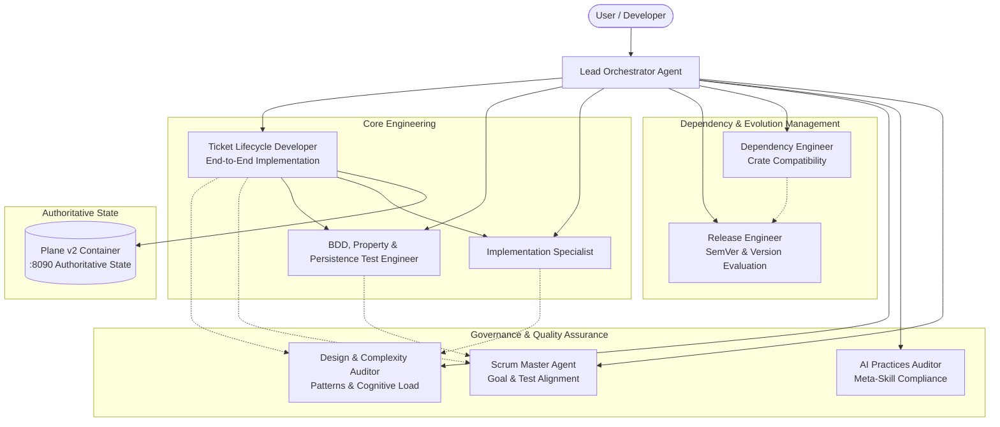

# Multi-Agent Architecture & Operating Guidelines

## Overview
This document defines the agent ecosystem, roles, interfaces, governance principles, and execution protocols for autonomous and collaborative software engineering in this project (`dendrite`).

The architecture adopts state-of-the-art AI development paradigms:
- **Separation of Concerns**: Single Responsibility Principle for autonomous agents and skills.
- **Specification-Driven Synthesis**: Explicit behavioral and technical constraints derived directly from requirements (`docs/` and project user stories).
- **Feedback Loops & Verification Gates**: Autonomous validation through static analysis, code complexity verification, automated coverage validation, and alignment auditing.
- **Context & Token Economy**: Minimalistic, targeted skill prompts loaded on-demand to prevent attention degradation and hallucinations.
- **Authoritative Project Management**: Self-hosted Plane v2 is the sole system of record and authority for ticket tracking, prioritization, and lifecycle states.

---

## Agent Topology & Hierarchy



---

## Autonomous Agent Profiles

### 1. Lead Orchestrator
- **Role**: Coordinates multi-agent workflows, evaluates user prompts, synthesizes subagent reports, and sequences execution pipelines.
- **Tools**: Subagent delegation, filesystem operations, git integration, workflow scheduling.
- **Execution Protocol**:
  1. Inspect requirements, active skills, and system context.
  2. Invoke specialized auditor or engineering agents.
  3. Validate results through verification metrics.
  4. Present concise, verifiable results with citations.

### 2. Dependency Compatibility Engineer (`crate-compatibility`)
- **Role**: Audits dependencies in `go.mod` / `Cargo.toml`, analyzes dependency graph conflicts, ensures compatibility across the ecosystem, and executes non-breaking version upgrades.
- **Governing Skill**: [crate-compatibility](file:///Users/yasuomaidana/GoLandProjects/Dendrite/.agents/skills/crate-compatibility/SKILL.md)
- **Primary Tools**: `go list -m all`, `go mod tidy`, `cargo tree`.

### 3. Release & SemVer Evaluator (`semver-version-evaluator`)
- **Role**: Assesses public API modifications, breaking changes, and release readiness according to Semantic Versioning (SemVer 2.0.0). Determines if version increments must be PATCH, MINOR, or MAJOR.
- **Governing Skill**: [semver-version-evaluator](file:///Users/yasuomaidana/GoLandProjects/Dendrite/.agents/skills/semver-version-evaluator/SKILL.md)
- **Primary Tools**: `git diff`, API AST inspections.

### 4. Architecture & Complexity Auditor (`pattern-complexity-auditor`)
- **Role**: Evaluates software design patterns (e.g. Typestate, RAII, Builder, Visitor, Strategy), enforces idiomatic patterns, inspects cyclomatic/cognitive complexity, and guards against anti-patterns.
- **Governing Skill**: [pattern-complexity-auditor](file:///Users/yasuomaidana/GoLandProjects/Dendrite/.agents/skills/pattern-complexity-auditor/SKILL.md)
- **Primary Tools**: `golangci-lint`, AST complexity analyzers, structural inspection.

### 5. AI Practices & Meta-Skill Auditor (`ai-practices-auditor`)
- **Role**: Validates that all AI agents, skills, and prompt instructions adhere to state-of-the-art AI development practices: structured YAML frontmatter, deterministic constraints, token optimization, no hallucinations, and guardrail enforcement.
- **Governing Skill**: [ai-practices-auditor](file:///Users/yasuomaidana/GoLandProjects/Dendrite/.agents/skills/ai-practices-auditor/SKILL.md)
- **Primary Tools**: Skill schema validator, markdown static analysis.

### 6. Agile Scrum Master & Goal Alignment Specialist (`scrum-master-alignment`)
- **Role**: Acts as the automated Scrum Master. Ensures that every test suite (unit, integration, doc-test, property-test) directly traces back to project milestones, user stories, acceptance criteria, and technical specifications in `docs/`. Strictly enforces mandatory Testcontainers verification for persistent layers.
- **Governing Skill**: [scrum-master-alignment](file:///Users/yasuomaidana/GoLandProjects/Dendrite/.agents/skills/scrum-master-alignment/SKILL.md)
- **Primary Tools**: Test mapping tracers, specification parsers, coverage alignment metrics.

### 7. Knowledge Graph & Architecture Mapping Specialist (`graphify`)
- **Role**: Converts repository content, source files, and supporting artifacts into a persistent knowledge graph to explain relationships, dependencies, architecture, and impact paths across the codebase.
- **Governing Skill**: [graphify](file:///Users/yasuomaidana/GoLandProjects/Dendrite/.gemini/config/skills/graphify/SKILL.md)
- **Primary Tools**: graph query tools, repository traversal, relationship analysis, evidence mapping.

### 8. Autonomous Ticket Lifecycle Developer (`ticket-lifecycle-developer`)
- **Role**: Guides and executes the complete 8-step ticket development lifecycle for active and unstarted tickets tracked authoritatively in Plane v2: requirement clarity check, ticket decomposition, TDD test definition, design pattern audit, feature implementation, test passing validation, complexity refactoring, and Plane state synchronization.
- **Governing Skill**: [ticket-lifecycle-developer](file:///Users/yasuomaidana/GoLandProjects/Dendrite/.agents/skills/ticket-lifecycle-developer/SKILL.md)
- **Primary Tools**: Plane v2 API / native MCP tools (`dendrite_plane_issues`, `dendrite_plane_replicate`), `go test`, `golangci-lint`, `testcontainers`.
- **Plane Ownership Invariant**:
  > [!IMPORTANT]
  > **Do NOT check `DEV_STATUS.md` when Plane is available.**
  > `DEV_STATUS.md` is strictly for humans and repository documentation purposes only. Agents will NEVER use or check `DEV_STATUS.md` when Plane is accessible. All ticket discovery, status tracking, and mutations MUST be done directly against Plane v2.

### 9. BDD, Property & Persistence Test Engineer (`Tester`)
- **Role**: Authors, executes, and validates behavior-driven tests, property tests, and persistent layer integration tests.
- **Persistent Layer Mandate**: For any storage, database, cold archive, or vector persistence component, integration tests **MUST** use Testcontainers. Tests that mock persistent backends without real container verification are rejected.
- **Primary Tools**: `go test`, property tests, Testcontainers.

### 10. Docusaurus Documentation & Project Sharing Agent (`DocusaurusAgent`)
- **Role**: Synthesizes, normalizes, and audits Docusaurus v3 Docs-as-Code portals, structures doc taxonomies, manages the interactive Project Sharing Hub, and packages standalone distribution bundles with cryptographic SHA-256 manifests.
- **Governing Package**: `pkg/docusaurus`
- **Primary Tools**: `dendrite doc docusaurus`, `dendrite_docusaurus_generate`, `dendrite_docusaurus_share`, `dendrite_docusaurus_audit`.
- **Operating Guide**: [`docs/guides/documentation-guide.md`](docs/guides/documentation-guide.md) defines canonical source editing, commit boundaries, and multi-tier publishing protocols.
- **Single Source of Truth & Zero Duplication Invariant**: The `docs/` folder is the sole canonical source for all specifications, architectural decisions, and guides.
  - **No Duplicate Documents in Website**: `website/docusaurus.config.ts` consumes `docs/` directly (`path: '../docs'`). Never author, duplicate, or commit documents inside `website/docs/`.
  - **Git Boundary Rule**: `website/docs/` is excluded via `.gitignore`. AI agents and developers must strictly reject committing documentation files inside `website/`.

---

## Operating Protocols & Best Practices

1. **Test-First & Specification Traceability**:
   - Every implementation must have explicit automated tests verifying business goals.
   - Trace tests to requirements before marking tasks complete.

2. **Continuous Static Verification**:
   - Zero linter warnings (`golangci-lint run`).
   - Automated formatting verification (`go fmt ./...`).
   - Enforce cyclomatic complexity limits ($\le 15$ per function) and cognitive complexity limits ($\le 20$).

3. **Mandatory Testcontainers for Persistent Layer**:
   - Any ticket, feature, or integration test touching the persistent layer (databases, cold archives, vector stores, object caches, or storage adapters) **MUST** use Testcontainers.
   - In-memory mocks or stubs alone are strictly prohibited for persistent layer verification.
   - Tests must execute against real, throwaway containerized instances to guarantee forensic durability, schema fidelity, and zero environmental drift.

4. **Autonomous Skill Loading**:
   - Agents must only load skills directly pertinent to their current sub-task to maintain maximum context window hygiene and instruction fidelity.

5. **Reporting Integrity**:
   - Reports must clearly distinguish verified CLI outputs from assumptions.
   - Do not claim tests pass or coverage targets are met without executing and verifying the respective commands.

6. **Authoritative Plane Project Management & DEV_STATUS Mandate**:
   - **Do NOT check `DEV_STATUS.md` when Plane is available.** Agents will NEVER use or check `DEV_STATUS.md` when Plane is accessible.
   - `DEV_STATUS.md` is strictly for humans and repository documentation purposes only.
   - Plane v2 (`http://localhost:8090` / MCP `dendrite_plane_issues`) is the sole authoritative source of truth for ticket tracking, prioritization, assignments, and lifecycle status.
   - Any updates to `DEV_STATUS.md` must only occur via replication from Plane (`dendrite plane replicate`) for human/repo record-keeping after Plane states have been updated.

---

## Mandatory Workflow Rule: Stories / Tickets / Milestones Connector

Whenever you draft or update a **Design Prompt** (including system architecture prompts or Penpot UI/UX design prompts) OR **insert/modify Tickets and User Stories**, you MUST execute the **Stories/Tickets/Milestones Connector** protocol before finalizing your output:

1. **Link Graph Entities**:
   - Explicitly map every new or modified ticket to its parent Story/Feature (`FEAT-*`), target Milestone (`M-*`), and upstream/downstream technical dependencies (`depends_on` / `blocks`).
2. **Enforce IDE Priority Rules**:
   - Keep general multi-IDE expansion (`FEAT-IDE-ECOSYSTEM` / `FEAT-100`: Neovim, Zed, Visual Studio, Eclipse) at `Lowest` priority.
   - Keep **VS Code (`TKT-IDE-002`)** at `Normal` priority (alongside existing first-class JetBrains support).
3. **Run Priority Propagation**:
   - Audit the dependency chain. If a `Normal`, `High`, or `Urgent` ticket requires a shared module currently marked `Lowest` (e.g. `TKT-IDE-001: Shared Core Engine`), elevate that shared module's effective priority to match the dependent ticket (`Normal`) and move it into the active milestone.
4. **Emit the Connector Sync Manifest**:
   - Append a concise **Connector Sync Summary** table at the end of every design prompt or ticket insertion showing:
     - `Entity ID` | `Type (Story/Ticket/Feature)` | `Assigned Priority` | `Effective Priority` | `Linked Milestone` | `DAG Edges Updated`

---

## Declarative Orchestration & Local Intelligent Worker Protocol

To maximize engineering velocity while strictly controlling commercial token expenditure, agents adopt the **Declarative Orchestration & Local Worker Protocol**:

```mermaid
flowchart TD
    UserReq([Developer Request in JetBrains AI Chat / IDE]) --> Triage[Local Agent Triage Gateway<br/>pkg/agent/triage]
    
    subgraph "High-Cognition Declarative Tier"
        Triage --> CloudOrch[Paid Cloud Orchestrator<br/>Gemini 2.5 Pro / Claude 3.5 Sonnet]
        CloudOrch -->|Outputs Concise Declarative Instructions<br/>(~100 tokens, 93% Output Savings)| Plan[Structured Declarative Plan<br/>Steps, Invariants, Skill Constraints]
    end
    
    subgraph "Zero-Cost Local Intelligent Worker Tier ($0.00)"
        Plan --> LocalWorker[Local Intelligent Agent<br/>Ollama Metal / OxiLLaMa / Candle / Hugging Face]
        LocalWorker --> FullImpl[Full Code Synthesis, TDD Implementation & Verification]
    end
    
    FullImpl --> Done([Final Validated Solution & Test Pass])
```

### Division of Responsibilities:
1. **Paid Cloud Orchestrator (`gemini-2.5-pro` / `copilot-sonnet`)**:
   - Acts strictly as a **Declarative Instruction Generator**.
   - Rather than generating hundreds of lines of code at metered output rates, it synthesizes an atomic, structured execution plan (atomic steps, interface contracts, error boundaries, and skill constraints).
   - Generates only ~80–120 tokens, achieving **90%+ cloud output token savings**.

2. **Local Intelligent Worker (`Ollama` / `OxiLLaMa` / `Candle` / `Hugging Face`)**:
   - Consumes the declarative instructions and executes the heavy lifting.
   - Generates the full implementation files, authors boilerplate unit tests, runs compiler checks, and digests test outputs.
   - Executes entirely on zero-cost local hardware ($0.00).

---

## Multi-Engine Decoupling: OxiLLaMa vs. Candle Architecture

Dendrite strictly decouples local inference backends, recognizing **OxiLLaMa** and **Candle** as distinct, independent engines:

| Engine Identifier | Architecture & Provenance | Default Port & Target | Primary Model | Sovereign / Zero-Cost |
|:---|:---|:---:|:---|:---:|
| **`oxillama`** | **`cool-japan/oxillama`**<br>Standalone Pure-Rust zero-FFI GGUF inference runner. | `http://127.0.0.1:8080` | `oxillama-rust-qwen7b` | **Yes ($0.00)** |
| **`candle`** | **`huggingface/candle`**<br>Minimalist, zero-dependency Rust tensor & ML framework. | `http://127.0.0.1:8083` | `candle-quant-llama` | **Yes ($0.00)** |
| **`ollama`** | **Local Ollama Metal**<br>Apple Silicon Metal GPU accelerated engine. | `http://127.0.0.1:11434` | `llama3.2:latest`, `hermes3:8b` | **Yes ($0.00)** |
| **`ollama-validated`** | **JetBrains Validated Ollama**<br>JetBrains qualified models for FIM and tool-calling. | `http://127.0.0.1:11434` | `qwen2.5-coder:14b`, `llama3.2:3b` | **Yes ($0.00)** |
| **`huggingface`** | **Hugging Face TGI / TEI**<br>Text Generation Inference & Text Embeddings Inference. | `http://tgi-node:8080`<br>`http://localhost:8082` | `deepseek-ai/DeepSeek-Coder-V2-Lite-Instruct`<br>`BAAI/bge-large-en-v1.5` | **Yes ($0.00)** |
