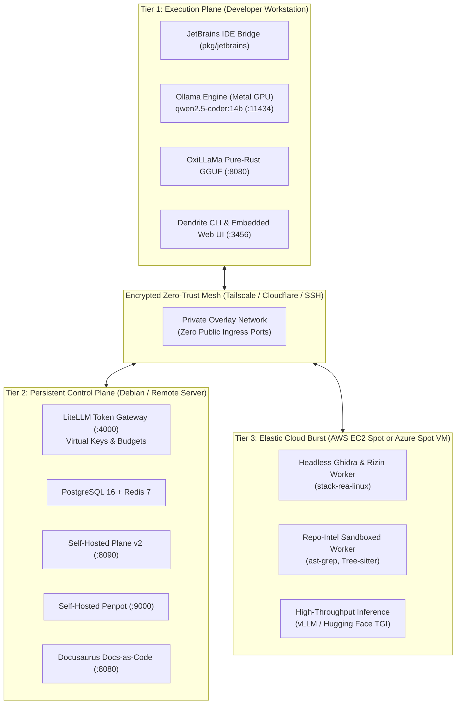

# Dendrite

> **Autonomous AI Development & Infrastructure Control Plane**  
> *Decoupled multi-node compute tiers, token budget governance, pluggable inference engines, sovereign issue tracking, and IDE intelligence.*

[](go.mod)
[](LICENSE)
[](pkg/env)
[](docs/architecture/01-system-topology.md)
[](DEV_STATUS.md)

---

## Overview: What Dendrite Does

**Dendrite** is an autonomous AI development and infrastructure control plane that orchestrates distributed multi-node compute tiers, governs token budgets, unifies inference providers, and empowers developers with sovereign project management and IDE intelligence:

- **Token Budget Governance**: Enforces sliding 24-hour and 7-day expenditure limits, rate-bounded supervisory throttling ($R_{\text{target}}$), and per-agent virtual key isolation through a managed LiteLLM gateway.
- **Pluggable Multi-Engine Inference**: Unifies local Apple Silicon Metal GPU engines (Ollama, pure-Rust OxiLLaMa), high-throughput containerized inference (vLLM, Hugging Face TGI/TEI, llama.cpp), and commercial fallback models (Gemini, Claude, Copilot) under a single automatic failover cascade.
- **Sovereign Issue Tracking & DAG Scheduling**: Integrates directly with self-hosted Plane v2 (`stacks/compose.plane.yaml`) as the authoritative source of truth for tickets, milestones, and Gantt charts.
- **Autonomous Coding Agent Harness**: Dispatches, monitors, and records autonomous agent loops (Aider, OpenHands, OpenCode, Google AGY, GitHub Copilot) inside ephemeral, RAII-cleaned container sandboxes.
- **IDE Intelligence & Model Context Protocol (MCP)**: Bridges GoLand, IntelliJ, and JetBrains IDEs via bidirectional MCP servers connecting AST symbols, diagnostic problem inspections, and background run configurations.
- **Living Docs-as-Code Reflection**: Introspects live CLI and MCP registries to automatically generate and strictly audit reference documentation ([`docs/cli/`](docs/cli/), [`docs/mcp/`](docs/mcp/)) via `dendrite docs generate --reference` and `dendrite docs audit --strict`.


## 1. The Neurobiological Inspiration: A Synthetic Nervous System

In mammalian neurobiology, no single neuron acts as an isolated monolith. Biological intelligence emerges not from brute-force scale within a single cell, but from a decentralized, highly specialized anatomical architecture where distinct cellular structures connect multiple neurons into a coherent, self-regulating biological network.

> [!NOTE]
> ### Disclaimer on Biological Analogies
> The neurobiological parallels used throughout this document serve as structural metaphors to illustrate architectural separation of concerns, pipeline routing, and bounded execution in distributed systems. Biological nervous systems rely on stochastic, continuous electrochemical dynamics, chemical diffusion, and emergent multi-cellular ensembles. Features described here as organelles, sheaths, or clefts (e.g., token rate limiters, Git validation checks, and deterministic AST parsers) map biological concepts onto software primitives for clarity, not literal bio-mimetic simulation.

### Multi-Scale Architectural Model: Micro-Neuron vs. Macro-Connectome
To prevent category confusion between individual cells and distributed networks, Dendrite distinguishes between two hierarchical tiers:
- **Intra-Neuron / Micro-Scale (The Synthetic Execution Unit)**: A single task execution pipeline, workspace sandbox, or compute worker functions as an individual synthetic neuron—sampling code inputs via dendrites, integrating state in its soma, gating all-or-none execution at the axon hillock, conducting action potentials down its axonal conduit, and packaging verified mutations into presynaptic vesicles.
- **Inter-Neuron / Macro-Scale (The Synthetic Connectome & Synaptic Mesh)**: The distributed multi-node ecosystem (local developer workstation, remote persistent control plane, elastic cloud burst nodes) forms a multi-cellular synthetic neural network. Communication across physical nodes is mediated by **intercellular synapses** over encrypted zero-trust meshes using the **Model Context Protocol (MCP)** [3].


The anatomical structures that bridge and interconnect neurons provide the foundational design pattern for **Dendrite**:

1. **Dendritic Arbors (Afferent Ingestion & Input Sampling)**:
   In biological tissue, dendrites form intricate branching trees that listen to surrounding cells, collecting biochemical potentials and sensory inputs across dendritic spines. In Dendrite, this corresponds to afferent signal ingestion: universal AST/CFG reachability slicing (`query slice`), external reference digestion (`ref`), reverse-engineering disassembly (`rea`), and hardware thermal telemetry (`telemetry`). The system never blindly dumps raw monolithic repositories into prompts; it prunes and filters inputs through its dendritic tree.

2. **The Soma & Axon Hillock (Cell Body, Integration Nucleus & All-or-None Firing Gate)**:
   The soma is the metabolic engine and central command of the neuron, housing the nucleus, endoplasmic reticulum, and mitochondria. It integrates thousands of microvolt postsynaptic graded potentials across its membrane until reaching the critical threshold of excitation. In Dendrite, the Soma embodies workspace state management (`project`), declarative environment replication blueprints (`env plan`/`replicate`), persistent segmented memory checkpoints (`store`), and sovereign issue tracking (`plane`). Crucially, the **Axon Hillock / Initial Segment** enforces the *all-or-none* firing threshold—analogous to Git branch protection guardrails (`vcs guard` / `hillock-guard`) that strictly arrest unverified or malformed pushes before they can propagate down the axonal tract.

3. **The Axonal Tract & Multi-Node Conduction (Conduit for Action Potentials)**:
   The axon is the neuron's high-speed long-distance fiber, carrying all-or-none action potentials away from the cell body across physical space without signal degradation. In Dendrite, the Axon represents the encrypted multi-node zero-trust network mesh (Tailscale, Cloudflare, SSH tunnels) that transports compute tasks across physical distances—connecting a local MacBook workstation to remote Debian servers and elastic AWS/Azure cloud-burst nodes (`topology`, `move`, `dist`).

4. **Myelin Sheaths & Nodes of Ranvier (Capacitive Shielding & Saltatory Conduction)** [2]:
   Glial cells wrap axons in lipid-rich myelin sheaths, punctuated periodically by unmyelinated **Nodes of Ranvier** where dense voltage-gated $Na^+$ channel clusters regenerate the action potential. This enables high-speed **saltatory conduction** while providing passive capacitive isolation. In Dendrite, Myelin represents low-latency multi-node transport, tenant container isolation (preventing signal crosstalk/leakage between concurrent workloads), and conduction velocity benchmarks (`bench <inference|gateway>`).

5. **Glial Regulation & Synaptic Pruning (Immune Surveillance & Maintenance)** [4]:
   In the central nervous system, astrocytes and microglia maintain the extracellular environment, perform continuous immune surveillance, and actively prune aberrantly connected or redundant synapses. In Dendrite, this corresponds to automated rebase conflict resolution and vendor branch cleanup (`audit-changes` / `microglial-prune`), code complexity analysis (`analyze`), and whole-project test coverage audits (`quality audit` / `homeostatic-audit`).

6. **Terminal Boutons & Synaptic Vesicles (Presynaptic Quantal Packaging)** [1]:
   At the presynaptic nerve ending, neurotransmitters are packaged into discrete membrane-bound vesicles. While biological vesicle exocytosis is probabilistic and driven by local intracellular calcium ($Ca^{2+}$) dynamics, Dendrite adapts this quantal packaging principle into deterministic transactions: state changes are packaged into atomic, verified vesicular quanta—autonomous Git commits with local LLM message generation (`commit` / `quantal-commit`) and persistent memory chunks (`store commit`).

7. **Synaptic Cleft & Postsynaptic Gating (Governed Intercellular Transmission)** [3]:
   The 20-nanometer intercellular junction between distinct neurons. Neurotransmitters cross the synaptic cleft only when receptor densities and activation thresholds permit, preventing excitotoxicity and seizure storms. In Dendrite, the Synapse represents token budget governance (`gateway`, `tokens` / `vesicle-quota`)—enforcing sliding-window financial limiters, rate-bounded supervisory throttling ($R_{\text{target}}$), and Model Context Protocol (`mcp`) standard intercellular bridges connecting discrete nodes, agents, and IDEs (`jetbrains` / `neuromuscular-bridge`).

8. **Postsynaptic Effectors & Neuromuscular Actuation (Efferent Dispatch & Execution)**:
   The target structures (downstream neurons, motor endplates, or effector muscle fibers) that translate synaptic neurotransmission into concrete physical work or downstream cognitive actions. In Dendrite, Effectors are autonomous coding agent loops (`agent run aider/openhands` / `effector-dispatch`), self-healing myotatic test loops (`test auto` / `myotatic-reflex`), and managed microservice process daemons (`service` / `motor-unit`).

9. **Connectomics, Morphogenesis & Activity-Dependent Plasticity** [4]:
   Dendrite differentiates static graph structure from dynamic adaptation:
   - **Connectomic Topology**: Multi-directory dependency graphs and topological DAG sorting (`pool resolve` / `connectome-pool`) map the structural connectome of the repository ecosystem.
   - **Dendritic Morphogenesis**: Polyglot cross-language translation (`query transpile`) and multi-source AST synthesis (`query fuse`) remodel the syntactic geometry of the code tree.
   - **Activity-Dependent Pruning**: Pruning stale vendor branches (`audit-changes` / `microglial-prune`) and promoting heavily activated context caches (`query reuse-audit`).

> [!NOTE]
> ### Scientific Footnotes on Biological Analogies
> - **[1] On Signal Flow and Presynaptic Anatomy (Mermaid & Sections 6, 7 & 8)**: For anatomical rigor, terminal boutons (axon terminals) are the physical presynaptic structures containing the neurotransmitter vesicular apparatus that directly precede the synaptic cleft. Downstream coding execution occurs at the postsynaptic effector stage (analogous to the motor endplate or target dendrite).
> - **[2] On the Myelin & Ranvier Analogy (Section 4)**: In electrophysiology, myelin and the Nodes of Ranvier provide electrical capacitive insulation and signal regeneration ($Na^+$ clusters) to accelerate conduction velocity. Their role in Dendrite is an engineering metaphor for multi-node low-latency transport, tenant isolation, and throughput benchmarking rather than an exact biological parallel to passive lipid membranes.
> - **[3] On Scale Equivocation: Subcellular Organelles vs. Network Topologies (Sections 2, 3 & 7)**: This architecture operates across two distinct scales: the micro-scale (an individual synthetic neuron modeling the pipeline of a single workspace/task) and the macro-scale (an intercellular synthetic connectome where discrete compute nodes interact across network meshes via the Model Context Protocol).
> - **[4] On Hebbian Plasticity vs. Deterministic Graph Solvers (Section 9)**: Biological plasticity (LTP, synaptic depression, dendritic spine remodeling) is an emergent, history-dependent process governed by continuous activation histories. Here, it is analogized to deterministic AST manipulation, connectomic DAG resolution, and microglial repository pruning rather than statistical connectionist weight updates.

---

## 2. Command Matrix: Standard & Neuro-Lore Nomenclature

Dendrite supports **dual nomenclature**: developers may invoke commands using standard devops terminology or their biological **Neuro-Lore Names** (with concise **Short Lore Aliases**). Both syntaxes are first-class citizens in the CLI.

| Anatomical Origin | Standard Command | Neuro-Lore Name | Short Alias | Functional Scope & Capabilities | Status |
| :--- | :--- | :--- | :--- | :--- | :---: |
| **Dendritic Arbor**<br/>*(Afferent Signal & Context Ingestion)* | `query slice` | `dendrite-slice` | `arbor` / `dslc` | Intent-driven AST/CFG reachability slicing and context debloater | `Active [x]` |
| | `query swap` | `dendrite-swap` | `swap` / `dswp` | AST-aware pattern and framework replacement engine | `Active [x]` |
| | `query transpile` | `dendrite-transpile` | `transpile` / `dtr` | Polyglot cross-language code translation & verification | `Active [x]` |
| | `query fuse` | `dendritic-morphogenesis` [4] | `morph` / `dfus` | Multi-source AST blending and syntax tree synthesis | `Active [x]` |
| | `query reuse-audit` | `activity-reuse` [4] | `d-audit` / `drau` | AST token reuse audit and anti-duplication scanner | `Active [x]` |
| | `ref <list\|add\|remove>` | `dendritic-afferent` | `afferent` / `aff` | Ingest Tier 1 external code references for cleanroom synthesis | `Active [x]` |
| | `rea <showcase\|list>` | `retrograde-analysis` | `retro` / `rea` | Open-source cleanroom disassembly and AST parity verification | `Active [x]` |
| **Soma & Axon Hillock**<br/>*(Central State, Life-Cycle & Firing Gate)* | `env doctor` / `doctor` | `soma-diagnose` | `probe` / `diag` | Host system capability discovery and pre-flight diagnostics | `Active [x]` |
| | `env plan` | `soma-blueprint` | `blueprint` / `splan` | Declarative environment replication planning (host/container/hybrid) | `Active [x]` |
| | `env replicate` | `soma-genesis` | `genesis` / `srep` | Multi-node toolchain and containerized environment replication | `Active [x]` |
| | `env status` | `soma-homeostasis` | `homeo` / `sst` | Real-time health monitoring of replicated services & containers | `Active [x]` |
| | `project <add\|switch\|list>`| `ganglion-workspace`| `ganglion` / `prj` | Multi-project workspace registry with <50ms context switching | `Active [x]` |
| | `plane <status\|next\|push>` | `chronos-tracker` | `chronos` / `pln` | Sovereign issue tracking, DAG scheduling, and Gantt alignment | `Active [x]` |
| | `store <status\|chunks\|rm>` | `engram-store` | `engram` / `gram` | Persistent segmented chunk checkpointing and contextual memory | `Active [x]` |
| | `pool <add\|rm\|resolve>` | `connectome-pool` [4] | `connectome` / `plx` | Multi-directory dependency inference & topological DAG solver | `Active [x]` |
| | `vcs <guard\|check\|status>` | `hillock-guard` [1] | `guard` / `vcs` | Axon Hillock all-or-none gate prohibiting unverified main pushes | `Active [x]` |
| **Axon & Myelin Sheath**<br/>*(Saltatory Conduction, Shielding & Latency)* | `topology [advisor]` | `axonal-pathway` | `axon` / `top` | Dynamic multi-node service placement and hardware router | `Active [x]` |
| | `move <svc> to --ssh` | `axonal-translocation`| `translocate` / `mv` | Zero-credential interactive service migration across SSH nodes | `Active [x]` |
| | `sync-remote` / `github-sync`| `saltatory-sync` | `salt-sync` / `gsync`| Bidirectional git/issue sync with commit reconciliation | `Active [x]` |
| | `dist <spawn\|interop>` | `neural-mesh` [3] | `dist` | Distributed codebase spawner and cross-project coordinator | `Active [x]` |
| | `bench <inference\|gateway>` | `conduction-velocity` [2]| `velocity` / `bnch` | TTFT, TPS, and load resilience stress-test benchmarking | `Active [x]` |
| **Glial Regulation & Pruning**<br/>*(Immune Surveillance & Cleanup)* | `audit-changes` | `microglial-prune` [4] | `prune` / `prn` | Microglial vendor branch audit, conflict detection, and rebase | `Active [x]` |
| | `quality <audit\|hitl-sync>` | `homeostatic-audit` | `allostasis` / `qlty` | Anti-mock scan, 100% coverage profiler, and HITL synchronization | `Active [x]` |
| | `analyze <status\|policy>` | `cognitive-analysis` | `cognition` / `anlz` | Cognitive complexity analyzer and execution policy router | `Active [x]` |
| **Terminal Boutons & Vesicles**<br/>*(Presynaptic Packaging & Quantal Release)* | `commit [flags]` | `quantal-commit` [1] | `quantal` / `cmt` | Discrete vesicular packaging with local LLM commit synthesis | `Active [x]` |
| | `tokens [status]` | `vesicle-quota` | `quota` / `tok` | Sliding 24h/7d financial expenditure limiter and token quota | `Active [x]` |
| **Synaptic Cleft & Gating**<br/>*(Governed Intercellular Transmission)* | `inference <list\|probe>` | `action-potential` | `spike` / `inf` | Pluggable multi-engine inference (Ollama, OxiLLaMa, vLLM, TGI) | `Active [x]` |
| | `gateway` / `dev gateway` | `synaptic-cleft` | `cleft` / `gate` | LiteLLM token governance, rate-limiting, and key provisioning | `Active [x]` |
| | `mcp <serve\|tools\|call>` | `interneuron-mcp` [3] | `inter` / `mcp` | Intercellular Model Context Protocol bridge connecting nodes/IDEs | `Active [x]` |
| | `jetbrains <probe\|open>` | `neuromuscular-bridge`| `bridge` / `jb` | GoLand/IntelliJ PSI symbol indexer, problems probe, and run harness | `Active [x]` |
| **Postsynaptic Effectors**<br/>*(Downstream Efferent Actuation)* | `agent <search\|route\|run>` | `effector-dispatch` [1]| `dispatch` / `agt` | Autonomous coding agent harness (Aider, OpenHands, OpenCode) | `Active [x]` |
| | `test <auto\|ui>` | `myotatic-reflex` | `reflex` / `tst` | Testcontainers table-driven synthesis and self-healing test loop | `Active [x]` |
| | `service <start\|stop\|health>`| `motor-unit` | `motor` / `svc` | Process manager for microservices (Penpot, Plane, Ollama) | `Active [x]` |
| | `story <next\|fork\|resolve>` | `synaptic-saga` | `saga` / `sty` | Autonomous multi-step story execution and DAG branching | `Active [x]` |
| | `triage` | `inhibitory-triage` | `triage` / `trg` | Local agent conflict resolution and priority arbitration | `Active [x]` |
| **Cortex & Sensory Integration**<br/>*(Sensory Cockpit & Knowledge Codex)* | `ui [--port 3456]` | `cortex-cockpit` | `cortex` / `ui` | Real-time embedded Web Control Cockpit (<800ms startup) | `Active [x]` |
| | `telemetry [snapshot\|metrics]`| `afferent-telemetry` | `sensory` / `tel` | Real-time Apple Silicon SoC thermals and Prometheus telemetry | `Active [x]` |
| | `doc <docusaurus\|reflect>` | `engram-codex` | `codex` / `doc` | Docs-as-Code reflection, taxonomy generation, and Docusaurus sync | `Active [x]` |

---

## 3. Architectural Philosophy: Decoupled Compute Tiers

Running background databases, AST graph indexing, binary disassemblers, and heavy model inference on a single developer workstation drains battery life, induces thermal throttling, and destabilizes editor responsiveness.

**Dendrite** separates developer workflows into three sovereign, decoupled tiers connected over zero-trust private meshes:



1. **Execution Plane (Workstation)**: Interactive, latency-critical tools: JetBrains IDE MCP Bridge, Apple Silicon Metal GPU inference (`qwen2.5-coder:14b`), pure-Rust OxiLLaMa server, and the single-binary embedded Web Control Cockpit.
2. **Persistent Control Plane (Debian / Remote Server)**: Continuous stateful services: LiteLLM Token Governance Gateway, PostgreSQL 16 + pgvector, Redis 7, self-hosted Plane v2, self-hosted Penpot design platform, and documentation reflection portals.
3. **Elastic Cloud-Burst Tier (AWS & Azure)**: On-demand Spot VMs with persistent block storage (AWS EBS gp3 or Azure Managed Disks) for headless Ghidra decompilation, monorepo AST indexing, and distributed vLLM inference.

---

## 4. Core Capabilities

### 🧠 Pluggable Inference Engines ([FEAT-020](docs/features/FEAT-020-pluggable-inference-engines.md))
- **Ollama Engine**: Metal GPU acceleration on Apple Silicon with zero-cost token accounting.
- **OxiLLaMa (`cool-japan/oxillama`)**: 100% pure Rust GGUF inference engine and OpenAI-compatible server with zero C/C++/Fortran FFI dependencies.
- **Hugging Face TGI & TEI**: Containerized Text Generation and Text Embeddings Inference with FlashAttention-2.
- **vLLM Engine**: High-throughput PagedAttention server for multi-agent concurrency.
- **llama.cpp Server**: Minimalist GGUF runner for low-overhead CPU or single-GPU deployments.
- **Commercial Fallback**: Dynamic failover to Gemini 2.5 Pro, Copilot, or Claude Sonnet when local quotas exhaust.

### 🌐 Pluggable Zero-Trust Mesh Networking ([FEAT-015](docs/features/FEAT-015-pluggable-mesh-networking.md))
- **Tailscale**: WireGuard overlay mesh with MagicDNS and point-to-point encryption.
- **Cloudflare Zero Trust**: Named `cloudflared` tunnels with zero open inbound ports and Cloudflare Access authentication.
- **Multiplexed SSH Port Forwarding**: Pure SSH tunnels (`-L` / `-R`) requiring zero third-party services or daemons.
- **Direct LAN / Localhost**: Support for private subnets or single-node air-gapped environments.

### 📋 Sovereign Issue Tracking & Design Systems ([FEAT-008](docs/features/FEAT-008-pluggable-issue-trackers.md), [FEAT-016](docs/features/FEAT-016-open-source-tooling.md))
- **Plane v2**: Production-grade, 100% self-hosted open-source project management (`stacks/compose.plane.yaml`).
- **Penpot**: Open-source design and prototyping platform for design token extraction and UI alignment (`stacks/compose.penpot.yaml`).
- **Linear & Jira**: Enterprise adapters with bidirectional sync, ticket transition hooks, and git commit provenance.

### 🛡️ Token Budget Governance ([FEAT-002](docs/features/FEAT-002-token-budget-governance.md))
- Sliding window financial limiters for 24h and 7d consumption ceilings.
- Rate-bounded supervisory throttling ($R_{\text{target}}$) with graceful degraded failovers.
- Virtual key segmentation per project, agent, and developer.

### ⚡ JetBrains IDE MCP Bridge ([FEAT-014](docs/features/FEAT-014-jetbrains-ide-mcp-integration.md))
- Bi-directional Model Context Protocol (MCP) bridge connecting GoLand, IntelliJ, and WebStorm.
- Real-time symbol lookup, AST inspection errors, and headless run configuration executions.

---

## 5. Installation, First Steps & Quickstart

### Prerequisites
- **Go**: Version `1.25` or higher ([go.dev/dl](https://go.dev/dl/))
- **Git**: Version `2.30+`
- **Docker & Docker Compose**: (Optional) For containerized microservice stacks (Plane, Penpot, LiteLLM)
- **Polyglot Toolchains**: (Optional) `bun` (for documentation site), `cargo` (for Rust modules), `uv` (for Python scripts)

### Installation from Source

Clone the repository and compile the single `dendrite` binary:

```bash
# Clone the repository
git clone https://github.com/yasuomaidana/dendrite.git
cd dendrite

# Build binary into ./bin/dendrite
go build -v -o bin/dendrite ./cmd/dendrite

# Optionally install globally to $GOPATH/bin
go install ./cmd/dendrite
```

Verify binary execution:
```bash
./bin/dendrite version
```

### First Steps: Environment Preparation & Synchronization

Initialize your workspace and synchronize agent rules, skills, and CI/CD tools:

```bash
# Synchronize environment, skills, and toolchain rules
dendrite env prepare

# Run pre-flight host and service diagnostics (<800ms)
dendrite doctor
```

### Pre-Flight Diagnostics & Health (Soma Diagnosis)
Run environment diagnostics using either standard or lore commands:

```bash
# Standard syntax
dendrite env doctor

# Or using the Neuro-Lore alias (<800ms)
dendrite probe
```

### Environment Replication (Soma Genesis)
Replicate entire environments natively on the host or inside Docker containers across local and remote nodes:

```bash
# 1. Plan replication in Hybrid Mode (services in Docker, dev tools on host)
dendrite env plan --mode hybrid --with-plane --with-penpot

# 2. Execute replication (or: dendrite genesis --mode hybrid)
dendrite env replicate --mode hybrid --with-plane --with-penpot

# 3. Check real-time component health (or: dendrite homeo)
dendrite env status
```

### Launching the Web Control Cockpit (Cortex Cockpit)
Spin up the embedded HTTP and WebSocket control server:

```bash
# Standard syntax
dendrite ui

# Or using the Neuro-Lore alias (<800ms startup)
dendrite cortex
```

### Intent-Driven AST Slicing (Dendritic Arbor)
Debloat context and extract exact call graphs before feeding LLM prompts:

```bash
# Extract only reachable AST nodes for a specific intent
dendrite arbor slice --sources ./pkg/env --entrypoint Replicate "verify docker container mounts"
```

### Multi-Node Topology Management (Axonal Pathways)
Switch between deployment scenarios declaratively:

```bash
# Scenario 1: Local MacBook + Debian Server (Zero Cloud Cost)
dendrite up local-hybrid

# Scenario 2: Elastic AWS Spot Compute with Persistent EBS gp3
dendrite up aws-burst

# Scenario 3: Elastic Azure Spot Compute with Managed Disks
dendrite up azure-burst

# Gracefully teardown compute while preserving persistent storage
dendrite down
```

### Autonomous Coding Agent Harness (Effector Dispatch)
Orchestrate autonomous coding tools through LiteLLM governance:

```bash
# Run Aider bound to virtual key spend limits
dendrite dispatch run aider --ticket DEN-030 --spend-cap 5.00

# Inspect past agent sessions, commits, and token expenditure
dendrite agent session list
```

### Living Documentation & Generated References

Dendrite features an automated Docs-as-Code reflection and audit engine that guarantees committed documentation never drifts from code:

- **[CLI Command Reference](docs/cli/) (`docs/cli/`)**: Individual reference pages for all 39 top-level commands (e.g. [`doctor.md`](docs/cli/doctor.md), [`env.md`](docs/cli/env.md), [`agent.md`](docs/cli/agent.md), [`doc.md`](docs/cli/doc.md)), documenting descriptions, aliases, subcommands, flags, and executable examples.
- **[MCP Tool Reference](docs/mcp/) (`docs/mcp/`)**: Individual reference pages for all registered Model Context Protocol tools (e.g. [`dendrite_env_status.md`](docs/mcp/dendrite_env_status.md), [`dendrite_ticket_list.md`](docs/mcp/dendrite_ticket_list.md), [`dendrite_commit.md`](docs/mcp/dendrite_commit.md)), documenting descriptions, JSON schemas, and example JSON-RPC/CLI calls.
- **[CLI Specification & Architecture Guide](docs/cli/dendrite-cli-specification.md)**: Design patterns, typestate lifecycles, and architecture boundaries.
- **[System Topology & Decoupled Compute Tiers](docs/architecture/01-system-topology.md)**: Network mesh routing and node placement models.

```bash
# Generate/regenerate reference documentation from live registries:
dendrite docs generate --reference

# Audit documentation completeness (exits 1 if any command or tool is undocumented or stale):
dendrite docs audit --strict
```

Both the local pre-commit hook (`scripts/pre-commit-hook.sh`) and CI workflow (`.github/workflows/ci.yml`) run `dendrite docs audit --strict` on every commit.

---

## 6. Repository Structure

```
.
├── cmd/dendrite/          # Main Dendrite CLI entrypoint & subcommands
├── infra/                 # Infrastructure-as-Code modules
│   └── modules/
│       ├── aws-burst/     # Terraform AWS EC2 Spot + EBS module
│       └── azure-burst/   # Terraform Azure Spot VM + Managed Disk module
├── pkg/
│   ├── agent/             # Autonomous coding agent harness (Aider, OpenHands, OpenCode)
│   ├── ai/                # Context compaction, token optimization & polyglot translation
│   ├── ast/               # Tree-sitter AST & complexity analyzer
│   ├── cli/               # Modular Command Registry, Dispatcher & Levenshtein Typo Advisor
│   ├── devtool/           # Productivity tools & ticket sync
│   ├── docgen/            # Docs-as-Code synthesizer & reflection
│   ├── env/               # Environment discovery, planner & replicator
│   ├── gateway/           # LiteLLM proxy renderer & sliding budget limiter
│   ├── jetbrains/         # JetBrains IDE MCP protocol client & bridge
│   ├── ollama/            # Idiomatic Ollama Metal engine client
│   ├── orchestrator/      # Cloud-init generators & compose runners
│   ├── rea/               # Reverse engineering MCP client (Hopper / Ghidra)
│   ├── sandbox/           # Ephemeral hardened container sandbox with RAII drop
│   ├── server/            # Embedded HTTP control server & WebSocket telemetry
│   ├── telemetry/         # Hardware sensors, thermal daemon & health pingers
│   ├── topology/          # Multi-node placement models & scenario validators
│   ├── tracker/           # Pluggable issue trackers (Plane, Linear, Jira)
│   └── workspace/         # Multi-project workspace registry
├── stacks/                # Production Docker Compose configurations
│   ├── compose.control.yaml  # Core PostgreSQL, Redis & LiteLLM
│   ├── compose.dev.yaml      # All-in-one developer stack
│   ├── compose.linear.yaml   # Linear mock & database
│   ├── compose.plane.yaml    # Self-hosted Plane v2 project tracker
│   ├── compose.penpot.yaml   # Self-hosted Penpot design platform
│   └── compose.grafana.yaml  # Prometheus & Grafana observability suite
└── docs/                  # Architecture specs (FEAT-*, ADR-*, Guides)
```

---

## 7. Quality & Definition of Done (DoD)

Dendrite adheres to autonomous software craftsmanship standards:

- **Statement Coverage**: All core packages enforce $\ge 85\%$ statement coverage in CI.
- **Persistent Layer Verification**: Persistent database adapters, volume mounts, and storage lifecyclers are verified against live throwaway test containers via [Testcontainers](https://rust.testcontainers.org).
- **Algorithmic Complexity**: Handler functions enforce Cyclomatic Complexity $\le 10$, Cognitive Complexity $\le 12$, and LOC $\le 80$.

To run the full test suite locally:
```bash
go test -cover ./pkg/...
```

---

### Standardized Polyglot Toolchains: Go, Cargo, Bun, uv

Dendrite strictly standardizes on modern, zero-latency toolchains across all sub-projects and documentation portals:
- **Go (`go`)**: Tested with `go test -v -race -cover ./pkg/...` and formatted with `gofmt` / `golangci-lint`.
- **Rust (`cargo`)**: Pure-Rust zero-FFI modules and crates managed via `cargo` (`cargo test`, `cargo build`, `cargo clippy`).
- **JavaScript / TypeScript (`bun`)**: Sub-second documentation build and test execution for `website/` and UI extensions via `bun` (`bun test`, `bun run build`) with zero legacy `npm` or `yarn`.
- **Python (`uv`)**: Extremely fast dependency resolution and script execution via `uv` (`uv run`, `uv pip`, `scripts/pyproject.toml`) with zero legacy `pip`.

To verify all toolchains locally:
```bash
./scripts/verify-cicd-local.sh --toolchains
```

---

## 8. Roadmap & Milestone Progress

Active milestone progress and tickets are tracked authoritatively in **Plane v2** (`http://localhost:8090`). **[DEV_STATUS.md](DEV_STATUS.md)** is maintained purely as a human-readable repository mirror replicated from Plane (`dendrite plane replicate`). Autonomous agents must never check or rely on `DEV_STATUS.md` when Plane is available.
