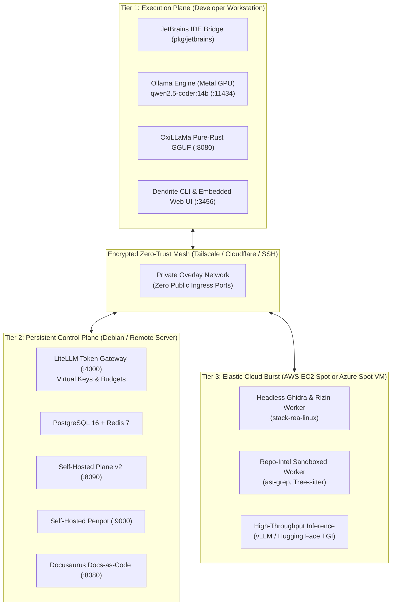

# Dendrite

> **Autonomous AI Development & Infrastructure Control Plane**  
> *Decoupled multi-node compute tiers, token budget governance, pluggable inference engines, sovereign issue tracking, and IDE intelligence.*

[](go.mod)
[](LICENSE)
[](pkg/env)
[](docs/architecture/01-system-topology.md)
[](DEV_STATUS.md)

---

## 1. The Neurobiological Inspiration: A Synthetic Nervous System

In mammalian neurobiology, no single neuron acts as an isolated monolith. Biological intelligence emerges not from brute-force scale within a single cell, but from a decentralized, highly specialized anatomical architecture where distinct cellular structures connect multiple neurons into a coherent, self-regulating biological network.


The anatomical structures that bridge and interconnect neurons provide the foundational design pattern for **Dendrite**:

1. **Dendritic Arbors (Afferent Ingestion & Input Sampling)**:
   In biological tissue, dendrites form intricate branching trees that listen to surrounding cells, collecting biochemical potentials and sensory inputs across dendritic spines. In Dendrite, this corresponds to afferent signal ingestion: universal AST/CFG reachability slicing (`query slice`), external reference digestion (`ref`), reverse-engineering disassembly (`rea`), and hardware thermal telemetry (`telemetry`). The system never blindly dumps raw monolithic repos into prompts; it prunes and filters inputs through its dendritic tree.

2. **The Soma / Perikaryon (Cell Body & Integration Nucleus)**:
   The soma is the metabolic engine and central command of the neuron, housing the nucleus, endoplasmic reticulum, and mitochondria. It integrates thousands of microvolt postsynaptic graded potentials across its membrane until reaching the critical threshold of excitation. In Dendrite, the Soma embodies workspace state management (`project`), declarative environment replication blueprints (`env plan`/`replicate`), persistent segmented memory checkpoints (`store`), and sovereign issue tracking (`plane`).

3. **The Axon Hillock & Axonal Tract (Conductive Transmission Conduit)**:
   The axon is the neuron's high-speed long-distance fiber, carrying all-or-none action potentials away from the cell body across physical space without signal degradation. In Dendrite, the Axon represents the encrypted multi-node zero-trust network mesh (Tailscale, Cloudflare, SSH tunnels) that transports compute tasks across physical distances—connecting a local MacBook workstation to remote Debian servers and elastic AWS/Azure cloud-burst nodes (`topology`, `move`).

4. **Myelin Sheath & Nodes of Ranvier (Saltatory Conduction & Shielding)**:
   Glial cells wrap axons in lipid-rich myelin sheaths, punctuated periodically by unmyelinated **Nodes of Ranvier**. Instead of crawling slowly down the membrane, action potentials leap discontinuously between nodes—a mechanism called **saltatory conduction** that achieves phenomenal propagation velocities while preventing energy dissipation. In Dendrite, Myelin represents velocity accelerators and protective guardrails: inference and gateway performance benchmarks (`bench`), Git branch guardrails (`vcs guard`), and topological branch rebase auditors (`audit-changes`).

5. **Synaptic Cleft & Neurotransmitter Gating (Governed Transmission)**:
   The synapse is the 20-nanometer intercellular junction where an axon terminal meets a downstream dendrite. Rather than letting unbounded electrical current flood the system, neurotransmitters cross the synaptic cleft only when activation thresholds and receptor densities permit, preventing excitotoxicity and seizure storms. In Dendrite, the Synapse is token budget governance (`gateway`, `tokens`)—enforcing sliding-window financial limiters, rate-bounded supervisory throttling ($R_{\text{target}}$), and Model Context Protocol (`mcp`) standard interneuron bridges.

6. **Synaptic Vesicles & Quantal Release (Discrete Atomic Payloads)**:
   Neurotransmitters are packaged into discrete membrane-bound bubbles called vesicles, released in quantified packets (quanta). In Dendrite, this corresponds to atomic, verified changes: autonomous Git commits with local LLM message generation (`commit`) and persistent memory chunks (`store commit`).

7. **Telodendria & Terminal Boutons (Efferent Dispatchers & Actuators)**:
   The axon terminates in delicate telodendria crowned with synaptic knobs (boutons) that interface with effector muscles or target neurons to produce physical movement or downstream thought. In Dendrite, Boutons are autonomous coding agents (`agent run aider/openhands`), microservice orchestrators (`service`), and automated test synthesizers with Testcontainers self-healing (`test auto`).

8. **Synaptic Plasticity (Long-Term Potentiation & Pruning)**:
   Biological neural networks continuously reshape themselves through Hebbian plasticity: *"neurons that fire together, wire together"* (Long-Term Potentiation), while unneeded or noisy pathways are metabolically pruned. In Dendrite, Plasticity manifests in multi-directory topological DAG solving (`pool resolve`), cleanroom reverse engineering (`rea`), and AST code transpilation/fusion (`query fuse`).

---

## 2. Command Matrix: Standard & Neuro-Lore Nomenclature

Dendrite supports **dual nomenclature**: developers may invoke commands using standard devops terminology or their biological **Neuro-Lore Names** (with concise **Short Lore Aliases**). Both syntaxes are first-class citizens in the CLI.

| Anatomical Origin | Standard Command | Neuro-Lore Name | Short Alias | Functional Scope & Capabilities | Status |
| :--- | :--- | :--- | :--- | :--- | :---: |
| **Dendritic Arbor**<br/>*(Afferent Signal & Context Ingestion)* | `query slice` | `dendrite-slice` | `arbor` / `dslc` | Intent-driven AST/CFG reachability slicing and context debloater | `Active [x]` |
| | `query swap` | `dendrite-swap` | `swap` / `dswp` | AST-aware pattern and framework replacement engine | `Active [x]` |
| | `query transpile` | `dendrite-transpile` | `transpile` / `dtr` | Polyglot cross-language code translation & verification | `Active [x]` |
| | `query fuse` | `dendrite-fuse` | `fuse` / `dfus` | Multi-source AST blending and syntax tree synthesis | `Active [x]` |
| | `query reuse-audit` | `dendrite-audit` | `d-audit` / `drau` | AST token reuse audit and anti-duplication scanner | `Active [x]` |
| | `ref <list\|add\|remove>` | `dendritic-afferent` | `afferent` / `aff` | Ingest Tier 1 external code references for cleanroom synthesis | `Active [x]` |
| | `rea <showcase\|list>` | `retrograde-analysis` | `retro` / `rea` | Open-source cleanroom disassembly and AST parity verification | `Active [x]` |
| **Soma / Perikaryon**<br/>*(Central State, Nucleus & Life-Cycle)* | `env doctor` / `doctor` | `soma-diagnose` | `probe` / `diag` | Host system capability discovery and pre-flight diagnostics | `Active [x]` |
| | `env plan` | `soma-plan` | `blueprint` / `splan` | Declarative environment replication planning (host/container/hybrid) | `Active [x]` |
| | `env replicate` | `soma-genesis` | `genesis` / `srep` | Multi-node toolchain and containerized environment replication | `Active [x]` |
| | `env status` | `soma-homeostasis` | `homeo` / `sst` | Real-time health monitoring of replicated services & containers | `Active [x]` |
| | `project <add\|switch\|list>`| `ganglion-workspace`| `ganglion` / `prj` | Multi-project workspace registry with <50ms context switching | `Active [x]` |
| | `plane <status\|next\|push>` | `chronos-tracker` | `chronos` / `pln` | Sovereign issue tracking, DAG scheduling, and Gantt alignment | `Active [x]` |
| | `store <status\|chunks\|rm>` | `engram-store` | `engram` / `gram` | Persistent segmented chunk checkpointing and contextual memory | `Active [x]` |
| | `pool <add\|rm\|resolve>` | `plexus-pool` | `plexus` / `plx` | Multi-directory dependency inference & topological DAG solver | `Active [x]` |
| **Axon & Axon Hillock**<br/>*(Conductive Conduction & Mesh)* | `topology [advisor]` | `axon-pathway` | `axon` / `top` | Dynamic multi-node service placement and hardware router | `Active [x]` |
| | `move <svc> to --ssh` | `axonal-translocation`| `translocate` / `mv` | Zero-credential interactive service migration across SSH nodes | `Active [x]` |
| | `sync-remote` / `github-sync`| `saltatory-sync` | `salt-sync` / `gsync`| Bidirectional git/issue sync with commit reconciliation | `Active [x]` |
| | `dist <spawn\|interop>` | `neural-mesh` | `syn-mesh` / `dist` | Distributed codebase spawner and cross-project coordinator | `Active [x]` |
| **Myelin & Nodes of Ranvier**<br/>*(Acceleration & Shielding)* | `bench <inference\|gateway>` | `conduction-velocity`| `velocity` / `bnch` | TTFT, TPS, and load resilience stress-test benchmarking | `Active [x]` |
| | `vcs <guard\|check\|status>` | `myelin-guard` | `guard` / `vcs` | Branch protection guardrails prohibiting unreviewed main pushes | `Active [x]` |
| | `audit-changes` | `synaptic-pruning` | `prune` / `prn` | Topological vendor branch audit, conflict detection, and rebase | `Active [x]` |
| | `quality <audit\|hitl-sync>` | `allostasis-audit` | `allostasis` / `qlty` | Anti-mock scan, 100% coverage profiler, and HITL synchronization | `Active [x]` |
| | `analyze <status\|policy>` | `cognitive-analysis` | `cognition` / `anlz` | Cognitive complexity analyzer and execution policy router | `Active [x]` |
| **Synaptic Cleft & Gating**<br/>*(Governed Neurotransmission)* | `inference <list\|probe>` | `action-potential` | `spike` / `inf` | Pluggable multi-engine inference (Ollama, OxiLLaMa, vLLM, TGI) | `Active [x]` |
| | `gateway` / `dev gateway` | `synaptic-cleft` | `cleft` / `gate` | LiteLLM token governance, rate-limiting, and key provisioning | `Active [x]` |
| | `tokens [status]` | `vesicle-quota` | `vesicle` / `tok` | Sliding 24h/7d financial expenditure limiter and token quota | `Active [x]` |
| | `mcp <serve\|tools\|call>` | `interneuron-mcp` | `inter` / `mcp` | Model Context Protocol bridge connecting tools, agents, and IDEs | `Active [x]` |
| | `jetbrains <probe\|open>` | `neuromuscular-bridge`| `bridge` / `jb` | GoLand/IntelliJ PSI symbol indexer, problems probe, and run harness | `Active [x]` |
| **Terminal Boutons**<br/>*(Efferent Actuation & Effectors)* | `agent <search\|route\|run>` | `bouton-dispatch` | `bouton` / `agt` | Autonomous coding agent harness (Aider, OpenHands, OpenCode) | `Active [x]` |
| | `test <auto\|ui>` | `myotatic-reflex` | `reflex` / `tst` | Testcontainers table-driven synthesis and self-healing test loop | `Active [x]` |
| | `commit [flags]` | `quantal-commit` | `quantal` / `cmt` | Autonomous commit synthesis with local LLM SemVer adherence | `Active [x]` |
| | `service <start\|stop\|health>`| `effector-service` | `effector` / `svc` | Process manager for microservices (Penpot, Plane, Ollama) | `Active [x]` |
| | `story <next\|fork\|resolve>` | `synaptic-saga` | `saga` / `sty` | Autonomous multi-step story execution and DAG branching | `Active [x]` |
| | `triage` | `inhibitory-triage` | `triage` / `trg` | Local agent conflict resolution and priority arbitration | `Active [x]` |
| **Cortex & Consciousness**<br/>*(Sensory Cockpit & Knowledge)* | `ui [--port 3456]` | `cortex-cockpit` | `cortex` / `ui` | Real-time embedded Web Control Cockpit (<800ms startup) | `Active [x]` |
| | `telemetry [snapshot\|metrics]`| `afferent-telemetry` | `sensory` / `tel` | Real-time Apple Silicon SoC thermals and Prometheus telemetry | `Active [x]` |
| | `doc <docusaurus\|reflect>` | `engram-codex` | `codex` / `doc` | Docs-as-Code reflection, taxonomy generation, and Docusaurus sync | `Active [x]` |

---

## 3. Architectural Philosophy: Decoupled Compute Tiers

Running background databases, AST graph indexing, binary disassemblers, and heavy model inference on a single developer workstation drains battery life, induces thermal throttling, and destabilizes editor responsiveness.

**Dendrite** separates developer workflows into three sovereign, decoupled tiers connected over zero-trust private meshes:



1. **Execution Plane (Workstation)**: Interactive, latency-critical tools: JetBrains IDE MCP Bridge, Apple Silicon Metal GPU inference (`qwen2.5-coder:14b`), pure-Rust OxiLLaMa server, and the single-binary embedded Web Control Cockpit.
2. **Persistent Control Plane (Debian / Remote Server)**: Continuous stateful services: LiteLLM Token Governance Gateway, PostgreSQL 16 + pgvector, Redis 7, self-hosted Plane v2, self-hosted Penpot design platform, and documentation reflection portals.
3. **Elastic Cloud-Burst Tier (AWS & Azure)**: On-demand Spot VMs with persistent block storage (AWS EBS gp3 or Azure Managed Disks) for headless Ghidra decompilation, monorepo AST indexing, and distributed vLLM inference.

---

## 4. Core Capabilities

### 🧠 Pluggable Inference Engines ([FEAT-020](docs/features/FEAT-020-pluggable-inference-engines.md))
- **Ollama Engine**: Metal GPU acceleration on Apple Silicon with zero-cost token accounting.
- **OxiLLaMa (`cool-japan/oxillama`)**: 100% pure Rust GGUF inference engine and OpenAI-compatible server with zero C/C++/Fortran FFI dependencies.
- **Hugging Face TGI & TEI**: Containerized Text Generation and Text Embeddings Inference with FlashAttention-2.
- **vLLM Engine**: High-throughput PagedAttention server for multi-agent concurrency.
- **llama.cpp Server**: Minimalist GGUF runner for low-overhead CPU or single-GPU deployments.
- **Commercial Fallback**: Dynamic failover to Gemini 2.5 Pro, Copilot, or Claude Sonnet when local quotas exhaust.

### 🌐 Pluggable Zero-Trust Mesh Networking ([FEAT-015](docs/features/FEAT-015-pluggable-mesh-networking.md))
- **Tailscale**: WireGuard overlay mesh with MagicDNS and point-to-point encryption.
- **Cloudflare Zero Trust**: Named `cloudflared` tunnels with zero open inbound ports and Cloudflare Access authentication.
- **Multiplexed SSH Port Forwarding**: Pure SSH tunnels (`-L` / `-R`) requiring zero third-party services or daemons.
- **Direct LAN / Localhost**: Support for private subnets or single-node air-gapped environments.

### 📋 Sovereign Issue Tracking & Design Systems ([FEAT-008](docs/features/FEAT-008-pluggable-issue-trackers.md), [FEAT-016](docs/features/FEAT-016-open-source-tooling.md))
- **Plane v2**: Production-grade, 100% self-hosted open-source project management (`stacks/compose.plane.yaml`).
- **Penpot**: Open-source design and prototyping platform for design token extraction and UI alignment (`stacks/compose.penpot.yaml`).
- **Linear & Jira**: Enterprise adapters with bidirectional sync, ticket transition hooks, and git commit provenance.

### 🛡️ Token Budget Governance ([FEAT-002](docs/features/FEAT-002-token-budget-governance.md))
- Sliding window financial limiters for 24h and 7d consumption ceilings.
- Rate-bounded supervisory throttling ($R_{\text{target}}$) with graceful degraded failovers.
- Virtual key segmentation per project, agent, and developer.

### ⚡ JetBrains IDE MCP Bridge ([FEAT-014](docs/features/FEAT-014-jetbrains-ide-mcp-integration.md))
- Bi-directional Model Context Protocol (MCP) bridge connecting GoLand, IntelliJ, and WebStorm.
- Real-time symbol lookup, AST inspection errors, and headless run configuration executions.

---

## 5. Quickstart & Command Reference

### Pre-Flight Diagnostics & Health (Soma Diagnosis)
Run environment diagnostics using either standard or lore commands:

```bash
# Standard syntax
dendrite env doctor

# Or using the Neuro-Lore alias (<800ms)
dendrite probe
```

### Environment Replication (Soma Genesis)
Replicate entire environments natively on the host or inside Docker containers across local and remote nodes:

```bash
# 1. Plan replication in Hybrid Mode (services in Docker, dev tools on host)
dendrite env plan --mode hybrid --with-plane --with-penpot

# 2. Execute replication (or: dendrite genesis --mode hybrid)
dendrite env replicate --mode hybrid --with-plane --with-penpot

# 3. Check real-time component health (or: dendrite homeo)
dendrite env status
```

### Launching the Web Control Cockpit (Cortex Cockpit)
Spin up the embedded HTTP and WebSocket control server:

```bash
# Standard syntax
dendrite ui

# Or using the Neuro-Lore alias (<800ms startup)
dendrite cortex
```

### Intent-Driven AST Slicing (Dendritic Arbor)
Debloat context and extract exact call graphs before feeding LLM prompts:

```bash
# Extract only reachable AST nodes for a specific intent
dendrite arbor slice --sources ./pkg/env --entrypoint Replicate "verify docker container mounts"
```

### Multi-Node Topology Management (Axonal Pathways)
Switch between deployment scenarios declaratively:

```bash
# Scenario 1: Local MacBook + Debian Server (Zero Cloud Cost)
dendrite up local-hybrid

# Scenario 2: Elastic AWS Spot Compute with Persistent EBS gp3
dendrite up aws-burst

# Scenario 3: Elastic Azure Spot Compute with Managed Disks
dendrite up azure-burst

# Gracefully teardown compute while preserving persistent storage
dendrite down
```

### Autonomous Coding Agent Harness (Bouton Dispatch)
Orchestrate autonomous coding tools through LiteLLM governance:

```bash
# Run Aider bound to virtual key spend limits
dendrite bouton run aider --ticket DEN-030 --spend-cap 5.00

# Inspect past agent sessions, commits, and token expenditure
dendrite agent session list
```

---

## 6. Repository Structure

```
.
├── cmd/dendrite/          # Main Dendrite CLI entrypoint & subcommands
├── infra/                 # Infrastructure-as-Code modules
│   └── modules/
│       ├── aws-burst/     # Terraform AWS EC2 Spot + EBS module
│       └── azure-burst/   # Terraform Azure Spot VM + Managed Disk module
├── pkg/
│   ├── agent/             # Autonomous coding agent harness (Aider, OpenHands, OpenCode)
│   ├── ai/                # Context compaction, token optimization & polyglot translation
│   ├── ast/               # Tree-sitter AST & complexity analyzer
│   ├── cli/               # Modular Command Registry, Dispatcher & Levenshtein Typo Advisor
│   ├── devtool/           # Productivity tools & ticket sync
│   ├── docgen/            # Docs-as-Code synthesizer & reflection
│   ├── env/               # Environment discovery, planner & replicator
│   ├── gateway/           # LiteLLM proxy renderer & sliding budget limiter
│   ├── jetbrains/         # JetBrains IDE MCP protocol client & bridge
│   ├── ollama/            # Idiomatic Ollama Metal engine client
│   ├── orchestrator/      # Cloud-init generators & compose runners
│   ├── rea/               # Reverse engineering MCP client (Hopper / Ghidra)
│   ├── sandbox/           # Ephemeral hardened container sandbox with RAII drop
│   ├── server/            # Embedded HTTP control server & WebSocket telemetry
│   ├── telemetry/         # Hardware sensors, thermal daemon & health pingers
│   ├── topology/          # Multi-node placement models & scenario validators
│   ├── tracker/           # Pluggable issue trackers (Plane, Linear, Jira)
│   └── workspace/         # Multi-project workspace registry
├── stacks/                # Production Docker Compose configurations
│   ├── compose.control.yaml  # Core PostgreSQL, Redis & LiteLLM
│   ├── compose.dev.yaml      # All-in-one developer stack
│   ├── compose.linear.yaml   # Linear mock & database
│   ├── compose.plane.yaml    # Self-hosted Plane v2 project tracker
│   ├── compose.penpot.yaml   # Self-hosted Penpot design platform
│   └── compose.grafana.yaml  # Prometheus & Grafana observability suite
└── docs/                  # Architecture specs (FEAT-*, ADR-*, Guides)
```

---

## 7. Quality & Definition of Done (DoD)

Dendrite adheres to autonomous software craftsmanship standards:

- **Statement Coverage**: All core packages enforce $\ge 85\%$ statement coverage in CI.
- **Persistent Layer Verification**: Persistent database adapters, volume mounts, and storage lifecyclers are verified against live throwaway test containers via [Testcontainers](https://rust.testcontainers.org).
- **Algorithmic Complexity**: Handler functions enforce Cyclomatic Complexity $\le 10$, Cognitive Complexity $\le 12$, and LOC $\le 80$.

To run the full test suite locally:
```bash
go test -cover ./pkg/...
```

---

## 8. Roadmap & Milestone Progress

Active milestone progress and tickets are tracked authoritatively in **Plane v2** (`http://localhost:8090`). **[DEV_STATUS.md](DEV_STATUS.md)** is maintained purely as a human-readable repository mirror replicated from Plane (`dendrite plane replicate`). Autonomous agents must never check or rely on `DEV_STATUS.md` when Plane is available.
