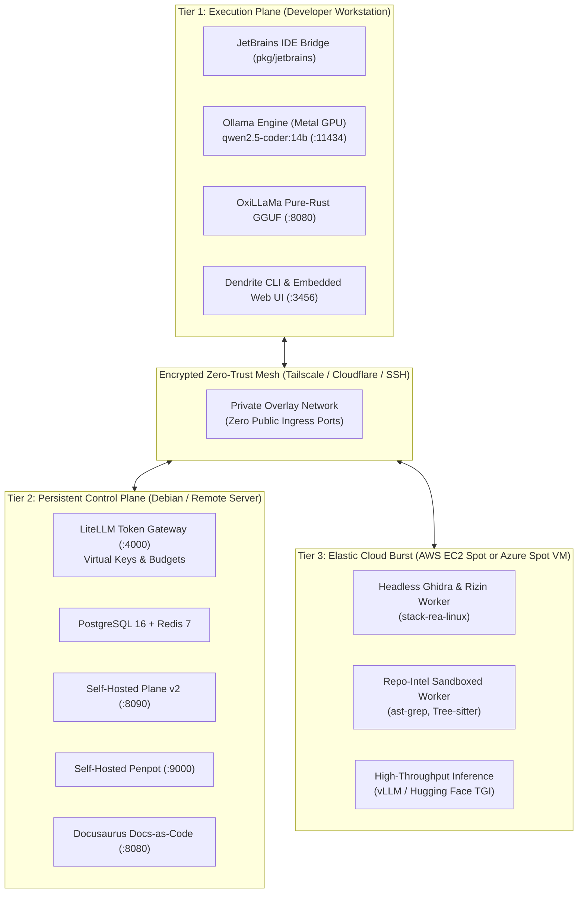

# Dendrite

> **Autonomous AI Development & Infrastructure Control Plane**  
> *Decoupled multi-node compute tiers, token budget governance, pluggable inference engines, sovereign issue tracking, and IDE intelligence.*

[](go.mod)
[](LICENSE)
[](pkg/env)
[](docs/architecture/01-system-topology.md)
[](DEV_STATUS.md)

---

## 1. Architectural Philosophy: Decoupled Compute Tiers

Running background databases, AST graph indexing, binary disassemblers, and heavy model inference on a single developer workstation drains battery life, induces thermal throttling, and destabilizes editor responsiveness.

**Dendrite** separates developer workflows into three sovereign, decoupled tiers connected over zero-trust private meshes:



1. **Execution Plane (Workstation)**: Interactive, latency-critical tools: JetBrains IDE MCP Bridge, Apple Silicon Metal GPU inference (`qwen2.5-coder:14b`), pure-Rust OxiLLaMa server, and the single-binary embedded Web Control Cockpit.
2. **Persistent Control Plane (Debian / Remote Server)**: Continuous stateful services: LiteLLM Token Governance Gateway, PostgreSQL 16 + pgvector, Redis 7, self-hosted Plane v2, self-hosted Penpot design platform, and documentation reflection portals.
3. **Elastic Cloud-Burst Tier (AWS & Azure)**: On-demand Spot VMs with persistent block storage (AWS EBS gp3 or Azure Managed Disks) for headless Ghidra decompilation, monorepo AST indexing, and distributed vLLM inference.

---

## 2. Core Capabilities

### 🧠 Pluggable Inference Engines ([FEAT-020](docs/features/FEAT-020-pluggable-inference-engines.md))
- **Ollama Engine**: Metal GPU acceleration on Apple Silicon with zero-cost token accounting.
- **OxiLLaMa (`cool-japan/oxillama`)**: 100% pure Rust GGUF inference engine and OpenAI-compatible server with zero C/C++/Fortran FFI dependencies.
- **Hugging Face TGI & TEI**: Containerized Text Generation and Text Embeddings Inference with FlashAttention-2.
- **vLLM Engine**: High-throughput PagedAttention server for multi-agent concurrency.
- **llama.cpp Server**: Minimalist GGUF runner for low-overhead CPU or single-GPU deployments.
- **Commercial Fallback**: Dynamic failover to Gemini 2.5 Pro, Copilot, or Claude Sonnet when local quotas exhaust.

### 🌐 Pluggable Zero-Trust Mesh Networking ([FEAT-015](docs/features/FEAT-015-pluggable-mesh-networking.md))
- **Tailscale**: WireGuard overlay mesh with MagicDNS and point-to-point encryption.
- **Cloudflare Zero Trust**: Named `cloudflared` tunnels with zero open inbound ports and Cloudflare Access authentication.
- **Multiplexed SSH Port Forwarding**: Pure SSH tunnels (`-L` / `-R`) requiring zero third-party services or daemons.
- **Direct LAN / Localhost**: Support for private subnets or single-node air-gapped environments.

### 📋 Sovereign Issue Tracking & Design Systems ([FEAT-008](docs/features/FEAT-008-pluggable-issue-trackers.md), [FEAT-016](docs/features/FEAT-016-open-source-tooling.md))
- **Plane v2**: Production-grade, 100% self-hosted open-source project management (`stacks/compose.plane.yaml`).
- **Penpot**: Open-source design and prototyping platform for design token extraction and UI alignment (`stacks/compose.penpot.yaml`).
- **Linear & Jira**: Enterprise adapters with bidirectional sync, ticket transition hooks, and git commit provenance.

### 🛡️ Token Budget Governance ([FEAT-002](docs/features/FEAT-002-token-budget-governance.md))
- Sliding window financial limiters for 24h and 7d consumption ceilings.
- Rate-bounded supervisory throttling ($R_{\text{target}}$) with graceful degraded failovers.
- Virtual key segmentation per project, agent, and developer.

### ⚡ JetBrains IDE MCP Bridge ([FEAT-014](docs/features/FEAT-014-jetbrains-ide-mcp-integration.md))
- Bi-directional Model Context Protocol (MCP) bridge connecting GoLand, IntelliJ, and WebStorm.
- Real-time symbol lookup, AST inspection errors, and headless run configuration executions.

---

## 3. Quickstart & Command Reference

### Installation & Environment Replication
Dendrite replicates entire environments natively on the host or inside Docker containers across local and remote nodes:

```bash
# 1. Audit target machine capabilities (OS, arch, installed tools)
dendrite env doctor

# 2. Plan replication in Hybrid Mode (services in Docker, dev tools on host)
dendrite env plan --mode hybrid --with-plane --with-penpot

# 3. Execute replication
dendrite env replicate --mode hybrid --with-plane --with-penpot

# 4. Check real-time component health
dendrite env status
```

### Launching the Web Control Cockpit
Spin up the embedded HTTP and WebSocket control server:

```bash
# Launch UI and automatically open default browser (<800ms startup)
dendrite ui

# Run control server as a headless background daemon
dendrite ui --daemon --port 3456
```

### Multi-Node Topology Management
Switch between deployment scenarios declaratively:

```bash
# Scenario 1: Local MacBook + Debian Server (Zero Cloud Cost)
dendrite up local-hybrid

# Scenario 2: Elastic AWS Spot Compute with Persistent EBS gp3
dendrite up aws-burst

# Scenario 3: Elastic Azure Spot Compute with Managed Disks
dendrite up azure-burst

# Gracefully teardown compute while preserving persistent storage
dendrite down
```

### Autonomous Coding Agent Harness
Orchestrate autonomous coding tools through LiteLLM governance:

```bash
# Run Aider bound to virtual key spend limits
dendrite agent run aider --ticket DEN-030 --spend-cap 5.00

# Inspect past agent sessions, commits, and token expenditure
dendrite agent session list
```

---

## 4. Repository Structure

```
.
├── cmd/dendrite/          # Main Dendrite CLI entrypoint & subcommands
├── infra/                 # Infrastructure-as-Code modules
│   └── modules/
│       ├── aws-burst/     # Terraform AWS EC2 Spot + EBS module
│       └── azure-burst/   # Terraform Azure Spot VM + Managed Disk module
├── pkg/
│   ├── agent/             # Autonomous coding agent harness (Aider, OpenHands, OpenCode)
│   ├── ai/                # Context compaction, token optimization & polyglot translation
│   ├── ast/               # Tree-sitter AST & complexity analyzer
│   ├── devtool/           # Productivity tools & ticket sync
│   ├── docgen/            # Docs-as-Code synthesizer & reflection
│   ├── env/               # Environment discovery, planner & replicator
│   ├── gateway/           # LiteLLM proxy renderer & sliding budget limiter
│   ├── jetbrains/         # JetBrains IDE MCP protocol client & bridge
│   ├── ollama/            # Idiomatic Ollama Metal engine client
│   ├── orchestrator/      # Cloud-init generators & compose runners
│   ├── rea/               # Reverse engineering MCP client (Hopper / Ghidra)
│   ├── sandbox/           # Ephemeral hardened container sandbox with RAII drop
│   ├── server/            # Embedded HTTP control server & WebSocket telemetry
│   ├── telemetry/         # Hardware sensors, thermal daemon & health pingers
│   ├── topology/          # Multi-node placement models & scenario validators
│   ├── tracker/           # Pluggable issue trackers (Plane, Linear, Jira)
│   └── workspace/         # Multi-project workspace registry
├── stacks/                # Production Docker Compose configurations
│   ├── compose.control.yaml  # Core PostgreSQL, Redis & LiteLLM
│   ├── compose.dev.yaml      # All-in-one developer stack
│   ├── compose.linear.yaml   # Linear mock & database
│   ├── compose.plane.yaml    # Self-hosted Plane v2 project tracker
│   ├── compose.penpot.yaml   # Self-hosted Penpot design platform
│   └── compose.grafana.yaml  # Prometheus & Grafana observability suite
└── docs/                  # Architecture specs (FEAT-*, ADR-*, Guides)
```

---

## 5. Quality & Definition of Done (DoD)

Dendrite adheres to autonomous software craftsmanship standards:

- **Statement Coverage**: All core packages enforce $\ge 85\%$ statement coverage in CI.
- **Persistent Layer Verification**: Persistent database adapters, volume mounts, and storage lifecyclers are verified against live throwaway test containers via [Testcontainers](https://rust.testcontainers.org).
- **Algorithmic Complexity**: Handler functions enforce Cyclomatic Complexity $\le 10$, Cognitive Complexity $\le 12$, and LOC $\le 80$.

To run the full test suite locally:
```bash
go test -cover ./pkg/...
```

---

## 6. Roadmap & Milestone Progress

Active milestone progress and tickets are tracked authoritatively in **Plane v2** (`http://localhost:8090`). **[DEV_STATUS.md](DEV_STATUS.md)** is maintained purely as a human-readable repository mirror replicated from Plane (`dendrite plane replicate`). Autonomous agents must never check or rely on `DEV_STATUS.md` when Plane is available.
