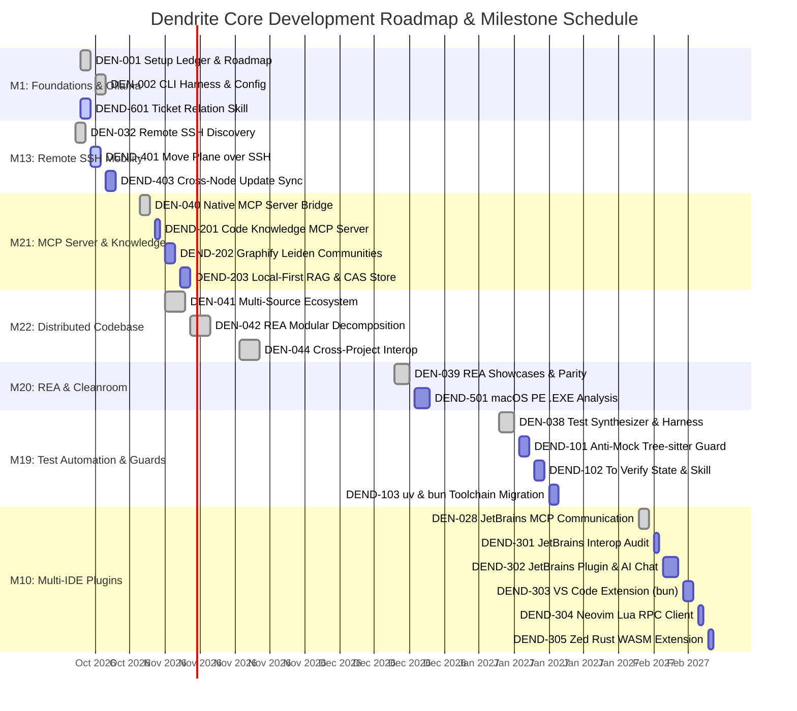

# Dendrite Gantt Diagram, Milestone Architecture & Ticket Relationships

> [!IMPORTANT]
> ### Authoritative Project Status & Plane Gantt View
> Plane v2 is the authoritative source for all tickets, milestone schedules, and dependency relationships.
> To view the live interactive Gantt diagram:
> 1. Open the Plane Web UI: **[http://localhost:8091](http://localhost:8091)**
> 2. Select Workspace: `dendrite-ws` -> Project: `Dendrite Core` (`DEN`)
> 3. Navigate to **Issues** or **Modules** in the left sidebar.
> 4. In the top-right Layout selector, switch from `List` or `Kanban` to **`Gantt`**.
> 5. You will see the entire chronological roadmap with milestone bands, scheduled ticket bars, and visual dependency arrows connecting blocked tickets to their predecessors.

---

## 1. Visual Gantt Chart (Mermaid Roadmap)



---

## 2. Milestone Chronological Timeline

Every milestone in Plane has non-overlapping, strictly ordered `start_date` and `target_date` timestamps:

| Milestone ID | Module Name | Target Focus | Start Date | Target Date | Tickets Count |
|:---|:---|:---|:---:|:---:|:---:|
| **M01** | Core Foundation, Developer Tools & Ollama | CLI harness, status sync, ticket relations | 2026-10-15 | 2026-10-26 | 5 |
| **M13** | Remote SSH Discovery & Service Placement | SSH topology, interactive service migration | 2026-10-27 | 2026-11-06 | 4 |
| **M15** | Azure Cloud-Burst Infrastructure & Storage | Spot VM lifecycler, managed disks | 2026-11-07 | 2026-11-16 | 2 |
| **M21** | Model Context Protocol & Code Knowledge MCP | MCP bridge, AST queries, Graphify RAG | 2026-11-17 | 2026-11-28 | 4 |
| **M22** | Distributed Codebase Ecosystem & Interop | Multi-repo sync, cross-project adapters | 2026-11-29 | 2026-12-16 | 6 |
| **M16** | Pluggable Multi-Provider Inference Engines | OxiLLaMa, TGI, TEI, vLLM, llama.cpp | 2026-12-17 | 2026-12-24 | 2 |
| **M17** | Performance Testing & k6 Benchmarks | TTFT/TPS benchmarks, failover cascade | 2026-12-25 | 2027-01-02 | 2 |
| **M20** | Open-Source REA Showcase Pipeline | macOS Windows PE analysis, cleanroom Rust | 2027-01-03 | 2027-01-11 | 2 |
| **M19** | Test Automation, Anti-Mock & uv/bun | Zero-mock AST guard, To Verify state, uv/bun | 2027-01-12 | 2027-01-26 | 4 |
| **M11** | Pluggable Mesh Networking & Zero-Trust | Cloudflare tunnels, WireGuard, LAN | 2027-01-27 | 2027-02-02 | 2 |
| **M14** | Observability Suite & Prometheus Exporters | Prometheus exposition, Grafana dashboards | 2027-02-03 | 2027-02-07 | 2 |
| **M10** | IDE Intelligence & Multi-IDE Plugin Suite | JetBrains, VS Code, Neovim, Zed plugins | 2027-02-08 | 2027-02-23 | 6 |
| **M12** | Open-Source Trackers & Penpot Design Tooling | Plane v2, Penpot compose provisioning | 2027-02-24 | 2027-03-03 | 3 |
| **M31** | Ticket-Milestone DAG Linker & Priority Skill | Dependency arrows, critical path solver | 2027-03-04 | 2027-03-12 | 3 |

---

## 3. Five Feature Groups: Plane Tickets & DAG Blockers

### Group A: Anti-Mock Policy, Verification Routine & Toolchain Migration
- **Milestone**: Milestone 19 (`Developer Test Automation & UI Integration`)
- **Governing Spec**: `docs/features/FEAT-044-two-stage-governance-and-anti-mock.md`

| Ticket | Name | Priority | Estimate | Blocked By | Dependency Reason |
|:---|:---|:---:|:---:|:---|:---|
| **DEND-101** | [Anti-Mock Guard]: Tree-sitter AST mock detection | Urgent | 5 SP | DEN-038 | Requires automated test synthesizer before enforcing anti-mock |
| **DEND-102** | [Verification Routine]: Plane `To Verify` intermediate state | High | 5 SP | DEND-101 | Needs AST scanner to guard ticket advancement |
| **DEND-103** | [Toolchain Migration]: Standardize build/test on `uv` & `bun` | Medium | 3 SP | DEND-102 | Toolchain replaces test invocations guarded by verification routine |

### Group B: Code Knowledge MCP, AST Graphify & Shared Library Deduplication
- **Milestone**: Milestone 21 (`Model Context Protocol Server Bridge`)
- **Governing Spec**: `docs/features/FEAT-045-code-knowledge-mcp-graphify.md`

| Ticket | Name | Priority | Estimate | Blocked By | Dependency Reason |
|:---|:---|:---:|:---:|:---|:---|
| **DEND-201** | [Code Knowledge MCP]: Local AST query MCP server | High | 5 SP | DEN-040 | Builds on native MCP stdio transport bridge |
| **DEND-202** | [Graphify Community Graph]: Leiden clustering & god nodes | High | 8 SP | DEND-201 | Feeds AST community data into Knowledge MCP |
| **DEND-203** | [Local-First RAG & CAS]: Zero-cost nomic embeddings & CAS store | Urgent | 8 SP | DEND-202 | RAG engine queries Leiden clusters and deduplicates shared libs |

### Group C: Multi-IDE Plugin Suite (JetBrains, VS Code, Neovim, Zed)
- **Milestone**: Milestone 10 (`IDE Intelligence & JetBrains MCP Bridge`)
- **Governing Spec**: `docs/features/FEAT-046-multi-ide-plugins.md`

| Ticket | Name | Priority | Estimate | Blocked By | Dependency Reason |
|:---|:---|:---:|:---:|:---|:---|
| **DEND-301** | [JetBrains Validation]: Audit IDE socket bridge without mocks | High | 3 SP | DEN-028 | Live validation of existing JetBrains communication |
| **DEND-302** | [Plugin - JetBrains]: JetBrains Plugin (`dendrite-jetbrains`) | Urgent | 8 SP | DEND-301 | Core Kotlin plugin implementation |
| **DEND-303** | [Plugin - VS Code]: VS Code Extension (`dendrite-vscode`) | High | 5 SP | DEND-302 | Port verified MCP chat interface to TypeScript/Bun |
| **DEND-304** | [Plugin - Neovim]: Headless Lua RPC client (`dendrite.nvim`) | Medium | 3 SP | DEND-303 | Headless terminal workflow |
| **DEND-305** | [Plugin - Zed]: Rust WASM extension (`dendrite-zed`) | Medium | 3 SP | DEND-304 | Modern native Rust WASM extension |

### Group D: Infrastructure Migration, Service Provisioning & Sync
- **Milestone**: Milestone 13 (`Remote SSH Hardware Discovery`) & Milestone 12 (`Penpot`)
- **Governing Spec**: `docs/features/FEAT-047-infrastructure-orchestration-ssh-penpot.md`

| Ticket | Name | Priority | Estimate | Blocked By | Dependency Reason |
|:---|:---|:---:|:---:|:---|:---|
| **DEND-401** | [Infra - Migration]: Zero-credential SSH service migration | Urgent | 8 SP | DEN-032 | Extends SSH node discovery into container mobility |
| **DEND-402** | [Infra - Start]: Mock-free service manager with Penpot | High | 5 SP | DEN-031 | Penpot docker-compose stack provisioning |
| **DEND-403** | [Infra - Sync]: Cross-node update propagation | High | 5 SP | DEND-401 | Propagates migrated service endpoints to cluster nodes |

### Group E: REA macOS Binary Analysis & Ticket Relationship Governance
- **Milestone**: Milestone 20 (`REA Showcases`) & Milestone 31 (`Ticket Linker`)
- **Governing Spec**: `docs/features/FEAT-048-rea-binary-analysis-and-ticket-relations.md`

| Ticket | Name | Priority | Estimate | Blocked By | Dependency Reason |
|:---|:---|:---:|:---:|:---|:---|
| **DEND-501** | [REA]: macOS PE .EXE analysis with pause/resume & purge | High | 8 SP | DEN-039 | Builds on verified cleanroom reverse engineering suite |
| **DEND-601** | [Tickets Skill]: Ticket Connection & Priority Updater | Urgent | 5 SP | DEN-001 | Powers Gantt diagram dependency linking |

---

## 4. Strategic GitHub Validation Issues Matrix

GitHub issues provide strategic human acceptance gates grouping related tickets:

| Issue # | GitHub Issue Title | Group | Covered Plane Tickets | Verification Command |
|:---:|:---|:---:|:---|:---|
| **#1** | Validate Anti-Mock Guard, 100% Coverage Routine & `To Verify` State | Group A | `DEND-101`, `DEND-102` | `dendrite audit anti-mock && dendrite skill verify DEND-102` |
| **#2** | Validate `uv` and `bun` Toolchain Migration with Zero pip/npm | Group A | `DEND-103` | `uv pip list && bun test` |
| **#3** | Validate Local-First Code Knowledge MCP, Graphify & Zero-Cost RAG | Group B | `DEND-201`, `DEND-202`, `DEND-203` | `dendrite mcp call knowledge.query '{\"repo\":\"dendrite\"}'` |
| **#4** | Validate Live JetBrains Interop & Full JetBrains AI Chat Plugin | Group C | `DEND-301`, `DEND-302` | `dendrite jetbrains probe && cd plugins/jetbrains && ./gradlew test` |
| **#5** | Validate VS Code Extension with MCP Context and Sidebar AI Chat | Group C | `DEND-303` | `cd plugins/vscode && bun test` |
| **#6** | Validate Neovim and Zed Headless Integration Specs | Group C | `DEND-304`, `DEND-305` | `nvim --headless -c 'PlenaryBustedDirectory tests/neovim'` |
| **#7** | Validate Moving Plane to Remote Debian SSH Server & Update Sync | Group D | `DEND-401`, `DEND-403` | `dendrite move plane to --ssh debian-server && dendrite cluster sync` |
| **#8** | Validate Provisioning & Starting Penpot Service Stack | Group D | `DEND-402` | `dendrite service start penpot --verify-mcp && dendrite service health penpot` |
| **#9** | Validate REA .EXE Analysis on macOS with Pause/Resume & Remote Purge | Group E | `DEND-501`, `DEND-601` | `dendrite rea analyze sample.exe && dendrite skill ticket-relate` |

---

## 5. Live CLI Alignment Tools

Dendrite provides dedicated commands for keeping Plane Gantt diagrams synchronized:

1. **Synchronize All Dates & Dependency Arrows**:
   ```bash
   ./bin/dendrite plane gantt-sync
   ```
   *Scans all modules and tickets in Plane, calculates chronological, non-overlapping timelines, attaches unassigned tickets to modules, and establishes `blocked_by` dependency arrows.*

2. **Link or Update Ticket Relations & Priority**:
   ```bash
   ./bin/dendrite skill ticket-relate \
     --ticket DEND-203 \
     --priority urgent \
     --blocked-by DEND-201,DEND-202 \
     --reason "Requires AST Leiden engine and shared library store"
   ```
