# Dendrite Architecture & Development Environment Specification

Welcome to the **Dendrite** engineering and technical architecture specification. Dendrite is a unified, topology-agnostic control plane and developer platform designed for **Autonomous Multi-Model AI Development, Token Governance, Reverse Engineering (REA), Static Code Intelligence, and AI-Assisted Engineering**.

---

## 1. Executive Summary & Design Goals

Dendrite decouples persistent system state and API governance from elastic, hardware-accelerated local compute and cloud-burst nodes. By unifying Terraform provisioning, modular Docker Compose stacks, Tailscale mesh networking, an embedded Web Dashboard, and a purpose-built CLI (`dendrite`), the platform achieves:

- **Hardware & Battery Preservation**: Offloads persistent databases (PostgreSQL 16, Redis 7), documentation engines (Docusaurus), orchestrators (n8n), and heavy Linux decompilers from local developer laptops (such as Apple Silicon MacBook Airs) to persistent low-power nodes (Debian server) or elastic cloud VMs (Azure or AWS burst).
- **Token Budget Governance & Optimization**: Operates LiteLLM Proxy Gateway with sliding spend windows, context caching (Gemini/Claude prefix cache), semantic AST compaction ($\ge 50\%$ prompt token savings), and zero-cost local Ollama inference (`qwen2.5-coder:14b`).
- **Autonomous Coding Agent Harness**: Integrates, configures, and orchestrates premier coding tools (**Aider**, **OpenHands**, **OpenCode**, and **Google AGY / Antigravity**) with LiteLLM virtual key injection, automated git commit provenance, AST repository context injection, and ephemeral container sandboxing.
- **AI-Assisted Development & Import**: Analyzes external repositories, extracts algorithmic boundaries, and cleanroom synthesizes idiomatic implementations with automated test vectors into target workspaces.
- **Polyglot Code Translation**: Converts source modules between languages (e.g. Python $\to$ Rust/Go, TypeScript $\to$ Go) with automated dual property-based testing asserting semantic parity.
- **Docs-as-Code Generation & Reflection**: Automates `FEAT-*` and `ADR-*` synthesis and mirrors the structural taxonomy, tone, and conventions of a mature reference project into target codebases (**Documentation Reflection**).
- **Pluggable Issue Trackers**: Supports seamless switching between Atlassian Jira, Plane, Linear, and GitHub Issues via an ergonomic CLI/UI and Strategy Pattern adapter architecture.
- **Binary & Application Reverse Engineering**: Implements the REA 3-stage methodology (*Decompile $\to$ Understand $\to$ Recreate*) using native Hopper on macOS and containerized Ghidra/Rizin on Linux.
- **Sandboxed Repository Intelligence**: Safely inspects third-party codebases using AST parsers (ast-grep, Tree-sitter), Graphify Leiden community detection, and ephemeral, read-only container sandboxes.
- **Multi-Project Workspace Support**: Manages multiple isolated projects with segregated AST indexes, spend logs, and environment configurations via the `dendrite` CLI and Web UI.
- **Zero-Trust Mesh & Team Sharing**: Replicates and shares environments across machines and teams via Tailscale overlay IPs, SOPS/age encrypted bundles, and reproducible IaC blueprints distributed through GitHub Releases.

---

## 2. Documentation Architecture

This documentation is organized into feature-oriented, modular specifications adhering to Docs-as-Code standards:

```mermaid
flowchart TD
    Index([docs/README.md]) --> Arch[1. Architecture Core]
    Index --> Features[2. Feature Specs FEAT-*]
    Index --> CLI[3. Dendrite CLI Spec]
    Index --> Sharing[4. Sharing & Replication Guides]
    Index --> Quality[5. Scrum & Complexity Scorecard]

    subgraph "1. Architecture Core"
        Arch1[01: System Topology & Multi-Node Placement]
        Arch2[02: Token Governance & LiteLLM Gateway]
        Arch3[03: Context Intelligence & REA Reverse Engineering]
    end

    subgraph "2. Feature Specifications (FEAT-*)"
        F1[FEAT-001: Topology & Scenario Engine]
        F2[FEAT-002: Token Budget & Cascading Fallbacks]
        F3[FEAT-003: Reverse Engineering Suite REA]
        F4[FEAT-004: Repo-Intel & AST Knowledge Graph]
        F5[FEAT-005: Multi-Project Workspaces]
        F6[FEAT-006: Ephemeral Sandboxed Execution]
        F7[FEAT-007: AWS Cloud Burst Provider]
        F8[FEAT-008: Pluggable Issue Trackers Jira/Plane/Linear]
        F9[FEAT-009: Dendrite Web UI & Dashboard]
        F10[FEAT-010: AI Token Optimization & Import]
        F11[FEAT-011: Polyglot Code Translation]
        F12[FEAT-012: Docs Generation & Reflection]
        F13[FEAT-013: Agent Harness Aider/OpenHands/OpenCode/AGY]
    end

    subgraph "3. Dendrite CLI & Web UI"
        C1[CLI Architecture, Commands, & Web UI]
    end

    subgraph "4. Sharing & Replication Guides"
        S1[Team Distribution & Bootstrap Guide]
        S2[Development Environment Replication Guide: Container & Host]
    end

    subgraph "5. Quality & Governance"
        Q1[Scrum DoD, Testcontainers & Complexity Guardrails]
    end

    Arch --> Arch1
    Arch --> Arch2
    Arch --> Arch3

    Features --> F1
    Features --> F2
    Features --> F3
    Features --> F4
    Features --> F5
    Features --> F6
    Features --> F7
    Features --> F8
    Features --> F9
    Features --> F10
    Features --> F11
    Features --> F12
    Features --> F13

    CLI --> C1
    Sharing --> S1
    Sharing --> S2
    Quality --> Q1
```



### Table of Contents

1. **Architecture Core**:
   - [System Topology & Placement Topologies](./architecture/01-system-topology.md)
   - [Token Budget Governance & Gateway](./architecture/02-token-governance-litellm.md)
   - [Context Intelligence & REA Engineering](./architecture/03-context-intelligence-re.md)
2. **Feature Specifications (`FEAT-*`)**:
   - [FEAT-001: Topology & Scenario Management](./features/FEAT-001-topology-scenarios.md)
   - [FEAT-002: Token Governance & Model Cascades](./features/FEAT-002-token-budget-governance.md)
   - [FEAT-003: Reverse Engineering Suite (REA)](./features/FEAT-003-reverse-engineering-rea.md)
   - [FEAT-004: Repository Intelligence & AST Graph](./features/FEAT-004-repo-intel-ast.md)
   - [FEAT-005: Multi-Project Workspace Management](./features/FEAT-005-multi-project-workspaces.md)
   - [FEAT-006: Ephemeral Sandboxed Execution](./features/FEAT-006-ephemeral-sandboxing.md)
   - [FEAT-007: AWS Cloud Burst Provider](./features/FEAT-007-aws-cloud-burst.md)
   - [FEAT-008: Pluggable Issue Trackers & Jira/Plane/Linear Providers](./features/FEAT-008-pluggable-issue-trackers.md)
   - [FEAT-009: Dendrite Web UI & Configuration Dashboard](./features/FEAT-009-dendrite-web-ui.md)
   - [FEAT-010: AI Token Optimization & Capability Import](./features/FEAT-010-ai-assisted-token-optimization.md)
   - [FEAT-011: Polyglot Code Translation & Verification](./features/FEAT-011-polyglot-translation-synthesis.md)
   - [FEAT-012: Documentation Generation & Reflection](./features/FEAT-012-docs-generation-reflection.md)
   - [FEAT-013: Autonomous Coding Agent Harness (Aider, OpenHands, OpenCode, Google AGY)](./features/FEAT-013-agentic-coding-tools.md)
3. **CLI & Dashboard System Design**:
   - [Dendrite CLI Specification & Command Reference](./cli/dendrite-cli-specification.md)
4. **Environment Sharing & Replication**:
   - [Development Environment Installation & Replication Guide (Container vs Host)](./guides/environment-replication.md)
   - [Environment Sharing, Onboarding & Bootstrap Guide](./guides/sharing-and-onboarding.md)
5. **Quality, Compliance & Complexity**:
   - [Scrum Master DoD, Testcontainers & Complexity Scorecard](./quality/scrum-and-complexity-scorecard.md)

---

## 3. Quickstart & Interactive Workflows

The control plane tool `dendrite` manages the entire lifecycle of the multi-node developer environment:

```bash
# 1. Run environment diagnostics and pre-flight checks
dendrite doctor

# 2. Inspect target computer OS, package manager and installed tools
dendrite env doctor

# 3. Plan replication for Docker containers (including containerized Linear)
dendrite env plan --mode container --with-linear

# 4. Replicate and bootstrap development environment
dendrite env replicate --mode container

# 5. Launch the embedded Web UI for visual configuration & monitoring
dendrite ui

# 6. Switch issue tracking provider to Linear or Jira
dendrite tracker switch linear

# 7. Spin up environment for the active project
dendrite up local-hybrid

# 8. Launch an interactive Aider coding session bound to LiteLLM gateway and active ticket
dendrite agent run aider --ticket DEN-006 --model copilot-sonnet

# 9. Run OpenHands in an ephemeral sandbox to solve an issue autonomously
dendrite agent run openhands --ticket PROJ-104 --sandbox --spend-limit 5.00

# 10. Run Google AGY (Antigravity) bound to LiteLLM gateway and ticket
dendrite agent run agy --ticket DEN-028 --task "Implement AST compaction harness" --model gemini-2.5-pro

# 11. Optimize project prompt tokens and context caching
dendrite ai optimize-tokens

# 12. Translate a legacy module with automated dual property tests
dendrite translate --from python --to rust --source src/math.py --out crates/math/src/lib.rs

# 13. Mirror documentation structure from an enterprise reference project
dendrite doc reflect --reference ../reference-core-platform --target .

# 14. Analyze an external third-party repository safely in an ephemeral sandbox
dendrite analyze repo https://github.com/ast-grep/ast-grep.git --ephemeral

# 15. Check real-time spend, thermal sensors, and node status
dendrite status
```

---

## 4. Development Environment Installation & Replication (Host & Containerized)

Dendrite provides built-in tools (`dendrite env`) and pre-configured Docker Compose manifests (`stacks/`) enabling developers to replicate the complete development stack either in **Docker containers** or **directly on the target computer host**.

### 4.1 Replication Modes Comparison

| Feature | Docker Container Mode (`--mode container`) | Host Direct Install Mode (`--mode host`) | Hybrid Mode (`--mode hybrid`) |
| :--- | :--- | :--- | :--- |
| **Isolation** | 100% sandboxed container processes & tmpfs | Native host execution | Containerized state, native developer CLI |
| **Dependencies** | Docker Engine 26+ & Docker Compose v2 | Homebrew, APT, npm, Go toolchain | Docker + Homebrew/APT |
| **Linear Replication** | Containerized Linear GraphQL server & PostgreSQL DB (`localhost:8085`) | Native Linear CLI installed via npm/brew | Containerized Linear backend + host CLI |
| **Hardware Metal** | CPU emulation or container GPU bindings | Direct Apple Silicon Metal / CUDA acceleration | Native Ollama Metal + containerized DBs |
| **Teardown** | Instant clean teardown (`docker compose down`) | Manual package uninstallation | Clean container drop + preserved CLI tools |

### 4.2 Replicating in Docker Containers (e.g. Containerized Linear)

To replicate the development environment inside Docker containers without modifying host system libraries:

```bash
# 1. Preview planned actions
dendrite env plan --mode container --with-linear

# 2. Execute replication (generates stacks/ and starts containers)
dendrite env replicate --mode container

# 3. Check health and connectivity
dendrite env status
```

#### Dedicated Linear Container Stack (`stacks/compose.linear.yaml`)
To launch just the local Linear issue tracking environment with its dedicated PostgreSQL database:
```bash
docker compose -f stacks/compose.linear.yaml up -d
```
- **GraphQL Endpoint**: `http://localhost:8085/graphql`
- **Health Probe**: `http://localhost:8085/health`
- **Postgres Database**: `localhost:5433` (DB: `linear_dev`, User: `linear_user`, Pass: `linear_password`)

### 4.3 Direct Installation on the Target Computer

For maximum local performance or systems without Docker virtualization:

```bash
# 1. Audit host system package manager and dependencies
dendrite env doctor

# 2. Install Linear CLI directly on the target machine (via npm or Homebrew)
dendrite env install linear --mode host

# 3. Install Ollama inference engine on the host
dendrite env install ollama --mode host

# 4. Verify host toolchain
dendrite env status
```

For complete architectural details, see the [Development Environment Installation & Replication Guide](./guides/environment-replication.md).
