# Dendrite Architecture & Development Environment Specification

Welcome to the **Dendrite** engineering and technical architecture specification. Dendrite is a unified, topology-agnostic control plane and developer platform designed for **Autonomous Multi-Model AI Development, Token Governance, Reverse Engineering (REA), Static Code Intelligence, Distributed Codebase Ecosystems, and AI-Assisted Engineering**.

---

## 1. Executive Summary & Design Goals

Dendrite decouples persistent system state and API governance from elastic, hardware-accelerated local compute and cloud-burst nodes. By unifying Terraform provisioning, modular Docker Compose stacks, Tailscale mesh networking, an embedded Web Dashboard, and a purpose-built CLI (`dendrite`), the platform achieves:

- **Hardware & Battery Preservation**: Offloads persistent databases (PostgreSQL 16, Redis 7), documentation engines (Docusaurus), orchestrators (n8n), and heavy Linux decompilers from local developer laptops (such as Apple Silicon MacBook Airs) to persistent low-power nodes (Debian server) or elastic cloud VMs (Azure or AWS burst).
- **Token Budget Governance & Optimization**: Operates LiteLLM Proxy Gateway with sliding spend windows, context caching (Gemini/Claude prefix cache), semantic AST compaction ($\ge 50\%$ prompt token savings), and zero-cost local Ollama inference (`qwen2.5-coder:14b`).
- **Distributed Codebase Ecosystem**: Implements a priority-tiered capability resolver ($P_1$: User/organization repositories, $P_2$: Curated high-performance OSS engines [`wgpu`, `turso`, `diesel`, `diesel-cte-ext`], $P_3$: Public package registries [`crates.io`, `npm`, `Maven`, `PyPI`]). Forcibly decomposes monolithic targets into reusable modules, coordinates multi-project interoperability via local LLMs, and spins off satellite side-projects into dedicated Plane v2 projects.
- **Autonomous Coding Agent Harness**: Integrates, configures, and orchestrates premier coding tools (**Aider**, **OpenHands**, **OpenCode**, and **Google AGY / Antigravity**) with LiteLLM virtual key injection, automated git commit provenance, AST repository context injection, and ephemeral container sandboxing.
- **AI-Assisted Development & Import**: Analyzes external repositories, extracts algorithmic boundaries, and cleanroom synthesizes idiomatic implementations with automated test vectors into target workspaces.
- **Polyglot Code Translation**: Converts source modules between languages (e.g. Python $\to$ Rust/Go, TypeScript $\to$ Go) with automated dual property-based testing asserting semantic parity.
- **Docs-as-Code Generation & Reflection**: Automates `FEAT-*` and `ADR-*` synthesis and mirrors the structural taxonomy, tone, and conventions of a mature reference project into target codebases (**Documentation Reflection**).
- **Pluggable Issue Trackers**: Supports seamless switching between Atlassian Jira, Plane, Linear, and GitHub Issues via an ergonomic CLI/UI and Strategy Pattern adapter architecture.
- **Binary & Application Reverse Engineering**: Implements the REA 3-stage methodology (*Decompile $\to$ Understand $\to$ Recreate*) using native Hopper on macOS and containerized Ghidra/Rizin on Linux.
- **Sandboxed Repository Intelligence**: Safely inspects third-party codebases using AST parsers (ast-grep, Tree-sitter), Graphify Leiden community detection, and ephemeral, read-only container sandboxes.
- **Multi-Project Workspace Support**: Manages multiple isolated projects with segregated AST indexes, spend logs, and environment configurations via the `dendrite` CLI and Web UI.
- **Zero-Trust Mesh & Team Sharing**: Replicates and shares environments across machines and teams via Tailscale overlay IPs, SOPS/age encrypted bundles, and reproducible IaC blueprints distributed through GitHub Releases.
- **Inference Benchmarking & Performance Testing (k6)**: Evaluates local and remote inference engine latency (TTFT, TPS) and stress-tests gateway fallback cascades under synthetic multi-agent load.
- **Agent Search & Discovery**: Hybrid vector/lexical matching to discover, recommend, and route engineering tasks to the optimal agent harness and inference model.
- **Developer Test Automation & UI Integration**: AST-driven self-healing test generation and k6-browser end-to-end Web UI integration testing.
- **JetBrains IDE Native MCP Integration**: 19 operational MCP tools accessible directly from GoLand, IntelliJ IDEA, PyCharm, and RustRover with bidirectional IDE control and automated configuration routines.

---

## 2. Documentation Architecture

This documentation is organized into feature-oriented, modular specifications adhering to Docs-as-Code standards:

```mermaid
flowchart TD
    Index([docs/README.md]) --> Arch[1. Architecture Core]
    Index --> Features[2. Feature Specs FEAT-*]
    Index --> Guides[3. Developer & IDE Guides]
    Index --> CLI[4. Dendrite CLI Spec]
    Index --> Quality[5. Quality & Governance]
    Index --> Roadmap[6. Project Status & Roadmap]

    subgraph "1. Architecture Core"
        Arch1[01: System Topology & Multi-Node Placement]
        Arch2[02: Token Governance & LiteLLM Gateway]
        Arch3[03: Context Intelligence & REA Reverse Engineering]
    end

    subgraph "2. Feature Specifications (FEAT-*)"
        F1[FEAT-001: Topology & Scenario Engine]
        F2[FEAT-002: Token Budget & Cascading Fallbacks]
        F3[FEAT-003: Reverse Engineering Suite REA]
        F4[FEAT-004: Repo-Intel & AST Knowledge Graph]
        F5[FEAT-005: Multi-Project Workspaces]
        F6[FEAT-006: Ephemeral Sandboxed Execution]
        F7[FEAT-007: AWS Cloud Burst Provider]
        F8[FEAT-008: Pluggable Issue Trackers Jira/Plane/Linear]
        F9[FEAT-009: Dendrite Web UI & Dashboard]
        F10[FEAT-010: AI Token Optimization & Import]
        F11[FEAT-011: Polyglot Code Translation]
        F12[FEAT-012: Docs Generation & Reflection]
        F13[FEAT-013: Agent Harness Aider/OpenHands/OpenCode/AGY]
        F14[FEAT-014: JetBrains IDE MCP Integration]
        F19[FEAT-019: Azure Cloud Burst Provider]
        F20[FEAT-020: Pluggable Inference Engines]
        F21[FEAT-021: Performance Testing & k6 Benchmarking]
        F22[FEAT-022: Agent Search & Capability Discovery]
        F23[FEAT-023: Test Automation & UI Test Harness]
        F26[FEAT-026: Distributed Codebase Ecosystem & Interoperability]
    end

    subgraph "3. Developer & IDE Guides"
        G0[Documentation Management & Publishing Guide]
        G1[JetBrains IDE MCP & Autonomous Agent Integration Guide]
        G2[Using Dendrite Tools with JetBrains IDEs Guide]
        G3[Environment Replication Guide: Container vs Host]
        G4[Environment Sharing & Onboarding Guide]
    end

    subgraph "4. Dendrite CLI"
        C1[CLI Architecture, Commands, & Web UI]
    end

    subgraph "5. Quality & Governance"
        Q1[Scrum Master Alignment & Complexity Scorecard]
    end

    subgraph "6. Project Status & Roadmap"
        R1[Development Status, Milestones & Ticket Pipeline DEV_STATUS]
    end

    Arch --> Arch1 & Arch2 & Arch3
    Features --> F1 & F2 & F3 & F4 & F5 & F6 & F7 & F8 & F9 & F10 & F11 & F12 & F13 & F14 & F19 & F20 & F21 & F22 & F23 & F26
    Guides --> G0 & G1 & G2 & G3 & G4
    CLI --> C1
    Quality --> Q1
    Roadmap --> R1
```



### Table of Contents

1. **Architecture Core**:
   - [System Topology & Placement Topologies](./architecture/01-system-topology.md)
   - [Token Budget Governance & Gateway](./architecture/02-token-governance-litellm.md)
   - [Context Intelligence & REA Engineering](./architecture/03-context-intelligence-re.md)
   - [Sub-Project Map & Responsibilities](./architecture/subprojects.md)
2. **Feature Specifications (`FEAT-*`)**:
   - [FEAT-001: Topology & Scenario Management](./features/FEAT-001-topology-scenarios.md)
   - [FEAT-002: Token Governance & Model Cascades](./features/FEAT-002-token-budget-governance.md)
   - [FEAT-003: Reverse Engineering Suite (REA)](./features/FEAT-003-reverse-engineering-rea.md)
   - [FEAT-004: Repository Intelligence & AST Graph](./features/FEAT-004-repo-intel-ast.md)
   - [FEAT-005: Multi-Project Workspace Management](./features/FEAT-005-multi-project-workspaces.md)
   - [FEAT-006: Ephemeral Sandboxed Execution](./features/FEAT-006-ephemeral-sandboxing.md)
   - [FEAT-007: AWS Cloud Burst Provider](./features/FEAT-007-aws-cloud-burst.md)
   - [FEAT-008: Pluggable Issue Trackers & Jira/Plane/Linear Providers](./features/FEAT-008-pluggable-issue-trackers.md)
   - [FEAT-009: Dendrite Web UI & Configuration Dashboard](./features/FEAT-009-dendrite-web-ui.md)
   - [FEAT-010: AI Token Optimization & Capability Import](./features/FEAT-010-ai-assisted-token-optimization.md)
   - [FEAT-011: Polyglot Code Translation & Verification](./features/FEAT-011-polyglot-translation-synthesis.md)
   - [FEAT-012: Documentation Generation & Reflection](./features/FEAT-012-docs-generation-reflection.md)
   - [FEAT-013: Autonomous Coding Agent Harness (Aider, OpenHands, OpenCode, Google AGY)](./features/FEAT-013-agentic-coding-tools.md)
   - [FEAT-014: JetBrains IDE MCP Integration](./features/FEAT-014-jetbrains-ide-mcp-integration.md)
   - [FEAT-017: Remote SSH Hardware Discovery & Automated Service Placement Router](./features/FEAT-017-remote-ssh-discovery.md)
   - [FEAT-019: Azure Cloud Burst Provider](./features/FEAT-019-azure-cloud-burst.md)
   - [FEAT-020: Pluggable Inference Engine Architecture & Multi-Provider Gateway](./features/FEAT-020-pluggable-inference-engines.md)
   - [FEAT-021: Performance Testing, Inference Benchmarking & Gateway Load Harness (k6)](./features/FEAT-021-performance-testing-k6-benchmark.md)
   - [FEAT-022: Agent Search, Capability Discovery & Semantic Routing Engine](./features/FEAT-022-agent-search-and-capability-discovery.md)
   - [FEAT-023: Developer Test Automation, Self-Healing Harness & UI Integration Suite](./features/FEAT-023-developer-test-automation-ui-harness.md)
   - [FEAT-024: Open-Source Reverse Engineering Showcases & Cleanroom Parity Verification Suite](./features/FEAT-024-open-source-showcases.md)
   - [FEAT-026: Distributed Codebase Ecosystem, Modular REA & Cross-Project Interoperability Coordinator](./features/FEAT-026-distributed-codebase-ecosystem.md)
   - [FEAT-027: Docusaurus Documentation Engine & Cross-Project Sharing Portal](./features/FEAT-027-docusaurus-project-sharing.md)
   - [FEAT-028: Local Agent Triage Gateway, Token-Efficient Prompt Router & Multi-MCP Orchestrator](./features/FEAT-028-local-agent-triage-gateway-token-efficiency.md)
3. **Developer & IDE Guides**:
   - [Documentation Management, Versioning & Publishing Guide](./guides/documentation-guide.md)
   - [JetBrains IDE MCP & Autonomous Agent Integration Guide](./guides/jetbrains-mcp-and-agents-setup.md)
   - [Using Dendrite Tools with JetBrains IDEs Guide](./guides/using-dendrite-tools-with-jetbrains.md)
   - [Development Environment Installation & Replication Guide (Container vs Host)](./guides/environment-replication.md)
   - [Tutorial: Asking Project Questions with Local RAG & Paid LLM Escalation](./guides/asking-questions-to-dendrite.md)
   - [Environment Sharing, Onboarding & Bootstrap Guide](./guides/sharing-and-onboarding.md)
4. **CLI & Dashboard System Design**:
   - [Dendrite CLI Command Reference](./cli/dendrite.md)
5. **Quality, Compliance & Complexity**:
   - [Scrum Master DoD, Testcontainers & Complexity Scorecard](./quality/scrum-and-complexity-scorecard.md)
6. **Project Status, Milestones & Ticket Lifecycle**:
   - [Dendrite Project Development Status & Roadmap (DEV_STATUS)](./roadmap/development-status-roadmap.md)

---

## 3. Quickstart & Interactive Workflows

The control plane tool `dendrite` manages the entire lifecycle of the multi-node developer environment:

```bash
# 1. Run environment diagnostics and pre-flight checks
dendrite soma diagnose

# 2. Configure JetBrains IDE with Dendrite MCP server (19 tools), Run Configs, and External Tools
dendrite jetbrains setup

# 3. Query distributed codebase sources by priority tier (P1: Own, P2: Curated OSS, P3: Registries)
dendrite dist sources --query "wgpu"

# 4. Decompose monolithic target into modular packages and probe ecosystem reuse (Scenario 1)
dendrite dist decompose --target game-renderer

# 5. Dispatch cross-project feature request with interim fallback TODOs (Scenario 3)
dendrite dist interop --source Docula --target Oxipix --feature simd-blend-modes

# 6. Spawn a new Rust satellite project and create Plane v2 project (Scenarios 2 & 4)
dendrite dist spawn --name carla-sensor-rs --lang rust --plane

# 7. Query active Plane v2 tickets
dendrite plane issues

# 8. Launch an interactive Aider coding session bound to LiteLLM gateway and active ticket
dendrite agent run aider --ticket DEN-036 --model copilot-sonnet

# 9. Run Google AGY (Antigravity) bound to LiteLLM gateway and ticket
dendrite agent run agy --ticket DEN-042 --task "Decompose monolithic renderer" --model gemini-2.5-pro

# 10. Run k6 performance benchmarks against local OxiLLaMa or LiteLLM gateway
dendrite bench inference --engine oxillama --vus 25 --duration 30s
```
