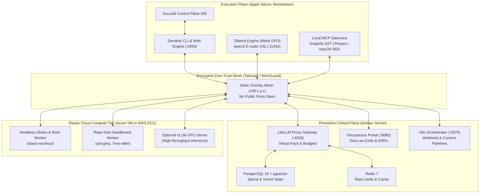

# System Topology & Multi-Node Placement Architecture

## 1. Architectural Philosophy: Decoupled Compute Tiers

Consolidating background services, relational databases, AST graph indexing, and autonomous model inference onto a single developer workstation degrades performance, depletes battery life, and triggers thermal throttling on passively cooled hardware (such as Apple Silicon MacBook Air).

Dendrite implements a decoupled multi-node architecture separating:
1. **Persistent Control Plane**: Runs continuous, stateful services (LiteLLM Proxy Gateway, PostgreSQL 16, Redis 7, Plane v2 / Jira integrations, Docusaurus Documentation Portal, n8n Orchestrator, Dendrite Web UI).
2. **Execution & Inference Plane**: Runs interactive developer tooling, Metal GPU-accelerated local inference (Ollama with `qwen2.5-coder:14b`), local MCP servers (Graphify AST, Penpot tokens), and native Mach-O binary analysis (Hopper / macOS REA).
3. **Elastic Cloud Compute Tier (Optional)**: Burst VM compute in Azure or AWS for heavy AST indexing of massive codebases, headless Ghidra decompilation of untrusted Linux ELF/PE binaries, and unthrottled vLLM inference.



---

## 2. Deployment Scenarios & Placement Matrix

Dendrite supports four deployment scenarios configured declaratively without modifying underlying container definitions:

### Scenario 1: Local-Hybrid (`local-hybrid`)
- **Control Plane**: Dedicated small Debian server (x86_64 or ARM64, 4–8 GB RAM) over LAN/Tailscale.
- **Execution Plane**: MacBook Air M4 (macOS ARM64, IDE, native REA, Metal-accelerated Ollama).
- **Cloud Compute**: None (0 cloud cost). Ideal for daily local development and overnight unmetered batch tasks.

### Scenario 2: Azure Cloud Burst (`azure-burst`)
- **Control Plane & Compute**: Single on-demand Azure Linux VM (D-series or Spot compute) provisioned via Terraform with attached persistent Managed Disk (stores Postgres state, Docusaurus docs, symbol caches).
- **Execution Plane**: Developer workstation connecting over Tailscale.
- **Debian Server**: Off / not involved. Ideal when travelling or working without access to home/office LAN infrastructure.

### Scenario 3: AWS Cloud Burst (`aws-burst` — [FEAT-007](../features/FEAT-007-aws-cloud-burst.md))
- **Compute Offloading**: EC2 Spot/On-Demand instance (`c6i.2xlarge`) + persistent EBS volume (gp3).
- **Scope**: Core compute offloading for heavy Ghidra decompilation and Tree-sitter repo indexing over Tailscale. Proprietary cloud services are non-priority.

### Scenario 4: Fully Distributed Enterprise (`distributed`)
- **Control Plane**: Debian server (permanent state anchor, zero cloud storage egress).
- **Execution Plane**: Developer workstation (interactive development, local Mach-O reverse engineering).
- **Elastic Compute**: Azure or AWS Spot / GPU VM for batch decompilation, large-scale repository indexing, and dynamic sandboxing.

| Component / Service                 | Scenario 1: Local-Hybrid | Scenario 2: Azure Cloud Burst | Scenario 3: AWS Cloud Burst | Scenario 4: Distributed |
|:------------------------------------|:-------------------------|:------------------------------|:----------------------------|:------------------------|
| **LiteLLM Gateway (:4000)**         | Debian Server            | Azure VM                      | Debian Server               | Debian Server           |
| **PostgreSQL 16 & Redis 7**         | Debian Server            | Azure Persistent Disk         | Debian Server               | Debian Server           |
| **Docusaurus Portal (:8080)**       | Debian Server            | Azure VM                      | Debian Server               | Debian Server           |
| **n8n / Issue Trackers (:5678)**    | Debian Server            | Azure VM                      | Debian Server               | Debian Server           |
| **Ollama Engine (Metal :11434)**    | MacBook Air M4           | MacBook Air M4                | MacBook Air M4              | MacBook Air M4          |
| **Native REA & Hopper**             | MacBook Air M4           | MacBook Air M4                | MacBook Air M4              | MacBook Air M4          |
| **Linux REA Worker (Ghidra/Rizin)** | Debian Server            | Azure VM                      | AWS EC2 (EBS attached)      | Azure or AWS VM         |
| **Repo-Intel Sandbox (`ast-grep`)** | Debian Server            | Azure VM                      | AWS EC2 (EBS attached)      | Azure or AWS VM         |

---

## 3. Two-Layer Infrastructure-as-Code (IaC) Architecture

To eliminate state conflict and configuration drift, Dendrite enforces a strict separation of concerns between Terraform and Docker Compose:

1. **Layer 1: Compute, Networking & Topology (Terraform)**:
   - Manages Azure VM instances (`azurerm`) and AWS EC2 Spot instances (`aws_spot_instance_request`).
   - Manages remote host Docker daemons over SSH (`ssh://user@node-name.ts.net`) using aliased `kreuzwerker/docker` providers.
   - Generates dynamic configuration artifacts (`litellm_config.yaml`, `.env`, Docker context registries) using `templatefile()` based on active Tailscale node IPs.
2. **Layer 2: Service Orchestration & Modularity (Docker Compose)**:
   - Uses modular Compose files (`stacks/compose.control.yaml`, `stacks/compose.sandbox.yaml`, `stacks/compose.rea-linux.yaml`).
   - Controls active service sets using `COMPOSE_PROFILES` (`control-plane`, `sandbox`, `rea-worker`).
   - Prevents Terraform from tracking hundreds of ephemeral container lifecycles directly.

### Placement Map Schema (`infra/terraform.tfvars`)

```hcl
scenario = "local-hybrid" # Options: local-hybrid, azure-burst, aws-burst, distributed

tailscale_endpoints = {
  control_plane   = "100.84.12.10" # debian-server.ts.net
  execution_plane = "100.84.12.25" # macbook-air.ts.net
  azure_burst     = ""             # azure-node.ts.net
  aws_burst       = ""             # aws-burst-node.ts.net
}

stack_placement = {
  control_plane = "debian"
  inference     = "macbook"
  linux_re      = "debian" # or "aws", "azure"
  repo_intel    = "debian" # or "aws", "azure"
}
```

---

## 4. Zero-Trust Mesh & Tunnel Security

1. **Zero Public Ingress**: Neither the Debian server, Azure VMs, nor AWS EC2 instances open public ports (`0.0.0.0`) for databases, proxy endpoints, or disassemblers.
2. **Encrypted Overlay**: All inter-service traffic binds to localhost (`127.0.0.1`), Unix domain sockets, or Tailscale private IPs (`100.x.y.z`) encrypted with WireGuard.
3. **Firewall Guardrails**:
   - Ollama engine on macOS binds to `OLLAMA_HOST=0.0.0.0:11434` but is strictly firewalled via `pfctl` to accept inbound connections exclusively from the Control Plane Tailscale IP.
   - Remote Docker Daemons accept connections exclusively via authenticated SSH keys (`ssh://deployer@100.x.y.z:22`).
