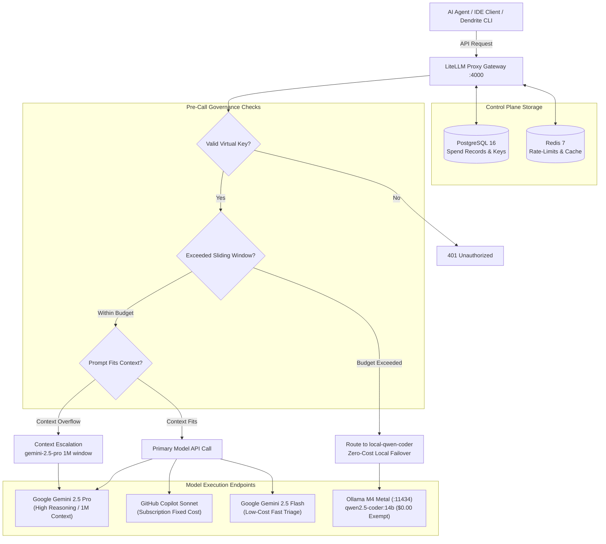

# Token Budget Governance & LiteLLM Gateway Architecture

## 1. Overview & Operational Mandate

Autonomous agentic loops (such as Aider, OpenHands, or custom LLM worker loops) pose significant financial and operational risks if left ungoverned:
1. **Unbounded Financial Expenditure**: Recursive execution loops can consume hundreds of dollars in API credits within hours.
2. **Abrupt Rate-Limiting Failures**: Provider HTTP 429 errors crash unattended overnight batch pipelines.
3. **Context Exceedance Errors**: Local or lightweight models fail when repository diffs or AST bundles exceed their token context windows.

Dendrite solves this via an intelligent **Governance & Routing Layer** centered on the **LiteLLM Proxy Gateway** backed by PostgreSQL 16 and Redis 7 on the persistent Control Plane.



---

## 2. Model Tiering & Configuration Registry

Dendrite provisions models declaratively inside `litellm_config.yaml` rendered by Terraform:

| Model Identifier | Provider Route | Context Window | Billing / Cost Profile | Primary Assignment |
| :--- | :--- | :--- | :--- | :--- |
| `gemini-2.5-pro` | `gemini/gemini-2.5-pro` | 1,048,576 tokens | Metered Usage ($/token) | Deep cross-module refactoring, architectural synthesis, long-context analysis. |
| `copilot-sonnet` | `github_copilot/claude-sonnet-4.5` | 200,000 tokens | Fixed Monthly Subscription | Primary interactive coding, complex algorithmic code synthesis. |
| `gemini-2.5-flash` | `gemini/gemini-2.5-flash` | 1,048,576 tokens | Low-Cost Metered ($/token) | High-speed triage, AST symbol classification, budget fallback tier 1. |
| `local-qwen-coder` | `ollama/qwen2.5-coder:14b` | 32,768 tokens | **$0.00 (Exempt)** | Overnight autonomous batch tasks, unit test generation, unmetered failover. |

### Upstream Protocol Compatibility
- **GitHub Copilot Route**: Configured with `drop_params: true` and custom client headers:
  - `Editor-Version: "vscode/1.95.0"`
  - `Copilot-Integration-Id: "vscode-chat"`
  - `X-Initiator` header forwarding to ensure multi-turn conversation billing integrity.
- **Local Ollama Exemption**: `local-qwen-coder` is registered with an explicit cost of `$0.000000` per token. LiteLLM's `skip_budget_checks` logic allows calls to this endpoint even when an agent key has reached its spend cap.

---

## 3. Sliding Budget Windows & Cascading Fallbacks

### Hierarchical Virtual Keys
Virtual Keys partition budget ceilings across teams, interactive developers, and autonomous batch workers:
```json
{
  "key_alias": "autonomous-coding-agent",
  "budget_limits": [
    { "budget_duration": "24h", "max_budget": 5.00 },
    { "budget_duration": "7d", "max_budget": 20.00 }
  ],
  "model_max_budget": {
    "gemini-2.5-pro": { "budget_limit": 10.00, "time_period": "7d" },
    "copilot-sonnet": { "budget_limit": 8.00, "time_period": "7d" }
  },
  "budget_fallbacks": {
    "gemini-2.5-pro": ["copilot-sonnet", "gemini-2.5-flash", "local-qwen-coder"],
    "copilot-sonnet": ["gemini-2.5-flash", "local-qwen-coder"]
  }
}
```

### Context Window Escalation Matrix
When a prompt exceeds local or intermediate model limits, LiteLLM intercepts the request before dispatch and routes it upstream:
- `local-qwen-coder` (> 32,768 tokens) $\to$ `gemini-2.5-pro` (1M tokens)
- `gemini-2.5-flash` (> 1M tokens) $\to$ `gemini-2.5-pro` (1M tokens)

---

## 4. Supervisory Control Daemon: 4 Operational Modes

The supervisory control engine (`supervisor.py` or `dendrite supervisor`) enforces continuous governance during batch operations across four distinct modes:

### Mode 1: Exhaustion-Capped Batch Mode
Executes batch queues using frontier commercial models (`gemini-2.5-pro`, `copilot-sonnet`). When LiteLLM signals budget cap reach or returns an upstream HTTP 429 quota exhaustion code, the runner transitions subsequent tasks to `local-qwen-coder` without aborting the queue.

### Mode 2: Hard Financial Capping Mode
Before dispatching any task, the supervisor polls LiteLLM's `/key/info` endpoint. If $\text{Cumulative Spend} \ge \text{MAX\_SPEND\_LIMIT\_USD}$, the runner immediately halts execution, stages modified files, updates the issue tracker (Plane v2), and exits cleanly.

### Mode 3: Rate-Bounded Throttling Mode
Prevents autonomous batch tasks from consuming interactive developer team allowances by calculating a consumption ceiling:
$$R_{\text{target}} = R_{\text{consumed}} + \left(0.30 \times R_{\text{weekly\_limit}}\right)$$
When cumulative consumption reaches $R_{\text{target}}$, the runner throttles dispatch or forces fallback to unmetered local models.

### Mode 4: Time-Bounded Curfew & Thermal Protection Mode
- **Curfew Gate**: All unattended overnight batch loops terminate at `07:00 AM`. Remaining tickets are left in queue, working git branches are committed and pushed, and a status report is posted to Plane.
- **MacBook Air M4 Thermal Protection**: Monitors Apple Silicon SoC die temperature (via macOS `powermetrics` / `osx-cpu-temp`). If temperature exceeds $85^\circ\text{C}$ during extended local Metal inference, the runner introduces mandatory cool-down sleep intervals (60s) between tasks to eliminate thermal throttling and preserve battery health.
