# Agent Quota Recovery & Multi-Agent Coordination

How Dendrite keeps work moving when any agent — including the orchestrating session — runs out of quota.
Tickets: DEN-988 (ledger + classifier), DEN-989 (dispatcher CLI), DEN-990 (fallback chain), DEN-991 (verify-only watcher), DEN-992 (session checkpoint/resume), DEN-993 (spike, this page's findings).

## Goals

- Any agent can hit its quota and the work **continues or pauses without loss**.
- Work **resumes without re-exploration** (same conversation, or a handover capsule for a different agent).
- A new session — the same agent after its reset, a different agent, or a human — picks up from a compact checkpoint.

Policy:

- On quota exhaustion: **other cloud** (GitHub Copilot via LiteLLM) → **local** OxiLLaMa/Ollama (complexity ≤ 4) → **park** until the provider resets.
- When the orchestrator is unavailable, the background watcher **verifies only**. It never commits, moves Plane states or touches GitHub.

## Building blocks

| Component | Command / package | Role |
|---|---|---|
| Job ledger | `pkg/agentjobs`, `.dendrite/jobs/<id>/` | `job.json` state, `events.jsonl` write-ahead log, prompt, handover capsule, agent log, `done` marker |
| Outcome classifier | `pkg/agentjobs/classify.go` | Maps exit code + log tail + file-scope changes to `QUOTA`, `TRANSIENT`, `PERMISSION`, `EARLY_EXIT`, `DONE` |
| Dispatcher | `dendrite agent jobs submit/list/show/tail/wait/retry/cancel` | Starts detached jobs with the standard headless preamble and a file-scope guard |
| Fallback chain | `pkg/agentjobs/fallback.go` + `pkg/scheduler/governor` | Escalates on `QUOTA`, marks exhausted providers until reset, parks with `resume_after` |
| Watcher | `dendrite agent jobs daemon [--install] [--idle-exit 30m]` | Verifies finished jobs (gofmt, build, vet, race tests, coverage), re-dispatches failures once, wakes parked jobs, kills and retries a running job with no sign of life; writes a heartbeat (`watcher.json` in the ledger root). `jobs submit` starts one when none is alive; `session resume` warns when jobs are in flight and none is |
| Visibility | `dendrite agent jobs watch [<job-id>\|--ticket T] [--once] [--json]` | One line per interval: status, elapsed time, process, model requests and age of the last, changed files, time left before the stall check, watcher up or down |
| Handoff | `dendrite session checkpoint` / `dendrite session resume` | < 500-token state checkpoint; `resume` is the first command of every new session |

## Progress signals (DEN-391)

AGY prints its result only when the turn ends, so `agent.log` says nothing while it works. Three signals exist instead:

- **agy's own log.** Every attempt runs with `--log-file <job dir>/agy.log`; agy writes one `streamGenerateContent` line per model request. The request count and the age of the last one separate a busy agent (reading, thinking) from a stuck one.
- **agent.log, live.** stdout and stderr are written to it as they arrive, not after the process ends.
- **Stall check.** The watcher counts the newest of the ledger entry, `agent.log`, `agy.log` and the files in the job's scope as the job's last sign of life. A job that keeps making model requests is never called stalled even when it has not touched a file.

The per-attempt wall-clock deadline (`DefaultAttemptTimeout`, 20 minutes) is enforced by the job's own runner, so it applies even when no watcher runs.

## Spike findings (DEN-993, 2026-10-17)

**AGY headless JSON output** (`agy -p … --output-format json`) returns:

```json
{"conversation_id": "159b3f22-…", "status": "SUCCESS", "response": "OK",
 "duration_seconds": 2.28, "num_turns": 1,
 "usage": {"input_tokens": 11995, "output_tokens": 1, "thinking_tokens": 0, "cache_read_tokens": 0, "total_tokens": 11996}}
```

- `conversation_id` must be stored in `job.json`.
- `agy --conversation <id> -p "continue …"` resumes with full memory (verified: the resumed turn recalled its previous answer).
- The resumed call re-sends history (24,209 input tokens versus 11,995 for a fresh call). It is still far cheaper than re-exploring a codebase, so a first `TRANSIENT` failure resumes the same conversation while it is small (see [AGY models and load spreading](#agy-models-and-load-spreading-den-1017)).
- Even a trivial call carries about 12k tokens of fixed overhead. Batch small tasks per job instead of firing many tiny jobs.
- `usage` is recorded per attempt in `events.jsonl` and feeds per-ticket attribution (`dendrite tokens`).
- In JSON mode the `conversation_id` is printed only when the turn ends, so a killed or stalled job loses it. Bound every headless run with `--print-timeout`, and run long jobs one at a time per workspace.

**AGY failure signatures observed in real runs:**

| Signature | Example | Class |
|---|---|---|
| exit 3 + `AGY_ERROR {"short_error":"…request failed: Post …: EOF","status":"UNKNOWN"…}` + "network issue connecting to the server" | DEN-982 first run | `TRANSIENT` |
| exit 3 + `AGY_ERROR {"short_error":"The stream was interrupted. Please continue the task you were working on.","retryable":false}` — flagged non-retryable but continuable | DEN-910 fix run | `TRANSIENT` |
| exit 0 + `jetski: no output produced — a tool required the "command" permission … auto-denied` | audit batches, DEN-900 first run | `PERMISSION` |
| exit 0 + "launched a … subagent" and no file changes | DEN-910 first run | `EARLY_EXIT` |
| exit 0 + changes inside the file scope | most jobs | `DONE` |
| every tier answers, but a one-word reply takes ~15 min (vs 2 s) and `--print-timeout` is ignored, after a day of heavy use | 2026-10-18 00:30 probes | `QUOTA` (throttled): detected by latency, not by an error string; the dispatcher enforces its own wall-clock deadline (kill the process group) and falls back to Copilot via LiteLLM |
| process alive, no file or log progress for > 30 min, near-zero CPU (AGY language server shut down underneath it) | DEN-910 rewrite + DEN-989 fix, launched in the same second | `STALLED`: the watcher kills the process group and resumes the conversation; parallel AGY jobs are started a few seconds apart |

**Quota exhaustion signatures.** None were observed yet, so these come from documented provider conventions and are kept in one table in `classify.go`:

- **Gemini / AGY:** `RESOURCE_EXHAUSTED` status or error code, HTTP `429`, "quota", "exhausted your capacity".
- **LiteLLM (any upstream, incl. Copilot):** `litellm.RateLimitError` / HTTP 429. Budget and virtual-key caps surface as `BudgetExceededError` (HTTP 400). Both are treated as `QUOTA`.
- **Local engines (OxiLLaMa / Ollama):** no quota. Connection refused means `TRANSIENT`, handled by auto-start (DEN-923).

**No local quota readout.** The AGY CLI keeps an internal `quota_manager` but exposes no remaining-quota value on disk or via a subcommand. Detection is therefore reactive (the classifier), plus proactive spend tracking from `usage` against the weekly policy in `pkg/scheduler/token`.

## Flow

```mermaid
stateDiagram-v2
    [*] --> Running: dendrite agent jobs submit
    Running --> Done: exit 0, changes in scope
    Running --> Transient: network / 5xx
    Running --> Quota: 429 / RESOURCE_EXHAUSTED / RateLimitError
    Running --> EarlyExit: no changes / subagent
    Running --> Permission: auto-denied command
    Transient --> Running: backoff; resume if small, else fresh + capsule; 2nd time other family (max 3)
    EarlyExit --> Running: retry once, no-subagent preamble
    Permission --> Running: retry once, file-tools preamble
    Quota --> Running: next tier (other Gemini family, Copilot, then local if C<=4) + capsule
    Quota --> Parked: no tier left
    Parked --> Running: resume_after passed and its quota bucket has cooled down
    Done --> Verified: watcher: gofmt, build, vet, race tests, coverage
    Done --> Running: verification failed, re-dispatch once with failure capsule
    Verified --> Committed: orchestrator only (dendrite commit, To Verify, HITL issue)
```



## AGY models and load spreading (DEN-1017)

AGY signs in with its own Google account and calls Google directly, so LiteLLM never sees AGY traffic. AGY offers its own catalog (`dendrite agent jobs models` refreshes and shows it). Dendrite schedules the Gemini 3.8 Flash and Gemini 4 Argon models by default. `DENDRITE_AGY_MODELS` (comma separated) replaces that list, for example to opt in to the Claude or GPT-OSS models AGY also offers.

- **Model choice.** `--model auto`, or no `--model`, picks by complexity and load:

  | Complexity | Candidates, in preference order |
  |---|---|
  | ≤ 3 | `gemini-3.8-flash-medium`, `gemini-4-argon-low` |
  | 4–6 (or unknown) | `gemini-3.8-flash-high`, `gemini-4-argon-medium` |
  | ≥ 7 | `gemini-4-argon-high`, `gemini-3.8-flash-high` |

  The family with the fewest active ledger jobs wins, and families that are cooling down are skipped. Concurrent jobs therefore spread across both families. The choice is logged as a `model_selected` event.
- **Validation.** `submit` rejects a model outside the allowed list, or one missing from a fresh (24h) `agy models` cache. The router (`dendrite agent route`) and the budget fallback only hand AGY models from its catalog.
- **Shared across repositories.** Each repository keeps its own ledger (`<repo>/.dendrite/jobs`), but cooldowns (`_providers.json`) and a registry of ledgers (`_ledgers.json`) live in `~/.dendrite/agentjobs` (`DENDRITE_SHARED_STATE_DIR` overrides it). Jobs submitted from synapse peers therefore count as load for each other, and a quota hit in one repository cools that family down everywhere.
- **Quota per family.** Cooldowns in `_providers.json` are keyed `agy:gemini-3.8`, `agy:gemini-4-argon`, `copilot`, `local` and `oxillama`, so a Gemini 3.8 quota hit leaves Argon available. A legacy bare `agy` key still covers every AGY family.
- **Cooldown length.** AGY reports quota as `RESOURCE_EXHAUSTED (code 429): Individual quota reached … Resets in 140h4m53s.` The cooldown runs until that reset. Without a hint it falls back to `Retry-After`, then to 1 hour. Individual AGY quotas can last days, so a 1-hour guess would waste one attempt per hour on an exhausted family.
- **Stall or throttle.** An AGY attempt that hits the 20-minute deadline without changes counts as throttling (`QUOTA`) only when no other job on the same family finished a turn during it. Otherwise it is a stall and is retried as `TRANSIENT`. On 2026-10-19 one Gemini 3.8 job stalled for 20 minutes while four others on Gemini 3.8 succeeded; the old rule cooled the whole family down for an hour.
- **Copilot key.** Detached runners do not inherit a shell that sourced `.env`, so the aider/Copilot tier resolves `LITELLM_MASTER_KEY` with `dotenv.Lookup`: the exported value, then the job worktree's own `.env`, then the global `$DENDRITE_HOME/.env`. Aider exits 0 after an authentication failure; that output is now marked `DENDRITE_PROVIDER_UNAVAILABLE`, so Copilot cools down and the job escalates instead of looking finished. Aider's history files go to the job directory, not the worktree.
- **Ladder.** The requested model, then the other family's comparable model (3.8 Flash High ↔ Argon Medium), then Copilot, then the `local` tier for complexity ≤ 4: a chat completion through the LiteLLM gateway alias `local-qwen3-9b`, served by Ollama on the GPU. A job submitted with `--agent oxillama` stays on OxiLLaMa (which prefills on the CPU) and parks on quota.
- **Transient retries.** A conversation is resumed only after a first transient whose attempt used fewer than `DENDRITE_AGY_RESUME_TOKEN_LIMIT` input tokens (default 400,000). Otherwise the retry starts a fresh conversation with the original prompt and a handover capsule. A second transient also moves the job to the other family. Before this, DEN-RELOC resumed a 567k-token conversation that kept dropping its stream: 567k → 812k → 1.06M input tokens over 4 attempts.
- **Scope baseline.** Files that are dirty before the first attempt are recorded with their blob hash (`job.baseline`). The scope check ignores them unless the agent changes them, so a run in a dirty checkout no longer blames the agent for the human's work. `submit` warns when it runs without `--isolate` in a dirty checkout.

## End-to-end verification (2026-10-18)

A real job ran in a throwaway Go module:

1. `dendrite agent jobs submit --agent agy --model gemini-3.8-flash-low --scope calc/` → one attempt, classified `DONE`, status `succeeded`.
2. `dendrite agent jobs daemon --once` → `verified` with gofmt, build, vet and tests all `ok`, and per-package coverage recorded. Nothing was committed.

The first run surfaced two bugs, both fixed:

- **State dir counted as agent edits.** The ledger lives inside the repository by default (`<repo>/.dendrite`), so the job's own bookkeeping counted as out-of-scope edits. The scope check now ignores `.dendrite/` and the ledger root.
- **Success classified as `TRANSIENT`.** A clean exit was misread because the agent's summary contained a path with `-501`, and a bare `50x` number matched the 5xx pattern. Bare numbers no longer match. A clean exit (code 0) without an `AGY_ERROR` envelope is never classified `QUOTA` or `TRANSIENT`, because quota or 5xx words in an agent's own summary are content.
