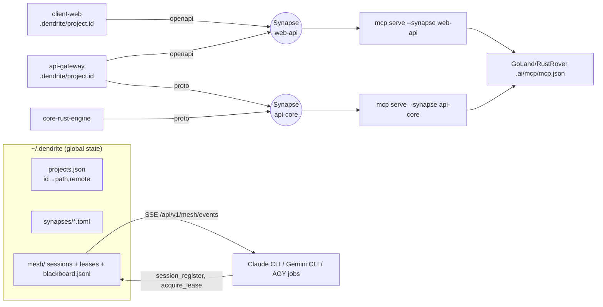
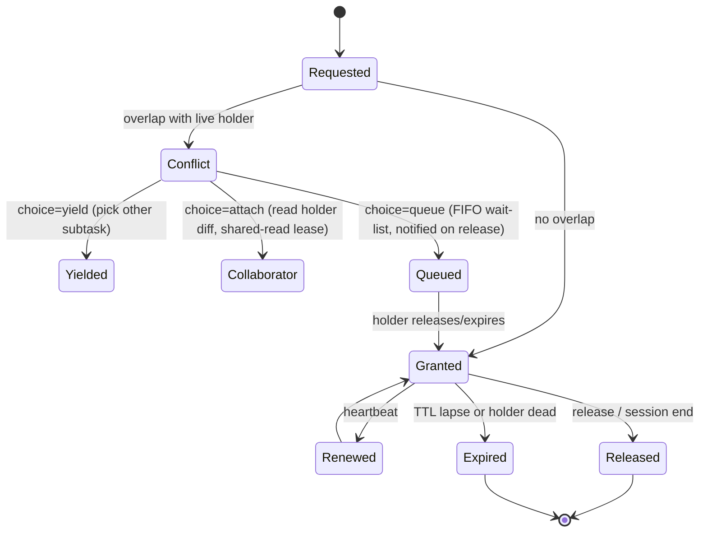

# Synapse & Multi-Agent Arbitration Mesh

Cross-project typed links (Synapses) with scoped MCP servers and self-healing paths, plus a lease/blackboard/worktree mesh that lets concurrent AI agents collaborate instead of clobbering each other.

Tickets: DEN-997 … DEN-1016 (Milestone 40: Synapse Cross-Project Links & Multi-Agent Arbitration Mesh)

## Goals
Dendrite links projects only through `dendrite pool` (`pkg/pool/dag`, per-git-root `.dendrite/pool.json`) and the global workspace registry (`pkg/workspace`, `~/.dendrite/config.json`). Neither has a stable project identity: entries are name + absolute path, so a manual `mv` silently breaks them. Concurrent agents (`dendrite agent jobs` → AGY/OxiLLaMa, interactive `agent run`, external Claude/Gemini CLIs) share a working tree with no cross-process coordination — the only guard is `CheckScope`, evaluated *after* the agent has already edited. Goal: typed cross-project links (Synapses) with scoped MCP servers and self-healing paths, plus a lease/blackboard/worktree mesh so concurrent agents cooperate instead of clobbering.

## 1. Nomenclature — verdict: **Synapse**
| Candidate | Fit | Verdict |
|---|---|---|
| **Synapse** | Neuro-consistent with Dendrite/axon/soma CLI categories; "typed junction transmitting signals between autonomous cells" = typed contract link between repos | **Adopt** |
| Nexus | Generic, collides with Sonatype Nexus (artifact repo) | Reject |
| Conduit | Implies one-way pipe; contracts are bidirectional | Reject |
| Chime | No semantic fit | Reject |

Mesh terms: **Session** (registered agent), **Lease** (semantic symbol lock), **Blackboard** (event bus + durable intent log), **Reconcile** (worktree → branch merge).



## 2. Synapse engine (`pkg/synapse`, `pkg/projectid`)
**Identity** (`pkg/projectid`): `<repo>/.dendrite/project.id` (committed) = `dpid_` + hex(SHA-256(random 32B ‖ abs path ‖ time))[:32]. BLAKE3 not adopted — no dep in go.mod and identity needs uniqueness, not speed; SHA-256 (stdlib, already used repo-wide) is sufficient. Secondary keys: normalized `git remote get-url origin`, root manifest name. `projectid.Ensure(dir)`, `projectid.Read(dir)`.

**Global project index** `~/.dendrite/projects.json` (`DENDRITE_HOME` override): `{id: {path, remote, name, last_seen}}`. `pool add` and `project add` call `Ensure` + index upsert (unifies the two registries on ID without migrating them).

**Manifest** `~/.dendrite/synapses/<id>.toml` (global: per-repo statedir can't hold cross-repo links; parsed with the existing hand-rolled TOML style — no new dep, or yaml.v3 if TOML proves fragile):
```toml
id = "web-api"
name = "Web ↔ API"
state = "active"            # draft|active|drifted|broken|archived
created_at = "2026-10-18T..."
[[members]]
project_id = "dpid_…"
alias = "client-web"
role = "consumer"           # producer|consumer|peer
path_hint = "/Users/…/client-web"   # cache only; id is truth
[[contracts]]
kind = "openapi"            # proto|openapi|jsonschema|go|rust|ts|pydantic|ffi|migrations
producer = "api-gateway"
path = "api/openapi.yaml"
consumers = [{ alias = "client-web", path = "src/api/types.ts" }]
[sync]
strategy = "go.work"        # go.work|cargo-patch|pnpm-workspace|none
[parity]
commands = { "api-gateway" = "go test ./contract/...", "client-web" = "bun test contract" }
```
State machine: `draft → active ⇄ drifted` (contract hash/drift via `pkg/polyglot/contract.CompareSchemas`), `active|drifted → broken` (a member unresolved), `broken → active` (heal), `* → archived`.

**Heal / locate algorithm**
1. For each member: if `path_hint/.dendrite/project.id == project_id` → OK.
2. Else candidate roots = parent of old path (up to 2 levels), `~/GoLandProjects`, `~/RustRoverProjects`, `~/WebstormProjects`, `~/PycharmProjects`, config `heal.roots`, CLI `[hint-dir]`.
3. Bounded walk (depth ≤4, skip `node_modules,target,.git,vendor,dist`), match `project.id` (exact) → else origin-remote match (unique) → else manifest-name match (report as *ambiguous*, never auto-apply).
4. `--auto` applies exact/unique-remote matches: rewrite `path_hint`, `projects.json`, `pool.json` entry, JetBrains scope; else print proposal.
5. Health matrix: `synapse | member | status(OK|MOVED|MISSING|AMBIGUOUS) | old → new`.

`synapse move <alias|id> <new-path>`: `os.Rename` (fallback copy+remove across devices, refusing if dest exists), then same rebind as heal step 4, all inside a `pkg/pool/switcher/transaction.go`-style snapshot/rollback.

## 3. Per-Synapse MCP
Reuse `pkg/mcpserver` (hand-rolled JSON-RPC 2.0, stdio). Add `dendrite mcp serve --synapse <id>`: builds a `Server` that registers **only** `synapse_*` tools bound to that manifest (no global 60+ tool list → small context). Later add SSE transport at `/api/v1/synapses/<id>/mcp` on `pkg/server` (:3456).

| Tool | Args | Backing code |
|---|---|---|
| `synapse_info` | – | manifest + health |
| `synapse_diff_contract` | `contract?` | `pkg/polyglot/contract` parsers + `CompareSchemas` across producer/consumer files |
| `synapse_query_peer` | `member, symbol?, kind?, file?` | `pkg/ast` Go provider (new `ExportedSymbols(dir)`); non-Go: contract parsers' type list |
| `synapse_run_parity_tests` | `members?` | runs `[parity].commands` in each member dir, concurrently, timeout |
| `synapse_propose_sync` | `apply=false` | `pkg/pool/switcher` (go.work / Cargo patch / pnpm) dry-run diff; apply only with `apply=true` |

Scoping rules: file paths resolved only inside member roots (reject `..`/absolute escapes); peer queries return signatures, not bodies (`FoldSignatures`). `jetbrains.configureMCPFile` generalized to write `dendrite-synapse-<id>` entries (merge, don't clobber the `dendrite` key); `syncJetBrainsScope` becomes merge-aware with one named scope per synapse.

## 4. Multi-agent mesh (`pkg/mesh`)
**Shared state** under `~/.dendrite/mesh/<project-id>/` (NOT statedir — inside a worktree `git rev-parse --show-toplevel` is the worktree, which would split state). Files: `sessions/<sid>.json`, `leases.json`, `blackboard.jsonl`. Cross-process safety: `flock` (`syscall.Flock`) on `mesh.lock` around every read-modify-write; atomic tmp+rename (reuse `agentjobs.writeFileAtomic` pattern).

**Sessions**: `{id, origin: managed|external, agent, pid, ticket, intent, scope[], worktree, started, heartbeat}`. Liveness = heartbeat < 90s AND `kill(pid,0)` ok; dead sessions reaped and their leases released. Ingestion:
- managed: `agentjobs.Dispatcher.Submit` registers + creates worktree;
- external: `dendrite exec --agent claude [--ticket] [--scope] -- claude …` (registers, exports `DENDRITE_SESSION_ID`, heartbeats, deregisters on exit) or MCP tool `mesh_session_register` from inside the agent.

**Leases**: key = `(file, symbol)`; `symbol=""` = whole file. Modes `exclusive|shared-read`. TTL default 5m, renew via heartbeat. Overlap = same file and (either is whole-file or symbol sets intersect). Symbol validation via `pkg/ast` for Go (unknown symbol → warning, still leased).

`LeaseConflictNotice = {lease, holder:{session, agent, ticket, intent, worktree, since, expires}, queue_position, options:[yield,attach,queue]}`.

**Blackboard**: append-only `blackboard.jsonl` (`{seq, time, session, topic, data}`; topics `session.*`, `lease.*`, `intent.checkpoint`, `worktree.tests`, `reconcile.*`) + live fan-out: generalize `pkg/server` `TelemetryHub` into a topic hub; SSE at `GET /api/v1/mesh/events?topics=…&since=seq` (replay from file then live). CLI `dendrite agent bus listen` tails the file (works without the server).

**Worktrees**: `.dendrite/worktrees/agent-<sid>/` on branch `agent/<sid>` from target HEAD, via `pkg/story/fork.OSGitExecutor.WorktreeAdd`. Removed on reconcile/evict.

**Reconcile** (Dimension D): agent passes Stage-B gate (`pkg/assert`) → `git rebase <target>` in worktree → on conflict, `pkg/ast.ChangedSymbols` both sides: disjoint symbols in same file ⇒ attempt `git merge-file` hunk merge per symbol; overlapping symbols ⇒ `reconcile.conflict` event + job `needs_review` (never auto-resolve overlapping semantic edits). Then fast-forward target, publish `reconcile.done`. Rust `dendrite-git-rs` (gix) deferred — Go `git` CLI path first.

**Concurrency scenario**
```mermaid
sequenceDiagram
  participant C as Claude CLI (T1)
  participant G as Gemini CLI (T2)
  participant M as Mesh
  C->>M: exec register (DEN-1, intent "schema refactor")
  M-->>C: worktree agent-c1
  C->>M: acquire_lease(models/user.go,[User])
  M-->>C: granted
  C->>M: publish intent.checkpoint "rewriting User types"
  G->>M: exec register (DEN-2, "API endpoint refactor")
  G->>M: acquire_lease(models/user.go,[User])
  M-->>G: LeaseConflictNotice(holder=c1, DEN-1, intent)
  G->>M: choose queue; subscribe worktree.tests
  G->>M: acquire_lease(api/handlers.go,[ListUsers]) granted (unblocked subtask)
  C->>M: worktree.tests pass → reconcile.done, release
  M-->>G: lease.granted models/user.go
  G->>G: rebase onto new target, continue
```

## 5. Open-source assessment
| Area | Candidate | Verdict | Reason |
|---|---|---|---|
| MCP | modelcontextprotocol/go-sdk | **Defer** | Existing `pkg/mcpserver` works, zero deps; adopt when SSE/streamable-HTTP + resources needed (revisit in DEN-1010) |
| MCP | mark3labs/mcp-go | Reject | Same rationale; two SDKs worse than one |
| Event bus | NATS embedded | Reject (now) | 15+ MB dep for single-host; flock+jsonl+existing SSE hub suffices; reconsider for multi-host |
| Coordination | AutoGen / Agent Protocol | Reject | Python orchestration frameworks; Dendrite orchestrates external CLIs, needs file-level locking not conversation graphs |
| Sandboxing | E2B / OpenHands runtime | Reject for mesh | Remote/container runtimes; `pkg/sandbox` already exists; worktrees give isolation cheaply |
| Isolation | git worktree vs VFS overlay | **Adopt worktree** | Native, already wrapped in `pkg/story/fork`; VFS (FUSE) is non-portable on macOS |
| Persistence | Engram/SQLite FTS5 | Defer | No Go driver in go.mod (sqlite via CLI shell-out); leases need transactional RMW → flock JSON now; blackboard FTS indexing can feed `pkg/store` later |
| Hashing | BLAKE3 | Reject | stdlib SHA-256 sufficient for IDs |
| Semantic merge | dendrite-git-rs (gix) | Defer | Go `git merge-file` + `pkg/ast` first |
**Build natively**: projectid, synapse manifest/heal, scoped MCP server mode, mesh sessions/leases/blackboard, exec shim, reconcile.

## 6. Plane roadmap (Milestone 40)
Tier key: **OX** = OxiLLaMa local (complexity ≤3, vendor audit after), **AGY** = AGY job (Gemini 3.x flash/pro), **CL** = Claude (this session: architecture, concurrency-critical code, review of OX/AGY output).

| Ticket | Title | Pkg | Cx | Tier | Blocked by |
|---|---|---|---|---|---|
| DEN-997 | Architecture spec doc | docs/architecture | 2 | CL | – |
| DEN-998 | Persistent project ID + global index | pkg/projectid | 3 | AGY | 997 |
| DEN-999 | Wire ID into pool add / project add | pkg/pool/dag, pkg/workspace | 3 | OX | 998 |
| DEN-1000 | Synapse manifest schema + store + state machine | pkg/synapse | 5 | AGY | 998 |
| DEN-1001 | CLI create/list/inspect | cmd/dendrite/synapse.go | 3 | OX | 1000 |
| DEN-1002 | locate/heal algorithm + health matrix | pkg/synapse | 6 | CL | 1000 |
| DEN-1003 | synapse move (atomic, rollback) | pkg/synapse | 5 | AGY | 1002 |
| DEN-1004 | Merge-aware JetBrains scopes + per-synapse mcp.json | pkg/jetbrains, pkg/pool/switcher | 4 | AGY | 1000 |
| DEN-1005 | Scoped MCP mode `mcp serve --synapse` + synapse_info | pkg/mcpserver | 5 | CL | 1000 |
| DEN-1006 | synapse_diff_contract | pkg/mcpserver, pkg/polyglot/contract | 4 | AGY | 1005 |
| DEN-1007 | synapse_query_peer (+ ast ExportedSymbols) | pkg/ast | 5 | AGY | 1005 |
| DEN-1008 | synapse_run_parity_tests + synapse_propose_sync | pkg/synapse | 5 | AGY | 1005 |
| DEN-1009 | Mesh store: flock, sessions, liveness/reaper | pkg/mesh | 7 | CL | 998 |
| DEN-1010 | Semantic leases + LeaseConflictNotice + queue | pkg/mesh | 8 | CL | 1009 |
| DEN-1011 | Blackboard jsonl + topic hub + SSE endpoint | pkg/mesh, pkg/server | 6 | AGY | 1009 |
| DEN-1012 | `dendrite exec` shim + mesh MCP tools | cmd/dendrite, pkg/mcpserver | 6 | CL | 1010 |
| DEN-1013 | `agent bus listen/sessions/leases/evict` CLI | cmd/dendrite | 3 | OX | 1011 |
| DEN-1014 | Per-session worktrees in agentjobs.Submit | pkg/agentjobs | 5 | AGY | 1009 |
| DEN-1015 | Reconcile: rebase + symbol-disjoint merge | pkg/mesh | 8 | CL | 1014 |
| DEN-1016 | IDE lease visibility (status file + JetBrains bridge notice) | pkg/jetbrains | 4 | AGY | 1011 |

Every ticket's description carries `[AC-1..N]` (deterministic, command-verifiable), DoD: `go test ./<pkg>/...` green, zero mocks, coverage ratchet passes (new packages must land at the ratchet's new-package bar), state → **To Verify**.

