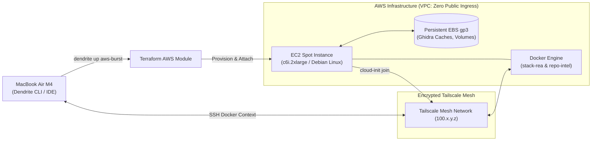

# FEAT-007: AWS Cloud Burst Provider & Topology Module

## 1. User Story & Business Objective
As a DevSecOps engineer and systems developer whose primary cloud infrastructure is AWS (or multi-cloud), I need Dendrite to support Amazon Web Services as an elastic burst compute provider alongside Azure, allowing me to spin up on-demand or Spot EC2 compute with persistent EBS volumes and join it to my Tailnet via Terraform, so that heavy reverse engineering, repository indexing, and containerized agent execution can be offloaded seamlessly to AWS.

> [!NOTE]
> **Priority Scope Declaration**:
> Core EC2 spot/on-demand VM compute, persistent EBS volumes, cloud-init Tailscale registration, and Docker-over-SSH orchestration are the primary deliverables. Advanced, proprietary cloud features (e.g., AWS Bedrock, complex AWS KMS envelope cascades, AWS ECS/Fargate) are **explicitly declared non-priority** and deferred to future milestones.

---

## 2. Technical Boundaries & Specifications

1. **Terraform AWS Provider Integration (`infra/modules/aws-burst`)**:
   - Provider: `hashicorp/aws` (~> 5.0).
   - Resource Types:
     - `aws_spot_instance_request` or `aws_instance` (e.g., `c6i.2xlarge` or `c7g.2xlarge` for cost-efficient compute).
     - `aws_ebs_volume` (gp3) for persistent symbol caches, AST databases, and Docker volumes.
     - `aws_volume_attachment` to attach storage on VM boot.
     - `aws_security_group` enforcing zero inbound traffic from `0.0.0.0/0`; all ingress restricted to the Tailscale subnet or zero open ports (outbound-only mesh handshake).
2. **Bootstrap via Cloud-Init**:
   - Automated installation of Docker Engine 26+, Tailscale daemon, and ephemeral Ed25519 deployer SSH key.
   - Ephemeral join to Tailnet via pre-authorized auth-key (`tailscale up --auth-key=... --hostname=aws-burst-node`).
3. **Topology Scenario Integration**:
   - Scenario identifier: `aws-burst`.
   - Maps `stack-rea` (headless Ghidra) and `stack-repo-intel` to `ssh://deployer@aws-burst-node.ts.net`.

---

## 3. Acceptance Criteria & Verification Matrix

- [x] **AC-1**: Executing `dendrite up aws-burst` provisions the EC2 instance, attaches the persistent EBS volume, joins Tailscale, and registers the Docker context in $< 3\text{ minutes}$.
- [x] **AC-2**: The EC2 instance security group contains zero public ingress rules (`0.0.0.0/0:22` is prohibited). All access occurs strictly over Tailscale private IPs.
- [x] **AC-3**: Spot instance termination or manual `dendrite down` unmounts the EBS volume cleanly without data corruption, allowing subsequent re-attachment.
- [x] **AC-4**: Teardown via `terraform destroy` or `dendrite down` eliminates compute charges while preserving the persistent EBS volume.

---

## 4. Definition of Done (DoD) & Persistence Verification

- **Automated Tests**: Terraform module syntax validation (`terraform validate`) and integration tests using [LocalStack](https://localstack.cloud) managed via [Testcontainers](https://rust.testcontainers.org) (`testcontainers-go` / `testcontainers-rs`) to verify EC2/EBS provisioning without live AWS billing.
- **Persistent Layer Verification**: Testcontainers integration suite asserts data read/write fidelity before and after volume detachment.
- **Complexity Guardrails**: Provisioning logic in Go CLI adheres to Cyclomatic Complexity $\le 10$, Cognitive Complexity $\le 12$.
