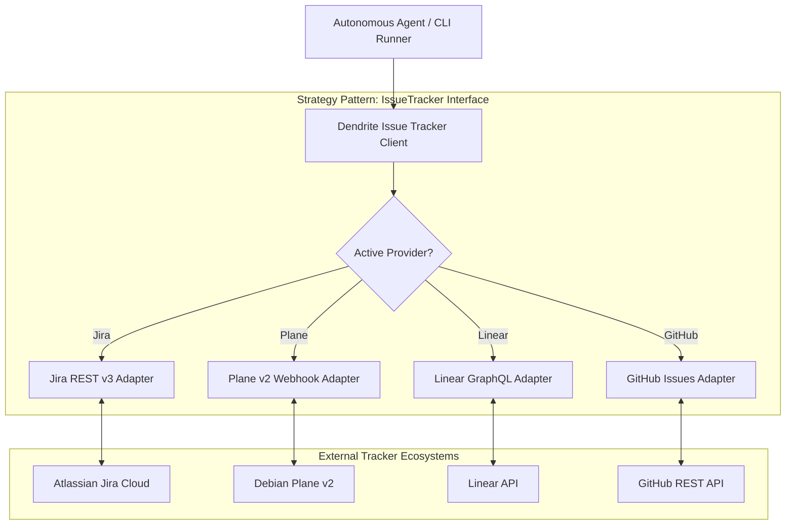

# FEAT-008: Pluggable Issue Tracker Architecture & Jira Provider Integration

## 1. User Story & Business Objective
As an engineering team or enterprise customer whose project workflows are hosted on Atlassian Jira (or GitHub Issues, Linear, or Plane), I need an ergonomic, provider-agnostic issue tracking abstraction in Dendrite, so that I can configure, switch, and operate with Jira without altering autonomous agent workflows, prompt structures, or Docs-as-Code conventions.

---

## 2. Technical Boundaries & Specifications

1. **Provider Strategy Pattern & Interface**:
   - Standardized Go interface `IssueTracker` decoupling the core orchestration loop from vendor-specific REST schemas:
   ```go
   type IssueTracker interface {
       GetIssue(ctx context.Context, id IssueID) (*UnifiedIssue, error)
       UpdateStatus(ctx context.Context, id IssueID, state IssueState) error
       AddComment(ctx context.Context, id IssueID, comment string) error
       LinkPullRequest(ctx context.Context, id IssueID, prURL string) error
       ValidateCredentials(ctx context.Context) error
   }
   ```
2. **Normalized Domain Model**:
   - Vendor schemas (Jira Atlassian Document Format ADF / Jira REST v3, Plane v2 JSON, Linear GraphQL) map into a unified `UnifiedIssue` domain struct:
     - `ID`: `IssueID` (e.g., `PROJ-142`)
     - `Title`: `string`
     - `DescriptionMarkdown`: Sanitized markdown representation
     - `State`: Enum (`Backlog`, `Todo`, `InProgress`, `InReview`, `Done`)
     - `LinkedSpecs`: Extracted `FEAT-*` or `ADR-*` references
     - `Labels`: `[]string`
3. **Supported Providers**:
   - **Atlassian Jira Cloud / Data Center**: REST API v3, basic auth with API token, JQL query engine, and Jira Webhooks (`jira:issue_updated`).
   - **Plane v2**: Self-hosted or Cloud webhook engine.
   - **GitHub Issues**: GitHub REST/GraphQL API.
   - **Linear**: Linear GraphQL API.
4. **CLI Ergonomics**:
   - `dendrite tracker list`: List available and active providers.
   - `dendrite tracker switch <provider>`: Switch active provider for the active project workspace.
   - `dendrite tracker config jira --url <url> --email <email> --token-env <VAR> --project-key <KEY>`.
   - `dendrite tracker test`: Validates network reachability, auth credentials, and project permissions.



---

## 3. Acceptance Criteria & Verification Matrix

- [x] **AC-1**: Switching provider via `dendrite tracker switch jira` updates workspace configuration without corrupting existing project metadata.
- [x] **AC-2**: Jira REST v3 adapter correctly parses Atlassian Document Format (ADF) descriptions into clean Markdown for AI context envelopes.
- [x] **AC-3**: Autonomous agent status transitions (e.g. `InProgress` $\to$ `InReview`) map to corresponding Jira workflow transition IDs dynamically discovered via `/rest/api/3/issue/{id}/transitions`.
- [x] **AC-4**: `dendrite tracker test` validates API token validity and project issue creation permissions in $< 1.5\text{s}$.
- [x] **AC-5**: Sensitive credentials (API tokens) are resolved strictly from environment variables or encrypted SOPS stores, never saved in plaintext config files.

---

## 4. Definition of Done (DoD) & Persistence Verification

- **Automated Tests**: Comprehensive unit tests for ADF-to-Markdown conversion, JQL builder, and transition resolution.
- **Persistent Layer Verification**: Integration tests run against a mock Jira REST v3 server managed via [Testcontainers](https://rust.testcontainers.org) (`wiremock` container), verifying end-to-end request/response serialization.
- **Complexity Guardrails**: Every tracker adapter implementation satisfies Cyclomatic Complexity $\le 10$, Cognitive Complexity $\le 15$. Elimination of God-struct anti-patterns through decoupled HTTP clients.
