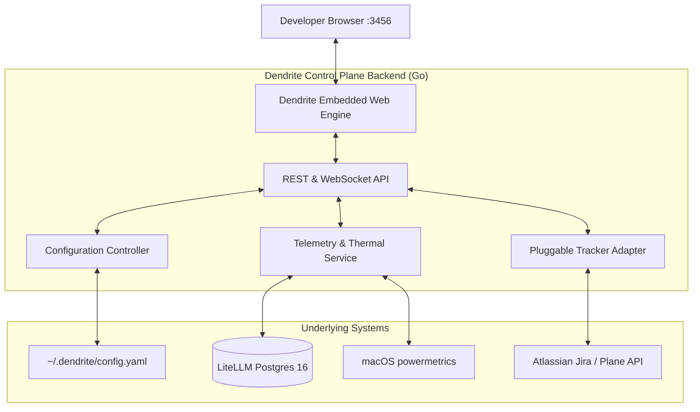

# FEAT-009: Dendrite Web UI & Real-Time Configuration Dashboard

## 1. User Story & Business Objective
As a developer or team lead who prefers visual interaction alongside the CLI, I need a unified, lightweight Web UI to create and update project configurations, manage topology scenarios, configure issue trackers (like Jira), and monitor real-time token spend, node health, and thermal telemetry.

---

## 2. Technical Boundaries & Specifications

1. **Host Architecture & Delivery**:
   - Single-binary embedded web application served by the `dendrite` Go binary using `embed.FS` (zero external runtime dependencies).
   - Local access: `http://127.0.0.1:3456`.
   - Mesh access: Available over Tailscale interface (`http://<control-plane>.ts.net:3456`) with token-based session authentication.
   - CLI launcher: `dendrite ui` (auto-launches default browser) or `dendrite ui --daemon`.
2. **Configuration Management Panels (Creation & Updates)**:
   - **Workspace Management**: Form wizard to add new repositories, set local clone paths, and create project-specific LiteLLM virtual keys.
   - **Topology & Scenario Switcher**: Interactive diagram toggling between `local-hybrid`, `azure-burst`, `aws-burst`, and `distributed` with live pre-flight checks.
   - **Issue Tracker Configurator**: Visual setup for Jira, Plane, Linear, or GitHub Issues with connection test buttons (`Validate Connection`).
   - **Token Governance**: Interactive sliders to set daily/weekly spend limits, edit fallback chains, and view model pricing rules.
3. **Real-Time Telemetry & Monitoring**:
   - **Token Consumption Gauges**: Visual circular meters displaying 24h and 7d consumption against hard caps.
   - **Thermal & Hardware Health**: Real-time Apple Silicon SoC die temperature chart ($85^\circ\text{C}$ threshold warning indicator).
   - **Node Health Mesh**: Live latency and status pings for Debian, MacBook, Azure, and AWS nodes.
   - **AST Knowledge Graph Inspector**: Visual canvas rendering Leiden community clusters from the active project's Graphify database.

---

## 3. Acceptance Criteria & Verification Matrix

- [x] **AC-1**: `dendrite ui` spins up the local HTTP listener and opens the default browser in $< 800\text{ms}$.
- [x] **AC-2**: Modifications made via the Web UI (e.g. updating spend caps or switching to Jira) write back atomically to `~/.dendrite/config.yaml` and trigger immediate hot-reload without CLI restart.
- [x] **AC-3**: Telemetry graphs update in real-time over WebSocket with latency $< 250\text{ms}$.
- [x] **AC-4**: Thermal alerts trigger visual red alerts in the UI if Apple Silicon SoC temperature exceeds $80^\circ\text{C}$.
- [x] **AC-5**: The embedded web UI assets increase binary size by $\le 12\text{MB}$.

---

## 4. Definition of Done (DoD) & Persistence Verification

- **Automated Tests**: REST API endpoints tested via Go table-driven HTTP integration tests; frontend components tested via headless browser specs.
- **Persistent Layer Verification**: Configuration updates performed via Web UI are verified against real disk files and PostgreSQL spend tables using Testcontainers.
- **Design Token Compliance**: UI styles, typography, and palette strictly align with Penpot design tokens defined in the design system.
- **Complexity Guardrails**: Backend HTTP handler functions have Cyclomatic Complexity $\le 8$, Cognitive Complexity $\le 10$.
