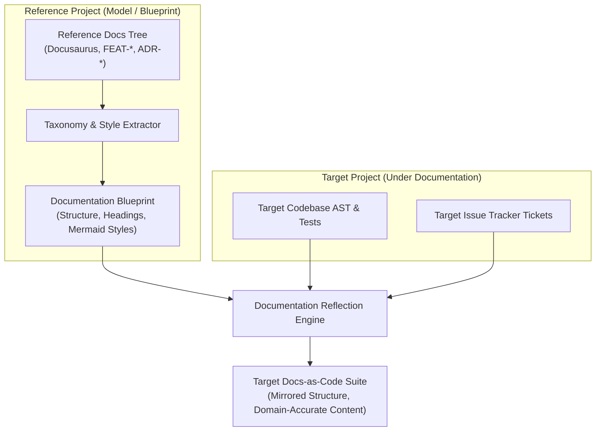

# FEAT-012: Automated Documentation Generation & Cross-Project Documentation Reflection

## 1. User Story & Business Objective
As a software architect and engineering lead managing multiple codebases, I need an automated documentation engine that synthesizes Docs-as-Code artifacts (`FEAT-*`, `ADR-*`, and API references) directly from code and tests, as well as a **Documentation Reflection** capability that uses an established reference project's documentation structure, style, and architectural patterns as a blueprint to generate matching, high-quality documentation for another project.

---

## 2. Technical Boundaries & Specifications

1. **Automated Documentation Synthesis**:
   - **Spec Extraction (`FEAT-*`)**: Analyzes test assertions, issue tracker descriptions, and code contracts to generate standardized feature specifications with YAML frontmatter.
   - **Decision Records (`ADR-*`)**: Generates Architecture Decision Records based on git diffs, dependency changes, and REA reverse-engineering findings.
   - **API & Schema Sync**: Compiles OpenAPI 3.1 and Markdown reference pages directly from AST symbol exports.
2. **Cross-Project Documentation Reflection**:
   - **Taxonomy & Structure Mirroring**: Analyzes the directory tree, frontmatter taxonomy, heading structures, and diagramming paradigms of a mature "Reference Project" (e.g., an enterprise core framework or well-documented microservice).
   - **Domain Contextualization**: Adapts the reference documentation blueprint to the target project's codebase, populating it with the target's actual types, dependencies, endpoints, and domain models rather than generic boilerplate.
   - **Style & Governance Transfer**: Enforces consistent terminology, Scrum acceptance criteria formats, and ADR reasoning patterns across heterogeneous projects in a team or enterprise.
3. **CLI Ergonomics**:
   - `dendrite doc gen --type feat|adr|api|readme`: Generates docs for the current workspace.
   - `dendrite doc reflect --reference ../reference-service --target .`: Reflects reference documentation taxonomy into the target project.

---

## 3. Acceptance Criteria & Verification Matrix

- [x] **AC-1**: `dendrite doc gen` extracts all public API endpoints and exports into validated Docusaurus Markdown with compliant YAML frontmatter.
- [x] **AC-2**: `dendrite doc reflect` reads a reference repository's docs folder and replicates its structural hierarchy, frontmatter schemas, and section taxonomy for the target project.
- [x] **AC-3**: Reflected documentation accurately references the target project's real functions, types, and dependencies with zero hallucinated identifiers.
- [x] **AC-4**: Generated architecture diagrams follow identical Mermaid layout styles as the reference documentation.

---

## 4. Definition of Done (DoD) & Persistence Verification

- **Automated Tests**: Unit tests assert frontmatter schema validation and AST symbol extraction accuracy; integration tests assert taxonomy matching between reference and target directories.
- **Persistent Layer Verification**: Generated documentation builds cleanly via Docusaurus Nginx container verified in [Testcontainers](https://rust.testcontainers.org).
- **Complexity Guardrails**: Extraction and reflection pipeline functions adhere to Cyclomatic Complexity $\le 10$, Cognitive Complexity $\le 12$.
