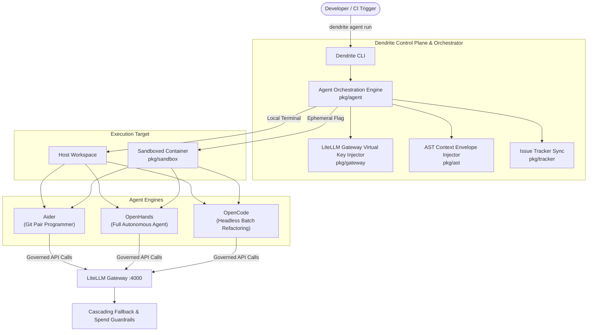

# FEAT-013: Autonomous Coding Agent Harness & Tool Orchestration (Aider, OpenHands, OpenCode)

## 1. User Story & Business Objective

As a software engineer and platform architect, I need Dendrite to natively support and orchestrate premier autonomous coding agents—specifically **Aider**, **OpenHands** (formerly OpenDevin), and **OpenCode**—by automatically bootstrapping their configurations, routing their API traffic through the LiteLLM Token Governance Gateway, enforcing sliding window budget caps and thermal curfews, injecting AST-compacted repository context, and executing them within ephemeral, cap-dropped container sandboxes with automated issue tracker status synchronization.

---

## 2. Technical Boundaries & Specifications

1. **Unified Agent Adapter Interface & Tool Registry (`pkg/agent`)**:
   - Provides a typed abstraction (`AgentRunner`) supporting multiple coding agent engines:
     - **Aider (`aider`)**: Terminal-centric CLI pair programming agent with tight Git repository integration and commit generation.
     - **OpenHands (`openhands`)**: Containerized autonomous software engineer capable of running arbitrary bash commands, editing code, and browsing documentation.
     - **OpenCode (`opencode`)**: Headless, lightweight automated code generation, refactoring, and batch pull-request agent.
2. **Automated Gateway Binding & Virtual Key Injection**:
   - Automatically generates ephemeral or workspace-scoped LiteLLM Virtual Keys for the agent session with strict budget ceilings (e.g. $5.00/session or $20.00/week).
   - Injects standard OpenAI/Anthropic environment variables into the agent runtime:
     - `OPENAI_API_BASE=http://<control-plane-host>:4000/v1`
     - `OPENAI_API_KEY=<dendrite-virtual-key>`
     - Model tier overrides (e.g., directing primary edits to `copilot-sonnet` and automated test generation to `local-qwen-coder`).
3. **AST Context Injection & Semantic Prompt Compaction**:
   - Prior to agent startup, extracts AST symbol graphs via `pkg/ast` and `pkg/devtool`, generating a compacted repository context envelope.
   - For Aider: Formats context as a repository map (`--map-tokens 2048` or custom repo prompt).
   - For OpenHands / OpenCode: Pre-loads the workspace context envelope into the initial prompt instructions.
4. **Sandboxed & Ephemeral Execution Modes**:
   - **Host Mode**: Runs directly in the developer's local terminal workspace (primarily for interactive Aider sessions).
   - **Ephemeral Sandbox Mode**: Spawns agent inside a cap-dropped, read-only root Docker container (`pkg/sandbox`) with an isolated scratch volume and automatic RAII teardown upon process exit.
5. **Issue Tracker & Git Provenance Linking**:
   - Links agent sessions to active tickets (e.g., `DEN-006` or Jira/Plane issue keys).
   - Formats git commit messages automatically: `[<TICKET-ID>] <Action Summary> (Agent: <aider|openhands|opencode>)`.
   - Posts session summaries and token spend metrics back to the active issue tracker.



---

## 3. Subcommand Specifications & Ergonomics

```bash
# 1. Run interactive Aider session bound to Dendrite's LiteLLM gateway and current ticket
dendrite agent run aider --ticket DEN-006 --model copilot-sonnet

# 2. Run OpenHands in an ephemeral sandbox to resolve an issue
dendrite agent run openhands --ticket PROJ-104 --sandbox --spend-limit 5.00

# 3. Run OpenCode in headless batch mode for automated refactoring
dendrite agent run opencode --task "Refactor pkg/ast to reduce cognitive complexity" --ephemeral

# 4. Display active and past agent sessions, spend metrics, and generated commits
dendrite agent session list
```

---

## 4. Acceptance Criteria & Verification Matrix

- [x] **AC-1**: `dendrite agent run <aider|openhands|opencode>` successfully configures the runtime environment with LiteLLM proxy base URL, virtual API keys, and model mappings without hardcoded secrets.
- [x] **AC-2**: When budget limits or thermal curfews are reached, the agent harness cleanly terminates the process, commits progress, and posts spend logs to the active issue tracker.
- [x] **AC-3**: Sandboxed execution (`--sandbox` / `--ephemeral`) boots the agent in an isolated container with zero unauthorized host filesystem mutations.
- [x] **AC-4**: Commits produced during agent sessions include structured ticket metadata and agent provenance tags.

---

## 5. Definition of Done (DoD) & Persistence Verification

- **Automated Tests**: Unit tests assert environment variable generation, argument rendering, and config validation across all three agent types with $\ge 85\%$ statement coverage.
- **Persistent Layer Verification**: Session history and spend records persisted in SQLite/PostgreSQL verified via real container instances using [Testcontainers](https://rust.testcontainers.org).
- **Complexity Guardrails**: Orchestrator functions adhere to Cyclomatic Complexity $\le 10$, Cognitive Complexity $\le 12$, and function length $\le 60$ LOC.
