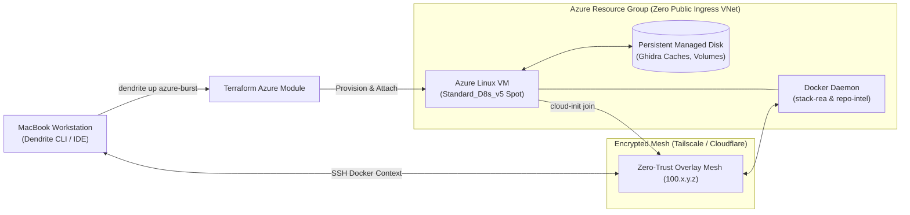

# FEAT-019: Azure Cloud Burst Provider & Topology Module

## 1. User Story & Business Objective
As an enterprise systems architect and DevOps engineer whose primary or multi-cloud infrastructure includes Microsoft Azure, I need Dendrite to support Azure as an elastic cloud-burst compute provider alongside AWS and local hardware. This capability enables provisioning on-demand or Spot Linux virtual machines (`Standard_D4s_v5`, `Standard_D8s_v5`) with persistent Azure Managed Disks (`StandardSSD_LRS` or `Premium_LRS`) and connecting them seamlessly to the private network mesh via Terraform, so that long-running reverse engineering tasks (headless Ghidra), AST repository indexing, and containerized coding agents run unthrottled in Azure without corrupting persistent state or draining developer laptop batteries.

> [!NOTE]
> **Core Architectural Scope**:
> Focus is placed on Linux VM Spot/On-Demand compute, persistent Managed Disk lifecycling, automated cloud-init bootstrap (Docker 26+, Tailscale / Cloudflare tunnel), and remote Docker-over-SSH contexts. Proprietary PaaS services (e.g. Azure OpenAI Service proxies, Azure Container Apps, Azure KeyVault hardware modules) are decoupled into secondary milestones.

---

## 2. Technical Boundaries & Specifications

1. **Terraform Azure Provider Integration (`infra/modules/azure-burst`)**:
   - Provider: `hashicorp/azurerm` (~> 3.90).
   - Core Resources:
     - `azurerm_linux_virtual_machine` (supports Spot eviction policy `Deallocate` with max bid price, or regular on-demand).
     - `azurerm_managed_disk` (data disk with persistent storage for Ghidra symbol caches, Tree-sitter databases, and PostgreSQL volume mounts).
     - `azurerm_virtual_machine_data_disk_attachment` to mount storage dynamically on boot.
     - `azurerm_network_security_group` enforcing **Zero Public Ingress**: inbound rule from `0.0.0.0/0:22` is prohibited. All administrative and data access occurs strictly through encrypted overlay networks (Tailscale, Cloudflare Tunnels, or private VNet peering).
     - `azurerm_public_ip` (optional, outbound-only NAT or strictly restricted).
2. **Cloud-Init Multi-Mesh Bootstrap**:
   - Automated bootstrap script configuring:
     - Docker Engine 26+ and Docker Compose v2.
     - Deployment user `deployer` with passwordless sudo and pre-shared Ed25519 SSH keys.
     - Automated join to the secure overlay network (Tailscale pre-authenticated auth-key or Cloudflare Tunnel daemon).
     - Auto-mounting and filesystem initialization of `/dev/disk/azure/scsi1/lun0` to `/var/lib/dendrite/storage`.
3. **Topology Placement Mapping**:
   - Scenario identifier: `azure-burst`.
   - Stack placement mapping:
     - `control_plane` $\to$ Azure VM (when traveling or operating without LAN Debian server).
     - `linux_re` (Ghidra headless) $\to$ Azure VM.
     - `repo_intel` (`ast-grep`, Tree-sitter) $\to$ Azure VM.
     - `inference` $\to$ Local MacBook Air (Metal GPU) or optional Azure GPU VM (`Standard_NC4as_T4_v3`).

---

## 3. Acceptance Criteria & Verification Matrix

- [ ] **AC-1**: Executing `dendrite up azure-burst` provisions the Azure Linux VM, provisions and attaches the persistent Managed Disk, configures cloud-init, and connects to the private mesh in $< 3.5\text{ minutes}$.
- [ ] **AC-2**: Network Security Group rules verify that zero public ports are accessible (`0.0.0.0/0:22` prohibited). Ingress is verified strictly via overlay network interfaces.
- [ ] **AC-3**: Graceful shutdown via `dendrite down` or Spot deallocation safely unmounts and detaches the Managed Disk without filesystem corruption, preserving all cached symbols and databases for subsequent attachment.
- [ ] **AC-4**: Teardown via `terraform destroy -target=module.azure_burst.azurerm_linux_virtual_machine` terminates compute billing while leaving the persistent Managed Disk intact.
- [ ] **AC-5**: Table-driven unit and integration tests achieve $\ge 85\%$ statement coverage in `pkg/orchestrator/azure`.

---

## 4. Definition of Done (DoD) & Persistence Verification

- **Automated Tests**: Terraform module syntax validation (`terraform validate`) and integration mocks verifying Azure Resource Manager envelope generation.
- **Persistent Layer Verification**: Integration tests assert Managed Disk detachment and remount idempotency using Testcontainers mock fixtures.
- **Complexity Guardrails**: Provisioning functions adhere to Cyclomatic Complexity $\le 10$, Cognitive Complexity $\le 12$, and LOC per function $\le 70$.
