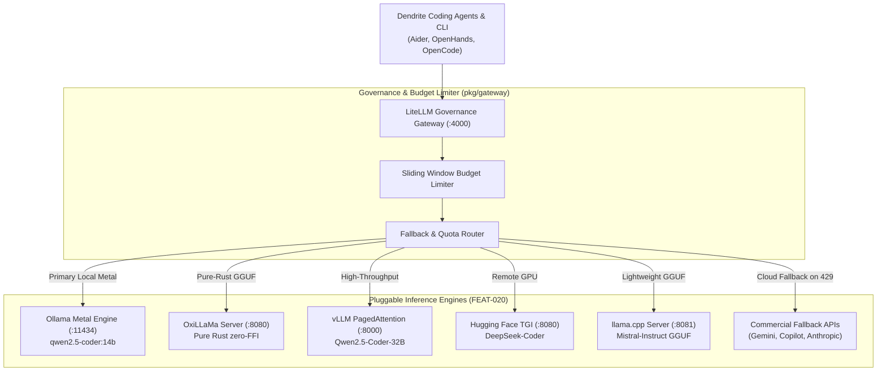

# FEAT-020: Pluggable Inference Engine Architecture & Multi-Provider Gateway

## 1. User Story & Business Objective
As an AI engineer and systems developer using local-first or hybrid LLM workflows, I need Dendrite to support multiple local and self-hosted inference engines—specifically **Ollama**, **OxiLLaMa (`cool-japan/oxillama`)**, **Hugging Face TGI/TEI**, **vLLM**, and **llama.cpp**—alongside commercial upstream APIs. This flexibility allows selecting the optimal runtime for each hardware tier (Apple Silicon Metal, remote NVIDIA CUDA servers, pure-Rust zero-FFI environments, or CPU-only nodes) while binding all inference calls to Dendrite's LiteLLM token governance, zero-cost accounting, and automatic fallback chains.

---

## 2. Technical Boundaries & Specifications

1. **Inference Provider Abstraction (`pkg/inference`)**:
   - Common interface decoupling execution from backend implementations:
     ```go
     type InferenceEngine interface {
         ID() string
         Type() EngineType // ollama, oxillama, huggingface_tgi, huggingface_endpoint, vllm, llamacpp
         Generate(ctx context.Context, req CompletionRequest) (*CompletionResponse, error)
         Stream(ctx context.Context, req CompletionRequest) (<-chan StreamChunk, error)
         Health(ctx context.Context) EngineHealth
         SupportedModels(ctx context.Context) ([]string, error)
     }
     ```
2. **Supported Inference Engines & Runtimes**:
   - **Ollama Engine (`pkg/ollama`)**:
     - Tailored for Apple Silicon Metal GPU acceleration and local workstation development.
     - Zero-cost token exemption in `pkg/gateway`.
     - Supports `qwen2.5-coder:14b`, `deepseek-coder:6.7b`, `llama3.2:3b`.
   - **OxiLLaMa Engine (`cool-japan/oxillama`)**:
     - 100% pure-Rust GGUF inference engine and OpenAI-compatible server (`oxillama-server`).
     - Eliminates all C, C++, and Fortran build toolchain dependencies and FFI overhead.
     - Memory-safe quantized inference with native GPU offloading via the KitaSan / SciRS2 ecosystem.
     - Ideal for pure-Rust sovereign server nodes and memory-constrained environments.
   - **Hugging Face Text Generation Inference (TGI)**:
     - Containerized high-performance inference engine for remote Linux GPU nodes (`ghcr.io/huggingface/text-generation-inference:2.4`).
     - Supports continuous batching, FlashAttention-2, and safetensors direct loading.
   - **Hugging Face Text Embeddings Inference (TEI)**:
     - Ultra-low-latency vector embedding engine (`ghcr.io/huggingface/text-embeddings-inference:1.5`) for semantic search and AST context compaction (`pkg/ai/tokenopt`).
   - **Hugging Face Inference Endpoints / Serverless API**:
     - Direct connector to hosted Hugging Face API (`https://api-inference.huggingface.co`) with token authentication and rate-limit backoff.
   - **vLLM Engine**:
     - High-throughput PagedAttention server for multi-agent concurrency and shared prefix caching.
   - **llama.cpp Server (`llama-server`)**:
     - Ultra-lightweight native C++ GGUF runner for CPU, Metal, or single-GPU environments with minimal memory footprint (<50MB runtime overhead).
3. **Integration with LiteLLM Token Governance Gateway (`pkg/gateway`)**:
   - Dynamic router configuration generating upstream model routes:
     ```yaml
     model_list:
       - model_name: local-coder
         litellm_params:
           model: ollama/qwen2.5-coder:14b
           api_base: http://localhost:11434
       - model_name: oxillama-rust
         litellm_params:
           model: openai/qwen2.5-coder-7b
           api_base: http://localhost:8080/v1
           api_key: "EMPTY"
       - model_name: hf-deepseek
         litellm_params:
           model: openai/deepseek-ai/DeepSeek-Coder-V2-Lite-Instruct
           api_base: http://tgi-node:8080/v1
           api_key: "EMPTY"
       - model_name: vllm-cluster
         litellm_params:
           model: openai/Qwen/Qwen2.5-Coder-32B-Instruct
           api_base: http://vllm-node:8000/v1
     ```
   - Zero-cost virtual key rate limits for self-hosted instances.



---

## 3. Acceptance Criteria & Verification Matrix

- [ ] **AC-1**: Dynamic LiteLLM template generator (`pkg/gateway`) supports registering Ollama, OxiLLaMa, Hugging Face TGI/TEI, vLLM, and llama.cpp backends through declarative scenario configuration.
- [ ] **AC-2**: Health probes periodically poll all configured inference engines and mark failing nodes offline within $< 2\text{ seconds}$, redirecting agent traffic to the next tier in the fallback chain.
- [ ] **AC-3**: Local and self-hosted inference engines (Ollama, OxiLLaMa, local llama.cpp) are exempt from financial dollar budgets while enforcing local concurrency and timeout limits.
- [ ] **AC-4**: Unified CLI commands `dendrite dev inference <list|probe|switch>` provide interactive status of active inference backends and loaded models.
- [ ] **AC-5**: Table-driven unit test suite achieves $\ge 85\%$ statement coverage across all provider adapters.

---

## 4. Definition of Done (DoD) & Persistence Verification

- **Automated Tests**: Integration tests verify OpenAI-compatible completions and streaming SSE chunks against mock HTTP backends.
- **Persistent Layer Verification**: Engine routing configurations and token usage logs are verified against PostgreSQL spend tables using Testcontainers.
- **Complexity Guardrails**: Engine adapter methods exhibit Cyclomatic Complexity $\le 8$, Cognitive Complexity $\le 10$.
