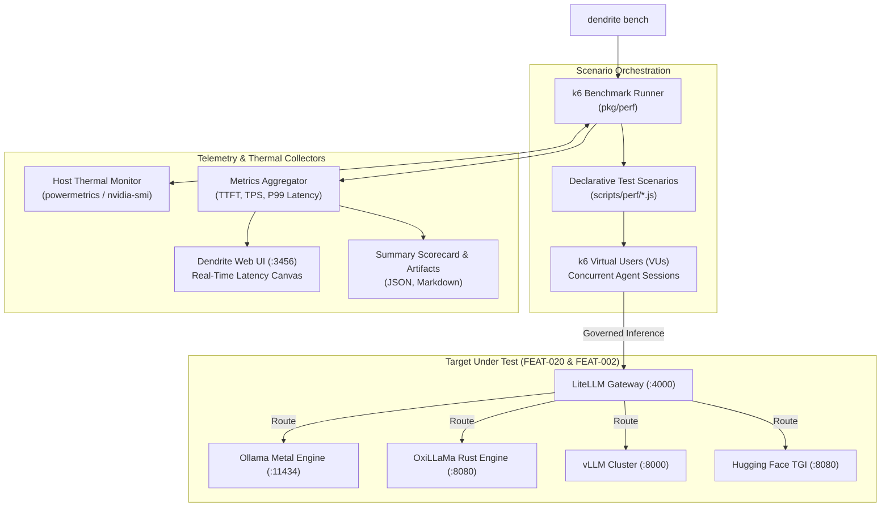

# FEAT-021: Performance Testing, Inference Benchmarking & Gateway Load Harness (k6)

## 1. User Story & Business Objective
As an AI platform engineer and QA architect, I need Dendrite to provide an automated, reproducible performance testing and benchmarking harness powered by **k6** to measure throughput, latency, concurrency limits, and failover cascades across local and remote inference engines (Ollama, OxiLLaMa, Hugging Face TGI/TEI, vLLM, and llama.cpp from [FEAT-020](file:///Users/yasuomaidana/GoLandProjects/Dendrite/docs/features/FEAT-020-pluggable-inference-engines.md)) and the LiteLLM Token Governance Gateway ([FEAT-002](file:///Users/yasuomaidana/GoLandProjects/Dendrite/docs/features/FEAT-002-token-budget-governance.md)). This enables development teams to stress-test agentic concurrency (10 to 500+ virtual users), measure Time-To-First-Token (TTFT) and Tokens-Per-Second (TPS), detect thermal-induced throttling on Apple Silicon, and verify that gateway fallback cascades trigger in $< 2\text{ seconds}$ without dropping active agent sessions.

---

## 2. Technical Boundaries & Specifications

1. **k6 Execution Engine & Runner (`pkg/perf`)**:
   - Integrates [k6](https://k6.io/) as both an embedded runner wrapper and a containerized executor via Testcontainers.
   - Supports declarative benchmark scenarios defined in TypeScript/JavaScript with Dendrite-specific metric extractors.
   - CLI invocation:
     ```bash
     # Benchmark specific inference engine from FEAT-020
     dendrite bench inference --engine oxillama --model qwen2.5-coder-7b --vus 20 --duration 60s

     # Stress-test LiteLLM gateway with fallback cascade fault injection
     dendrite bench gateway --rate 150 --max-vus 100 --inject-faults rate-limit-429

     # Full multi-engine matrix comparison
     dendrite bench matrix --engines ollama,oxillama,vllm,tgi --output report.json
     ```
2. **Inference Performance Metrics (LLM Benchmark Protocol)**:
   - **Time To First Token (TTFT)**: High-resolution timestamp from request dispatch to initial SSE chunk arrival ($p50, p95, p99$).
   - **Token Generation Velocity (TPS)**: $\frac{\text{Completion Tokens}}{\text{Stream Duration} - \text{TTFT}}$ per stream.
   - **Prompt Processing Speed**: Tokens per second evaluated during prompt ingestion/pre-fill.
   - **SoC Thermal Correlation**: Continuously polls `powermetrics` (Apple Silicon) or `nvidia-smi` (CUDA) during load tests to correlate token latency degradation with thermal throttling ($> 85^\circ\text{C}$).
3. **Gateway Load & Cascade Failover Stress**:
   - Simulates multi-agent surges hitting LiteLLM Token Governance Gateway (`:4000`).
   - Injects HTTP 429 (Rate Limit Exceeded) and HTTP 503 (Node Eviction / Network Glitch) to verify the automatic fallback router switches traffic to secondary/tertiary tiers in $< 2\text{s}$ while preserving SSE chunk streams.
   - Validates sliding window budget counters under concurrent writes without race conditions or database deadlocks in PostgreSQL/Redis.
4. **Metric Telemetry & Dashboard Integration**:
   - Real-time Prometheus metrics exporter (`:9102/metrics`) or direct WebSocket push to the Dendrite Web UI ([FEAT-009](file:///Users/yasuomaidana/GoLandProjects/Dendrite/docs/features/FEAT-009-dendrite-web-ui.md)).
   - Visual latency waterfall, TTFT histograms, and error-budget gauges embedded in the Web UI dashboard.



---

## 3. Idiomatic Design Patterns & Complexity Guardrails

1. **Typestate Pattern (Benchmark Session Lifecycle)**:
   - The test runner enforces explicit typestates preventing invalid operations (e.g., collecting metrics before execution):
     ```go
     type BenchmarkSession[State any] struct {
         id     BenchmarkRunID
         config BenchmarkConfig
         state  State
     }
     type Uninitialized struct{}
     type Provisioned struct{ Runner k6Runner }
     type Executing struct{ Cancel context.CancelFunc }
     type Completed struct{ Metrics BenchmarkSummary }
     ```
2. **Strategy Pattern (Execution Engines)**:
   - Decouples runner backends: `LocalK6Runner`, `ContainerizedK6Runner` (Testcontainers), and `SyntheticMockRunner`.
3. **RAII & Drop Semantics**:
   - Ephemeral virtual users, network sockets, temporary script bundles, and test containers are deterministically pruned using `defer` upon run completion or cancellation.
4. **Domain Newtypes**:
   - `type VirtualUsers uint32`
   - `type TTFT time.Duration`
   - `type TokensPerSecond float64`
   - `type BenchmarkRunID string`
5. **Complexity Thresholds**:
   - Maximum Cyclomatic Complexity $\le 10$ per function.
   - Maximum Cognitive Complexity $\le 12$ per function.
   - Maximum Function Length $\le 75$ lines.

---

## 4. Acceptance Criteria & Verification Matrix

- [ ] **AC-1**: `dendrite bench inference` executes concurrent k6 load against any backend specified in [FEAT-020](file:///Users/yasuomaidana/GoLandProjects/Dendrite/docs/features/FEAT-020-pluggable-inference-engines.md) and outputs TTFT ($p50, p95, p99$) and generation TPS.
- [ ] **AC-2**: Cascade failover scenario verifies that when the primary engine responds with 429 or drops connection, LiteLLM redirects agent traffic to the fallback tier within $< 2\text{ seconds}$ with zero lost prompts.
- [ ] **AC-3**: Concurrency stress testing with up to 100 VUs against the sliding window budget limiter in `pkg/gateway` records zero race conditions and zero over-allocation errors in PostgreSQL/Redis.
- [ ] **AC-4**: Apple Silicon thermal correlation flags an automated warning when SoC temperature exceeds $85^\circ\text{C}$ or throttling drops TPS by $\ge 20\%$.
- [ ] **AC-5**: Benchmarking results export to JSON and Markdown summary artifacts adhering to project Docs-as-Code standards.

---

## 5. Definition of Done (DoD) & Persistence Verification

- **Automated Tests**: Go table-driven unit tests for scenario builders, metric parsers, and runner lifecycle with $\ge 85\%$ statement coverage.
- **Persistent Layer Verification**: Gateway benchmark load verified against real PostgreSQL 16 spend tables and Redis 7 counters managed by Testcontainers.
- **Zero Linter Warnings**: `golangci-lint run` passes with zero issues.
