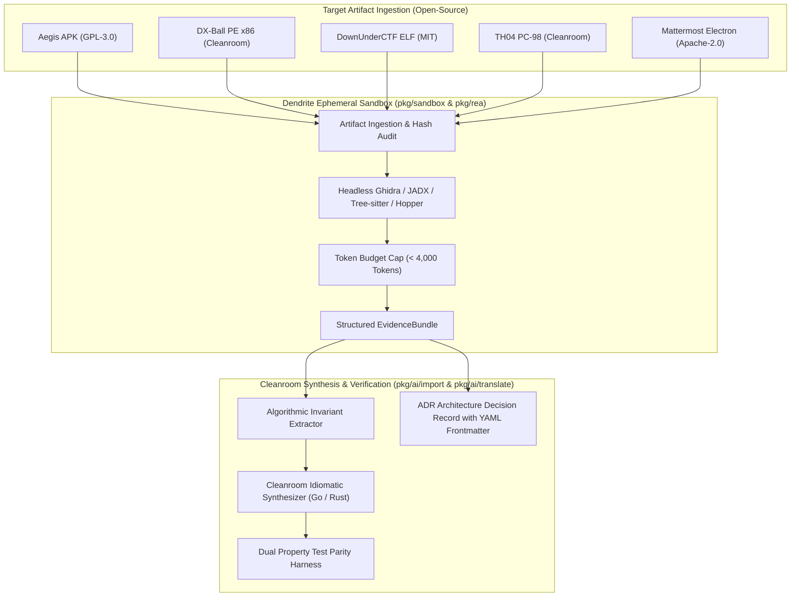

# FEAT-024: Open-Source Reverse Engineering Showcases & Cleanroom Parity Verification Suite

## 1. User Story & Business Objective
As a systems engineer, security researcher, and AI tool builder, I need a suite of concrete, fully open-source showcase targets integrated into Dendrite's REA reverse engineering pipeline (`pkg/rea`, `pkg/ai/import`, `pkg/sandbox`) so that users and automated CI pipelines can verify decompilation, evidence extraction, cleanroom code synthesis, and property test parity without infringing on proprietary copyrights, violating software licenses, or risking intellectual property entanglements.

---

## 2. Rationale: Mandatory Open-Source Criteria for Showcases

Closed-source targets (such as proprietary desktop apps like Notion) present significant compliance and operational friction:
1. **Intellectual Property & Licensing Risks**: Decompiling proprietary binaries or distributed Electron ASAR bundles often violates commercial Terms of Service (ToS) and Digital Millennium Copyright Act (DMCA) anti-circumvention provisions unless explicitly covered by narrow interoperability exceptions.
2. **Reproducibility in CI/CD**: Proprietary software cannot be legally redistributed, downloaded, or cached in headless continuous integration runners.
3. **Cleanroom Integrity**: Open-source targets provide verifiable reference source code that acts as a ground-truth "test oracle", allowing property testing to mathematically prove functional parity between the synthesized cleanroom implementation and the upstream specification.

---

## 3. Selected Open-Source Showcase Portfolio

| Showcase Project | Upstream Repository | Open-Source License | Target Type | Extracted Capability | Ground-Truth Oracle | Role / Substitution |
| :--- | :--- | :--- | :--- | :--- | :--- | :--- |
| **Aegis Authenticator** | `beemdevelopment/Aegis` | GPL-3.0 | Android APK / DEX | TOTP 6-digit algorithm & 30s clock step | RFC 6238 standard & Aegis test suite | Official REA showcase |
| **DX-Ball Reconstruction** | `N0zoM1z0/dx-ball` | Permissive Open Source (MIT) | Windows PE x86 (1996) | Position-to-pan sound calculation helper | 3,205 x86 test cases & 63 compiled bytes | Official REA showcase |
| **DownUnderCTF Flag Checker** | `DownUnderCTF` | Open Source / CC | Linux ELF x86_64 | Bitmask & modular arithmetic constraints | SMT solver & challenge verification binary | Official REA showcase |
| **TH04 Bullet Math** | `N0zoM1z0/th04` | Open Source Reconstruction | PC-98 DOS 16-bit | Fixed-point angle aiming trigonometry | Reconstructed C++ & Borland asm parity | Official REA showcase |
| **Mattermost Desktop** | `mattermost/desktop` | Apache-2.0 | Electron ASAR / JS | Preload IPC bridge & rich-text clipboard serialization | Mattermost Desktop test suite | **Open-source replacement for proprietary Notion** |

---

## 4. Technical Architecture & Verification Flow

---

## 5. Acceptance Criteria & Verification Matrix

- [ ] **AC-1 (Aegis Showcase)**: Automated extraction of `TOTP.java` algorithmic invariants from APK; synthesis of clean Go `pkg/rea/showcase/otp` generator passing RFC 6238 test vectors with 100% test parity.
- [ ] **AC-2 (DX-Ball Showcase)**: Containerized headless Ghidra disassembles position-to-pan routine from x86 binary; synthesizes clean C/Go function passing all 3,205 test vectors and reproducing 63 compiled function bytes.
- [ ] **AC-3 (DownUnderCTF Showcase)**: Linux ELF binary disassembled in sandboxed worker; arithmetic constraints extracted into SMT equations, automated solver yields correct flag string verified against challenge runner.
- [ ] **AC-4 (TH04 Showcase)**: 16-bit real-mode instructions parsed; fixed-point angle calculation synthesized in modern idiomatic Go/C++ with zero memory corruption vulnerabilities.
- [ ] **AC-5 (Mattermost Showcase)**: Mattermost Desktop ASAR inspected; preload context bridge and clipboard IPC paths mapped; client and test harness synthesized with zero proprietary Notion dependencies.
- [ ] **AC-6 (Token & Sandbox Budget Guardrails)**: Each showcase extraction strictly conforms to $< 4,000$ token evidence bundles and runs within the container sandbox (`cap_drop: [ALL]`).
- [ ] **AC-7 (CLI Showcase Runner)**: Command `dendrite rea showcase <target>` executes analysis, synthesis, and verification reporting in JSON and Markdown.

---

## 6. Definition of Done (DoD)

- **Test Suite**: Automated table-driven unit and integration tests under `tests/showcase` achieving $\ge 85\%$ statement coverage.
- **Complexity Guardrails**: Cyclomatic Complexity $\le 10$, Cognitive Complexity $\le 15$ across all showcase harnesses.
- **License Compliance**: Automated SPDX license auditor confirms 100% open-source compliance with zero proprietary or non-distributable binary blobs.
