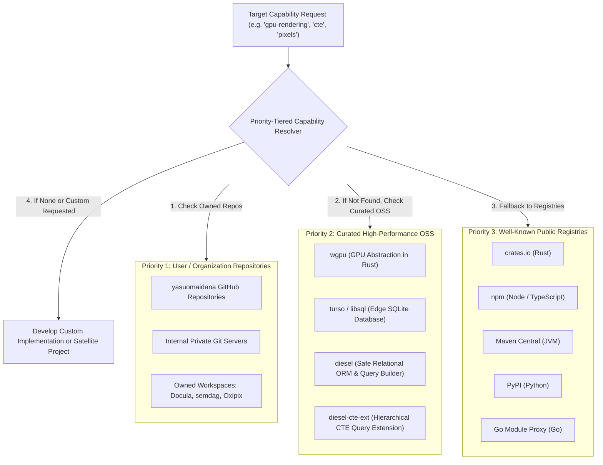

# FEAT-026: Distributed Codebase Ecosystem, Modular REA & Cross-Project Interoperability Coordinator

## 1. User Story & Architectural Concept

### What is a "Distributed Codebase"?
In modern multi-repository and organization-scale engineering, developers and projects rarely build everything in isolation from scratch. Instead, developers maintain their own internal repositories, git servers, and private packages containing established utilities, high-performance engines, and domain tools. In parallel, the broader open-source ecosystem provides proven registries (crates.io, npm, Maven, PyPI, Go proxy) and battle-tested libraries.

Re-implementing existing tools from scratch wastes token budgets, causes regression risks, and delays project delivery. The **Distributed Codebase Feature** turns Dendrite into an ecosystem-aware orchestrator that recognizes distributed sources, prioritizes user/organization-owned repositories first, seamlessly incorporates curated open-source engines, forcibly decomposes monolithic systems into reusable modules, and coordinates cross-project dependencies through local LLMs.

---

## 2. Priority-Tiered Source Resolution Architecture

Dendrite evaluates libraries and codebase hosts in strict priority order ($P_1 > P_2 > P_3$):

### Pre-Configured Ecosystem Sources
1. **Priority 1 (Own Repositories)**:
   - `yasuomaidana-repositories`: `https://github.com/yasuomaidana`
   - Owned projects: `Docula` (AST/Docs reflection), `semdag` (Semantic DAGs), `Oxipix` (SIMD imaging/pixels).
2. **Priority 2 (Curated OSS)**:
   - `wgpu`: `https://github.com/gfx-rs/wgpu` (GPU abstraction, Vulkan, Metal, DX12, WebGPU).
   - `turso`: `https://github.com/tursodatabase/libsql` (Edge SQLite database).
   - `diesel`: `https://github.com/diesel-rs/diesel` (Safe ORM and query builder).
   - `diesel-cte-ext`: `https://github.com/leynos/diesel-cte-ext` (CTE and recursive queries).
3. **Priority 3 (Public Registries)**:
   - `crates.io`, `npm`, `maven-central`, `pypi`, `go-proxy`.

---

## 3. Four Core Execution Scenarios

### Scenario 1: Modular REA with Ecosystem Reuse Probe
- **Forced Modular Decomposition**: By default, monolithic targets (binaries, decompiled code, legacy systems) are divided into bounded, single-responsibility modules.
- **Ecosystem Search & Reuse**: When Reverse Engineering Architecture (REA) analyzes an evidence bundle, it matches extracted function domains against the distributed codebase.
- **Custom Development Gate**: Dendrite only generates custom implementations if:
  1. An explicit user override exists (`UserRequestedCustom: true`), or
  2. A verified technical benefit is demonstrated (e.g., zero-copy memory layout, SIMD vectorization, sub-microsecond latency).

### Scenario 2: Parallel Repository & Project Spawning
- Decomposed sub-modules are generated as decoupled, autonomous codebases in parallel.
- Automatically handles filesystem scaffolding (`Cargo.toml`, `go.mod`, `package.json`, `README.md`), Git initialization (`git init`), and Dendrite workspace registration (`pkg/workspace`).

### Scenario 3: Interoperability Coordinator (Local LLM Managed)
- Coordinates multi-project dependencies across user-owned repositories (e.g. `Docula` depending on `semdag` and `Oxipix`).
- **Feature Gap Delegation**: When `Docula` needs a feature not yet in `Oxipix`, the coordinator:
  1. Detects `Oxipix` is owned (Priority 1) and dispatches a feature development ticket to `Oxipix`.
  2. Generates interim fallback code in `Docula` tagged with `// TODO(interop:Oxipix): Replace with Oxipix::feature once implemented`.
  3. Unblocks `Docula` development without stall (vital for 100% Rust translation or large-scale refactoring).
  4. Once `Oxipix` implements and verifies the feature, triggers reconciliation to apply the native integration patch to `Docula`.
  5. Local LLM governance uses zero-cost Apple Silicon Ollama (`qwen2.5-coder:14b`) to evaluate trade-offs and dispatch actions.

### Scenario 4: Generative Satellite Projects & Plane Project Lifecycle
- When translating a complex system (e.g. rewriting the CARLA simulator into 100% Rust), missing subsystems or foreign libraries are spun off into satellite side-projects (e.g. `carla-sensor-rs`, `carla-traffic-rs`).
- Automatically creates dedicated projects in Plane v2 (`POST /api/v1/workspaces/{slug}/projects/`) and tracks their tickets, milestones, and documentation independently.

---

## 4. Acceptance Criteria & Definition of Done

- [x] **Registry & Priority Resolver (`pkg/distcodebase`)**: Priority 1 own repos, Priority 2 curated OSS (`wgpu`, `turso`, `diesel`, `diesel-cte-ext`), Priority 3 registries.
- [x] **Forced Modular Decomposition Engine**: Decomposes targets into reusable modules, mapping existing ecosystem libraries.
- [x] **Interoperability Coordinator**: Dispatches cross-project feature requests, generates interim fallback code with `TODO(interop:...)` markers, and reconciles upon completion.
- [x] **Project & Plane Spawner**: Parallel project scaffolding with Git init, Dendrite workspace registration, and Plane v2 project creation.
- [x] **Native MCP Tools**: `dendrite_dist_sources`, `dendrite_dist_decompose`, `dendrite_dist_interop`, `dendrite_dist_spawn`.
- [x] **CLI Subcommands**: `dendrite dist <sources|resolve|decompose|interop|spawn>`.
- [x] **Test Coverage**: Automated test suites achieve $\ge 85\%$ statement coverage (Current: $89.2\%$).
