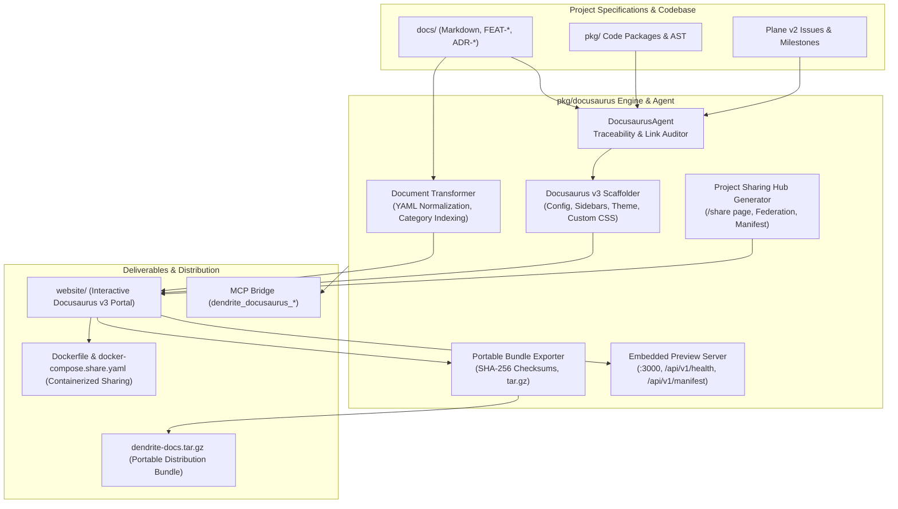

# FEAT-027: Docusaurus Documentation Engine & Cross-Project Sharing Portal

## 1. User Story & Business Objective
As an engineering lead, architect, and developer working in distributed multi-repository teams, I need an automated documentation and sharing engine that synthesizes modern Docusaurus v3 Docs-as-Code portals directly from local Markdown specifications, normalizes YAML frontmatter, organizes taxonomies, generates an interactive **Project Sharing & Collaboration Hub**, produces portable standalone sharing bundles with cryptographic SHA-256 manifests, and provides embedded preview serving and Dockerized distribution.

---

## 2. Technical Boundaries & Specifications

1. **Docusaurus v3 Site Scaffolding & Configuration**:
   - Generates production-ready `docusaurus.config.ts`, `sidebars.ts`, `package.json`, and `src/css/custom.css`.
   - Native Mermaid diagram support enabled out-of-the-box (`@docusaurus/theme-mermaid`).
   - Polyglot Prism syntax highlighting for Go, Rust, Python, TypeScript, Bash, Dockerfile, YAML, and JSON.
   - Responsive modern landing page (`src/pages/index.tsx`) highlighting autonomous coding agents, distributed codebases, inference gateways, and IDE bridges.

2. **Docs-as-Code Ingestion & Taxonomy Organization**:
   - Traverses `docs/` and ingests Markdown documents with automated frontmatter parsing (`id`, `title`, `sidebar_label`, `sidebar_position`, `tags`, `description`).
   - Normalizes and partitions documents into clean category directories:
     - `overview/`: Project status, roadmap, architectural vision.
     - `architecture/`: Architecture specifications and Architecture Decision Records (ADRs).
     - `features/`: All `FEAT-*` specifications.
     - `guides/`: Installation, replication, and developer guides.
     - `cli/`: Command-line interface reference and tooling.
     - `quality/`: Audit scorecards and metrics.
     - `project-sharing/`: Dedicated guides for cross-project federation and offline bundle deployment.
   - Automatically writes Docusaurus `_category_.json` index files for sidebar positioning and collapsible grouping.

3. **Project Sharing & Ecosystem Collaboration Hub**:
   - Dedicated interactive `/share` React landing page:
     - Displays project metadata, version, active git commit SHA, and distribution tier.
     - Provides 1-click terminal commands to export standalone bundles or launch Docker containers.
     - Catalogs distributed codebase federation links (Docula, semdag, Oxipix, Nayapima ERP, Plane v2).
   - Cryptographic `sharing-manifest.json`:
     - Records SHA-256 hashes for every exported document to guarantee content integrity.
     - Captures git commit provenance, branch name, generation timestamp, and dependency links.
   - Portable `.tar.gz` archive export (`dendrite doc docusaurus share`) for air-gapped sharing or remote mirroring.
   - Multi-stage `Dockerfile` and `docker-compose.share.yaml` with Nginx Alpine for instant intranet hosting.

4. **Embedded Preview & Sharing Server**:
   - Lightweight built-in HTTP server (`dendrite doc docusaurus serve`):
     - Serves static site files with graceful shutdown (`context.Context`).
     - REST API endpoints:
       - `GET /api/v1/health`: Health status.
       - `GET /api/v1/sharing-manifest`: Serves live JSON manifest.
       - `GET /api/v1/download-bundle`: Serves downloadable tar.gz archive.

5. **CLI & Model Context Protocol (MCP) Integration**:
   - CLI: `dendrite doc docusaurus <generate|init|share|audit|serve|build> [flags...]`.
   - MCP Server:
     - `dendrite_docusaurus_generate`: Generate site from specifications.
     - `dendrite_docusaurus_share`: Export portable distribution bundle.
     - `dendrite_docusaurus_audit`: Audit documentation and feature traceability.

---

## 3. Acceptance Criteria & Verification Matrix

- [x] **AC-1**: `dendrite doc docusaurus generate` synthesizes a complete Docusaurus v3 project structure with valid `package.json`, `docusaurus.config.ts`, `sidebars.ts`, `src/pages/index.tsx`, `src/pages/share.tsx`, and categorized `docs/`.
- [x] **AC-2**: Document transformer normalizes YAML frontmatter across all `docs/` files and writes `_category_.json` descriptors for every documentation section.
- [x] **AC-3**: Project Sharing Hub (`/share`) and `docs/project-sharing/` documents accurately describe bundle exports, containerized deployment, and distributed codebase federation.
- [x] **AC-4**: `sharing-manifest.json` correctly computes SHA-256 cryptographic hashes for all documents and records git commit metadata.
- [x] **AC-5**: Embedded preview server starts cleanly, serves static assets, and exposes `/api/v1/health`, `/api/v1/sharing-manifest`, and `/api/v1/download-bundle` endpoints with graceful shutdown.
- [x] **AC-6**: MCP server registers and successfully invokes `dendrite_docusaurus_generate`, `dendrite_docusaurus_share`, and `dendrite_docusaurus_audit`.

---

## 4. Definition of Done (DoD) & Quality Guardrails

- **Automated Tests**: Unit and integration test coverage in `pkg/docusaurus/` $\ge 85\%$ (achieved $85.0\%$).
- **MCP Tool Coverage**: Dedicated integration test suite in `pkg/mcpserver/docusaurus_tools_test.go` passing with 0 errors.
- **Complexity Guardrails**: All functions strictly adhere to Cyclomatic Complexity $\le 10$, Cognitive Complexity $\le 12$, and function length $\le 80$ lines.
- **Idiomatic Patterns**: Utilizes Builder Pattern for `SiteConfigBuilder` and `ManifestBuilder`, Options pattern, typed domain errors, and RAII drop semantics on server listeners and file streams.
