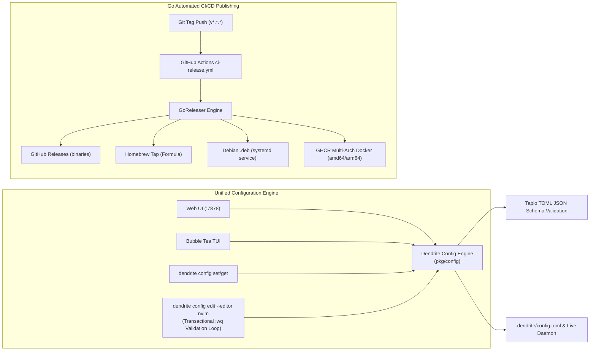

# FEAT-034: Dual-Mode Configuration Parity & Multi-Channel Go CI/CD Automation

## 1. Executive Summary & Problem Statement

### The Problem
Developer tools often suffer from configuration drift across their graphical interfaces, terminal TUIs, and command-line flags. Manual editing of TOML configuration files can lead to invalid configurations without immediate feedback. Additionally, distributing cross-platform Go tools across Homebrew, Debian servers (systemd), and cloud containers (GHCR) requires a reliable, automated release pipeline.

### User Story & Architectural Pillars
As a developer and system maintainer, I need:
1. **100% Configuration Parity**: Identical control over pool, store, token policy, and backups across Web UI (localhost:7878), SSH Terminal UI (Bubble Tea), ergonomic CLI commands (`dendrite config set/get`), and direct editing in `nvim`/`vim` with transactional staging, `:wq` validation loops, and JSON schema autocompletion.
2. **Multi-Channel Go CI/CD Publishing**: Automated GitHub Actions + GoReleaser pipeline releasing cross-compiled binaries to GitHub Releases, updating Homebrew Tap (`brew install yasuomaidana/tap/dendrite`), building Debian `.deb` packages with systemd units, and pushing multi-arch Docker images to GHCR.

---

## 2. Technical Architecture & Idiomatic Design Patterns

### 2.1 Transactional nvim/vim Editing & Schema Loop
- When `dendrite config edit --editor nvim [--section <name>]` is invoked:
  1. Stages `.dendrite/config.toml` into a temporary staging buffer.
  2. Launches `nvim +/^\[<section>\]` directly at the desired TOML table.
  3. On `:wq`, validates TOML syntax and schema ranges before applying to live daemon.
  4. If validation fails, re-opens `nvim +<line>` with the exact parser error.
- Every generated config includes taplo schema directives:
  `#:schema https://raw.githubusercontent.com/yasuomaidana/dendrite/main/schema/dendrite-config.schema.json`

### 2.2 GoReleaser Multi-Channel Packaging Pipeline
Configured in `.goreleaser.yaml` to generate:
- Binaries: Linux, macOS, Windows (amd64, arm64).
- Homebrew formula pushed to `yasuomaidana/homebrew-tap`.
- Debian package with `deploy/systemd/dendrite-daemon.service`.
- Multi-arch Docker images on `ghcr.io/yasuomaidana/dendrite`.

---

## 3. Acceptance Criteria & Definition of Done

- [ ] **AC-1 (Unified Configuration Parity)**: Identical configuration semantics across Web UI (:7878), SSH TUI, CLI (`config set/get`), and nvim/vim.
- [ ] **AC-2 (Transactional nvim/vim Staging)**: `:wq` validation loop with cursor positioning at offending line on syntax error and Taplo schema integration.
- [ ] **AC-3 (Multi-Channel GoReleaser Pipeline)**: Automated builds for linux/darwin/windows on amd64/arm64, Homebrew tap formula, and Debian `.deb` packages with systemd daemon.
- [ ] **AC-4 (GHCR Multi-Arch Containers)**: Publishes verified Docker images to `ghcr.io/yasuomaidana/dendrite`.
- [ ] **AC-5 (Scrum DoD & Pipeline Quality)**: Matrix tests and linters pass in CI before release triggering.
