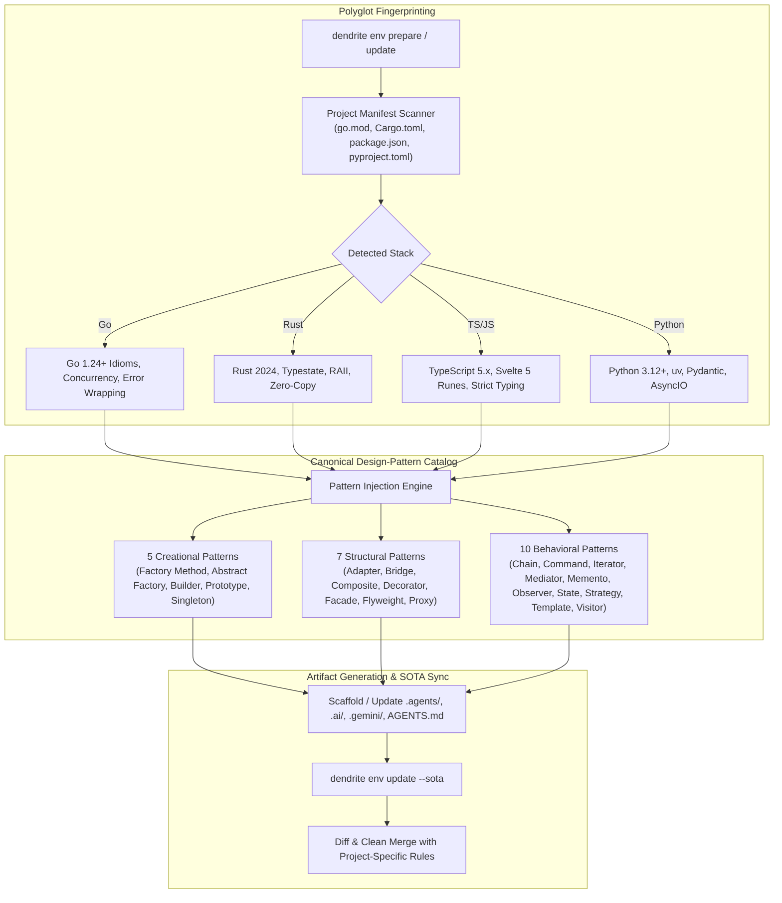

# FEAT-039: Polyglot Environment Bootstrapper & Canonical Design-Pattern Analyzer

## 1. Executive Summary & Problem Statement

### The Problem
AI coding assistants and autonomous agent frameworks depend heavily on repository instruction files (`.agents/`, `.ai/`, `.gemini/`, and `AGENTS.md`). In multi-project repositories, these files are often statically generated for a specific language (e.g., Rust-specific borrow-checker rules) and copied blindly into Go, TypeScript, Python, or embedded C projects, polluting agent attention with irrelevant syntax constraints.

Furthermore, when agents refactor code, they lack a comprehensive, language-tailored architectural taxonomy. Monolithic functions and sprawling `switch/if-else` blocks are rewritten without grounding in standard, proven software design patterns. Finally, agent instructions quickly grow stale as language versions evolve and industry best practices shift.

### User Story & Architectural Pillars
As a lead architect and polyglot engineer, I need `dendrite env prepare` and `dendrite env update` to:
1. Autonomously inspect project manifests (`go.mod`, `Cargo.toml`, `package.json`, `pyproject.toml`, `CMakeLists.txt`) to fingerprint the runtime stack and generate tailored `.agents/`, `.ai/`, `.gemini/`, and `AGENTS.md` instructions.
2. Embed a complete, language-adapted **Canonical Design-Pattern Analyzer** grounded in standard software engineering principles (22 patterns across Creational, Structural, and Behavioral categories).
3. Provide an autonomous SOTA updater (`dendrite env update --sota`) that discovers modern language idioms and merges updates cleanly without overwriting custom rules.

---

## 2. Technical Architecture & Idiomatic Design Patterns

### 2.1 The 22 Canonical Design-Pattern Taxonomy
Each generated pattern skill module contains:
- **Intent**: Core architectural purpose.
- **Problem / Code Smell**: Concrete symptoms in code (e.g. cyclomatic complexity $> 15$, deep nesting, God objects).
- **Language Applicability**: How the pattern manifests idiomatically in the detected language (e.g. Go interfaces and first-class functions vs. Rust traits and phantom types vs. TypeScript class hierarchies).
- **Refactoring Steps**: Step-by-step transformation instructions.
- **Over-Engineering Anti-Patterns**: Warnings against premature abstraction.

#### Complete Catalog Matrix
1. **Creational Patterns (5)**:
   - *Factory Method*: Virtual constructor decoupling object creation from caller.
   - *Abstract Factory*: Families of related objects without specifying concrete classes.
   - *Builder*: Step-by-step construction of complex objects with build-time validation.
   - *Prototype*: Cloning existing instances without dependency on concrete classes.
   - *Singleton*: Single instance guarantee (with concurrency/thread-safety caveats and Dependency Injection alternatives).
2. **Structural Patterns (7)**:
   - *Adapter*: Interface translation allowing incompatible types to collaborate.
   - *Bridge*: Decoupling abstraction from implementation for independent evolution.
   - *Composite*: Tree structures of objects treated uniformly.
   - *Decorator*: Dynamic behavior addition via wrappers without inheritance.
   - *Facade*: Simplified interface to a complex library or subsystem.
   - *Flyweight*: Shared common state to fit massive object counts in RAM.
   - *Proxy*: Placeholder controlling access, caching, or lazy initialization.
3. **Behavioral Patterns (10)**:
   - *Chain of Responsibility*: Request passing along a handler chain.
   - *Command*: Encapsulating requests as stand-alone objects with undo/queue support.
   - *Iterator*: Sequential traversal of complex collections without exposing underlying representation.
   - *Mediator*: Restricted direct communications between components through a central coordinator.
   - *Memento*: Capturing and restoring object internal state without violating encapsulation.
   - *Observer*: Subscription mechanism notifying multiple objects of events.
   - *State*: Altering object behavior when internal state changes (Typestate in Rust/Go).
   - *Strategy*: Interchangeable algorithm family selected at runtime.
   - *Template Method*: Skeleton algorithm in superclass deferring specific steps.
   - *Visitor*: Adding operations to existing object structures without modifying them.

### 2.2 SOTA Updater Engine
The updater executes a 3-way semantic diff:
$$\text{Base Template} \oplus \text{Project Customizations} \oplus \text{Upstream SOTA Idioms} \implies \text{Merged Instructions}$$
Custom user-defined rules in `AGENTS.md` are marked with `<!-- USER_RULE_START -->` and are strictly preserved across updates.

---

## 3. Behavioral Scenarios (Gherkin)

### Scenario 6A: Customizing Agent Files for a Non-Rust Project
- **Given** a Go + Svelte 5 repository currently contains legacy Rust-oriented `.agents/` and `AGENTS.md` files
- **When** the user runs `dendrite env prepare`
- **Then** Dendrite detects Go and Svelte 5, replaces Rust-specific cargo/borrow-checker instructions with idiomatic Go concurrency, error wrapping, and Svelte 5 runes rules across `.agents/`, `.ai/`, `.gemini/`, and `AGENTS.md`, and configures `.gitignore`.

### Scenario 6B: Design-Pattern Analysis Against Canonical Catalog
- **Given** the design-pattern analyzer skill is generated by `dendrite env prepare`
- **When** an agent audits a module with sprawling `switch/if-else` state transitions
- **Then** the skill references the Behavioral catalog (specifically `State` and `Strategy` patterns), diagnoses the smell, and proposes an idiomatic refactoring tailored to the repository's language.

### Scenario 6C: SOTA Best-Practices Sync
- **Given** an existing project with initialized agent directories
- **When** the user executes `dendrite env update --sota`
- **Then** Dendrite queries state-of-the-art best practices for the detected tech stack, displays a diff of recommended updates to `.agents/`, `.ai/`, `.gemini/`, and `AGENTS.md`, and merges the improvements without overwriting custom rules.

---

## 4. Acceptance Criteria & Definition of Done

- [ ] **AC-1 (Polyglot Fingerprinting)**: Inspects manifests and correctly identifies Go, Rust, TS/JS, Python, and C/C++ environments.
- [ ] **AC-2 (Canonical Pattern Catalog Injection)**: Generates all 22 standard design pattern specifications adapted to the target language.
- [ ] **AC-3 (Non-Destructive SOTA Update)**: `dendrite env update --sota` updates base instructions while strictly preserving project-specific custom sections.
- [ ] **AC-4 (DoD & Complexity Thresholds)**: Generated files conform to schema; cyclomatic complexity $\le 15$; cognitive complexity $\le 20$; test coverage $\ge 85\%$.
