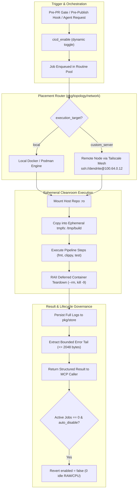

# FEAT-043: Local & Custom-Server Ephemeral CI/CD Routine & Mesh Runner

## 1. Executive Summary & Problem Statement

### The Problem
Small engineering teams, open-source maintainers, and independent developers face significant roadblocks with existing CI/CD systems:
1. **Runner Cost & Cloud Waste**: Public cloud runners (GitHub Actions hosted minutes) incur compounding bills or strict queue limits for compute-heavy verification steps (e.g. `cargo clippy`, integration tests, k6 benchmarks).
2. **Idle Resource Drain in Self-Hosted Daemons**: Traditional self-hosted runners run continuous polling daemons and open background listeners, consuming battery and RAM on local developer workstations.
3. **Dirty Workspace & Contaminated State**: Non-ephemeral build runners share build directories, node_modules, and target folders, leading to subtle state contamination, leaked artifacts, and untrusted side-effects between runs.
4. **Context Window Exhaustion for AI Agents**: Raw CI/CD logs produce thousands of lines of output that quickly exceed LLM context windows and waste token budgets when agents attempt autonomous fixes.

### Architectural Pillars & Solution
FEAT-043 establishes a lightweight, self-hosted **Ephemeral CI/CD Routine** (`pkg/routines/cicd` / `internal/routines/cicd`) seamlessly orchestrated by Dendrite:
1. **Disabled by Default & Dynamic On-Demand Activation**: The routine defaults to `enabled = false` in `dendrite.toml`, consuming zero idle CPU/RAM. Authorized agents or orchestrator hooks dynamically enable it (`cicd_enable`) on demand and automatically revert it to disabled (`auto_disable_after_run = true`) when the active queue drains.
2. **Strict Ephemeral Execution Sandboxes (`ephemeral = true`)**: Every pipeline job executes in a fresh, disposable container environment (`--rm`, isolated bridge network, `tmpfs` workspace mounted to `/tmp/build`) where the host workspace is mounted read-only (`:ro`). The container is completely destroyed upon job completion, timeout, or failure.
3. **Local vs. Custom-Server Routing over Mesh**:
   - `target = "local"`: Executes on the developer workstation's Docker/Podman engine via `pkg/pool`.
   - `target = "custom_server"`: Seamlessly tunnels execution to a designated remote Execution Plane node (e.g. Debian builder at `100.64.0.12`) over Dendrite's Tailscale/WireGuard mesh (`pkg/topology/network`), offloading heavy compilation while keeping workstation resources free.
4. **Pluggable Execution Backends**:
   - `container` (Default): Native Docker/Podman ephemeral execution.
   - `github_ephemeral_runner`: Registers a one-time self-hosted GitHub Actions runner (`--ephemeral`) that consumes a single queued workflow job and immediately de-registers and purges its state.
5. **Token-Budget Log Tailing & Diagnostic Extraction**: Captures full raw logs to persistent store (`pkg/store`), but returns only compact, high-signal diagnostics ($\le 2048$ bytes / 40 lines of error tail, failing stage, exit code) over MCP.



---

## 2. Technical Architecture & Idiomatic Design Patterns

### 2.1 RAII Teardown & Ephemeral Container Lifecycle
To ensure zero zombie containers or leaking disk state, the ephemeral runner uses deterministic `defer` blocks:
```go
// Enforce immediate and forceful cleanup
defer func() {
    if cfg.Ephemeral {
        killCmd := exec.Command("docker", "rm", "-f", runID)
        if cfg.ExecutionTarget == TargetCustomServer && cfg.RemoteDockerHost != "" {
            killCmd.Env = append(killCmd.Environ(), fmt.Sprintf("DOCKER_HOST=%s", cfg.RemoteDockerHost))
        }
        _ = killCmd.Run()
    }
}()
```
The workspace is mounted strictly `:ro` (`-v repo_path:/workspace:ro`), and files are copied into a memory-backed tmpfs (`/tmp:rw,exec,size=2g`). This guarantees that host git tracking is immune to malicious or accidental in-container mutations.

### 2.2 Typestate Pattern for Pipeline Jobs
Pipeline execution transitions through strict typestate phases:
- `Pipeline<Queued>`: Registered in active pool, resource limit allocated.
- `Pipeline<Spawning>`: Ephemeral container initialized on local or remote target.
- `Pipeline<Executing>`: Step execution loop streaming output to store.
- `Pipeline<Teardown>`: Container purged, tmpfs discarded.
- `Pipeline<Completed>`: Status synthesized with pass/fail and error tail.

### 2.3 Tailscale Mesh Offloading (`custom_server`)
When `execution_target = "custom_server"`, Dendrite bypasses public ingress ports and leverages the encrypted Tailscale mesh (`100.64.0.0/10` CGNAT subnet). Remote execution is routed via SSH socket or Docker daemon socket over WireGuard with zero public open ports.

---

## 3. Configuration Specification (`dendrite.toml`)

```toml
# ============================================================================
# ROUTINE: LOCAL & CUSTOM-SERVER EPHEMERAL CI/CD
# ============================================================================
[routines.cicd]
enabled = false                  # DISABLED BY DEFAULT to save resources on small setups
allow_dynamic_enable = true      # Allows MCP tool / orchestrator to enable on-demand
auto_disable_after_run = true    # Automatically revert to disabled once triggered jobs finish
ephemeral = true                 # Destroy execution environment and state after every job
backend = "container"            # Options: "container" (Docker/Podman) | "gh_runner" (act / GitHub Runner)
execution_target = "local"       # Options: "local" | "custom_server"
max_concurrent_jobs = 2
job_timeout_sec = 1800

[routines.cicd.custom_server]
# Used when execution_target = "custom_server"
node_name = "debian-builder-01"
use_tailscale_mesh = true        # Route via Dendrite's network.go Tailscale/WireGuard layer
remote_docker_host = "ssh://dendrite@100.64.0.12"
work_dir = "/tmp/dendrite-ephemeral-ci"

[routines.cicd.container_defaults]
rust_image = "rust:1.85-slim-bookworm"
cpu_limit = "4.0"
memory_limit = "8g"
mount_cargo_cache = false        # Keep false for strict ephemeral purity; true for speed
```

---

## 4. MCP Tools Catalog & JSON-RPC 2.0 Schemas

| Tool Identifier | Description | Input Parameters | Output Response |
|:---|:---|:---|:---|
| `cicd_status` | Returns whether the CI/CD routine is enabled, active runner backend, execution target, and queue depth. | `{}` | `enabled` (bool), `backend`, `execution_target`, `active_jobs` (int), `ephemeral` (bool). |
| `cicd_enable` | Dynamically enables or disables the CI/CD routine at runtime with ephemeral and auto-disable overrides. | `enabled` (bool), `ephemeral` (optional bool), `auto_disable` (optional bool) | `status` ("updated"), `current_state`. |
| `cicd_run_pipeline` | Triggers immediate ephemeral pipeline run for specified repo path, commit, and steps. | `repo_path` (string), `commit` (string), `steps` ([]string), `image` (string), `target` (optional string) | `run_id`, `success` (bool), `duration_ms`, `ephemeral_used`, `target_host`, `error_tail` (string, max 2048 chars). |

---

## 5. Definition of Done & Quality Guardrails

1. **Goal Traceability**: All functional requirements verified by table-driven unit tests and integration tests under `pkg/routines/cicd`.
2. **Persistent Layer Testing via Testcontainers**: Ephemeral execution verified using Testcontainers to launch throwaway Docker/Podman daemon fixtures and mock remote SSH mesh nodes.
3. **Coverage Threshold**: Code coverage $\ge 85\%$ across all CI/CD routine packages.
4. **Pattern & Complexity Standards**:
   - Zero production unwraps or panics.
   - Clean RAII drop semantics on SIGINT/SIGTERM.
   - Cyclomatic Complexity $\le 15$, Cognitive Complexity $\le 20$ per function.
   - Maximum function length $\le 80$ lines.
