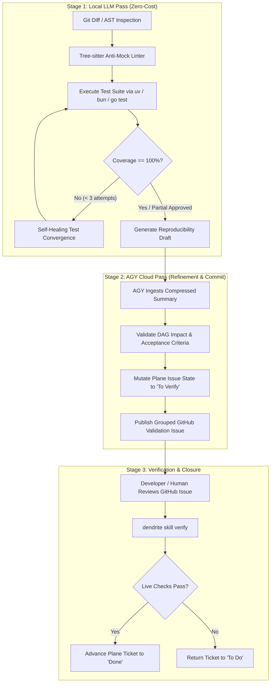

# FEAT-044: Two-Stage LLM Governance, Zero-Mock Policy & uv/bun Toolchain Migration

## 1. Executive Summary & Context
In accordance with Dendrite's enterprise AI token economy and zero-mock testing philosophy, FEAT-044 establishes:
1. **Two-Stage LLM Governance Pipeline**: Enforces a strict local-first model triage (Ollama Metal / `qwen3.5:9b` / `llama3.2`) for drafting and AST scanning, followed by cloud escalation to Google Antigravity (AGY) only for strategic DAG verification and state commitment.
2. **Strict Zero-Mock Testing Policy**: Banned test doubles (mocks, stubs, fakes, monkey patching) across all code paths. All verifications must execute against live services or ephemeral container stacks (Docker/Testcontainers).
3. **100% Statement Coverage Guard & The `To Verify` Workflow State**: Prevents tickets from prematurely moving to `Done`. Features must pass a 100% coverage threshold across 3 retry attempts before entering the intermediate `To Verify` status in Plane.
4. **Toolchain Modernization**: Standardizes project dependency management and script execution on `uv` (replacing legacy `pip`) and `bun` (replacing legacy `npm`).

---

## 2. Architecture & Operational Workflows



### 2.1 Two-Stage Pipeline Specification
- **Stage 1 (Local Model)**:
  - Hardware/Runtime: Ollama Metal (`localhost:11434`) using `llama3.2` or `qwen3.5:9b`.
  - Tasks: Tree-sitter AST queries searching for banned mock packages (`gomock`, `testify/mock`, `unittest.mock`, `jest.fn()`).
  - Command execution: `uv run pytest`, `bun test`, `go test -cover`.
  - Token Cost: **$0.00** (Zero commercial cloud spend).
- **Stage 2 (AGY Engine)**:
  - Hardware/Runtime: Google Antigravity (Gemini Cloud API).
  - Tasks: Cross-repo DAG topological reachability, updating Plane tickets, emitting formatted GitHub issues.

### 2.2 Toolchain Modernization (`uv` & `bun`)
- All Python tools (`scripts/`, `bench/`, `agents/`) must use `uv`:
  ```bash
  uv venv
  uv pip sync requirements.txt
  uv run python <script.py>
  ```
- All TypeScript/JavaScript tools (`web/`, `plugins/vscode/`) must use `bun`:
  ```bash
  bun install --frozen-lockfile
  bun test --coverage
  bun run build
  ```

---

## 3. Plane Tickets

| Ticket ID | Title | Priority | Estimate | Milestone | Start Date | Target Date | Blocked By |
|:---|:---|:---:|:---:|:---|:---:|:---:|:---|
| **DEND-101** | [Anti-Mock Guard]: Tree-sitter AST mock detection & pre-commit hook | Urgent | 5 SP | Milestone 19 | 2027-01-07 | 2027-01-10 | DEN-038 |
| **DEND-102** | [Verification Routine]: Plane `To Verify` intermediate state & `dendrite verify` skill | High | 5 SP | Milestone 19 | 2027-01-11 | 2027-01-14 | DEND-101 |
| **DEND-103** | [Toolchain Migration]: Standardize build & test tooling on `uv` and `bun` | Medium | 3 SP | Milestone 19 | 2027-01-15 | 2027-01-19 | DEND-102 |

---

## 4. Grouped GitHub Validation Issues

### GitHub Issue #1: Validate Anti-Mock Guard, 100% Coverage Verification Routine, and `To Verify` Workflow
- **Covers Plane Tickets**: `DEND-101`, `DEND-102`
- **Acceptance Criteria**:
  1. AST scanner flags any PR or file introducing mock libraries.
  2. Test runner enforces 100% statement coverage across target packages.
  3. Plane issues transition to `To Verify` rather than directly to `Done`.
  4. Executing `dendrite skill verify <id>` inspects git cleanliness and promotes status to `Done`.
- **Replication & Evaluation Instructions**:
  ```bash
  # 1. Run Tree-sitter AST anti-mock check across packages
  dendrite audit anti-mock --scan pkg/

  # 2. Run automated test suite with coverage assertion
  go test -coverprofile=coverage.out ./pkg/tracker/...
  go tool cover -func=coverage.out | grep total | awk '{print $3}'

  # 3. Simulate ticket verification routine
  dendrite skill ticket-relate --ticket DEND-102 --priority high
  dendrite skill verify DEND-102 --dry-run
  ```

### GitHub Issue #2: Validate `uv` and `bun` Toolchain Modernization
- **Covers Plane Ticket**: `DEND-103`
- **Acceptance Criteria**:
  1. Zero invocation of legacy `pip` or `npm` across build and test scripts.
  2. Python environments resolve via `uv.lock`.
  3. Web and node tooling execute with sub-second startup using `bun`.
- **Replication & Evaluation Instructions**:
  ```bash
  # 1. Verify uv presence and lockfile integrity
  uv --version
  uv pip list

  # 2. Verify bun presence and test execution
  bun --version
  ```
