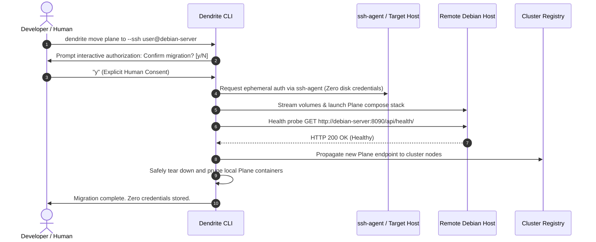

# FEAT-047: Infrastructure Mobility, Remote SSH Plane Migration & Penpot Lifecycle

## 1. Executive Summary & Context
As multi-node topologies scale, services must migrate dynamically between workstations, on-prem servers, and cloud hosts. FEAT-047 formalizes:
1. **Interactive SSH Service Migration (`dendrite move <svc> to --ssh <target>`)**: Migrates running containerized services (e.g., self-hosted Plane v2) to a remote Debian SSH server, requiring explicit human terminal authorization, zero persistent storage of credentials, remote health validation, and safe local resource reclamation.
2. **Service Provisioning Lifecycle (`dendrite service start <svc>`)**: Starts and provisions infrastructure stacks (exemplified by Penpot design tooling) without mock abstractions.
3. **Cross-Node Update Propagation (`dendrite cluster sync`)**: Propagates updated endpoint URLs, certificates, and API tokens across all connected nodes in the mesh.

---

## 2. Secure Migration Workflow & Permission Model



### 2.1 Security & Credential Invariants
- **Zero Credential Persistence**: Private keys, passwords, or tokens are **never** written to local disk, `.env` files, logs, or persistent SQLite stores. Ephemeral authentication delegates strictly to active `ssh-agent` sockets.
- **Mandatory Interactive Gate**: Any migration command that deletes local containers requires interactive terminal confirmation. Unattended `--force` flags without TTY fail immediately.
- **Atomic Rollback**: If remote health probes fail within 120 seconds of volume transfer, local services remain running and remote artifacts are cleaned up.

---

## 3. Plane Tickets

| Ticket ID | Title | Priority | Estimate | Milestone | Start Date | Target Date | Blocked By |
|:---|:---|:---:|:---:|:---|:---:|:---:|:---|
| **DEND-401** | [Infra - Migration]: Zero-credential SSH service migration (`move <svc> to --ssh`) | Urgent | 8 SP | Milestone 13 | 2026-10-14 | 2026-10-16 | DEN-032 |
| **DEND-402** | [Infra - Start]: Mock-free service lifecycle manager with Penpot compose/MCP provisioning | High | 5 SP | Milestone 12 | 2027-01-30 | 2027-02-01 | DEN-031 |
| **DEND-403** | [Infra - Sync]: Cross-node endpoint & schema update propagation (`dendrite cluster sync`) | High | 5 SP | Milestone 13 | 2026-10-17 | 2026-10-18 | DEND-401 |

---

## 4. Grouped GitHub Validation Issues

### GitHub Issue #7: Validate Moving Plane to a Remote Debian SSH Server & Propagating Endpoint Updates
- **Covers Plane Tickets**: `DEND-401`, `DEND-403`
- **Acceptance Criteria**:
  1. Audit confirms zero plain-text credentials written to logs or disk.
  2. Migration prompts for interactive human authorization.
  3. Remote Plane passes health check on port `8090`.
  4. Local Plane containers and volumes are pruned cleanly after confirmed remote readiness.
  5. Cluster nodes update their `PLANE_API_URL` without restart.
- **Replication & Evaluation Instructions**:
  ```bash
  # 1. Audit migration pipeline for mocks and credential persistence
  dendrite audit module infra/migrate --assert-no-mocks

  # 2. Execute migration (interactive prompt)
  dendrite move plane to --ssh user@debian-server

  # 3. Verify remote health and local cleanup
  curl -s http://debian-server:8090/api/health/
  docker ps | grep plane && echo "FAIL: local still active" || echo "PASS: local cleaned"

  # 4. Confirm cluster sync propagation
  dendrite cluster sync --verify-propagation
  ```

### GitHub Issue #8: Validate Provisioning & Starting Penpot Service
- **Covers Plane Ticket**: `DEND-402`
- **Acceptance Criteria**:
  1. `dendrite service start penpot` spins up PostgreSQL, Redis, backend, frontend, and exporter.
  2. Penpot MCP bridge responds to design token queries.
- **Replication & Evaluation Instructions**:
  ```bash
  # 1. Start Penpot stack
  dendrite service start penpot --target local --verify-mcp

  # 2. Check health of all 5 Penpot containers
  dendrite service health penpot --deep
  ```
