# FEAT-048: REA Cross-Platform Binary Analysis & Ticket Relationship Governance

## 1. Executive Summary & Context
FEAT-048 completes the engineering requirements for:
1. **macOS PE/EXE Binary Analysis with Pause & Resume**: Allows macOS developer workstations to dissect Windows x86_64 PE binaries (`.EXE`) using local models (`qwen3.5:9b`), pausing at arbitrary checkpoints, persisting intermediate CFG state in remote stores, and resuming seamlessly.
2. **Multi-Tier Inference Triage**: Local LLMs evaluate control-flow complexity. Simple basic blocks are decompiled locally ($0.00 spend). Obfuscated or high-cyclomatic functions escalate to commercial cloud models.
3. **Remote Knowledge Storage & Safe Purge (`dendrite rea purge`)**: Persists extracted ASTs, structs, and call graphs in remote Turso/PostgreSQL instances, with safe deletion routines when analysis is concluded.
4. **Ticket Connection & Priority Skill (`dendrite chronos relate`)**: Provides a manual and automated CLI/MCP skill enabling humans and agents to link blocker relations (`blocked_by`, `blocking`, `relates_to`), update priorities, and ensure Gantt chart dependency arrows render in Plane.

---

## 2. REA Architecture & Ticket DAG Synchronization

```mermaid
flowchart TD
    subgraph REA["REA Binary Analysis Pipeline (macOS)"]
        EXE[Windows .EXE Binary] --> PEParser[Go PE/COFF Header & Section Parser]
        PEParser --> CFG[Disassemble Control Flow Graph]
        CFG --> Triage{Local LLM Triage<br/>Cyclomatic Complexity <= 15?}
        Triage -- Yes --> LocalDecompile[Local Model Decompiles to Rust Structs]
        Triage -- No --> PauseGate[Pause Checkpoint & Prompt Paid Escalation]
        PauseGate --> CloudDecompile[Paid Cloud Model Synthesizes Clean Rust]
        LocalDecompile --> RemoteStore[Persist Segments to Remote Knowledge Store]
        CloudDecompile --> RemoteStore
        RemoteStore --> PurgeCmd["dendrite rea purge (Safe Memory Reclaim)"]
    end

    subgraph Tickets["Ticket Connection & Priority Governance"]
        HumanAgent[Human / Autonomous Agent] --> CreateTicket[Ticket Created in Plane]
        CreateTicket --> SkillRelate["dendrite chronos relate<br/>--ticket <id> --priority <prio> --blocked-by <ids>"]
        SkillRelate --> PlaneAPI[Plane REST API: /api/workspaces/.../issue-relation/]
        PlaneAPI --> GanttArrow[Plane Gantt View Renders Dependency Arrows]
    end
```



### 2.1 REA macOS PE Analysis Protocol
1. **Analyze**: `dendrite rea analyze sample.exe --format pe64 --tier local`
2. **Pause**: `dendrite rea pause --analysis-id <ID>` (persists register state, disassembled basic blocks, and checkpoint token to remote store).
3. **Resume with Model Switch**: `dendrite rea resume --analysis-id <ID> --model paid-cloud-pro`
4. **Export Cleanroom Rust**: `dendrite rea export --analysis-id <ID> --target-language rust --output pkg/engine/`
5. **Safe Memory Purge**: `dendrite rea purge --analysis-id <ID> --force`

### 2.2 Ticket Connection & Priority Skill Specification
- Command signature:
  ```bash
  dendrite chronos relate \
    --ticket <ID> \
    [--priority urgent|high|medium|low] \
    [--blocked-by <TICKET_A,TICKET_B>] \
    [--blocking <TICKET_C>] \
    [--relates-to <TICKET_D>] \
    [--reason "<context>"]
  ```
- Implemented in `cmd/dendrite/plane.go` and exposed via MCP tool `dendrite_plane_relation_link`.

---

## 3. Plane Tickets

| Ticket ID | Title | Priority | Estimate | Milestone | Start Date | Target Date | Blocked By |
|:---|:---|:---:|:---:|:---|:---:|:---:|:---|
| **DEND-501** | [REA]: macOS PE/EXE analysis, pause/resume checkpointing, multi-tier LLM triage & purge | High | 8 SP | Milestone 20 | 2026-12-17 | 2026-12-20 | DEN-039 |
| **DEND-601** | [Tickets Skill]: Ticket Connection & Priority Updater (`dendrite chronos relate`) | Urgent | 5 SP | Milestone 31 | 2026-10-15 | 2026-10-16 | DEN-001 |

---

## 4. Grouped GitHub Validation Issues

### GitHub Issue #9: Validate REA .EXE Analysis on macOS with Pause/Resume, Remote Store & Ticket DAG Scheduling
- **Covers Plane Tickets**: `DEND-501`, `DEND-601`
- **Acceptance Criteria**:
  1. macOS CLI parses 64-bit Windows PE headers, imports, and exports.
  2. Execution can be paused mid-analysis, verifying state is written to remote store.
  3. Resume with model switch completes analysis and emits zero-copy safe Rust structs.
  4. `dendrite rea purge` deletes database records and frees scratch memory.
  5. `dendrite chronos relate` links blockers in Plane and reflects in Gantt timeline arrows.
- **Replication & Evaluation Instructions**:
  ```bash
  # 1. Run PE analysis on macOS fixture
  dendrite rea analyze tests/fixtures/sample_win64.exe --checkpoint-interval 10s

  # 2. Test pause and resume
  dendrite rea pause --id pe-session-1
  dendrite rea resume --id pe-session-1 --tier local

  # 3. Purge remote memory
  dendrite rea purge --id pe-session-1 --force

  # 4. Validate Ticket Relation skill
  dendrite chronos relate \
    --ticket DEND-601 \
    --priority urgent \
    --blocked-by DEN-001 \
    --reason "Core ticket DAG relationship synchronization"
  ```
