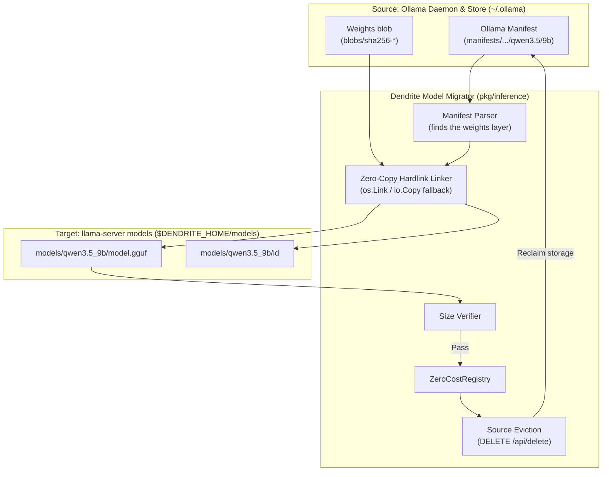

# FEAT-080: Ollama to llama.cpp Model Migration & Source Eviction

## 1. Executive Summary & Problem Statement

### The Problem
Large Language Models running under a local Ollama daemon consume substantial memory and disk space (for example 18 GB for `qwen3.8:27b` and 7.6 GB for `qwen3.5:9b`). Ollama stores a model's weights as a plain GGUF blob, which llama.cpp's `llama-server` loads directly. Dendrite can therefore hand a model to `llama-server`, which it starts on demand and stops when no session needs it, and reclaim Ollama's copy.

### User Story
As an engineer optimizing a workstation, I need one command that finds an Ollama model's GGUF weights, places them where `llama-server` finds them without copying, verifies the result, registers the model as zero-cost and optionally evicts the Ollama copy.

---

## 2. Technical Architecture

### 2.1 Zero-Copy Hardlink Migration
`ModelMigrator` places the weights with an atomic OS hardlink (`os.Link`), falling back to a streaming copy when the two paths are on different filesystems. This avoids doubling disk usage.
- **Source paths**:
  - `~/.ollama/models/manifests/registry.ollama.ai/library/<model>/<tag>`
  - `~/.ollama/models/manifests-v2/ollama.com/library/<model>/<tag>`
  - `~/.ollama/models/blobs/sha256-<digest>`
- **Weights layer**: the manifest layer typed `application/vnd.ollama.image.model`; when no layer carries that type, the largest layer.
- **Destination paths** (`$DENDRITE_HOME/models`, or `$DENDRITE_GGUF_MODELS_DIR`):
  - `<model_tag>/model.gguf`
  - `<model_tag>/id`: the first line is the model id the server serves the weights under.

### 2.2 Pre-Eviction Verification Gate
Source deletion never occurs blindly. Before eviction the migrator checks that `model.gguf` exists and, when the manifest states a size, that the sizes match. On any discrepancy eviction is aborted and the source stays untouched.

### 2.3 Zero-Cost Governance
Migrated models are registered in Dendrite's `ZeroCostRegistry` (`.dendrite/zero_cost_models.json`) under both `llamacpp/<model>` and `<model>`, exempting them from commercial token budgets in `pkg/gateway`.

### 2.4 On-Demand `llama-server` (`:8080`)
Dendrite starts `llama-server` when a session needs it and stops it after the idle grace once no session holds a lease (`pkg/llamalease`).
- **CLI commands**:
  - `dendrite spike serve [--port 8080]`: hold the server in the foreground until Ctrl+C.
  - `dendrite spike hold`, `status`, `stop`: keep it alive, inspect it, and stop it.
- **Endpoints** (served by `llama-server`):
  - `GET /v1/models`, `POST /v1/chat/completions` (JSON and SSE streaming), `GET /health`.

### 2.5 JetBrains IDE Integration
Bind `llama-server` to JetBrains AI Assistant, Continue and CodeGPT with Base URL `http://127.0.0.1:8080/v1`. See [Using llama.cpp with JetBrains IDEs](../guides/llamacpp-jetbrains-integration.md).

---

## 3. Behavioral Scenarios (Gherkin)

### Scenario 1: Dry-Run Model Migration
- **Given** model `qwen3.5:9b` is registered in Ollama
- **When** the developer executes `dendrite spike migrate qwen3.5:9b --dry-run`
- **Then** the migrator reports blob count and byte size without modifying disk or contacting deletion endpoints.

### Scenario 2: Successful Migration with Memory Reclaim
- **Given** models `qwen3.5:9b` (7.1 GB) and `qwen3.8:27b` (16.9 GB) exist in Ollama
- **When** migration is executed with `--delete-source`
- **Then** each model's weights are hardlinked to `$DENDRITE_HOME/models/<model>/model.gguf`, an `id` file is written, and Ollama is instructed to evict the model, reclaiming over 24 GB of storage.

### Scenario 3: Serving a Migrated Model
- **Given** model `qwen3.5:9b` is migrated
- **When** the developer executes `dendrite spike serve`
- **Then** Dendrite starts `llama-server` on the largest installed model that fits the memory budget and prints the endpoints.

### Scenario 4: Clean Server Shutdown
- **Given** a Dendrite-started `llama-server` on port 8080
- **When** the developer executes `dendrite spike stop`
- **Then** Dendrite terminates the process and releases port 8080.

---

## 4. Acceptance Criteria & Definition of Done

- [x] **AC-1 (Domain Migrator)**: `ModelMigrator` migrates models from Ollama to the llama-server models directory with typed options (`pkg/inference/migration.go`).
- [x] **AC-2 (Zero-Copy Linking)**: Avoids redundant writes via atomic hardlinks.
- [x] **AC-3 (Verification Gate)**: Confirms the weights and their size before source deletion.
- [x] **AC-4 (Source Eviction)**: Removes migrated models from the Ollama daemon via API and disk manifests to save memory.
- [x] **AC-5 (CLI & MCP Tooling)**: Exposed via CLI `dendrite spike migrate` and the MCP tool `dendrite_inference_migrate_model`.
- [x] **AC-6 (Unit Test Coverage)**: Unit tests in `pkg/inference/migration_test.go` and `pkg/inference/migration_gaps_test.go`.
- [x] **AC-7 (Lifecycle & JetBrains Integration)**: Documentation for managed and direct execution, JetBrains IDE setup and clean server termination.
