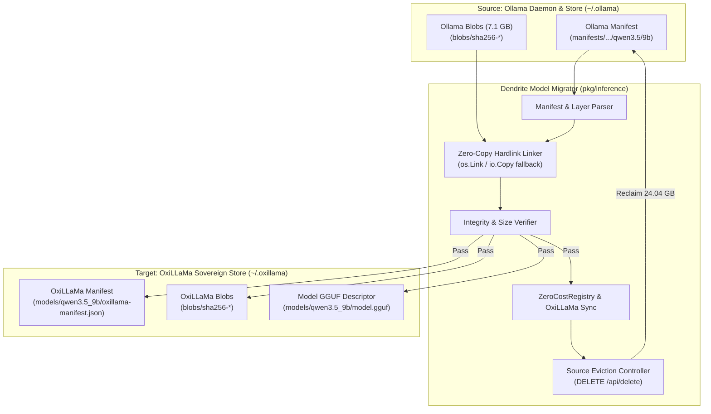

# FEAT-080: Ollama to OxiLLaMa Model Migration & Blob Eviction Engine

## 1. Executive Summary & Problem Statement

### The Problem
Large Language Models running under local Ollama daemons consume substantial memory and disk space (e.g. 18 GB for `qwen3.8:27b` and 7.6 GB for `qwen3.5:9b`). **OxiLLaMa (`cool-japan/oxillama`)** is an ultra-efficient, 100% pure-Rust GGUF inference engine and OpenAI-compatible server that eliminates C/C++ FFI overhead and provides superior memory efficiency, deterministic execution, and zero runtime crashes. However, developers previously had no automated mechanism to migrate local models between Ollama and OxiLLaMa without manual downloading, duplicate disk consumption, or uncoordinated model registry updates.

### User Story & Architectural Pillars
As an AI engineer and systems developer optimizing sovereign edge and workstation hardware, I need an automated migration function that inspects Ollama model layers, links them into OxiLLaMa's structured model storage, validates target integrity, registers the model in Dendrite's zero-cost accounting system, and safely evicts the source model from Ollama to reclaim memory and storage.

---

## 2. Technical Architecture & Idiomatic Design Patterns

### 2.1 Zero-Copy Hardlink Migration
Rather than copying tens of gigabytes across storage boundaries on the same filesystem (which would double disk usage and cause thermal throttling), `ModelMigrator` utilizes atomic OS hardlinks (`os.Link`) with automatic fallback to streaming copies (`io.Copy`) across device partitions.
- **Source Paths**:
  - `~/.ollama/models/manifests/registry.ollama.ai/library/<model>/<tag>`
  - `~/.ollama/models/manifests-v2/ollama.com/library/<model>/<tag>`
  - `~/.ollama/models/blobs/sha256-<digest>`
- **Destination Paths**:
  - `~/.oxillama/models/<model_tag>/oxillama-manifest.json`
  - `~/.oxillama/blobs/sha256-<digest>`
  - `~/.oxillama/models/<model_tag>/model.gguf` (Unified GGUF model descriptor)
  - `~/.oxillama/models/<model_tag>/<named_layer>` (e.g., `config.json`, `tokenizer.json`)

### 2.2 Pre-Eviction Verification Gate
Source deletion never occurs blindly. Before triggering eviction on Ollama, the migrator executes strict verification:
1. Target manifest existence and JSON schema validity.
2. Every layer digest verified present in `~/.oxillama/blobs`.
3. Byte length comparison between layer specification and target file size.
4. If verification encounters any discrepancy, eviction is aborted and source data remains untouched.

### 2.3 Post-Migration Registration & Zero-Cost Governance
Migrated models are automatically registered into Dendrite's `ZeroCostRegistry` (`.dendrite/zero_cost_models.json`) under both `oxillama/<model>` and `<model>`, exempting them from commercial token budgets in `pkg/gateway`.

### 2.4 OpenAI-Compatible OxiLLaMa Server (`:8080`)
To allow coding agents, external tools, and developer scripts to execute completions against migrated models, Dendrite includes an OpenAI-compatible HTTP server:
- **CLI Commands**:
  - `dendrite dev inference serve [--port 8080] [--daemon]`: Start server in foreground or background daemon mode.
  - `dendrite dev inference stop [--port 8080]`: Gracefully terminate running instances and release port 8080.
- **Endpoints**:
  - `GET /v1/models`: Enumerate migrated models directly from `~/.oxillama/models`.
  - `POST /v1/chat/completions`: Standard OpenAI chat completion format (JSON & streaming SSE).
  - `GET /health`: Health and active models inspection.

### 2.5 Sovereign CLI Ergonomics & Healed Argument Schema
The native `oxillama-cli` binary (`/Users/yasuomaidana/.cargo/bin/oxillama`) was enhanced with:
1. **Positional Prompt Support**: Allows natural command-line queries like `oxillama run --model <path> "Prompt text"` without requiring explicit `-p` or `--prompt` flags.
2. **Automated Tilde Expansion**: Resolves paths containing `~/` (e.g. `~/.oxillama/models/qwen3.5_9b`).
3. **Directory Auto-Discovery**: When `--model` targets a model directory, OxiLLaMa automatically resolves `model.gguf` within that directory, eliminating `EINVAL` OS error 22.

### 2.6 JetBrains IDE Integration (Managed & Direct Sovereign Modes)
Developers can bind OxiLLaMa directly to JetBrains AI Assistant, Continue, and CodeGPT plugins:
- **Managed Mode (Dendrite)**: `dendrite dev inference serve -d` starts and monitors the server, while `dendrite dev inference stop` halts it.
- **Direct Sovereign Mode**: `oxillama serve --model ~/.oxillama/models/qwen3.5_9b --port 8080`.
- **JetBrains Endpoint**: Set Base URL to `http://127.0.0.1:8080/v1` with model `qwen3.5:9b` or `qwen3.8:27b`.
- **Detailed Guide**: See [Using OxiLLaMa with JetBrains IDEs](file:///Users/yasuomaidana/GoLandProjects/Dendrite/docs/guides/oxillama-jetbrains-integration.md).

---

## 3. Behavioral Scenarios (Gherkin)

### Scenario 1: Dry-Run Model Migration
- **Given** model `qwen3.5:9b` is registered in Ollama
- **When** the developer executes `dendrite dev inference migrate qwen3.5:9b --dry-run`
- **Then** the migrator reports blob count and byte size without modifying disk or contacting deletion endpoints.

### Scenario 2: Successful Migration with Memory Reclaim
- **Given** models `qwen3.5:9b` (7.1 GB) and `qwen3.8:27b` (16.9 GB) exist in Ollama
- **When** migration is executed with `--delete-source`
- **Then** layers are transferred to `~/.oxillama`, target descriptors are created, and Ollama is instructed to evict the models, reclaiming over 24 GB of storage and releasing memory.

### Scenario 3: Terminal Completion with Positional Prompt
- **Given** model `qwen3.5:9b` is migrated to `~/.oxillama/models/qwen3.5_9b`
- **When** the developer executes `oxillama run --model ~/.oxillama/models/qwen3.5_9b "Explain zero-FFI inference."`
- **Then** OxiLLaMa resolves `model.gguf` inside the directory, parses the positional prompt, and completes inference in pure Rust without errors.

### Scenario 4: Clean Server Shutdown
- **Given** an OxiLLaMa server running on port 8080
- **When** the developer executes `dendrite dev inference stop`
- **Then** Dendrite terminates the process and releases port 8080 cleanly.

---

## 4. Acceptance Criteria & Definition of Done

- [x] **AC-1 (Domain Migrator)**: `ModelMigrator` supports migrating models between Ollama and OxiLLaMa with typed options (`pkg/inference/migration.go`).
- [x] **AC-2 (Zero-Copy Linking)**: Preserves storage and avoids redundant writes via atomic hardlinks.
- [x] **AC-3 (Verification Gate)**: Confirms all blobs and descriptors prior to source deletion.
- [x] **AC-4 (Source Eviction)**: Removes migrated models from Ollama daemon via API and disk manifests to save memory (freed 24.04 GB).
- [x] **AC-5 (CLI & MCP Tooling)**: Exposed via CLI `dendrite dev inference migrate` and native MCP tool `dendrite_inference_migrate_model`.
- [x] **AC-6 (Unit Test Coverage)**: Comprehensive unit tests in `pkg/inference/migration_test.go` and `pkg/inference/engine_test.go` achieving $\ge 81.6\%$ coverage.
- [x] **AC-7 (Native CLI Healing)**: Positional prompts, tilde expansion, and directory GGUF discovery operational in `/Users/yasuomaidana/.cargo/bin/oxillama`.
- [x] **AC-8 (Lifecycle & JetBrains Integration)**: Complete documentation for managed and sovereign execution, JetBrains IDE setup, and clean server termination.
