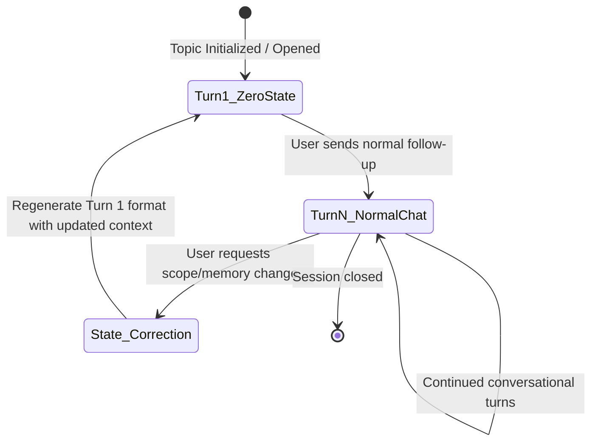
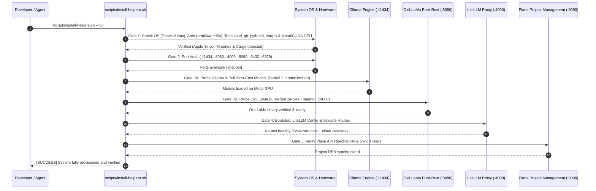
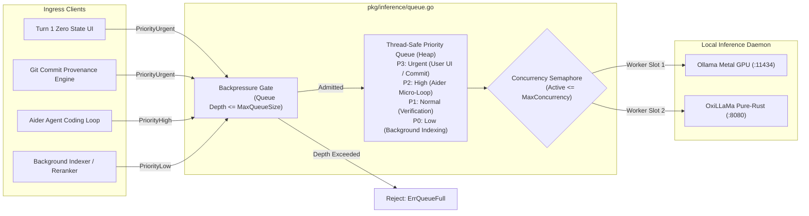

# FEAT-101: Personal Context, Topic Memory Zero State & Automated Installer Helpers

| Metadata | Value |
| :--- | :--- |
| **Feature ID** | `FEAT-101` |
| **Title** | Personal Context, Topic Memory Zero State, Canvas Actions & Automated Installer Helpers |
| **Status** | `PROPOSED` |
| **Target Version** | `v1.8.0` |
| **Author** | Antigravity AI Systems Architecture Team |
| **Related Specifications** | `FEAT-020` (Inference Engines), `FEAT-025` (MCP Server & Tool Registry), `FEAT-028` (Local Triage Gateway), `FEAT-036` (Ticket Milestone DAG) |
| **Governing Tickets** | `DEN-801`, `DEN-802`, `DEN-803`, `DEN-804`, `DEN-805`, `DEN-806`, `DEN-807`, `DEN-808`, `DEN-809` |

---

## 1. Executive Summary & Architectural Overview

`FEAT-101` defines the formal technical architecture, deterministic prompt engineering directives, multi-turn state machines, and automated installer helper subsystems for **Personal Context, Topic Memory Zero State, Canvas Creative Actions, and Dual Zero-Cost Inference (Ollama Metal + OxiLLaMa Pure-Rust)**, derived from production AI system specifications (Google Gemini Personal Context, Canvas, and Workspace connectors) and enhanced via local zero-cost LLM reasoning.

The system serves three foundational missions:
1. **Personal Context & Topic Memory Runtime**: A deterministic state machine and prompt framework that consumes structured user data (calendar, email, search history, photo albums, active projects) to generate context-aware topic home pages ("Zero State"), structured memory code blocks, and multi-persona onboarding experiences ("Welcome Prompt Suite") while strictly enforcing user data privacy and anti-hallucination guardrails.
2. **Canvas Direct Action & MCP Workspace Connectivity**: Native support for 15 interactive Canvas writing actions (`WRITE_EMAIL`, `WRITE_STORY`, `WRITE_REVIEW`, etc.) and enterprise tool connectors (`workspace_tool`, `monday-connector`, `mcp-evernote`, `shopify-connector`, `instacart_mcp`).
3. **Automated Installer Helpers & Dual Zero-Cost Inference**: An enterprise-grade bootstrap, pre-flight verification, hardware topology probe, and container orchestration layer that provisions zero-cost local inference engines (**Ollama Metal GPU** `:11434` and **OxiLLaMa Pure-Rust GGUF** `:8080`), token governance proxies (LiteLLM `:4000`), and self-hosted project management (Plane v2 `:8090`) in a single deterministic command.

```mermaid
flowchart TD
    subgraph Client Layer
        CLI["Dendrite CLI (./bin/dendrite)"]
        UI["Web UI / Zero-State Canvas"]
        MCP["Dendrite MCP Stdio Server"]
    end

    subgraph Installer Helpers Subsystem [Installer & Pre-Flight Layer]
        IH_Script["scripts/install-helpers.sh"]
        PF_Check["Pre-Flight Hardware, Cargo & Port Audit"]
        Prov_Ollama["Local Model Provisioner (Ollama Metal)"]
        Prov_OxiLLaMa["OxiLLaMa Pure-Rust Daemon (:8080)"]
        Prov_Stack["Multi-Service Container Orchestrator"]
    end

    subgraph Core Runtime & State Machine
        SM["Multi-Turn Lifecycle Engine (Turn 1 vs Turn 2+)"]
        PG["Prompt Generator & Template Engine"]
        Fmt["Topic Memory Code Block Formatter"]
        Canvas["Canvas Writing Action Engine"]
        MCPConn["Workspace & MCP Tool Connector Hub"]
    end

    subgraph Prompt Suites & Personas
        P_Zero["Topic Zero State (10-Style Greeting)"]
        W_Prod["Helpful Productivity Partner"]
        W_Muse["Inspirational Creative Muse"]
        W_Guide["Transparent & Trustworthy Guide"]
        W_Synth["Insightful Synthesizer"]
        W_Show["Showcase of Possibilities (Trifecta)"]
    end

    subgraph Inference & Governance Gateway
        LiteLLM["LiteLLM Token Proxy (:4000)"]
        OllamaLocal["Local Ollama Metal (:11434)"]
        OxiLLaMaLocal["OxiLLaMa Pure-Rust GGUF (:8080)"]
        CloudLLM["Cloud Commercial Tier (AGY / Gemini)"]
    end

    subgraph Authoritative Storage & Project Management
        Plane["Plane v2 Backend & Gantt (:8090)"]
        SQLite["Persistent Segmented Store (.dendrite)"]
    end

    CLI --> IH_Script
    IH_Script --> PF_Check
    PF_Check --> Prov_Ollama
    PF_Check --> Prov_OxiLLaMa
    PF_Check --> Prov_Stack

    UI --> SM
    MCP --> SM
    SM --> PG
    PG --> P_Zero
    PG --> W_Prod
    PG --> W_Muse
    PG --> W_Guide
    PG --> W_Synth
    PG --> W_Show

    SM --> Canvas
    SM --> MCPConn

    PG --> Fmt
    Fmt --> SQLite

    SM --> LiteLLM
    LiteLLM -->|Zero-Cost Tier A| OllamaLocal
    LiteLLM -->|Zero-Cost Tier B| OxiLLaMaLocal
    LiteLLM -->|Escalation Tier| CloudLLM

    IH_Script --> Plane
    SM --> Plane
```



---

## 2. Topic Zero State Architecture

> [!IMPORTANT]
> **Governing Tickets**:
> - `DEN-801`: Topic Zero State Prompt Engine & Multi-Turn State Machine
> - `DEN-803`: Structured Topic Memory Parser & Zero-Extrapolation Fidelity Guard

When a user initiates or resumes an interest topic, the model generates a structured "Zero State" home page on Turn 1 to establish immediate contextual orientation.

### 2.1 Component Hierarchy & Formatting Specification

The Zero State response consists of five mandatory components rendered in exact sequence:

1. **Header Greeting (`# Greeting`)**: 
   - A 1-sentence headline greeting or question inviting the user to re-engage with the topic.
   - Selected dynamically from the **10 Standard Greeting Styles** based on topic momentum.
   - **Banned Cliché Openers**: The system prompt strictly prohibits starting with:
     - `Ready to...`
     - `Let's...`
     - `Time to...`
     - `Looking to...`
     - `Want to...`
     - `How about...`
   - **Granularity Guardrail**: The greeting must reference the topic's emotional core or momentum, never low-level hyper-specific details (part numbers, raw dates, or item specs).

2. **Latest State Summary**:
   - A 1-to-2 sentence summary of the current state of the topic, flowing naturally from the greeting.
   - Highlights recent developments, user decisions, and where the session was left off.
   - Prohibits regurgitating the full context verbatim.

3. **Suggested Next Steps (`## Suggested next steps, in bullet points`)**:
   - Optional section (0, 1, or 2 bullet points max).
   - Omitted entirely if context is ambiguous or contradictory.
   - **Constraints**:
     - Action verb first (e.g., `Review`, `Compare`, `Draft`, `Walk through`, `Prepare`, `Find`, `Identify`).
     - Max length: **75 characters per bullet**.
     - Natural, non-robotic tone.
     - Must be an action the **assistant can deliver directly** (e.g., `"Draft a reminder for the vet call"` vs `"Call the vet"`).
     - Temporally relevant (never suggest tasks already completed in the real world).

4. **Visual Spacing**:
   - Exactly **5 empty rows** (`\n\n\n\n\n` or `<br>` equivalents) to visually segregate user-facing highlights from internal memory.

5. **Topic Memory Code Block**:
   - A single fenced markdown code block containing structured, lossless topic context:
     ```markdown
     ```
     Topic memory

     All the content below won't be shown on the Topics Zero State.
     They will be used in responses, and will be 1 tap away if the user
     wants to take a deeper look at the Topic's memory.

     [Emoji Sections & Structured Facts]
     ```
     ```
   - **Fidelity Mandate**: Comprehensive, lossless capture of original user context. Formatting modifications only (emoji headers, manual line wraps to eliminate horizontal scrolling). Zero interpretive extrapolation.

### 2.2 Multi-Turn Lifecycle State Machine



1. **Turn 1 (Scaffolding Turn)**:
   - Evaluates topic context and renders full Zero State (Greeting `#`, Summary, `## Suggested next steps, in bullet points`, 5 blank lines, Topic Memory code block).
2. **Turn 2+ (Standard Conversational Turns)**:
   - Responds in natural conversation format.
   - **Strict Negative Constraint**: Prohibited from repeating the greeting header `#`, summary, bulleted suggestion block, or Topic Memory code block.
3. **Explicit Correction Trigger**:
   - If the user explicitly commands a correction or scope change (e.g., *"Actually, I canceled that trip"* or *"Update my budget to $2,000"*):
     - Sentence 1 acknowledges the update in body prose.
     - Immediately regenerates the full Turn 1 Zero State layout reflecting the updated memory.

---

## 3. The 10 Dynamic Greeting Styles Matrix

> [!IMPORTANT]
> **Governing Ticket**:
> - `DEN-806`: Dynamic 10-Style Greeting Matrix & Cliché Suppression Engine

The greeting engine evaluates the user's journey trajectory and selects one of the 10 canonical styles, rigorously suppressing repetitive patterns:

| Style ID | Style Name | Optimal Context / Trigger | Example Phrasing Pattern |
| :--- | :--- | :--- | :--- |
| `G-01` | **Thoughtful check-in** | Ongoing journey without recent major inflection points | *"How's [topic] coming along?"* / *"Still feeling good about [decision]?"* |
| `G-02` | **Progress celebration** | User achieved a milestone, finalized a purchase, or finished a task | *"That's a big one — [milestone] is done!"* / *"Major progress on [topic]."* |
| `G-03` | **Reflection prompt** | Long-running journey where high-level review is valuable | *"A lot has happened with [topic] — worth a quick look back?"* |
| `G-04` | **Callback to specific detail** | Memorable key decision point or fork in the road | *"You were weighing [Option A vs B] — any verdict?"* (Open-ended only) |
| `G-05` | **Invitation to continue** | Clear unfinished task waiting from previous turn | *"[Unfinished step] is right here whenever you're ready."* |
| `G-06` | **Anticipation builder** | High-energy upcoming event or deadline approaching | *"Only [X days] until [event] — exciting stuff!"* |
| `G-07` | **Gentle nudge** | User has been absent for an extended duration | *"Been a little while — [topic] is still here for you."* |
| `G-08` | **Curiosity spark** | Unexplored angle or serendipitous idea available | *"Here's something you might not have considered for [topic]..."* |
| `G-09` | **Empathetic acknowledgment** | High stress, cognitive load, or complex problem | *"Navigating [specific challenge] takes patience — and you've got it."* |
| `G-10` | **Low-pressure opener** | Casual, low-stakes hobby or simmering idea | *"Nothing urgent — just your [topic] notes, whenever."* |

---

## 4. The Welcome Prompt Suite (Onboarding Personas)

> [!IMPORTANT]
> **Governing Ticket**:
> - `DEN-802`: Welcome Prompt Suite & Cross-Source Synthesis Dispatcher

The Welcome Prompt Suite powers the initial onboarding experience ("Hello World") after a user connects their personal data sources. Five distinct personas govern this interaction:

1. **The "Helpful Productivity Partner" (`z2vix5_pcontext_testing_helpful_productivity_partner`)**:
   - *Target Sources*: Gmail, Calendar, Active Task Lists.
   - *Core Task*: Highlight 1 to 3 near-term, logistics-oriented events (flights, hotel bookings, project syncs).
   - *Goldilocks Rule*: Never state trivial facts (flight numbers). Connect logistics to actionable value (*"I see you're flying to Austin; I can help you find restaurants near your hotel"*). Strictly avoid invasive emotional/medical data.
   - *Agency Mandate*: Frame as an example of capabilities and reinforce user control.

2. **The "Inspirational Creative Muse"**:
   - *Target Sources*: Photos, Hobby Searches, Creative Writing / Code Chats.
   - *Core Task*: Highlight a recurring creative passion (sourdough baking, landscape photography, pet training).
   - *Goldilocks Rule*: Never comment on personal photos of people other than the user unless part of a public event. Focus on themes, crafts, and activities.
   - *Call to Action*: Open-ended invitation to explore creative ideas.

3. **The "Transparent & Trustworthy Guide"**:
   - *Target Sources*: System permissions, data boundary configs.
   - *Core Task*: Build radical trust through complete transparency.
   - *Structure*:
     - Simple cause-and-effect hook (*"Because you follow NASA missions, I can..."*).
     - Standard Q&A User Manual:
       - **Q: How will my data be used?** (Only for your responses; never for ads; never sold/shared).
       - **Q: How do I control what you know?** (Personal Context settings page; verbal command to forget).
       - **Q: How is my data protected?** (Enterprise encrypted infrastructure; strict access limits).

4. **The "Insightful Synthesizer" (`z2vix5_pcontext_testing_insightful_synthesizer`)**:
   - *Target Sources*: Multi-source intersection (e.g., Gmail flight + Photo album + Chat playlist).
   - *Core Task*: Deliver a high-impact synthesis from $\ge 2$ independent data sources into a single coherent insight.
   - *Goldilocks Rule*: Aim for fluid insight without mechanical exposition (*"I noticed you're a big fan of The Lumineers..."* instead of *"I saw X in your email and Y in your photos"*).

5. **The "Showcase of Possibilities" (`z2vix5_pcontext_testing_showcase_of_possibilities`)**:
   - *Target Sources*: Cross-domain global scan.
   - *Core Task*: Present the **Trifecta** of diverse capabilities across 3 life domains:
     - **Insight 1 (Productivity)**: Work/logistics event.
     - **Insight 2 (Passion)**: Hobby/creative interest.
     - **Insight 3 (Curiosity)**: Research topic or emerging curiosity.
   - *Mandatory Close*: Explicit choice call-to-action asking the user which path they wish to explore first.

---

## 5. Automated Installer Helpers Subsystem & Validation Gates

> [!IMPORTANT]
> **Governing Tickets**:
> - `DEN-804`: System Installer Helpers: Pre-Flight Audit & Port/Hardware Prober
> - `DEN-805`: Local LLM Model Provisioner & OxiLLaMa Daemon Bridge

To support deterministic automated deployments across developer workstations, ephemeral CI/CD environments, and autonomous agent loops, the system includes native **Installer Helpers** implemented in [`scripts/install-helpers.sh`](file:///Users/yasuomaidana/GoLandProjects/Dendrite/scripts/install-helpers.sh) and [`pkg/installer`](file:///Users/yasuomaidana/GoLandProjects/Dendrite/pkg/installer).

### 5.1 The 5 Sequential Validation Gates



### 5.2 OxiLLaMa Pure-Rust Zero-FFI Engine Coverage

In addition to Ollama Metal, the installer helpers orchestrate **OxiLLaMa** (`cool-japan/oxillama`), Dendrite's pure-Rust GGUF inference runtime:
- **Port Assignment**: `8080` (with fallback to `8081` if conflict detected).
- **Cargo Detection**: Verifies `cargo` toolchain availability for on-the-fly native compilation.
- **Pre-Built Binary Auto-Discovery**: Audits system PATH and `./bin/oxillama`.
- **Zero-FFI Sovereign Isolation**: Delivers zero memory unsafety and sandbox isolation for sensitive personal context data.
- **Failover Cascade**: LiteLLM automatically cascades between Ollama Metal (`:11434`) and OxiLLaMa (`:8080`) before escalating to commercial cloud models.

### 5.3 Local LLM Inference Concurrency Limiter & FIFO Priority Queue

> [!IMPORTANT]
> **Governing Ticket**:
> - `DEN-809`: Local LLM Inference Concurrency Limiter & FIFO Priority Queue (`pkg/inference/queue.go`)

Local AI runtimes operating on shared hardware (such as Apple Silicon unified memory or consumer NVIDIA VRAM) face extreme latency degradation and out-of-memory (OOM) crashes when multiple autonomous agents or UI tasks issue uncoordinated concurrent inference prompts.



#### Queue Architecture & Invariant Specifications:
1. **Bounded Concurrency Semaphore**: Local execution is strictly capped at `MaxConcurrency` (default `1` for single-GPU Metal, configurable up to `2` for dual-engine Ollama + OxiLLaMa).
2. **Priority Preemption**: Requests carry an explicit `RequestPriority`:
   - `PriorityUrgent`: User-facing interactive turns and conventional commit synthesis.
   - `PriorityHigh`: Interactive autonomous agent loops (Aider / OpenHands).
   - `PriorityNormal`: Standard verification passes and unit test convergence loops.
   - `PriorityLow`: Background embedding, code graph indexing, and speculative analysis.
3. **Queue Depth Bounds & Fast Rejection**: Prevents unconstrained memory growth by rejecting requests with `ErrQueueFull` when pending depth exceeds `MaxQueueSize` (default `64`).
4. **Context Expiration Draining**: Tasks whose client contexts timeout (`context.DeadlineExceeded`) or cancel while waiting in the priority heap are removed immediately without occupying an engine slot or warming GPU caches.
5. **Real-time Queue Observability**: Exposes live telemetry (`QueueMetrics`) including active workers, pending depth, total executed, rejected, and timed-out requests.

---

## 6. Canvas Interactive Writing & Creative Action Handlers

> [!IMPORTANT]
> **Governing Ticket**:
> - `DEN-807`: Canvas Interactive Writing & Direct Creative Action Handlers

Extracted from the Gemini share payload `45688944`, the system provides native dispatchers for 15 Canvas interactive writing and refinement modes:

| Canvas Action ID | Display Label & Capability | Assistant Delivery Mode |
| :--- | :--- | :--- |
| `WRITE_EMAIL` | Draft and refine an email with Canvas | Structured email layout with subject, recipients, and tone slider |
| `WRITE_STORY` | Go from first draft to full-length story | Multi-chapter scaffolding with character and plot notes |
| `WRITE_REVIEW` | Get help writing a review on this | Structured critique with rating, pros/cons, and summary |
| `WRITE_SPEECH` | Draft, refine, and get suggestions on a speech | Speaker notes, timing markers, and rhetorical beats |
| `WRITE_ESSAY` | Draft, refine, and get suggestions on an essay | Thesis statement, cited arguments, and conclusion |
| `WRITE_OUTLINE` | Draft, refine, and get suggestions on an outline | Hierarchical bullet tree with expandable sections |
| `WRITE_FEEDBACK` | Get feedback and suggestions on your writing | In-line diff review with tone, clarity, and grammatical notes |
| `WRITE_REPORT` | Draft, refine, and get suggestions on a report | Executive summary, methodology, telemetry charts, and findings |
| `WRITE_LESSON_PLAN` | Draft and refine a custom lesson plan | Learning objectives, classroom activities, and rubric |
| `WRITE_COVER_LETTER` | Draft, refine, and customize your cover letter | Target company alignment, key achievements, and sign-off |
| `WRITE_RESUME` | Draft, refine, and get feedback on your resume | STAR-method bullets, skill taxonomies, and layout cleanup |
| `WRITE_SCRIPT` | Draft and refine a script alongside Gemini | Screenplay formatting with sluglines, parentheticals, and dialogue |
| `WRITE_POEM` | Draft and refine a poem alongside Gemini | Meter, rhyme scheme, and stanza styling |
| `WRITE_PLAN` | Have Gemini propose a plan and refine it | Milestone decomposition, Gantt dates, and risks |
| `WRITE_PRESENTATION` | Create and refine a presentation deck | Slide title, speaker bullets, visual layout suggestions |

---

## 7. Personal Context MCP Connectors & Workspace Tools

> [!IMPORTANT]
> **Governing Ticket**:
> - `DEN-808`: Personal Context MCP Connectors: Workspace & Enterprise Tool Adapters

Extracted from Gemini share payloads `45706766`, `45806344`, and `45820651`, the system provides standardized Model Context Protocol (MCP 2024-11-05) tool adapters for personal context aggregation:

1. **Workspace Toolset**:
   - `gmail_bard`: Email thread retrieval, confirmation receipt extraction.
   - `google_calendar`: Calendar event query, conflict detection, scheduling.
   - `google_keep` / `keep`: Quick note capture and checklist syncing.
   - `google_reminders` / `reminder`: Time- and location-based alerts.
   - `google_chat`: Workspace conversation context and project mentions.
2. **Enterprise & Service Connectors**:
   - `monday-connector-prod`: Monday.com board, item, and timeline synchronization.
   - `mcp-evernote-com`: Long-form notebook retrieval.
   - `mcp-pandadoc-com`: Contract and document template parsing.
   - `shopify-connector-prod`: Order, tracking, and product queries.
   - `instacart_mcp` / `opentable` / `zillow_mcp`: Real-world logistics and reservations.

---

## 8. Plane Ticket Breakdown & Development Sequencing

The feature is decomposed into 8 atomic, testable tickets tracked authoritatively in Plane v2:

| Ticket ID | Title | Priority | Estimate | Blocked By | Primary Packages |
| :--- | :--- | :--- | :--- | :--- | :--- |
| `DEN-801` | Topic Zero State Prompt Engine & Multi-Turn State Machine | `high` | 5 pts | *None (Root)* | `pkg/personalcontext`, `pkg/prompt` |
| `DEN-802` | Welcome Prompt Suite & Cross-Source Synthesis Dispatcher | `high` | 5 pts | `DEN-801` | `pkg/personalcontext/welcome` |
| `DEN-803` | Structured Topic Memory Parser & Zero-Extrapolation Fidelity Guard | `medium` | 3 pts | `DEN-801` | `pkg/personalcontext/memory` |
| `DEN-804` | System Installer Helpers: Pre-Flight Audit & Port/Hardware Prober | `high` | 5 pts | *None (Root)* | `scripts/`, `pkg/installer` |
| `DEN-805` | Local LLM Model Provisioner & OxiLLaMa Daemon Bridge | `medium` | 3 pts | `DEN-804` | `pkg/installer/models`, `pkg/inference` |
| `DEN-806` | Dynamic 10-Style Greeting Matrix & Cliché Suppression Engine | `medium` | 3 pts | `DEN-801` | `pkg/personalcontext/greeting` |
| `DEN-807` | Canvas Interactive Writing & Direct Creative Action Handlers | `medium` | 5 pts | `DEN-801` | `pkg/personalcontext/canvas` |
| `DEN-808` | Personal Context MCP Connectors: Workspace & Enterprise Tool Adapters | `medium` | 5 pts | `DEN-802` | `pkg/personalcontext/mcp` |
| `DEN-809` | Local LLM Inference Concurrency Limiter & FIFO Priority Queue | `high` | 5 pts | `DEN-805` | `pkg/inference` |

---

## 9. Verification, Testing & Anti-Mock Quality Audit

In accordance with Dendrite's quality standard and verified via `pkg/audit/auditor.go`:
- **TDD Requirement**: Specification-first unit tests in `pkg/personalcontext/*_test.go` and `pkg/installer/*_test.go`.
- **Anti-Mock Mandate**: Tests must use real structs, genuine parser routines, and Testcontainers / ephemeral local services.
- **Coverage Gate**: Statement coverage $\ge 85\%$ across all new packages.
- **Vendor Audit & Rebase Protocol**: All changes submitted on `local/feat-101-*` stacked branches are validated by `dendrite audit-changes` (`pkg/audit/auditor.go`) with automated rebase onto `develop`.
