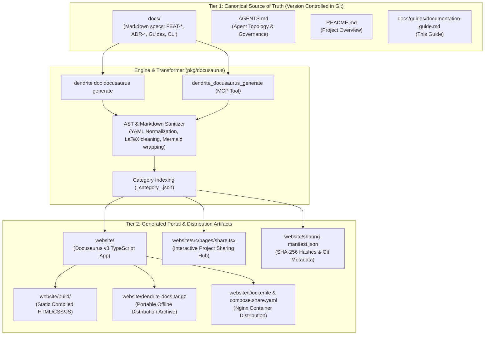
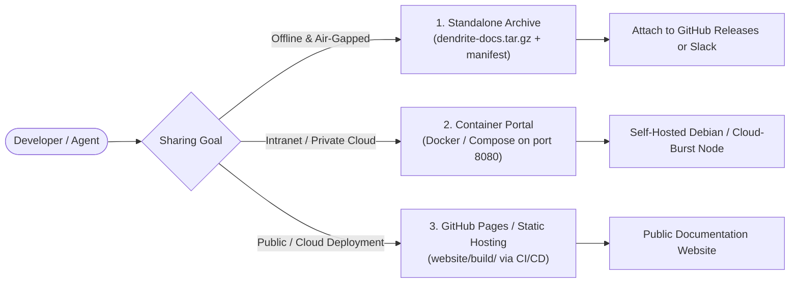

# Documentation Management, Versioning & Publishing Guide

> **Authoritative Guide for Engineers & Autonomous Agents**  
> Explains how to author, transform, audit, commit, bundle, and publish documentation across the Dendrite ecosystem using Docs-as-Code and Docusaurus v3.

---

## 1. Documentation Architecture: The Two-Tier System

Dendrite uses a **Two-Tier Documentation Architecture** to cleanly separate human/agent canonical authoring from compiled portal presentation:



---

## 2. Anti-Duplication Strategy & Single Source of Truth

To prevent document drift, version conflicts, and repository bloat, Dendrite enforces a strict **Zero Duplication Policy**:

1. **Single Source of Truth (`docs/`)**:
   - All architectural blueprints, feature specs (`FEAT-*`), guides, CLI manuals, scorecards, roadmaps, and project-sharing guides live exclusively under `docs/`.
   - Never author, edit, or maintain separate documentation copies inside `website/docs/`.

2. **Direct Ingestion (`path: '../docs'`)**:
   - `website/docusaurus.config.ts` is configured with `docs: { path: '../docs' }`, enabling the portal to compile and hot-reload directly from canonical Markdown files.
   - Eliminates file duplication on disk during local development and builds.

3. **Git Boundary Protection**:
   - `website/docs/` is explicitly listed in `.gitignore` and `website/.gitignore`.
   - Even if standalone archives or transient export directories are generated during distribution packaging, Git will never track duplicate documentation files.

---

## 3. What to Edit (Canonical Sources)

Always author and update documentation in the **canonical source directories**:

1. **`docs/` Directory**:
   - `docs/features/`: Feature specifications (`FEAT-001` through `FEAT-027`). Must contain YAML frontmatter (`id`, `title`, `tags`, `dependencies`, `plane_epic`) and Acceptance Criteria.
   - `docs/architecture/`: Architecture Decision Records (`ADR-*`) and structural blueprints.
   - `docs/guides/`: Operational playbooks, JetBrains IDE setup, and developer onboarding.
   - `docs/cli/`: Command-line interface references and tool parameters.
   - `docs/quality/`: Scrum alignment, complexity metrics, and performance audit reports.
   - `docs/roadmap/`: Development status, milestones, and ticket lifecycles.
2. **Root Specifications**:
   - [`AGENTS.md`](file:///Users/yasuomaidana/GoLandProjects/Dendrite/AGENTS.md): Agent ecosystem roles, tools, and DoD verification gates.
   - [`README.md`](file:///Users/yasuomaidana/GoLandProjects/Dendrite/README.md): High-level system overview and architectural diagrams.
   - `DEV_STATUS.md`: Human reference status log (Plane v2 is the authoritative system of record).

> [!WARNING]
> **Never directly author documentation inside `website/docs/`**.  
> The files under `website/docs/` are dynamically transformed and regenerated by the Dendrite Docusaurus Engine. Any direct edits in `website/docs/` will be overwritten on the next generation cycle.

---

## 4. What to Commit vs. What to Ignore

Keep the git repository clean, lightweight, and deterministic by strictly following these boundary rules:

### ✅ MUST COMMIT (Source Control)

| Path | Description | Reason |
| :--- | :--- | :--- |
| `docs/**/*.md` | Canonical source documentation | Source of truth for all requirements and architecture. |
| `AGENTS.md`, `README.md` | Core repository specifications | Foundational guidelines and entry points. |
| `pkg/docusaurus/**/*.go` | Documentation & sharing engine code | Go implementation for generator, transformer, bundler. |
| `cmd/dendrite/docusaurus.go`| CLI command handlers | Command-line ergonomics (`dendrite doc docusaurus`). |
| `website/package.json` | Docusaurus dependencies | Ensures deterministic `npm install` across environments. |
| `website/docusaurus.config.ts` | Portal configuration | Defines navigation, themes, Mermaid, and Prism settings. |
| `website/sidebars.ts` | Autogenerated sidebar routing | Standardizes sidebar generation hierarchy. |
| `website/src/**` | Landing page, custom CSS & `/share` Hub | Custom React layout and Project Sharing Hub. |
| `website/static/**` | Logos, icons, and static assets | Visual branding assets (`static/img/logo.svg`). |
| `website/Dockerfile` | Multi-stage Nginx containerfile | Containerized intranet hosting recipe. |
| `website/docker-compose.share.yaml` | Intranet docker compose manifest | 1-command deployment for teams. |
| `website/nginx.conf` | Web server configuration | High-speed gzip and client-side routing fallback. |
| `website/.gitignore` | Local ignore configuration | Prevents accidental check-in of build caches. |

### ❌ NEVER COMMIT (Ignored in `.gitignore`)

| Path | Reason |
| :--- | :--- |
| `website/docs/` | Transient generated copy. The single canonical source is `docs/`. |
| `website/node_modules/` | Heavy npm dependencies (~1,400 packages). Reinstall via `npm install`. |
| `website/build/` | Compiled static distribution bundle. Rebuild via `npm run build`. |
| `website/.docusaurus/` | Webpack build caches and temporary route JSON metadata. |
| `website/dendrite-docs.tar.gz` | Binary distribution archive. Recreate via `dendrite doc docusaurus share`. |
| `website/*.log` | Local npm or Webpack execution logs. |

---

## 5. How to Generate & Verify Documentation Locally

Use the Dendrite CLI or native MCP tools to generate and inspect documentation:

### Step 1: Synthesize Docusaurus Portal from Canonical Markdown
```bash
./bin/dendrite doc docusaurus generate \
  --docs docs \
  --out website \
  --title "Dendrite Documentation" \
  --tier federated
```
This automatically:
- Traverses `docs/`, parses frontmatter, and categorizes files into clean taxonomies (`overview`, `architecture`, `features`, `guides`, `cli`, `quality`, `project-sharing`).
- Injects Docusaurus `_category_.json` indices for collapsible sidebars.
- Generates the interactive `/share` Project Sharing Hub.
- Creates `website/sharing-manifest.json` with cryptographic SHA-256 hashes of every document.

### Step 2: Audit Documentation Coverage & Traceability
```bash
./bin/dendrite doc docusaurus audit --root . --docs docs
```
Reports total features discovered, acceptance criteria verification status, and identifies modules needing dedicated documentation.

### Step 3: Run Interactive Live Preview
```bash
# Option A: Built-in Dendrite Preview Server (Zero npm dependencies required)
./bin/dendrite doc docusaurus serve --site website --port 3000

# Option B: Docusaurus Hot-Reloading Development Server
cd website
npm install
npm start
```
Open [http://localhost:3000](http://localhost:3000) in your browser:
- Documentation: [http://localhost:3000/docs/overview](http://localhost:3000/docs/overview)
- Project Sharing Hub: [http://localhost:3000/share](http://localhost:3000/share)
- Live Manifest: [http://localhost:3000/api/v1/sharing-manifest](http://localhost:3000/api/v1/sharing-manifest)

### Step 4: Verify Production Static Compilation
```bash
npm --prefix website run build
```
Confirms that all MDX syntax, links, and Mermaid diagrams compile cleanly into `website/build/` with zero fatal build errors.

---

## 6. How to Publish & Share Documentation

Dendrite provides three flexible publication and sharing workflows:



### Method 1: Export Portable Standalone Archive (Offline & Cross-Team)
Export a portable archive with cryptographic checksum verification:
```bash
./bin/dendrite doc docusaurus share --site website --out website/dendrite-docs.tar.gz
```
- **Deliverables**: `website/dendrite-docs.tar.gz` and `website/sharing-manifest.json`.
- **Integrity**: Recipients can verify document authenticity against the SHA-256 hashes in `sharing-manifest.json`.
- **Publishing**: Attach `dendrite-docs.tar.gz` to GitHub Releases, send via Slack, or upload to S3.

### Method 2: Containerized Intranet Hosting (Docker Compose)
Host the documentation portal on a shared internal server or persistent control plane node:
```bash
cd website
docker compose -f docker-compose.share.yaml up --build -d
```
- Serves high-speed compiled documentation on port `3000` (or configured port) via Nginx Alpine with gzip compression and healthchecks.
- Integrates seamlessly with remote SSH servers, Tailscale mesh private overlay networks, or cloud-burst nodes.

### Method 3: Cloud or GitHub Pages Deployment
To publish to GitHub Pages or static web hosting:
```bash
# Set base URL in site configuration
./bin/dendrite doc docusaurus generate --docs docs --out website

# Build static bundle
npm --prefix website run build

# Deploy via Docusaurus CLI (if GIT_USER / SSH keys configured)
cd website
GIT_USER=<username> npm run deploy
```
Alternatively, configure GitHub Actions to deploy the contents of `website/build/` to GitHub Pages upon pushes to `main`.

---

## 7. Model Context Protocol (MCP) Integration for AI Agents

Autonomous agents interacting with Dendrite should use the registered MCP tools:

- `dendrite_docusaurus_generate`: Re-synthesize website layout and docs hierarchy.
  ```json
  {"docs_dir": "docs", "target_dir": "website", "title": "Dendrite Documentation", "sharing_tier": "federated"}
  ```
- `dendrite_docusaurus_share`: Export standalone bundle and compute SHA-256 manifest.
  ```json
  {"site_dir": "website", "bundle_path": "website/dendrite-docs.tar.gz"}
  ```
- `dendrite_docusaurus_audit`: Audit documentation completeness against codebase packages and tickets.
  ```json
  {"project_root": ".", "docs_dir": "docs"}
  ```

---

## 8. Pre-Commit Checklist for Developers & Agents

Before committing changes to version control:
- [ ] Edited only canonical Markdown files in `docs/`, `AGENTS.md`, or `README.md`.
- [ ] Ran `./bin/dendrite doc docusaurus generate` to sync changes into `website/`.
- [ ] Confirmed `go test -cover ./pkg/docusaurus/...` passes ($\ge 85\%$ coverage).
- [ ] Verified `npm --prefix website run build` builds static assets without MDX compilation errors.
- [ ] Checked `git status` to ensure `node_modules/`, `build/`, `.docusaurus/`, and `.tar.gz` remain uncommitted.
