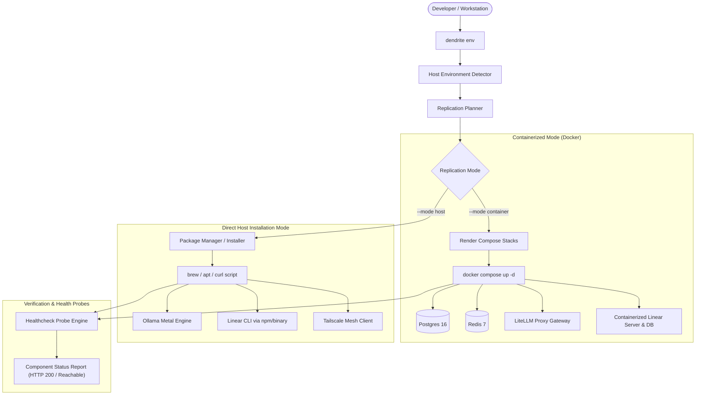

# Development Environment Installation & Replication Guide

This guide details the methodologies, tools, and automation provided by **Dendrite** to replicate, install, and bootstrap the complete development environment on any target computer—either natively on the host OS or completely containerized via Docker.

---

## 1. Overview & Dual Replication Architecture

Dendrite accommodates both isolated, reproducible cloud/local container setups and high-performance native host developer environments:

1. **Docker Containerized Mode (`--mode container`)**:
   - Spins up all services, databases, gateways, and mock backends in Docker containers.
   - Ideal for reproducible setups, sandboxed testing, clean teardown, and hosting local instances of tools (such as **Linear** in a container with a dedicated PostgreSQL database).
   - Zero host pollution, guaranteed port isolation, and automated health checks.
2. **Direct Host Installation Mode (`--mode host`)**:
   - Installs and configures development tooling directly on the target workstation (macOS or Linux).
   - Leverages native package managers (Homebrew on macOS, APT/DNF/Pacman on Linux, or verified installer scripts).
   - Unlocks maximum performance for local Metal inference (Ollama GPU acceleration on Apple Silicon) and native CLI tools (Linear CLI, Go toolchain, Tailscale).
3. **Hybrid Mode (`--mode hybrid`)**:
   - The recommended default for developers: heavy background infrastructure (PostgreSQL 16, Redis 7, LiteLLM Proxy, containerized Linear issue tracker) runs in Docker, while local developer tools (Go, Ollama Metal, Tailscale, Linear CLI) run natively on the host computer.



---

## 2. Replicating the Environment with Docker Containers

### Fast Replicate Command
To bootstrap the entire stack in containers (including the containerized Linear issue tracker):

```bash
# Preview replication actions without making changes
dendrite env replicate --mode container --dry-run

# Replicate and start all containerized services
dendrite env replicate --mode container
```

### Composing Individual Stacks Manually
Dendrite maintains pre-configured, production-grade Docker Compose manifests under `stacks/`:

- **All-in-One Dev Stack** (`stacks/compose.dev.yaml`):
  Combines PostgreSQL, Redis, LiteLLM Gateway, and containerized Linear.
  ```bash
  docker compose -f stacks/compose.dev.yaml up -d
  ```

- **Containerized Linear Stack** (`stacks/compose.linear.yaml`):
  Runs a containerized Linear-compatible GraphQL server with a dedicated PostgreSQL database:
  ```bash
  docker compose -f stacks/compose.linear.yaml up -d
  ```

- **Control Plane Stack** (`stacks/compose.control.yaml`):
  Runs persistent state for multi-project token governance and gateways:
  ```bash
  docker compose -f stacks/compose.control.yaml up -d
  ```

### Verifying Containerized Linear
Once started, the containerized Linear service exposes:
- **GraphQL Endpoint**: `http://localhost:8085/graphql`
- **Healthcheck Probe**: `http://localhost:8085/health`
- **Dedicated PostgreSQL Database**: `localhost:5433` (DB: `linear_dev`, User: `linear_user`)

You can test reachability directly:
```bash
curl -s http://localhost:8085/health
# {"status":"ok","service":"linear-mock","database":"healthy"}
```

---

## 3. Installing Tools Directly on the Target Computer

For developers who prefer running tools directly on the host without Docker virtualization:

### Guided Host Environment Discovery
Inspect what is currently present on your machine:
```bash
dendrite env doctor
```
Example output:
```
[+] Host Environment Discovery:
    - Operating System:  darwin (arm64)
    - Package Manager:   homebrew
    - Docker Engine:     true
    - Docker Compose:    true
    - Ollama Engine:     true
    - Go Toolchain:      true
    - Node / NPM:        Node: true, NPM: true
    - Tailscale Mesh:    true
    - Linear Host CLI:   true
```

### Installing Specific Tools on the Host
You can instruct Dendrite to generate the exact installation command and execute it:

```bash
# Install Linear CLI on the target host (via npm, brew, or binary)
dendrite env install linear --mode host

# Install and bootstrap Ollama on the host
dendrite env install ollama --mode host

# Install Tailscale mesh daemon on the host
dendrite env install tailscale --mode host
```

---

## 4. Replicating Linear: Container vs. Host

| Capability | Containerized Linear (`--mode container`) | Direct Host Installation (`--mode host`) |
| :--- | :--- | :--- |
| **Primary Use Case** | Local offline testing, CI/CD pipelines, autonomous agent sandbox testing | Team management, interactive ticket triage, CLI integration |
| **Backend Storage** | Isolated PostgreSQL 16 container (`localhost:5433`) | Linear Cloud GraphQL API (`api.linear.app`) |
| **Network Isolation** | Private Docker bridge network `dendrite-mesh` | Host loopback / Internet egress |
| **Port Mapping** | `8085:8085` | N/A (CLI binary) |
| **Health Probe** | `GET http://localhost:8085/health` | `linear --version` |
| **Installation Command**| `dendrite env install linear --mode container` | `dendrite env install linear --mode host` |

---

## 5. Environment Verification & Health Monitoring

To verify all components after installation or replication:

```bash
dendrite env status
```

Example status dashboard:
```
[+] Real-Time Environment Component Status:
    [ONLINE / HEALTHY] docker       - Docker Engine & Container Runtime (Endpoint: )
    [ONLINE / HEALTHY] linear       - Linear Issue Tracker (Containerized / Local Service) (Endpoint: http://localhost:8085)
    [ONLINE / HEALTHY] litellm      - LiteLLM Token Governance Gateway (Endpoint: http://localhost:4000)
    [ONLINE / HEALTHY] ollama       - Ollama Local Inference Engine (Endpoint: http://localhost:11434)
```
