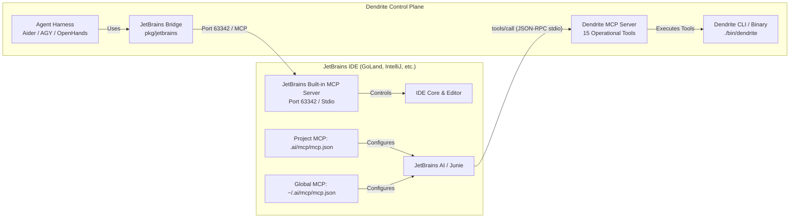

# JetBrains IDE MCP & Autonomous Agent Integration Guide

## 1. Overview & Architecture

Dendrite provides bidirectional integration with the **JetBrains IDE Ecosystem** (GoLand, IntelliJ IDEA, PyCharm, RustRover, WebStorm, CLion) through two complementary communication channels:

1. **JetBrains Native MCP Client (IDE $\to$ Dendrite)**:
   JetBrains IDEs (2024.3+, 2025+, 2026+) support the **Model Context Protocol (MCP 2024-11-05)**. By configuring Dendrite's native MCP server (`bin/dendrite mcp serve`), JetBrains AI Assistant, Junie, and embedded agents gain direct access to Dendrite's 15 operational MCP tools (ticket tracking, multi-engine inference probing, topology advisor, agent runners, environment replication, and telemetry).

2. **Dendrite JetBrains Bridge (Dendrite $\to$ IDE)**:
   Through `pkg/jetbrains` and `dendrite jetbrains <probe|open|problems|symbols|build|run|setup>`, Dendrite's autonomous agents can reach back into the running JetBrains IDE over the IDE's built-in MCP server / port `63342` to navigate active editor tabs, trigger background compilations, query PSI symbols, and extract live compiler diagnostics.



---

## 2. Automated Routine: `dendrite jetbrains setup`

Dendrite includes an automated routine to configure all necessary JetBrains files in one command:

```bash
# Full automated setup (project MCP, global MCP, run configurations, external tools)
./bin/dendrite jetbrains setup

# Target only the current project (.ai/mcp/mcp.json and .idea/)
./bin/dendrite jetbrains setup --project-only

# Target only global user settings (~/.ai/mcp/mcp.json)
./bin/dendrite jetbrains setup --global-only
```

Alternatively, this routine can be triggered dynamically from any AI agent via the MCP tool `dendrite_jetbrains_setup`:

```bash
./bin/dendrite mcp call dendrite_jetbrains_setup '{"project_only": true}'
```

### What the Routine Configures:
1. **`.ai/mcp/mcp.json` (Project Root)**: Registers `dendrite` as an active project MCP server.
2. **`~/.ai/mcp/mcp.json` (User Home)**: Registers `dendrite` as a globally available MCP server across all installed JetBrains IDEs.
3. **`.idea/runConfigurations/`**: Generates 6 ready-to-run GoLand / IntelliJ configurations:
   - `Dendrite_MCP_Server.xml` (`dendrite mcp serve`)
   - `Dendrite_Agent_Aider.xml` (`dendrite agent run aider --ticket DEN-036`)
   - `Dendrite_Agent_Antigravity.xml` (`dendrite agent run agy`)
   - `Dendrite_Web_UI.xml` (`dendrite ui --port 3456`)
   - `Dendrite_Doctor.xml` (`dendrite doctor`)
   - `Dendrite_JetBrains_Probe.xml` (`dendrite jetbrains probe`)
4. **`.idea/tools/External_Tools.xml`**: Adds context-menu IDE external tools:
   - `Dendrite: Run Aider on Active File`
   - `Dendrite: Run Antigravity on Active File`
   - `Dendrite: Probe MCP Diagnostics`
   - `Dendrite: List Registered MCP Tools`
   - `Dendrite: Telemetry Snapshot`

---

## 3. Manual Configuration in JetBrains

If you prefer to configure JetBrains manually or verify your IDE settings, follow these methods:

### Method A: Configuration via `.ai/mcp/mcp.json` (Recommended)

JetBrains IDEs automatically detect MCP configuration files matching standard MCP JSON schemas:
- **Project Scope**: `<project-root>/.ai/mcp/mcp.json`
- **Global Scope**: `~/.ai/mcp/mcp.json`

Add the following configuration:

```json
{
  "mcpServers": {
    "dendrite": {
      "command": "/Users/yasuomaidana/GoLandProjects/Dendrite/bin/dendrite",
      "args": [
        "mcp",
        "serve"
      ],
      "env": {
        "DENDRITE_WORKSPACE": "/Users/yasuomaidana/GoLandProjects/Dendrite",
        "DENDRITE_ENV": "development"
      }
    }
  }
}
```

Once saved, JetBrains's `McpProjectServerConfigurationService` reloads the file via VFS listeners without requiring an IDE restart.

---

### Method B: Configuration via JetBrains IDE GUI

1. Open **Settings / Preferences** (`Cmd + ,` on macOS, `Ctrl + Alt + S` on Linux/Windows).
2. Navigate to **Tools $\to$ Model Context Protocol (MCP)** or **AI Assistant $\to$ Model Context Protocol (MCP)**.
3. Click the **`+` (Add)** icon and select **Command (stdio)**.
4. Fill in the fields:
   - **Name**: `dendrite`
   - **Command**: `/Users/yasuomaidana/GoLandProjects/Dendrite/bin/dendrite`
   - **Arguments**: `mcp serve`
   - **Environment Variables**:
     - `DENDRITE_WORKSPACE`: `/Users/yasuomaidana/GoLandProjects/Dendrite`
     - `DENDRITE_ENV`: `development`
5. Click **Apply** and **OK**.
6. The IDE status bar MCP widget will display `dendrite (15 tools connected)`.

---

## 4. Verification & Operational Health Check

To verify that the MCP server and agent harnesses are fully functional, run the verification commands below:

### 1. Verify MCP Tools Discovery
```bash
./bin/dendrite mcp tools
```
*Expected Output*:
```
[+] Registered Dendrite MCP Tools (15):
    - dendrite_ticket_list     : List all project tickets, their statuses, complexity scores...
    - dendrite_ticket_update   : Update the status of a project ticket in DEV_STATUS.md...
    - dendrite_jetbrains_setup : Configure JetBrains IDE toolset with Dendrite MCP servers...
    - dendrite_agent_run       : Launch an autonomous coding agent loop (aider, openhands, opencode, agy)...
    - dendrite_telemetry       : Sample real-time SoC thermal metrics and 24h/7d token spend totals...
    ...
```

### 2. Verify Live MCP Execution
```bash
# Query tickets through MCP
./bin/dendrite mcp call dendrite_ticket_list '{}'

# Query real-time thermals & spend
./bin/dendrite mcp call dendrite_telemetry '{}'

# Launch agent loop via MCP
./bin/dendrite mcp call dendrite_agent_run '{"agent_type":"aider","task":"Verify MCP bridge","ticket_id":"DEN-040"}'
```

### 3. Verify IDE Connectivity from Dendrite
```bash
./bin/dendrite jetbrains probe
```
*Expected Output*:
```
[+] Probing JetBrains IDE MCP Server...
  [✓] Connected: JetBrains GoLand MCP Server (v2024.3)
  [✓] Discovered Tools (6):
      - open_file_in_editor      : Opens the specified file in the active JetBrains editor window.
      - get_file_problems        : Retrieves inspection problems and syntax errors for a file.
      - search_symbol            : Searches for symbols matching query across project index.
      - build_project            : Compiles and builds the currently open project in JetBrains.
      - execute_run_configuration: Runs a specified run/test configuration inside the IDE.
      - lint_files               : Lints specified file paths using JetBrains inspections.
```

---

## 5. Summary of Registered MCP Tools & Agents

| Name | Interface Type | Role / Capability | Primary Execution Path |
|:---|:---|:---|:---|
| **Dendrite Native MCP** | Stdio JSON-RPC 2.0 | Control Plane Server (15 tools) | `./bin/dendrite mcp serve` |
| **JetBrains IDE Bridge** | MCP / HTTP (63342) | Bidirectional IDE inspection & control | `./bin/dendrite jetbrains probe` |
| **Aider Agent** | Autonomous CLI loop | Interactive terminal pair programmer | `./bin/dendrite agent run aider` |
| **Antigravity (AGY)** | Autonomous CLI loop | High-cognition strategic agent | `./bin/dendrite agent run agy` |
| **OpenHands** | Autonomous Sandbox | Software engineering container loop | `./bin/dendrite agent run openhands` |
| **OpenCode** | Headless Batch | Fast non-interactive refactoring | `./bin/dendrite agent run opencode` |
| **Ticket Lifecycle Dev** | Meta-Skill Agent | 8-phase spec & TDD lifecycle | `.gemini/skills/ticket-lifecycle-developer/` |
| **AI Practices Auditor** | Meta-Skill Agent | Token economy & schema guardrails | `.gemini/skills/ai-practices-auditor/` |
| **Complexity Auditor** | Meta-Skill Agent | AST & cognitive complexity analysis | `.gemini/skills/pattern-complexity-auditor/` |
