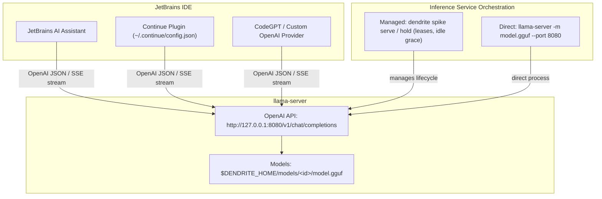

# Using llama.cpp with JetBrains IDEs (Managed & Direct Modes)

## 1. Overview & Architecture

**llama.cpp** (`ggml-org/llama.cpp`) runs GGUF models locally, and its `llama-server` binary is an OpenAI-compatible HTTP server. It uses Metal on Apple Silicon, CUDA on NVIDIA GPUs and the CPU elsewhere.

Dendrite supports two ways of running it for JetBrains IDEs (GoLand, IntelliJ IDEA, PyCharm, RustRover, WebStorm, CLion):

1. **Managed mode (Dendrite control plane)**: Dendrite starts `llama-server` when a session needs it, binds `127.0.0.1:8080`, keeps it alive while any session holds a lease, and stops it after the idle grace. Zero-cost token accounting applies.
2. **Direct mode (`llama-server` CLI)**: you run `llama-server` yourself on any port.



---

## 2. Installation & Model Storage

Install llama.cpp with Dendrite's helper (Homebrew on macOS, the official release on Linux):

```bash
scripts/install-helpers.sh --llamacpp
```

Dendrite looks for models in `$DENDRITE_HOME/models` (default `~/.dendrite/models`), or in `$DENDRITE_GGUF_MODELS_DIR` when set:

```
~/.dendrite/models/
├── qwen3_8b_q4km/
│   ├── model.gguf     # the weights llama-server loads
│   └── id             # optional: first line is the model id the server serves it under
└── qwen3.5_9b/
    └── model.gguf
```

Move a model from Ollama's store without copying it (a hardlink when the disk allows):

```bash
dendrite spike migrate qwen3.5:9b --to llamacpp
```

`dendrite spike models` lists what is installed and whether each model fits this machine's memory budget. Dendrite never starts a model that would starve the machine.

---

## 3. Mode 1: Managed (via Dendrite)

### 3.1 Starting the server

```bash
# Holds the server in the foreground until Ctrl+C
dendrite spike serve --port 8080

# Keep it alive for a while, or until Ctrl+C
dendrite spike hold --for 30m
```

With no `--model`, Dendrite starts the largest installed model that fits the memory budget. Expected output:

```
[✓] llama-server serves qwen3_8b_q4km at http://127.0.0.1:8080
    * Chat Endpoint: http://127.0.0.1:8080/v1/chat/completions
```

### 3.2 Health and status

```bash
dendrite spike status
dendrite spike probe llamacpp-local
```

### 3.3 Stopping

```bash
dendrite spike stop            # frees the port
```

The managed server also stops by itself after the idle grace once no session holds it.

---

## 4. Mode 2: Direct (`llama-server`)

```bash
llama-server -m ~/.dendrite/models/qwen3_8b_q4km/model.gguf --alias qwen3_8b --host 127.0.0.1 --port 8080 -c 8192
```

Dendrite never stops a server it did not start. Stop one you started by hand with `dendrite spike stop`, `pkill -f llama-server`, or `lsof -ti :8080 | xargs kill`.

---

## 5. Configuring JetBrains IDEs

Once the server answers on `http://127.0.0.1:8080`:

### 5.1 JetBrains AI Assistant

1. Open **Settings / Preferences** and go to **Tools → AI Assistant → Models**.
2. Under **Custom Models**, add an **OpenAI Compatible** provider.
3. Set **Server URL** to `http://127.0.0.1:8080/v1`, **API Key** to `dummy`, and **Model Name** to the model id the server serves (see `curl -s http://127.0.0.1:8080/v1/models`).
4. Click **Test Connection**, then select the provider as the active model.

### 5.2 Continue plugin

Add the model to `~/.continue/config.json`:

```json
{
  "models": [
    {
      "title": "llama.cpp (local)",
      "provider": "openai",
      "model": "qwen3_8b_q4km",
      "apiBase": "http://127.0.0.1:8080/v1",
      "apiKey": "dummy-token"
    }
  ]
}
```

### 5.3 CodeGPT plugin

Choose **Custom OpenAI**, set **Base URL** to `http://127.0.0.1:8080/v1`, any **API Key**, and the served model id.

---

## 6. Verification Checklist

| Check | Command | Expected result |
| :--- | :--- | :--- |
| **Binary installed** | `llama-server --version` | Prints the llama.cpp build. |
| **Server startup** | `dendrite spike serve` | Serves a model at `http://127.0.0.1:8080`. |
| **API health** | `curl -s http://127.0.0.1:8080/health` | `{"status":"ok"}`. |
| **Models API** | `curl -s http://127.0.0.1:8080/v1/models` | Lists the served model. |
| **IDE integration** | Prompt AI Assistant or Continue | A local answer with no cloud token cost. |
| **Clean shutdown** | `dendrite spike stop` | Port 8080 is released. |
