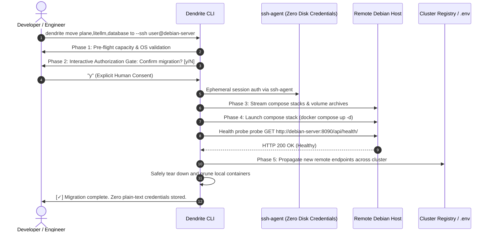

# Tutorial: Moving Dendrite Services to a Remote Debian SSH Server

## 1. Overview & Architectural Goals

Heterogeneous infrastructure architectures require elastic service mobility: moving persistent background daemons (such as **Plane v2**, **LiteLLM Gateway**, and **PostgreSQL/Redis Storage**) from local developer laptops to dedicated servers (such as a persistent **Debian Linux** home server or VPS with **4 GB RAM and a 1 TB Disk**).

The **Dendrite Zero-Credential Service Migration Engine** (`dendrite move <svc> to --ssh <target>`) governs this transition through a **5-Phase Atomic Lifecycle**:



---

## 2. Invariants & Security Guardrails

1. **Zero Credential Persistence**: Private keys, passwords, and tokens are **never** persisted to disk, `.env` files, or log artifacts. All network transport delegates to ephemeral active `ssh-agent` sockets or standard SSH identity configuration.
2. **Interactive Human Terminal Authorization**: Deleting or pruning local containers requires explicit human terminal confirmation (`[y/N]`). Unattended execution without interactive stdin requires explicit `--yes` or `--dry-run`.
3. **Atomic Rollback on Failure**: If remote health probes fail within the 120-second deadline, remote containers are automatically torn down and local services remain untouched.
4. **Local Resource Reclamation**: Only after remote containers pass health checks are local containers safely pruned.

---

## 3. Server Capacity Sizing: Debian 4 GB RAM / 1 TB Disk

When evaluating a Debian server with **4 GB RAM** and a **1 TB Disk**:

| Component | RAM Footprint | Disk Footprint | Accelerator | Debian Suitability |
|:---|:---:|:---:|:---:|:---|
| **Debian Linux OS & Systemd** | 1024 MB (Reserved) | ~10 GB | None | Base Operating System |
| **Plane v2 Project Management** | 1536 MB | 20 GB | None | **Eligible** (Runs PostgreSQL 5434, Redis 6380, API 8090, UI 8091) |
| **LiteLLM Token Gateway** | 512 MB | 5 GB | None | **Eligible** (Runs Proxy :4000) |
| **PostgreSQL 16 & Redis 7** | 1024 MB | 30 GB | None | **Eligible** (Runs Core Storage :5432, :6379) |
| **Ollama Local LLM** | 8192 MB | 50 GB | **Metal / CUDA** | **Excluded** (Requires Apple Silicon Metal or CUDA GPU, must stay local) |
| **Headless Ghidra RE** | 4096 MB | 15 GB | None | **Excluded** (Requires full 4 GB memory alone) |

### Net Allocation Summary
- **Allocated Service RAM**: $1536 + 512 + 1024 = 3072\text{ MB}$ ($3.0\text{ GB}$)
- **OS Kernel & Daemon Reserve**: $1024\text{ MB}$ ($1.0\text{ GB}$)
- **Total RAM Used**: $4096\text{ MB}$ ($4.0\text{ GB} \le 4.0\text{ GB}$)
- **Total Disk Allocated**: $55\text{ GB} \ll 1000\text{ GB}$ ($945\text{ GB}$ available headroom)

---

## 4. Step-by-Step Execution Tutorial

### Step 1: Pre-Flight Capacity Evaluation (`dendrite move plan`)
Evaluate hardware fit for a 4 GB RAM and 1 TB disk server:
```bash
./bin/dendrite move plan --ram 4GB --disk 1TB
```
Output:
```text
==========================================================================================
              DENDRITE SERVICE CAPACITY EVALUATION: DEBIAN LINUX (RAM: 4.0 GB, DISK: 1000 GB)
==========================================================================================
  * Total Server RAM : 4096 MB (4.0 GB)
  * Total Server Disk: 1000 GB (1.0 TB)
  * OS System Reserve: 1024 MB (Debian Linux kernel, systemd, SSH daemon)
  * Net Service RAM  : 3072 MB (Allocated: 3072 MB, Remaining: 0 MB)
  * Net Service Disk : 1000 GB (Allocated: 55 GB, Remaining: 945 GB)
------------------------------------------------------------------------------------------
[+] SERVICES ELIGIBLE TO LIVE ON DEBIAN SERVER (CUMULATIVE FIT):
  1. plane           [Plane v2 Self-Hosted Project Management Stack]
  2. litellm         [LiteLLM Token Governance Gateway]
  3. database        [PostgreSQL 16 & Redis 7 Control Plane Storage]
```

### Step 2: Validate Migration with Dry-Run
Run a pre-flight dry-run against the target Debian server:
```bash
./bin/dendrite move debian to --ssh user@debian-server --dry-run
```
*(Or specify explicit services: `./bin/dendrite move plane,litellm,database to --ssh user@debian-server --dry-run`)*

### Step 3: Execute Live Interactive Migration
Execute the migration command:
```bash
./bin/dendrite move debian to --ssh user@debian-server
```
The CLI will display:
```text
================================================================================
               DENDRITE INFRASTRUCTURE SERVICE MIGRATION GATE                  
================================================================================
Target Remote Host : user@debian-server
Services to Move   : plane, litellm, database
Prune Local Stacks : true
Security Policy    : Ephemeral ssh-agent (ZERO credentials written to disk/logs)
--------------------------------------------------------------------------------
Confirm migration to remote SSH server? [y/N]: 
```
Type `y` and press Enter.

### Step 4: Verification of Remote Health & Local Cleanup
Once migration completes:
1. Verify remote Plane API:
   ```bash
   curl -s http://debian-server:8090/api/health/
   ```
2. Verify remote LiteLLM Gateway:
   ```bash
   curl -s http://debian-server:4000/health/liveliness
   ```
3. Confirm local containers are cleanly pruned:
   ```bash
   docker ps | grep -E "plane|litellm|postgres"
   ```
4. Verify cluster configuration points to remote Debian host:
   ```bash
   echo $PLANE_API_URL
   ```

---

## 5. Model Context Protocol (MCP) Integration

Dendrite exposes native MCP tools for autonomous agents to plan and execute migrations:

### Planning Capacity via MCP
```json
{
  "name": "dendrite_service_plan",
  "arguments": {
    "ram_mb": 4096,
    "disk_gb": 1000
  }
}
```

### Triggering Migration via MCP
```json
{
  "name": "dendrite_service_move",
  "arguments": {
    "services": ["plane", "litellm", "database"],
    "target_host": "user@debian-server",
    "dry_run": true
  }
}
```
