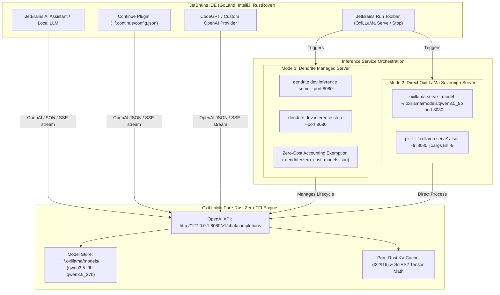

# Using OxiLLaMa with JetBrains IDEs (Managed & Direct Sovereign Modes)

## 1. Overview & Architecture

**OxiLLaMa (`cool-japan/oxillama`)** is an ultra-efficient, 100% pure-Rust zero-FFI Large Language Model inference engine and OpenAI-compatible server. Unlike traditional C/C++ backends (like `llama.cpp`), OxiLLaMa executes entirely without FFI overhead, memory safety vulnerabilities, or runtime crashes, providing deterministic latency and minimal memory footprint on Apple Silicon and Linux workstations.

Dendrite supports two complementary operational modes for integrating OxiLLaMa with JetBrains IDEs (GoLand, IntelliJ IDEA, PyCharm, RustRover, WebStorm, CLion):

1. **Managed Mode (via Dendrite Control Plane)**:
   Dendrite autonomously orchestrates OxiLLaMa lifecycle, model registration, zero-cost token accounting exemption, port binding (`127.0.0.1:8080`), and graceful shutdown.
2. **Direct Sovereign Mode (Native `oxillama` CLI)**:
   Developers run the sovereign `oxillama` native Rust binary directly from terminal or background daemons, binding the OpenAI-compatible REST server to any port.



---

## 2. Model Storage & Resolution Architecture

OxiLLaMa stores migrated models and tensors in `~/.oxillama/`:

```
~/.oxillama/
├── blobs/                        # De-duplicated SHA-256 tensor blobs (hardlinked from Ollama)
│   ├── sha256-10986d0f...        # 2.4 GB embed_tokens blob
│   ├── sha256-830bcce7...        # 682 MB lm_head blob
│   └── ...                       # 24.04 GB total reclaimed zero-copy storage
└── models/
    ├── qwen3.5_9b/               # Migrated Qwen 3.5 9B Model Directory
    │   ├── model.gguf            # Unified GGUF model descriptor (auto-discovered)
    │   ├── oxillama-manifest.json# Typed OxiLLaMa manifest layer catalog
    │   ├── config.json           # Model architecture parameters
    │   └── tokenizer.json        # Fast BPE tokenizer vocabulary
    └── qwen3.8_27b/              # Migrated Qwen 3.8 27B Model Directory
        ├── model.gguf            # Unified GGUF model descriptor (auto-discovered)
        ├── oxillama-manifest.json# Typed OxiLLaMa manifest layer catalog
        └── config.json
```

### Healed CLI Ergonomics & Path Auto-Resolution
The native `oxillama` CLI includes built-in enhancements:
- **Positional Prompts**: Allows passing prompt directly: `oxillama run --model <path> "Prompt text"` without requiring `-p` / `--prompt`.
- **Tilde Expansion**: Auto-expands `~/` paths (e.g. `~/.oxillama/models/qwen3.5_9b`).
- **Directory Auto-Discovery**: When `--model` targets a model directory (e.g. `~/.oxillama/models/qwen3.5_9b`), it automatically resolves the internal `model.gguf` without throwing `EINVAL` OS error 22.

---

## 3. Mode 1: Using OxiLLaMa via Dendrite (Managed Mode)

In Managed Mode, Dendrite handles the entire server lifecycle, ensuring proper port allocation, health monitoring, zero-cost token governance, and clean process termination.

### 3.1 Starting the Server
Start the OpenAI-compatible HTTP server:

```bash
# Foreground / interactive mode
dendrite dev inference serve --port 8080

# Background daemon mode
dendrite dev inference serve --port 8080 --daemon
```

Expected output:
```
[✓] OxiLLaMa Pure-Rust OpenAI Server listening at http://127.0.0.1:8080
    * Models Endpoint:     http://127.0.0.1:8080/v1/models
    * Chat Endpoint:       http://127.0.0.1:8080/v1/chat/completions
    * Storage Directory:   ~/.oxillama/models
```

### 3.2 Checking Server Health & Status
Verify that OxiLLaMa is responding and check available models:

```bash
dendrite dev inference probe oxillama-rust
```

Output:
```
[+] Probing engine 'oxillama-rust' (oxillama at http://127.0.0.1:8080)...
    * [Online] Engine: oxillama-rust Type: oxillama Status: Online Latency: 1.2ms Cost: zero-cost
        Models: qwen3.5:9b, qwen3.8:27b
```

### 3.3 Stopping the Server Cleanly
To stop the server and release port 8080:

```bash
dendrite dev inference stop
```

Or for a non-standard port:
```bash
dendrite dev inference stop --port 8080
```

Output:
```
[+] Stopping OxiLLaMa server on port 8080...
[✓] Successfully stopped OxiLLaMa server (terminated 1 process(es) on port 8080)
```

---

## 4. Mode 2: Using OxiLLaMa Directly (Sovereign CLI Mode)

Developers who prefer standalone CLI execution can invoke the native `oxillama` binary directly.

### 4.1 Running Direct One-Shot Terminal Inference
Test prompt generation instantly in your terminal:

```bash
# Positional prompt with model directory
oxillama run --model ~/.oxillama/models/qwen3.5_9b "Explain zero-FFI inference."

# Limiting tokens or adjusting temperature
oxillama run --model ~/.oxillama/models/qwen3.8_27b "Generate a Go HTTP handler" --max-tokens 128 --temp 0.2
```

### 4.2 Starting the Native Server
Launch the native pure-Rust OpenAI server:

```bash
# Foreground execution
oxillama serve --model ~/.oxillama/models/qwen3.5_9b --port 8080

# Background execution (redirecting logs)
nohup oxillama serve --model ~/.oxillama/models/qwen3.5_9b --port 8080 > ~/.oxillama/server.log 2>&1 &
```

### 4.3 Stopping the Direct Server
To terminate a direct OxiLLaMa server instance:

```bash
# Method A: Using Dendrite (works across both managed and direct servers)
dendrite dev inference stop

# Method B: Process kill by name
pkill -f "oxillama serve"

# Method C: Port kill via lsof
lsof -ti :8080 | xargs kill -9
```

---

## 5. Configuring JetBrains IDEs to Use OxiLLaMa

Once the server is running on `http://127.0.0.1:8080`, configure your JetBrains IDE using any of the following integrations:

### 5.2 Option A: JetBrains AI Assistant (Built-in Chat)
Starting with JetBrains 2024.3 and 2025+, AI Assistant supports custom OpenAI-compatible endpoints:

1. Open **Settings / Preferences** (`Cmd + ,` on macOS).
2. Navigate to **Tools $\to$ AI Assistant $\to$ Models**.
3. Under **Custom Models**, click **+ (Add Custom Model Provider)** and select **OpenAI Compatible**.
4. Configure the provider parameters:
   - **Provider Name**: `OxiLLaMa Pure-Rust`
   - **Server URL**: `http://127.0.0.1:8080/v1`
   - **API Key**: `dummy` (or leave blank if auth is disabled)
   - **Model Name**: `qwen3.5:9b` or `qwen3.8:27b`
5. Click **Test Connection**; JetBrains queries `GET /v1/models` and confirms a green checkmark.
6. Select `OxiLLaMa Pure-Rust` as your active chat or code completion engine.

### 5.3 Option B: Continue Plugin (Recommended for Zero-Subscription)
The **Continue** extension (`continue.dev`) is the premier open-source coding copilot for JetBrains:

1. Install **Continue** from **Settings $\to$ Plugins $\to$ Marketplace**.
2. Open the Continue configuration file at `~/.continue/config.json`.
3. Add the OxiLLaMa models to the `models` array:

```json
{
  "models": [
    {
      "title": "OxiLLaMa Qwen 3.5 9B (Pure-Rust Zero-FFI)",
      "provider": "openai",
      "model": "qwen3.5:9b",
      "apiBase": "http://127.0.0.1:8080/v1",
      "apiKey": "dummy-token"
    },
    {
      "title": "OxiLLaMa Qwen 3.8 27B (High Capacity)",
      "provider": "openai",
      "model": "qwen3.8:27b",
      "apiBase": "http://127.0.0.1:8080/v1",
      "apiKey": "dummy-token"
    }
  ],
  "tabAutocompleteModel": {
    "title": "OxiLLaMa Fast Tab Autocomplete",
    "provider": "openai",
    "model": "qwen3.5:9b",
    "apiBase": "http://127.0.0.1:8080/v1"
  }
}
```
4. Save the file. Continue will immediately reload and expose the local sovereign OxiLLaMa engine in the IDE sidebar and inline autocomplete.

### 5.4 Option C: CodeGPT Plugin
1. Install **CodeGPT** from **Settings $\to$ Plugins**.
2. Navigate to **Settings $\to$ Tools $\to$ CodeGPT $\to$ Providers**.
3. Select **Custom OpenAI**.
4. Set:
   - **Base URL**: `http://127.0.0.1:8080/v1`
   - **API Key**: `sk-oxillama`
   - **Model**: `qwen3.5:9b`
5. Click **Apply**.

---

## 6. JetBrains Toolbar Run Configurations (1-Click Start / Stop)

Dendrite can generate JetBrains run configurations in `.idea/runConfigurations/` allowing developers to control OxiLLaMa directly from the IDE run toolbar:

Run the automated setup:
```bash
dendrite jetbrains setup
```

This registers:
- `OxiLLaMa_Serve.xml`: Starts `dendrite dev inference serve --port 8080` in the background.
- `OxiLLaMa_Stop.xml`: Executes `dendrite dev inference stop` to release port 8080.
- `OxiLLaMa_Probe.xml`: Performs a quick health probe and prints available models in the IDE console.

---

## 7. Verification Checklist

| Check | Command | Expected Result |
| :--- | :--- | :--- |
| **Direct Inference** | `oxillama run --model ~/.oxillama/models/qwen3.5_9b "Hello"` | Emits completion in terminal zero-FFI (`✓ Done`). |
| **Server Startup** | `dendrite dev inference serve -d` | Listening on `http://127.0.0.1:8080`. |
| **API Health** | `curl -s http://127.0.0.1:8080/health` | `{"status":"online","engine":"oxillama-rust"}`. |
| **Models API** | `curl -s http://127.0.0.1:8080/v1/models` | Lists `qwen3.5:9b` and `qwen3.8:27b`. |
| **JetBrains Integration** | Prompt JetBrains AI Assistant / Continue | Instant response generated with zero cloud token cost. |
| **Clean Shutdown** | `dendrite dev inference stop` | Terminated and port 8080 released. |
