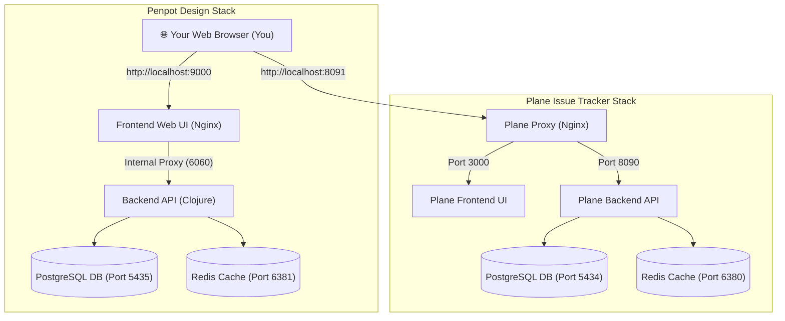

# Beginner's Guide: Running Penpot & Plane Locally

Welcome! If you are new to self-hosted development tools, Docker containers, or terminal workflows, this step-by-step guide is designed specifically for you.

By the end of this tutorial, you will have two industry-standard tools running smoothly on your computer:
1. **Penpot** (Port `9000`): An open-source, web-based design and prototyping workspace (an open alternative to Figma).
2. **Plane** (Port `8091`): An open-source, modern project and issue tracker (an open alternative to Linear and Jira).

---

## 1. The Big Picture: How These Services Work

When running these services locally, you don't need to install Python, Java, or databases directly on your personal computer. Instead, **Docker Compose** runs each part in a lightweight, self-contained virtual "box" (a container).



### Port Summary Table
Keep this handy whenever you open your browser:

| Service | Browser URL | Default Role |
| :--- | :--- | :--- |
| **Penpot Web App** | [http://localhost:9000](http://localhost:9000) | UI design canvas, vector tools & design tokens |
| **Penpot Backend API** | `http://localhost:9001` (Internal `6060`) | REST API engine & Clojure backend |
| **Plane Web App** | [http://localhost:8091](http://localhost:8091) | Project management, issue boards, backlog & cycles |
| **Plane Backend API** | `http://localhost:8090` | Issue tracker REST API & instance engine |

---

## 2. Step 1: Starting the Services

Make sure Docker Desktop (or your Docker engine) is running on your computer.

Open your terminal in the root directory of the Dendrite repository and run:

### Starting Penpot
```bash
docker compose -f stacks/compose.penpot.yaml up -d
```

### Starting Plane
```bash
docker compose -f stacks/compose.plane.yaml up -d
```

> **What does `-d` mean?**  
> It stands for "detached mode". It tells Docker to run the containers quietly in the background so you get your terminal prompt back immediately.

### Checking If Everything Is Healthy
Run:
```bash
docker ps
```
You should see containers starting with `dendrite-penpot-*` and `dendrite-plane-*` reporting `(healthy)` or `Up`.

---

## 3. Step 2: Setting Up Accounts & Logging In

Neither Penpot nor Plane ships with a default `admin / admin` password out of the box. This is an intentional security practice. Instead, you create your own initial account the very first time you launch them.

### Standardized Credentials for Local Development
To make onboarding effortless and avoid remembering multiple logins, the entire Dendrite environment (`stacks/.env`) standardizes on the following credentials for both Penpot and Plane:

| Field | Standard Local Value | Description |
| :--- | :--- | :--- |
| **Full Name** | `Dendrite Developer` | Your display name across both platforms |
| **Email Address** | `dev@dendrite.ai` | Standardized local login email |
| **Password** | `dendrite123` | Shared local development password |

---

### Setting Up Penpot

#### Option A: Sign Up in the Browser (Easiest & Shows Onboarding Tour)
Because our local configuration has `disable-email-verification` active, you do **not** need a real email server:

1. Open your browser and go to: **[http://localhost:9000](http://localhost:9000)**
2. Click **Create account** (or navigate to `http://localhost:9000/#/auth/register`).
3. Fill in the standardized form:
   - **Full Name**: `Dendrite Developer`
   - **Email Address**: `dev@dendrite.ai`
   - **Password**: `dendrite123`
4. Click **Sign up**. You will be taken directly into your new design workspace, where the introductory walkthrough slides will guide you through the canvas!

#### Option B: Create an Account via Terminal CLI
If you prefer creating an account directly from the command line:

```bash
# Creates the user and automatically presents the interactive tutorial on first login:
docker exec -it dendrite-penpot-backend python3 manage.py create-profile \
  -n "Dendrite Developer" \
  -e "dev@dendrite.ai" \
  -p "dendrite123"
```

*(Note: Adding `--skip-tutorial --skip-walkthrough` marks the tutorial as completed in advance if you want to jump straight into an empty workspace).*

Once executed, go to [http://localhost:9000](http://localhost:9000) and log in with:
- **Email**: `dev@dendrite.ai`
- **Password**: `dendrite123`

---

### Setting Up Plane

1. Open your browser and go to: **[http://localhost:8091](http://localhost:8091)**
2. The initial **Onboarding Wizard** will appear asking you to set up your instance:
   - **Step 1: Create your Admin Profile**:
     - **Full Name**: `Dendrite Developer`
     - **Email Address**: `dev@dendrite.ai`
     - **Password**: `dendrite123`
   - **Step 2: Create your Workspace**:
     - **Workspace Name**: `dendrite` (This sets your workspace URL slug to `http://localhost:8091/dendrite`).
   - **Step 3: Create your First Project**:
     - **Project Name**: `Dendrite Core`
     - **Identifier**: `DEN`
3. Click **Continue**. You will land right on the Plane issue board. Whenever you log in again in the future, simply use `dev@dendrite.ai` and `dendrite123`.

#### Connecting Plane to Dendrite (API Token)
If you want Dendrite's autonomous tools and agents to synchronize tickets with Plane:
1. In Plane, click your profile avatar at the top left > **Settings**.
2. Go to **API Tokens** (or **Workspace Settings** > **API Tokens**).
3. Click **Add API Token**, name it `Dendrite CLI`, and copy the generated token.
4. Set it in your terminal environment or `.env` file:
   ```bash
   export PLANE_API_KEY="your-copied-token-here"
   export PLANE_BASE_URL="http://localhost:8091"
   export PLANE_WORKSPACE_SLUG="dendrite"
   ```

---

## 4. How to Enable or Replay Tutorials & Walkthroughs

If you skipped the initial walkthrough or want to review the built-in guidance again later, here is exactly how to access them at any time:

### For Penpot

#### 1. In the Web UI (Available Anytime Without Database Edits)
- **Official Starter Templates & Interactive Files**: On your Penpot Dashboard, click **Templates** (or **Libraries & Templates**). Creating a new file from any official template (such as *Prototypes*, *Flexible Layouts*, or *Wireframing Kit*) opens interactive sample artboards directly on your canvas.
- **Keyboard Shortcuts & Quick Tips**: Press **`?`** (or `Shift + /`) anywhere on the workspace canvas to display the full keyboard shortcut and navigation guide.
- **Official Interface Tour**: Open the **Main Menu** (the Penpot logo in the upper-left) > **Help** > **User Guide**, or visit the [Penpot Interface Tour](https://help.penpot.app/user-guide/interface-tour/).

#### 2. Replay the Welcome Walkthrough Slides
If you want Penpot to display the first-time welcome walkthrough popup again for `dev@dendrite.ai`, reset the flags in the local database:

```bash
docker exec -it dendrite-penpot-db psql -U penpot_user -d penpot_dev -c \
  "UPDATE profile SET props = props || '{\"~:viewed-tutorial?\": false, \"~:viewed-walkthrough?\": false}' WHERE email = 'dev@dendrite.ai';"
```

Now refresh [http://localhost:9000](http://localhost:9000) in your browser. The initial welcome walkthrough slides will appear immediately!

---

### For Plane

#### 1. In the Web UI
- **Help Center & Documentation**: Click the **`?` Help** icon at the bottom-left sidebar of the Plane interface to open links to the official documentation, user guide, and release notes.
- **Keyboard Shortcuts**: Press **`Cmd + /`** (macOS) or **`Ctrl + /`** (Windows/Linux) anywhere inside Plane to toggle the quick-action shortcut modal.

#### 2. Replay Plane's Onboarding Tour
If you want Plane to re-trigger its interactive onboarding walkthrough sequence:

```bash
docker exec -it dendrite-plane-db psql -U plane_user -d plane_dev -c \
  "UPDATE profiles SET is_tour_completed = false, is_onboarded = false WHERE user_id = (SELECT id FROM users WHERE email = 'dev@dendrite.ai');"
```

Refresh [http://localhost:8091](http://localhost:8091) in your browser to restart the tour!

---

## 5. Troubleshooting: What Did the "502 Bad Gateway" Mean?

If you ever encounter an error like this in your browser or terminal logs:

```text
[error] connect() failed (111: Connection refused) while connecting to upstream,
request: "GET /api/main/methods/get-profile HTTP/1.1",
upstream: "http://172.18.0.12:6001/api/main/methods/get-profile", host: "localhost:9000"
"GET /api/main/methods/get-profile HTTP/1.1" 502
```

Here is what that actually means in plain English:

1. **What is a 502 error?**  
   Think of the **Frontend** container as a receptionist at a front desk, and the **Backend** container as an employee in an office upstairs. A `502 Bad Gateway (Connection refused)` means a customer walked in, the receptionist dialed the upstairs office extension, but the phone kept ringing or was disconnected because the employee had stepped out or the phone was unplugged.

2. **Why did it happen in Penpot?**
   - **Database Connection Error**: The backend couldn't connect to PostgreSQL because the database credentials were typed in a format that the Clojure database driver couldn't read (`UnknownHostException`). Because the backend could not reach the database, it stopped running.
   - **Port Discrepancy**: Penpot's backend listens internally on port **6060** (not `6001`). When the frontend tried to talk to port `6001`, nobody was listening.
   - **Upstream Validation**: Nginx required an exporter upstream address so it wouldn't fail DNS lookups on boot.

3. **How was it fixed?**
   - In `stacks/compose.penpot.yaml`, the database username and password are now passed as explicit environment variables (`PENPOT_DATABASE_USERNAME` and `PENPOT_DATABASE_PASSWORD`).
   - The backend port and proxy routes are properly directed to port **6060**.
   - The frontend health check was updated to use a native TCP socket check (`exec 3<>/dev/tcp/127.0.0.1/8080`) instead of looking for missing `wget` binaries.

---

## 6. Handy Diagnostic Commands

If something ever looks stuck, here are the most useful commands:

### 1. View live logs of a specific service
```bash
# Watch Penpot backend logs in real time
docker logs -f dendrite-penpot-backend

# Watch Penpot frontend logs
docker logs -f dendrite-penpot-frontend

# Watch Plane backend API logs
docker logs -f dendrite-plane-api
```
*(Press `Ctrl + C` to exit log viewing).*

### 2. Test if the Penpot backend is responding
```bash
curl -i http://localhost:9000/api/main/methods/get-profile
```
If working, you will receive `HTTP/1.1 200 OK` and a JSON response.

### 3. Restart a service cleanly
```bash
docker compose -f stacks/compose.penpot.yaml restart
docker compose -f stacks/compose.plane.yaml restart
```

---

## 7. How to Stop the Services

When you are done developing for the day and want to free up memory on your machine:

```bash
# Stop Penpot
docker compose -f stacks/compose.penpot.yaml down

# Stop Plane
docker compose -f stacks/compose.plane.yaml down
```

> **Will I lose my projects, drawings, or issues?**  
> **No!** All your databases, user accounts, tickets, and design files are stored safely in persistent Docker volumes (`penpot-postgres-data` and `plane-postgres-data`). The next time you run `docker compose up -d`, everything will be right where you left it.
