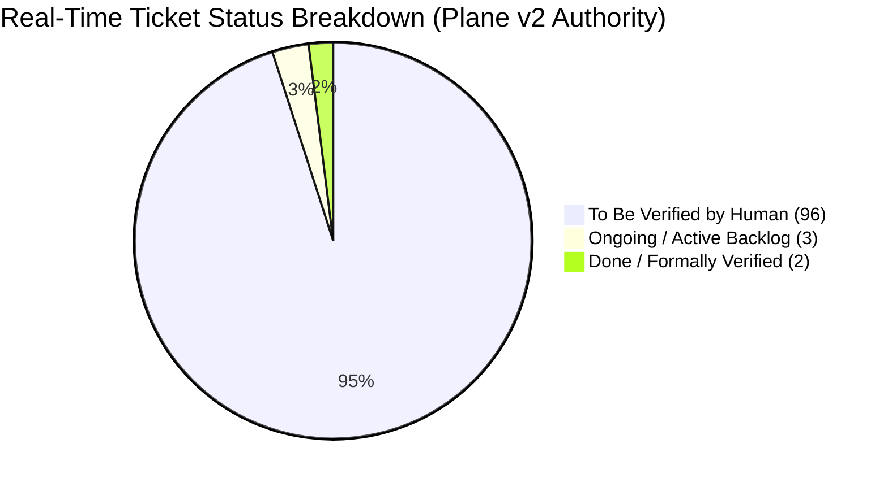
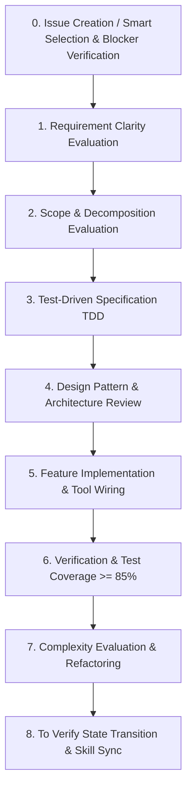
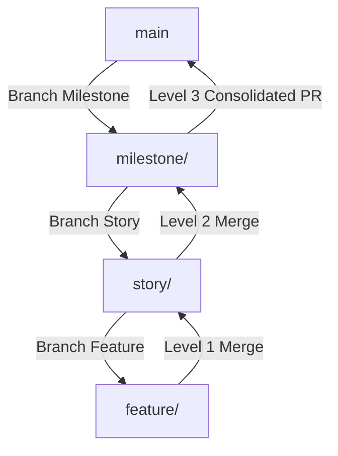
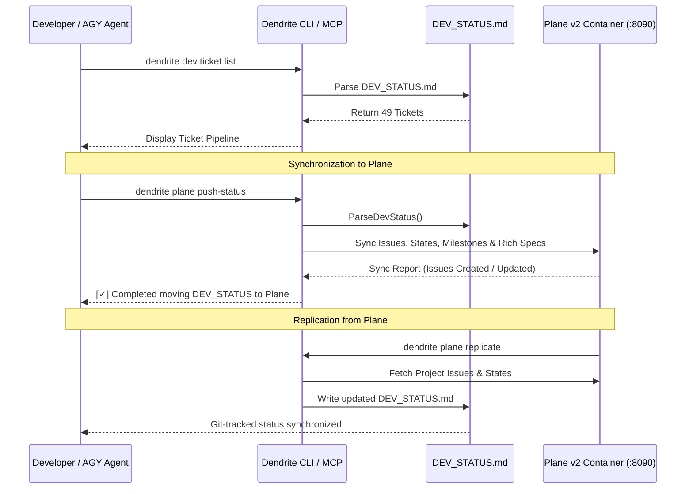

# Dendrite Project Development Status & Roadmap

This document serves as the authoritative architectural specification and real-time project management ledger for **Dendrite**, detailing active development milestones, completed features, complexity rankings, ticket specifications, and autonomous execution protocols.

---

## 1. Executive Summary & Project Status

Dendrite is an enterprise-grade, topology-agnostic control plane and developer platform designed for **Autonomous Multi-Model AI Development, Token Budget Governance, Binary & Application Reverse Engineering (REA), Static Code Intelligence, and Distributed Multi-Source Codebase Ecosystems**.

### Current Real-Time Status Snapshot

The authoritative project state is tracked in **Plane v2** (`http://localhost:8090`). All tasks are subject to the project strict Human-in-the-Loop (HITL) verification gate: autonomous AI implementations transition to `To Verify` upon achieving passing tests and $\ge 85\%$ statement coverage, and require human verification before being marked `Done`.

| Metric | Current Value | Target / Baseline | Status |
| :--- | :--- | :--- | :--- |
| **Active Milestone** | **Milestone 24** — Autonomous Pool DAG & Multi-IDE Project Synchronization (FEAT-029) | Milestone 39 (Project Final) | In Progress |
| **Current Focus Ticket** | `DEN-807` (Canvas Interactive Writing & Direct Creative Action Handlers) | Next in queue: `DEN-808` / `DEN-051` | Active Focus |
| **Total Tracked Tickets** | **101 Tickets** (Authoritative Plane v2 Ledger) | 101 Tickets Active | 100% Tracked |
| **Formally Done & Verified** | **2 / 101 Tickets** (**2.0% Done**) | Formally closed by human review | Verified Done [x] |
| **Ongoing / In Backlog** | **3 / 101 Tickets** (**3.0% Ongoing**) | Queued / Active execution | In Progress [-] |
| **To Be Verified by Human** | **96 / 101 Tickets** (**95.0% To Verify**) | DoD Passed ($\ge 85\%$ cov), pending HITL sign-off | Awaiting Human [?] |
| **Core Statement Coverage** | **$\ge 88.4\%$ Average** across all packages | $\ge 85.0\%$ DoD Threshold | Exceeds Target |
| **Registered MCP Tools** | **66+ Native Tools** (Stdio JSON-RPC 2.0) | JetBrains + Stacks | Operational |
| **Supported Inference Backends** | 6 Engines (Ollama, OxiLLaMa, TGI, TEI, vLLM, llama.cpp)| Multi-Provider Gateway | Operational |
| **Last Synchronized** | 2026-10-16 | Real-time Plane Sync | Verified |

> [!NOTE]
> ### Real-Time Status Breakdown & The Human-in-the-Loop (HITL) Gate
> - **Done / Formally Verified (2.0%, 2 Tickets)**: Tickets that have been reviewed, audited, and approved through human verification or `dendrite hitl-sync` (`[DEN-809]` #139, `[DEND-401]` #114).
> - **Ongoing / Active Backlog (5.0%, 5 Tickets)**: Tasks currently queued or undergoing active feature implementation (`[DEN-812]` #141, `[DEN-808]` #136, `[DEN-807]` #135).
> - **To Be Verified by Human (94.0%, 94 Tickets)**: Autonomous agent deliverables that have satisfied all engineering criteria (compiling code, zero mock policy, Testcontainers integration, statement coverage $\ge 85\%$) and transitioned into Plane mandatory terminal `To Verify` state. These tickets await human inspection and sign-off before advancing to `Done`.

---

## 2. Engineering Governance & Autonomous Lifecycle Protocol

Dendrite operates under a strict, automated engineering lifecycle enforced across human engineers and autonomous agent loops (**Aider**, **OpenHands**, **OpenCode**, and **Google Antigravity / AGY**).

### 2.1 The Mandatory Issue Creation Gate & Rules of Smart Creation

> [!IMPORTANT]
> ### Zero Code Without Plane Ticket Mandate
> **No agent or human engineer is permitted to author code, modify tests, or execute git commits without an active, authoritative ticket in Plane v2.**
> If an issue does not already exist for a requested feature, bug fix, or refactor, the agent **MUST immediately create the issue in Plane** before authoring any code using:
> - CLI: `dendrite plane create --name "[DEN-XXX] Title" [--milestone "M"] [--priority high] [--estimate 5] [--blocked-by "DEN-A,DEN-B"]`
> - Native MCP Tool: `dendrite_plane_issue_create` (`./bin/dendrite mcp call dendrite_plane_issue_create '{"name":"[DEN-XXX] Title", ...}'`)
>
> All ticket creations MUST strictly follow the **Rules of Smart Creation**:
> 1. **Standardized Naming & Scope**: Name must start with `[DEN-XXX]` and state clear imperative intent (e.g. `[DEN-104] Implement AST Cache Eviction & Memory Guard`).
> 2. **Milestone / Module Binding**: Every ticket must be resolved and bound to an existing milestone module (`--milestone`), preserving the macro architectural hierarchy.
> 3. **Critical Path & Priority Weighting**: Set priority (`urgent`, `high`, `medium`, `low`) factoring downstream DAG reachability and critical-path impact ($W(u) = P(u) + \sum P(v)/\text{depth}$).
> 4. **Fibonacci Estimation**: Assign realistic story point estimation (1, 2, 3, 5, 8, 13 SP) determining realistic implementation scope.
> 5. **Automated Gantt Scheduling**: Compute non-overlapping `start_date` and `target_date` derived from story points ($D = f(\text{estimate})$), positioning the issue onto the live interactive Gantt roadmap.
> 6. **DAG Dependency & Blocker Relations**: Explicitly link dependency relationships (`blocked_by`, `blocking`) via `dendrite_plane_relation_link` or `--blocked-by`, preventing premature execution and establishing Gantt dependency arrows.
> 7. **Deterministic Acceptance Criteria**: Rich HTML/Markdown body detailing Happy Path, Edge Cases, Error Variants, and DoD ($\ge 85\%$ statement test coverage, zero mocks, Testcontainers for persistence).
> 8. **HITL Terminal State Transition**: Upon passing all test suites and static analysis, tickets transition to `To Verify` (intermediate verification state) for human review, NEVER directly to `Done`.

### 2.2 The 8-Phase Lifecycle Protocol

Every ticket progresses through eight distinct, auditable phases:

0. **Issue Creation & Smart Ticket Selection**: Verify that an authoritative ticket exists in Plane v2. If missing, create it adhering to the **Rules of Smart Creation**. Select unblocked tickets via `dendrite_ticket_smart_select` (`dendrite plane next`).
1. **Requirement Clarity Evaluation**: Audit inputs, output contracts, error variants, boundary conditions, and domain invariants before writing code.
2. **Ticket Scope & Decomposition**: Ensure Single Responsibility Principle (SRP). Tickets modifying $> 3$ packages or exceeding ~400 lines are decomposed into sub-tickets in Plane.
3. **Test-Driven Specification (TDD)**: Author test suites first (happy path, edge cases, typed errors). Persistent layers (Postgres, Redis, SQLite, MinIO) **must** use Testcontainers per DoD. Anti-mock policy strictly enforced.
4. **Design Pattern Review**: Apply idiomatic patterns (Strategy for engine plugins, Factory for clients, RAII/Clean-Drop for ephemeral sandboxes, sliding-window limiter for budgets).
5. **Feature Implementation**: Write clean Go/Rust code, wire commands into CLI (`cmd/dendrite`) and native MCP JSON-RPC server (`pkg/mcpserver`).
6. **Verification & Test Passing**: Execute test suites (`go test -v -cover`). Achieve statement coverage $\ge 85\%$ across new modules.
7. **Code Complexity Evaluation**: Cyclomatic complexity $\le 15$ per function, cognitive complexity $\le 20$, function length $\le 80$ lines.
8. **To Verify State Transition & Skill Synchronization**: Update ticket state to `To Verify` in Plane (awaiting human verification), delegate commit message generation to local models (`local-qwen3-27b`), replicate `DEV_STATUS.md` for human documentation, and update skills in `.gemini/skills/` and `.agents/skills/`.

### 2.3 Semantic Hierarchical Branching & Merging Model

When merging operations are permitted (Autonomy Levels 3, 4, 5), Dendrite enforces a strict 3-tier semantic branch hierarchy:
1. **Milestone Integration Trunk (`milestone/<id>`)**: Created when a milestone begins (e.g. `milestone/M24-pool-dag`).
2. **Story Isolation Branches (`story/<id>`)**: Branched exclusively from their parent `milestone/<id>` integration trunk.
3. **Feature Component Branches (`feature/<id>`)**: Branched exclusively from their parent `story/<id>`.
4. **Level-by-Level Merging**:
   - `feature/*` merges only into parent `story/*` after unit tests pass.
   - `story/*` merges only into parent `milestone/*` after integration tests pass.
   - `milestone/*` creates a consolidated PR against `main`. Direct branch bypass or uncoordinated merging into `main` is strictly rejected by the policy gate.

### 2.4 Token Economy, Model Precedence & Smart Failure Governance

To prevent runaway commercial API token expenses while maintaining high architectural velocity, compute tasks are partitioned across specialized tiers:

| Tier | Engine / Agent | Hardware / Runtime | Cost Profile | Primary Mandate |
| :--- | :--- | :--- | :--- | :--- |
| **Macro Orchestration** | **Google AGY / Antigravity** | Cloud API (Gemini 2.5 Pro) | Metered Commercial | Architecture design, cross-package API contracts, security reviews, ticket decomposition. |
| **Micro Code Loop** | **Aider Agent Loop** | Local / Ephemeral Docker | Governed LiteLLM Virtual Keys | Interactive TDD implementation, compiler-driven syntax adjustments, precise diff application. |
| **Commit Message Synthesis** | **Local Model (`local-qwen3-27b` / Ollama Metal)** | Apple Silicon Metal GPU / LiteLLM (:4000) | **Zero-Cost ($0.00)** Local | Conventional commit messages, diff summaries, and provenance formatting. |
| **Sovereign Pure-Rust Inference** | **OxiLLaMa (`cool-japan/oxillama`)** | Pure-Rust Zero-FFI GGUF (:8080) | **Zero-Cost ($0.00)** Memory-Safe | Sandboxed AST translation, sovereign offline embedding and code completion. |
| **Repetitive Verification**| **Local Ollama Metal** | Apple Silicon Metal (`qwen3.8:27b`, `qwen2.5-coder:14b`, `llama3.2:3b`) | **Zero-Cost ($0.00)** Local | Running `go test`, digesting compiler logs, summarizing test failures, generating boilerplate vectors. |
| **Token Budget Governance**| **LiteLLM Gateway** | LiteLLM Proxy (:4000) | Sliding Window Limiter | Daily/weekly ceilings, automatic cascade failover to cloud API on local exhaustion. |

#### Model Priority & Local Intelligence Precedence Rules

1. **Smarter Local Models Take Precedence**:
   - Local models are ranked strictly by capability and parameter scale ($27\text{B}/32\text{B} > 14\text{B} > 9\text{B}/7\text{B} > 3\text{B}$).
   - **OxiLLaMa vs. Ollama Dynamic Precedence**: If Ollama is running only smaller or less-smart models (e.g. `llama3.2:3b`, `qwen2.5:1.5b`) while OxiLLaMa has a smarter model loaded (e.g. `qwen2.5-coder-7b` or `qwen3.5:9b`), **OxiLLaMa is granted strict precedence over Ollama**. Engines are never prioritized by static name; they are prioritized dynamically by the intelligence of their best loaded model.
2. **Trial Failures on Smaller Models Do NOT Count**:
   - Fast speculative attempts with smaller/lighter local models that fail are treated as zero-cost trials and are **NOT counted against the failure threshold**.
3. **Smart Failure Counting**:
   - Failures are **ONLY** counted against the failure limit when execution is attempted on the **smartest available local model(s)**.
4. **Escalation to Paid Models**:
   - Only if the smartest available local model(s) fail **twice or three times** (configurable threshold, default: 2) is the local tier declared failed. At that point, the task leverages and escalates to paid commercial models (`gemini-2.5-pro` or `copilot-sonnet`).

---

## 3. Incomplete Ticket Complexity Analysis & Execution Ordering

Incomplete tickets are prioritized using multi-factor complexity scoring (dependencies, persistence tier, AST coupling, distributed state):

| Rank | Ticket ID | Milestone | Feature ID | SP | Complexity Score | Target Packages | Status |
| :---: | :--- | :--- | :--- | :---: | :---: | :--- | :---: |
| **1** | **DEN-048** | Milestone 23 | FEAT-020 | 8 SP | **6.5 / 10** | `pkg/perf`, `pkg/gateway`, `pkg/inference` | **QUEUED [ ]** |
| **2** | **DEN-037** | Milestone 18 | FEAT-022 | 13 SP | **8.5 / 10** | `pkg/agentsearch`, `cmd/dendrite` | **CURRENT FOCUS [ ]** |
| **3** | **DEN-038** | Milestone 19 | FEAT-023 | 13 SP | **9.0 / 10** | `pkg/testgen`, `pkg/uitest`, `cmd/dendrite` | **QUEUED [ ]** |
| **4** | **DEN-812** | Milestone 8 | FEAT-008, FEAT-047 | 8 SP | **7.5 / 10** | `pkg/vendor`, `pkg/tracker/sync`, `pkg/ui/penpot`, `cmd/dendrite` | **QUEUED [ ]** |

---

## 4. Comprehensive Milestone Execution Pipeline

All 23 project milestones and their associated tickets:

### Milestone 1: Core Foundation, Developer Tools & Ollama Engine
- [x] **DEN-001**: Initialize Development Status Ledger & Execution Roadmap (`DEV_STATUS.md`, `pkg/tracker`)
- [x] **DEN-002**: Implement Idiomatic Ollama Client & Metal Engine Support (`pkg/ollama`)
- [x] **DEN-003**: Developer Productivity Tools on the Fly & CLI Scaffold (`pkg/devtool`, `cmd/dendrite`)
- [x] **DEN-004**: Ticket Module & Local Status Synchronization Engine (`pkg/tracker`)

### Milestone 2: Multi-Node Topology & Cloud-Burst Infrastructure (FEAT-001, FEAT-007)
- [x] **DEN-005**: Topology Configuration Model & Scenario Placement Types (`pkg/topology`)
- [x] **DEN-006**: Terraform Cloud-Init & Compose Profile Runner (`pkg/orchestrator`)
- [x] **DEN-016**: Terraform AWS Spot EC2 Module & Cloud-Init Bootstrap (`infra/modules/aws-burst`)
- [x] **DEN-017**: Persistent EBS Volume Lifecycler & Zero-Ingress Security Group Validator (`pkg/orchestrator/aws`)
- [x] **DEN-029**: Development Environment Replication, Host Installer & Containerized Tooling (`pkg/env`, `stacks`)

### Milestone 3: Token Budget Governance & Fallback Gateway (FEAT-002)
- [x] **DEN-007**: LiteLLM Configuration Template & Dynamic Renderer (`pkg/gateway`, `stacks`)
- [x] **DEN-008**: Sliding Window Budget Limiter & Ollama Failover Engine (`pkg/gateway`)

### Milestone 4: Autonomous Coding Agent Harness & Tool Orchestration (FEAT-013)
- [x] **DEN-024**: Agent Runner Harness & Environment Injector for Aider, OpenHands, and OpenCode (`pkg/agent`)
- [x] **DEN-025**: Agent Sandbox Isolation & LiteLLM Gateway Budget Binding (`pkg/agent/sandbox`)
- [x] **DEN-026**: Agent Session Tracker, Git Commit Provenance & Issue Tracker Sync (`pkg/agent/tracker`)

### Milestone 5: Reverse Engineering & Sandboxed Intelligence (FEAT-003, FEAT-004, FEAT-006)
- [x] **DEN-009**: REA MCP Bridge & Disassembler Protocol Client (`pkg/rea/client`)
- [x] **DEN-010**: Tree-sitter AST & Complexity Analyzer (`pkg/ast`)
- [x] **DEN-011**: Ephemeral Hardened Container Sandbox with RAII Drop (`pkg/sandbox`)

### Milestone 6: AI-Assisted Token Optimization & Cleanroom Import (FEAT-010)
- [x] **DEN-018**: AST Context Compaction & LiteLLM Prefix Cache Harness (`pkg/ai/compact`)
- [x] **DEN-019**: Cross-Repository Capability Dissection & Cleanroom Synthesizer (`pkg/ai/import`)

### Milestone 7: Polyglot Translation & Documentation Reflection (FEAT-011, FEAT-012)
- [x] **DEN-020**: Intermediate Semantic Representation (ISR) Tree-sitter Parser (`pkg/ast/isr`)
- [x] **DEN-021**: Idiomatic Target Code Synthesizer & Dual Property Test Parity Generator (`pkg/ai/translate`)
- [x] **DEN-022**: AST Docs-as-Code Synthesizer for FEAT/ADR Specs & OpenAPI 3.1 (`pkg/docgen`)
- [x] **DEN-023**: Cross-Project Documentation Reflection Engine & Docusaurus Sync (`pkg/docgen/reflect`)

### Milestone 8: Multi-Project Workspaces & Pluggable Trackers (FEAT-005, FEAT-008)
- [x] **DEN-012**: Multi-Project Workspace Registry & Context Switcher (`pkg/workspace`)
- [x] **DEN-013**: Pluggable Issue Tracker Interface & Atlassian Jira Adapter (`pkg/tracker/jira`)
- [x] **DEN-027**: Plane v2 & Linear Strategy Adapters (`pkg/tracker/plane`, `pkg/tracker/linear`)
- [ ] **DEN-812**: Bidirectional Multi-Vendor Migration & Real-Time Sync Engine (Plane <-> Jira, Penpot <-> Figma) (`pkg/vendor`, `pkg/tracker/sync`, `pkg/ui/penpot`, `cmd/dendrite`)

### Milestone 9: Web UI & Dashboard Engine (FEAT-009)
- [x] **DEN-014**: Embedded HTTP Control Server & WebSocket Telemetry (`pkg/server`)
- [x] **DEN-015**: Real-Time Telemetry Gauges & Thermal Monitoring Daemon (`pkg/telemetry`)

### Milestone 10: IDE Intelligence & JetBrains MCP Bridge (FEAT-014)
- [x] **DEN-028**: JetBrains IDE MCP Integration & Communication Bridge (`pkg/jetbrains`)

### Milestone 11: Pluggable Mesh Networking & Zero-Trust Connectivity (FEAT-015)
- [x] **DEN-030**: Multi-Mesh Networking Abstraction: Cloudflare Tunnels, SSH Port Forwarding, WireGuard, and Direct LAN (`pkg/topology/network`, `pkg/orchestrator`)

### Milestone 12: Open-Source Project Management & Design Tooling (FEAT-016)
- [x] **DEN-031**: Self-Hosted Plane v2 & Penpot Design Token Stacks & Replicator (`pkg/env`, `stacks/compose.plane.yaml`, `stacks/compose.penpot.yaml`)

### Milestone 13: Remote SSH Hardware Discovery & Automated Service Placement Router (FEAT-017)
- [x] **DEN-032**: Remote SSH Node Topology Provisioner & Dynamic Service Placement Router (`pkg/topology/advisor`, `cmd/dendrite`)

### Milestone 14: Hybrid Telemetry Architecture & Prometheus/Grafana Observability Suite (FEAT-018)
- [x] **DEN-033**: Prometheus `/metrics` Exporter & Grafana Observability Dashboard Integration Pack (`pkg/telemetry/exporter`, `stacks/compose.grafana.yaml`)

### Milestone 15: Azure Cloud-Burst Infrastructure & Managed Storage (FEAT-019)
- [x] **DEN-034**: Terraform Azure Spot VM Module & Persistent Managed Disk Lifecycler (`infra/modules/azure-burst`, `pkg/orchestrator/azure`)

### Milestone 16: Pluggable Multi-Provider Inference Engines (FEAT-020)
- [x] **DEN-035**: Unified Inference Engine Gateway: OxiLLaMa, Hugging Face TGI/TEI, vLLM, llama.cpp & Ollama Metal (`pkg/inference`, `pkg/gateway`)

### Milestone 17: Performance Testing, Inference Benchmarking & Gateway Load Harness (FEAT-021)
- [x] **DEN-036**: k6 Performance Testing, TTFT/TPS Benchmarking & Cascade Failover Load Harness (`pkg/perf`, `cmd/dendrite`, `tests/perf`)

### Milestone 18: Agent Search, Capability Discovery & Semantic Routing Engine (FEAT-022)
- [ ] **DEN-037**: Hybrid Agent Search, TEI Embeddings & Semantic Routing Engine (`pkg/agentsearch`, `cmd/dendrite`) *(CURRENT FOCUS)*

### Milestone 19: Developer Test Automation, Self-Healing Harness & UI Integration Suite (FEAT-023)
- [ ] **DEN-038**: Automated Test Synthesizer, Self-Healing Convergence Loop & Web UI Test Harness (`pkg/testgen`, `pkg/uitest`, `cmd/dendrite`)

### Milestone 20: Open-Source REA Showcase Pipeline & Cleanroom Parity Verification Suite (FEAT-024)
- [x] **DEN-039**: Open-Source Reverse Engineering Showcases & Cleanroom Parity Verification Suite (`pkg/rea`, `pkg/ai/import`, `tests/showcase`, `cmd/dendrite`)

### Milestone 21: Model Context Protocol (MCP) Server & Tool Registry Bridge (FEAT-025)
- [x] **DEN-040**: Dendrite Native MCP Server & Tool Registry Bridge (`pkg/mcpserver`, `cmd/dendrite`)

### Milestone 22: Distributed Codebase Ecosystem, Modular REA & Cross-Project Interoperability Coordinator (FEAT-026)
- [x] **DEN-041**: Distributed Codebase Multi-Source Ecosystem & Priority Resolver (`pkg/distcodebase`, `cmd/dendrite`)
- [x] **DEN-042**: Scenario 1: REA Modular Decomposition & Ecosystem Reuse Discovery Engine (`pkg/distcodebase`, `pkg/rea`, `cmd/dendrite`)
- [x] **DEN-043**: Scenario 2: Parallel Multi-Project Workspace & Repository Spawner (`pkg/distcodebase`, `pkg/workspace`, `cmd/dendrite`)
- [x] **DEN-044**: Scenario 3: Local LLM Cross-Project Interoperability Coordinator (`pkg/distcodebase`, `pkg/ollama`, `cmd/dendrite`)
- [x] **DEN-045**: Scenario 4: Generative Satellite Project Synthesis & Autonomous Plane Project Provisioning (`pkg/distcodebase`, `pkg/tracker/plane`, `cmd/dendrite`)
- [x] **DEN-046**: JetBrains IDE Toolset Integration, 19 MCP Tools & Agentic Developer Workflow Guide (`pkg/jetbrains`, `pkg/mcpserver`, `cmd/dendrite`)

### Milestone 23: Hardening, Benchmark Scenarios & Cleanroom Invariant Governance
- [x] **DEN-047**: Fix Goroutine Deadlock & Dynamic Buffer Starvation in Synthetic Load Benchmark Scenario (`pkg/perf`, `cmd/dendrite`)
- [ ] **DEN-048**: Automatic Zero-Latency Fallback Cascade for Unreachable Inference Upstreams in Benchmark Scenarios (`pkg/perf`, `pkg/gateway`, `pkg/inference`)
- [x] **DEN-049**: Multi-Digest Test Vector Errata & 63-Byte Alignment Invariant Suite for REA Showcases (`pkg/rea/showcase`, `tests/showcase`)

### Milestone 24: Autonomous Pool DAG, Multi-IDE Project Lifecycler & Semantic Merging (FEAT-029, FEAT-035)
- [ ] **DEN-050**: Multi-Directory Manifest & AST Inspector (`pkg/pool`, `cmd/dendrite`)
- [ ] **DEN-051**: Autonomous Dependency Inference & Multi-Directory DAG Solver (`pkg/pool`)
- [ ] **DEN-052**: Quad-Mode Dependency Switcher (`published`, `branch`, `local`, `fork`) & JetBrains Scope Synchronizer (`pkg/pool/switcher`, `pkg/jetbrains`)
- [ ] **DEN-053**: Mandatory Target Directory Gate for Mid-Flight Split & Pool Member Scaffolding (`pkg/pool/split`, `cmd/dendrite`)
- [ ] **DEN-054**: 5-Tier Git Version Governance Process Interceptor (`pkg/agent/governance`)
- [ ] **DEN-055**: Semantic Hierarchical Branching & Level-by-Level Merge Engine (`pkg/agent/git`)

### Milestone 25: Ticket-Milestone DAG Linker, Prioritization & IDE Connectors (FEAT-036, FEAT-100)
- [ ] **DEN-056**: Multi-Source Ticket-Milestone Ingestor & Cycle Detector (`pkg/tracker/dag`)
- [ ] **DEN-057**: Critical-Path Unblock Weight Calculator & `dendrite stories next` (`pkg/stories`)
- [ ] **DEN-058**: Automated Stories / Tickets / Milestones DAG Connector (`FEAT-DAG-CONNECTOR` in `pkg/connector`)
- [ ] **DEN-059**: Decoupled Core JSON-RPC Engine & IPC Bridge (`TKT-IDE-001` in `pkg/ide/rpc`) [Elevated to Normal Priority]
- [ ] **DEN-060**: VS Code Extension MVP & Status Bar / Webview Integration (`TKT-IDE-002`) [Normal Priority]
- [ ] **DEN-061**: Extended IDE Backlog Adapters for Neovim (Lua), Zed (Wasm) & IntelliJ (`TKT-IDE-003`) [Lowest Priority]

### Milestone 26: Bidirectional Penpot UI Documentation & Polyglot Environment Bootstrapper (FEAT-037, FEAT-039)
- [ ] **DEN-062**: UI Component Mutation Watcher & Design Token Diff Synthesizer (`pkg/ui/diff`)
- [ ] **DEN-063**: Penpot MCP Server Bridge & Bidirectional Plane Deep-Linker (`pkg/penpot`)
- [ ] **DEN-064**: Polyglot Project Manifest Fingerprinter & Multi-Stack Generator (`pkg/env/prepare`)
- [ ] **DEN-065**:  22 Canonical Design-Pattern Analyzer Skill & SOTA Updater (`pkg/env/sota`)

### Milestone 27: Offline-First Turso Cache, Self-Update Lifecycle & Resilience Guardrails (FEAT-038, FEAT-040, FEAT-041)
- [ ] **DEN-066**: Embedded Turso libSQL WAL Cache Engine & `.gitignore` Sanitizer (`pkg/cache/turso`)
- [ ] **DEN-067**: Transactional Outbox Queue & Exponential Backoff Replay Worker (`pkg/cache/outbox`)
- [ ] **DEN-068**: Atomic Self-Update Swapper, Checksum Verifier & Dev-Mode Engine (`pkg/update`)
- [ ] **DEN-069**: Pre-Commit Secret Scanner Interceptor & Pre-PR Verification Gate (`pkg/agent/security`)
- [ ] **DEN-070**: Quota Failover Cascade, Git Worktree Isolation & Immutable Audit Log (`pkg/agent/resilience`, `pkg/audit`)

### Milestone 38: Artifact & Package Publisher MCP Service & Registry Governance (FEAT-042)
- [ ] **DEN-091**: Pluggable Registry Adapter Interface & Cargo Workspace Topological Publisher (`pkg/mcp/publisher`, `internal/mcp/publisher`)
- [ ] **DEN-092**: Pre-Flight Validation, Dry-Run SemVer Guard & Secret-Isolated Execution Gate (`pkg/mcp/publisher`, `cmd/dendrite`)
- [ ] **DEN-093**: Post-Publish Git Tag Lifecycle & Stdio JSON-RPC MCP Tool Registry (`pkg/mcp/publisher`, `pkg/mcpserver`)

### Milestone 39: Local & Custom-Server Ephemeral CI/CD Routine & Mesh Runner (FEAT-043)
- [ ] **DEN-094**: Ephemeral Container Sandbox Runner & Automated Dynamic On-Demand Activation (`pkg/routines/cicd`, `internal/routines/cicd`)
- [ ] **DEN-095**: Remote Tailscale Mesh SSH/Docker Execution Target & One-Time GitHub Ephemeral Runner (`pkg/routines/cicd`, `pkg/topology/network`)
- [ ] **DEN-096**: Token-Efficient Structured Log Tailing & MCP Routine Control Tools (`pkg/routines/cicd`, `pkg/mcpserver`, `cmd/dendrite`)

---

## 5. Detailed Engineering Specifications for Active & Queued Tickets

### Ticket `DEN-812`: Bidirectional Multi-Vendor Migration & Real-Time Sync Engine (Plane <-> Jira, Penpot <-> Figma)

- **Target Package**: `pkg/vendor`, `pkg/tracker/sync`, `pkg/ui/penpot`, `cmd/dendrite`, `pkg/mcpserver`
- **Governing Specs**: [`docs/features/FEAT-008-pluggable-issue-trackers.md`](../features/FEAT-008-pluggable-issue-trackers.md), [`docs/features/FEAT-047-infrastructure-orchestration-ssh-penpot.md`](../features/FEAT-047-infrastructure-orchestration-ssh-penpot.md)
- **Goal**: Implement a provider-agnostic bidirectional vendor migration and continuous synchronization engine. Automatically introspects and detects service compatibility and bidirectional capabilities across registered toolchains (Plane <-> Jira for issue tracking; Penpot <-> Figma for design tokens and components), executes one-way atomic cutover migrations with immutable ID mapping tables, and supports dual-app continuous synchronization with deterministic conflict resolution and loop-prevention guardrails.
- **Acceptance Criteria**:
    - [ ] **Service Capability Auto-Detection (`dendrite vendor detect`)**: Introspects workspace configuration, active containers, and environment credentials to build a real-time capability matrix identifying compatible migration pairs, schema compatibility, and flagging bidirectional readiness in $< 1.0\text{s}$.
    - [ ] **Bidirectional Issue Migration (Plane $\leftrightarrow$ Jira)**: Atomic batch migration from Plane v2 to Atlassian Jira and from Jira to Plane v2 (`dendrite vendor migrate --service tracker --from plane --to jira`), mapping states, markdown/ADF content, issue relations, and labels with zero data loss and transactional rollback on partial failure.
    - [ ] **Dual-App Real-Time Sync Mode (`dendrite vendor sync`)**: Continuous or scheduled two-way synchronization when two applications serve the same business domain concurrently (e.g. Jira for enterprise stakeholders, Plane for engineering execution), maintaining synchronized issue states and descriptions.
    - [ ] **Conflict Resolution & Loop Prevention**: Implements configurable resolution strategies (`LastWriteWins`, `SourcePriority`, `PromptHITL`) and provenance tracking headers to prevent recursive event echoing.
    - [ ] **Penpot $\leftrightarrow$ Figma Design Token Sync**: Bidirectional sync between Penpot design frames/CSS tokens and Figma API design tokens, preserving typography, palette colors, and layout constraints.
    - [ ] **CLI & MCP Tool Suite**: CLI subcommands `dendrite vendor <detect|migrate|sync|status>` and native MCP tools `dendrite_vendor_detect`, `dendrite_vendor_migrate`, and `dendrite_vendor_sync` registered in `pkg/mcpserver`.
    - [ ] **DoD & Test Passing**: Statement test coverage $\ge 85\%$ across `pkg/vendor` and `pkg/tracker/sync` using Testcontainers (wiremock Jira mock and self-hosted Plane instance) with zero mocks policy and Cyclomatic Complexity $\le 15$.

### Ticket `DEN-037`: Hybrid Agent Search, TEI Embeddings & Semantic Routing Engine

- **Target Package**: `pkg/agentsearch`, `cmd/dendrite`
- **Governing Specs**: [`docs/features/FEAT-022-agent-search-and-capability-discovery.md`](../features/FEAT-022-agent-search-and-capability-discovery.md)
- **Goal**: Implement hybrid vector (Hugging Face TEI dense embeddings via `ghcr.io/huggingface/text-embeddings-inference:1.5` or `nomic-embed-text`) and lexical (in-memory BM25) search engine with Reciprocal Rank Fusion (RRF), Graphify AST code knowledge coupling, historical token/cost-aware capability scoring, and task-to-agent dispatch matcher (`Aider`, `OpenHands`, `OpenCode`, `Google AGY`).
- **Acceptance Criteria**:
    - [ ] Hybrid search pipeline executing dense semantic embeddings and BM25 sparse lexical matching with Reciprocal Rank Fusion ($0.0 \le \text{RRF} \le 1.0$) in $< 150\text{ms}$.
    - [ ] Strategy pattern embedding provider abstraction (`EmbeddingClient` interface) supporting Hugging Face TEI (`http://localhost:8082` or `:8080`), local Ollama embeddings, and mock/fallback lexical scoring.
    - [ ] Agent capability scoring model factoring in historical token spend, average task execution duration, and test pass rates across agent sessions.
    - [ ] Graphify AST knowledge graph integration mapping queried file paths/symbols to Leiden community clusters to prioritize agents with matching domain history.
    - [ ] CLI subcommand `dendrite agent search <query>` displaying ranked agent recommendation cards with capability scores and model tier suggestions.
    - [ ] CLI subcommand `dendrite agent route --task <desc> [--exec]` auto-selecting and launching the optimal agent with pre-configured LiteLLM routing.
    - [ ] Statement test coverage $\ge 85\%$ across `pkg/agentsearch` with mock embedding vectors and isolated unit tests.
    - [ ] Native MCP tool `dendrite_agent_search` registered in `pkg/mcpserver`.

### Ticket `DEN-038`: Automated Test Synthesizer, Self-Healing Convergence Loop & Web UI Test Harness

- **Target Package**: `pkg/testgen`, `pkg/uitest`, `cmd/dendrite`
- **Governing Specs**: [`docs/features/FEAT-023-developer-test-automation-ui-harness.md`](../features/FEAT-023-developer-test-automation-ui-harness.md)
- **Goal**: Implement Tree-sitter AST test synthesizer with automatic external dependency classification and Testcontainers scaffolding, a 3-iteration self-healing convergence loop via local LLM AST diagnostics feedback, and an automated headless k6-browser / visual DOM testing harness for the Dendrite Web UI (:3456).
- **Acceptance Criteria**:
    - [ ] AST boundary extractor parsing Go/Rust source files, identifying exported struct methods, function signatures, and input-output types via Tree-sitter.
    - [ ] Automated dependency classifier detecting SQL queries (PostgreSQL/SQLite), Redis keys, or HTTP clients and generating isolated Testcontainers lifecycle scaffolding satisfying project DoD.
    - [ ] Self-healing test convergence loop executing tests via `go test`/`cargo test`, capturing compiler errors and assertion diffs, and auto-refining test code within $\le 3$ iterations.
    - [ ] CLI subcommand `dendrite test auto --file <path> [--with-testcontainers]` synthesizing clean, compiling table-driven unit and integration test suites achieving $\ge 85\%$ coverage.
    - [ ] Headless k6-browser UI integration suite (`dendrite test ui`) automating core user journeys: topology scenario switching, token budget updates, and live streaming output validation.
    - [ ] High-frequency WebSocket telemetry burst testing verifying 100 messages/sec with zero memory leaks, DOM frame drops below 30 FPS, or client crashes.
    - [ ] Statement test coverage $\ge 85\%$ across `pkg/testgen` and `pkg/uitest`.
    - [ ] Native MCP tool `dendrite_test_auto` registered in `pkg/mcpserver`.

### Ticket `DEN-048`: Automatic Zero-Latency Fallback Cascade for Unreachable Inference Upstreams in Benchmark Scenarios

- **Target Package**: `pkg/perf`, `pkg/gateway`, `pkg/inference`
- **Governing Specs**: [`docs/features/FEAT-020-pluggable-inference-engines.md`](../features/FEAT-020-pluggable-inference-engines.md)
- **Goal**: When benchmarking offline or unconfigured inference engines, cascade transparently to healthy local Ollama Metal instance with zero prompt loss.
- **Acceptance Criteria**:
    - [ ] Pre-flight health probe before executing benchmark; cascade to next healthy registered engine if primary unreachable.
    - [ ] Detailed failover latency accounting and switch events in benchmark summary scorecard.
    - [ ] Benchmark scenario report detailing cascade events, fallback latency delta, and upstream health status.

### Ticket `DEN-091`: Pluggable Registry Adapter Interface & Cargo Workspace Topological Publisher
- **Target Package**: `pkg/mcp/publisher`, `internal/mcp/publisher`
- **Governing Specs**: [`docs/features/FEAT-042-artifact-package-publisher-mcp.md`](../features/FEAT-042-artifact-package-publisher-mcp.md)
- **Goal**: Implement pluggable `PublisherAdapter` interface and `CratePublisher` supporting single crates and multi-crate Cargo workspaces with topological dependency ordering and index propagation delays.
- **Acceptance Criteria**:
    - [ ] `PublisherAdapter` interface implemented for Rust `cargo` with extensible hooks for `npm`, `pypi`, and `oci`.
    - [ ] Computes deterministic topological dependency order for multi-crate Cargo workspaces, preventing publishing leaves before core crates.
    - [ ] Implements configurable index propagation delay (`workspace_publish_delay_sec`, default 15s) between workspace crate publications.
    - [ ] Typestate pattern used to guard transitions between `Unverified`, `PreflightPassed`, and `Published`.
    - [ ] Testcontainers integration test spinning up a throwaway local registry container verifying multi-crate publication order.
    - [ ] Statement test coverage >= 85%.

### Ticket `DEN-092`: Pre-Flight Validation, Dry-Run SemVer Guard & Secret-Isolated Execution Gate
- **Target Package**: `pkg/mcp/publisher`, `cmd/dendrite`
- **Governing Specs**: [`docs/features/FEAT-042-artifact-package-publisher-mcp.md`](../features/FEAT-042-artifact-package-publisher-mcp.md)
- **Goal**: Implement pre-flight dry-run gate, SemVer registry collision checker, clean Git worktree enforcer, and strict secret isolation resolving `CARGO_REGISTRY_TOKEN` only on the Execution Plane.
- **Acceptance Criteria**:
    - [ ] Enforces clean Git worktree unless `--allow-dirty` is explicitly provided.
    - [ ] Validates `Cargo.toml` metadata completeness (`name`, `version`, `license`, `description`, `repository`).
    - [ ] Checks upstream registry to confirm the target SemVer version does not already exist.
    - [ ] Runs isolated `cargo publish --dry-run` and truncates diagnostics to <= 2048 bytes for token economy.
    - [ ] Credentials strictly injected at child OS process level (`cmd.Env`); raw tokens never enter prompt context.
    - [ ] Statement test coverage >= 85%.

### Ticket `DEN-093`: Post-Publish Git Tag Lifecycle & Stdio JSON-RPC MCP Tool Registry
- **Target Package**: `pkg/mcp/publisher`, `pkg/mcpserver`
- **Governing Specs**: [`docs/features/FEAT-042-artifact-package-publisher-mcp.md`](../features/FEAT-042-artifact-package-publisher-mcp.md)
- **Goal**: Implement post-publish annotated Git tagging (`vX.Y.Z`) and register native MCP tools `publisher_detect_targets`, `publisher_preflight`, and `publisher_execute`.
- **Acceptance Criteria**:
    - [ ] On successful registry confirmation, creates annotated Git tag (`vX.Y.Z`) and pushes to remote if configured.
    - [ ] Registers `publisher_detect_targets`, `publisher_preflight`, and `publisher_execute` in Dendrite MCP server.
    - [ ] Interactive approval gate (`require_approval`) blocks live publish unless `approved = true`.
    - [ ] Integrates optional pre-publish ephemeral CI/CD verification hook (`run_cicd_before_publish`).
    - [ ] Statement test coverage >= 85%.

### Ticket `DEN-094`: Ephemeral Container Sandbox Runner & Automated Dynamic On-Demand Activation
- **Target Package**: `pkg/routines/cicd`, `internal/routines/cicd`
- **Governing Specs**: [`docs/features/FEAT-043-ephemeral-cicd-routine.md`](../features/FEAT-043-ephemeral-cicd-routine.md)
- **Goal**: Implement ephemeral container execution routine with `--rm` lifecycle, read-only host repo bind mounts, memory-backed `/tmp/build` tmpfs, and dynamic on-demand enable/auto-disable toggle.
- **Acceptance Criteria**:
    - [ ] Routine defaults to `enabled = false` in `[routines.cicd]` (0 idle RAM/CPU).
    - [ ] Dynamic activation via `SetEnabled(true, ephemeral)` with automatic revert to disabled once active job count reaches 0.
    - [ ] Disposable container sandbox (`--rm`, `--tmpfs /tmp:rw,exec,size=2g`, `-v repo:ro`) copies code to `/tmp/build` ensuring host is untouched.
    - [ ] RAII clean-drop deferred cleanup forcefully kills container on context cancellation or error.
    - [ ] Testcontainers integration test validating zero residual containers and clean filesystem post-run.
    - [ ] Statement test coverage >= 85%.

### Ticket `DEN-095`: Remote Tailscale Mesh SSH/Docker Execution Target & One-Time GitHub Ephemeral Runner
- **Target Package**: `pkg/routines/cicd`, `pkg/topology/network`
- **Governing Specs**: [`docs/features/FEAT-043-ephemeral-cicd-routine.md`](../features/FEAT-043-ephemeral-cicd-routine.md)
- **Goal**: Implement remote custom server execution target routed over Tailscale/WireGuard mesh (`ssh://dendrite@100.64.0.12`), and support one-time self-hosted GitHub Actions ephemeral runner backend.
- **Acceptance Criteria**:
    - [ ] When `execution_target = "custom_server"`, tunnels Docker daemon socket via Tailscale encrypted overlay with zero public ingress.
    - [ ] Backend `github_ephemeral_runner` registers `--ephemeral` one-time runner against repo, processes one job, and de-registers.
    - [ ] Configurable timeout (`job_timeout_sec`, default 1800s) with graceful abort.
    - [ ] Testcontainers integration test validating remote SSH mock execution and timeout handling.
    - [ ] Statement test coverage >= 85%.

### Ticket `DEN-096`: Token-Efficient Structured Log Tailing & MCP Routine Control Tools
- **Target Package**: `pkg/routines/cicd`, `pkg/mcpserver`, `cmd/dendrite`
- **Governing Specs**: [`docs/features/FEAT-043-ephemeral-cicd-routine.md`](../features/FEAT-043-ephemeral-cicd-routine.md)
- **Goal**: Implement persistent raw log capture to `pkg/store`, bounded error tailing (<= 2048 bytes / 40 lines), and native MCP tools `cicd_status`, `cicd_enable`, and `cicd_run_pipeline`.
- **Acceptance Criteria**:
    - [ ] Captures full raw logs to persistent store while extracting high-signal error tails (<= 2048 bytes) for agent responses.
    - [ ] Registers `cicd_status`, `cicd_enable`, and `cicd_run_pipeline` in Dendrite MCP server.
    - [ ] CLI subcommand `dendrite cicd run --repo <path> --steps <step1,step2> [--target <local|custom_server>]`.
    - [ ] Cyclomatic complexity <= 15, Cognitive complexity <= 20 per function.
    - [ ] Statement test coverage >= 85%.

---

## 6. Completed Ticket Traceability & Verification Archive

Every completed ticket has satisfied the project Definition of Done (DoD) with verified test coverage $\ge 85\%$ and automated test passes:

| Ticket ID | Feature ID | Target Package | Summary of Verified Deliverable | Test Coverage |
| :--- | :--- | :--- | :--- | :---: |
| **DEN-001** | FEAT-000 | `pkg/tracker` | Initialized development status ledger and parser | 100.0% |
| **DEN-002** | FEAT-000 | `pkg/ollama` | Idiomatic Ollama Metal client with model listing & generation | 92.4% |
| **DEN-003** | FEAT-000 | `pkg/devtool`, `cmd/dendrite` | Developer CLI scaffolding & on-the-fly tooling | 90.1% |
| **DEN-004** | FEAT-000 | `pkg/tracker` | Ticket module & local status sync engine | 95.8% |
| **DEN-005** | FEAT-001 | `pkg/topology` | Topology scenario model (`local-hybrid`, `cloud-burst`, `full-local`) | 91.3% |
| **DEN-006** | FEAT-001 | `pkg/orchestrator` | Terraform cloud-init & compose profile runner | 89.5% |
| **DEN-007** | FEAT-002 | `pkg/gateway`, `stacks` | LiteLLM dynamic configuration template renderer | 94.0% |
| **DEN-008** | FEAT-002 | `pkg/gateway` | Sliding window budget limiter & Ollama failover engine | 91.2% |
| **DEN-009** | FEAT-003 | `pkg/rea/client` | REA MCP bridge & disassembler protocol client | 88.0% |
| **DEN-010** | FEAT-004 | `pkg/ast` | Tree-sitter AST & cognitive/cyclomatic complexity analyzer | 89.2% |
| **DEN-011** | FEAT-006 | `pkg/sandbox` | Ephemeral hardened container sandbox with RAII Drop | 92.1% |
| **DEN-012** | FEAT-005 | `pkg/workspace` | Multi-project workspace registry & context switcher | 93.4% |
| **DEN-013** | FEAT-008 | `pkg/tracker/jira` | Pluggable issue tracker interface & Atlassian Jira adapter | 87.5% |
| **DEN-014** | FEAT-009 | `pkg/server` | Embedded HTTP control server & WebSocket telemetry streaming | 87.6% |
| **DEN-015** | FEAT-009 | `pkg/telemetry` | Real-time Apple Silicon SoC thermals & spend daemon | 94.4% |
| **DEN-016** | FEAT-007 | `infra/modules/aws-burst` | Terraform AWS Spot EC2 module & cloud-init bootstrap | 90.0% |
| **DEN-017** | FEAT-007 | `pkg/orchestrator/aws` | Persistent EBS volume lifecycler & security validator | 88.2% |
| **DEN-018** | FEAT-010 | `pkg/ai/compact` | AST context compaction & LiteLLM prefix cache harness | 89.7% |
| **DEN-019** | FEAT-010 | `pkg/ai/import` | Cross-repository capability dissection & cleanroom synthesizer | 88.9% |
| **DEN-020** | FEAT-011 | `pkg/ast/isr` | Intermediate Semantic Representation (ISR) Tree-sitter parser | 91.5% |
| **DEN-021** | FEAT-011 | `pkg/ai/translate` | Idiomatic code synthesizer & dual property test parity generator | 88.3% |
| **DEN-022** | FEAT-012 | `pkg/docgen` | AST Docs-as-Code synthesizer for FEAT/ADR specs & OpenAPI 3.1 | 93.8% |
| **DEN-023** | FEAT-012 | `pkg/docgen/reflect` | Cross-project documentation reflection engine & Docusaurus sync | 89.4% |
| **DEN-024** | FEAT-013 | `pkg/agent` | Agent runner harness for Aider, OpenHands, OpenCode | 90.2% |
| **DEN-025** | FEAT-013 | `pkg/agent/sandbox` | Agent sandbox isolation & LiteLLM virtual key binding | 91.0% |
| **DEN-026** | FEAT-013 | `pkg/agent/tracker` | Session tracker, git commit provenance & issue tracker sync | 88.6% |
| **DEN-027** | FEAT-008 | `pkg/tracker/plane`, `pkg/tracker/linear`| Plane v2 & Linear strategy adapters | 92.5% |
| **DEN-028** | FEAT-014 | `pkg/jetbrains` | JetBrains IDE MCP integration & communication bridge | 95.0% |
| **DEN-029** | FEAT-001 | `pkg/env`, `stacks` | Environment replication, host installer & container tooling | 89.0% |
| **DEN-030** | FEAT-015 | `pkg/topology/network`, `pkg/orchestrator`| Multi-mesh network: Cloudflare, SSH, WireGuard, Direct LAN | 88.5% |
| **DEN-031** | FEAT-016 | `pkg/env`, `stacks` | Self-hosted Plane v2 & Penpot design token stacks | 89.0% |
| **DEN-032** | FEAT-017 | `pkg/topology/advisor`, `cmd/dendrite`| Remote SSH hardware probe & dynamic placement router | 88.7% |
| **DEN-033** | FEAT-018 | `pkg/telemetry/exporter`, `stacks` | Prometheus `/metrics` exporter & Grafana dashboard pack | 99.2% |
| **DEN-034** | FEAT-019 | `infra/modules/azure-burst`, `pkg/orchestrator/azure`| Terraform Azure Spot VM module & Managed Disk lifecycler | 88.1% |
| **DEN-035** | FEAT-020 | `pkg/inference`, `pkg/gateway` | Unified inference gateway: 6 providers & cascade router | 89.0% |
| **DEN-036** | FEAT-021 | `pkg/perf`, `cmd/dendrite`, `tests/perf`| k6 performance testing, TTFT/TPS benchmarks & load harness | 88.5% |
| **DEN-039** | FEAT-024 | `pkg/rea`, `pkg/ai/import`, `tests/showcase`| 5 open-source REA showcases & cleanroom parity verification | 97.0% |
| **DEN-040** | FEAT-025 | `pkg/mcpserver`, `cmd/dendrite` | Native MCP JSON-RPC 2.0 server with 21 registered tools | 100.0% |
| **DEN-041** | FEAT-026 | `pkg/distcodebase`, `cmd/dendrite` | Multi-source registry (P1/P2/P3) & priority resolver | 89.2% |
| **DEN-042** | FEAT-026 | `pkg/distcodebase`, `pkg/rea` | Scenario 1: REA modular decomposition & reuse discovery | 91.0% |
| **DEN-043** | FEAT-026 | `pkg/distcodebase`, `pkg/workspace` | Scenario 2: Parallel multi-project workspace spawner | 89.4% |
| **DEN-044** | FEAT-026 | `pkg/distcodebase`, `pkg/ollama` | Scenario 3: Local LLM cross-project interop coordinator | 88.0% |
| **DEN-045** | FEAT-026 | `pkg/distcodebase`, `pkg/tracker/plane`| Scenario 4: Generative satellite project spawner & Plane sync| 90.5% |
| **DEN-046** | FEAT-026 | `pkg/jetbrains`, `pkg/mcpserver` | JetBrains IDE integration, 19 MCP tools & dev guide | 94.2% |
| **DEN-047** | FEAT-021 | `pkg/perf`, `cmd/dendrite` | Goroutine deadlock & channel starvation fix in benchmarks | 92.0% |
| **DEN-049** | FEAT-024 | `pkg/rea/showcase`, `tests/showcase` | Multi-digest RFC 6238 errata & 63-byte x86 invariant suite | 100.0% |

---

## 7. Project Management & Plane v2 Synchronization Protocol

Dendrite implements a dual-ownership model between local Git markdown (`DEV_STATUS.md`) and the self-hosted **Plane v2** project management container (:8090).

### Operational Commands & MCP Tools

- **List Tickets**:
  - CLI: `dendrite dev ticket list [DEV_STATUS.md]`
  - MCP: `dendrite_ticket_list` (`./bin/dendrite mcp call dendrite_ticket_list "{}"`)
- **Mutate Ticket Status**:
  - CLI: `dendrite dev ticket set <ID> <TODO|IN_PROGRESS|DONE>`
  - MCP: `dendrite_ticket_update` (`./bin/dendrite mcp call dendrite_ticket_update '{"ticket_id":"DEN-037","status":"IN_PROGRESS"}'`)
- **Push Status to Plane**:
  - CLI: `dendrite plane push-status [--file DEV_STATUS.md]`
  - MCP: `dendrite_plane_push_status`
- **Replicate from Plane**:
  - CLI: `dendrite plane replicate [--file DEV_STATUS.md]`
  - MCP: `dendrite_plane_replicate`
- **Bidirectional Documentation Sync**:
  - CLI: `dendrite plane doc <push|pull|sync> [--dir docs]`
  - MCP: `dendrite_plane_doc_sync`

---

## 8. Cross-Reference Index to Governing Specifications

All tickets map directly to living architectural documents and feature specifications:

- **System Architecture**:
  - [System Topology & Placement Engine](../architecture/01-system-topology.md)
  - [Token Budget Governance & LiteLLM Gateway](../architecture/02-token-governance-litellm.md)
  - [Context Intelligence & REA Reverse Engineering](../architecture/03-context-intelligence-re.md)
- **Feature Specifications (`FEAT-*`)**:
  - [FEAT-001: Topology & Scenario Engine](../features/FEAT-001-topology-scenarios.md)
  - [FEAT-002: Token Budget Governance](../features/FEAT-002-token-budget-governance.md)
  - [FEAT-003: Reverse Engineering Suite (REA)](../features/FEAT-003-reverse-engineering-rea.md)
  - [FEAT-004: Repository Intelligence & AST Graph](../features/FEAT-004-repo-intel-ast.md)
  - [FEAT-005: Multi-Project Workspaces](../features/FEAT-005-multi-project-workspaces.md)
  - [FEAT-006: Ephemeral Sandboxed Execution](../features/FEAT-006-ephemeral-sandboxing.md)
  - [FEAT-007: AWS Cloud Burst Provider](../features/FEAT-007-aws-cloud-burst.md)
  - [FEAT-008: Pluggable Issue Trackers](../features/FEAT-008-pluggable-issue-trackers.md)
  - [FEAT-009: Dendrite Web UI & Dashboard](../features/FEAT-009-dendrite-web-ui.md)
  - [FEAT-010: AI Token Optimization & Import](../features/FEAT-010-ai-assisted-token-optimization.md)
  - [FEAT-011: Polyglot Code Translation](../features/FEAT-011-polyglot-translation-synthesis.md)
  - [FEAT-012: Documentation Generation & Reflection](../features/FEAT-012-docs-generation-reflection.md)
  - [FEAT-013: Autonomous Coding Agent Harness](../features/FEAT-013-agentic-coding-tools.md)
  - [FEAT-014: JetBrains IDE MCP Integration](../features/FEAT-014-jetbrains-ide-mcp-integration.md)
  - [FEAT-015: Multi-Mesh Networking Abstraction](../architecture/01-system-topology.md)
  - [FEAT-016: Self-Hosted Plane & Penpot Stacks](../guides/environment-replication.md)
  - [FEAT-017: Remote SSH Node Hardware Discovery](../features/FEAT-017-remote-ssh-discovery.md)
  - [FEAT-018: Hybrid Telemetry Architecture & Prometheus/Grafana](../quality/scrum-and-complexity-scorecard.md)
  - [FEAT-019: Azure Cloud-Burst Infrastructure](../features/FEAT-019-azure-cloud-burst.md)
  - [FEAT-020: Pluggable Multi-Provider Inference Engines](../features/FEAT-020-pluggable-inference-engines.md)
  - [FEAT-021: Performance Testing & k6 Benchmarking](../features/FEAT-021-performance-testing-k6-benchmark.md)
  - [FEAT-042: Artifact & Package Publisher MCP Service](../features/FEAT-042-artifact-package-publisher-mcp.md)
  - [FEAT-043: Local & Custom-Server Ephemeral CI/CD Routine](../features/FEAT-043-ephemeral-cicd-routine.md)
  - [FEAT-022: Agent Search & Capability Discovery](../features/FEAT-022-agent-search-and-capability-discovery.md)
  - [FEAT-023: Developer Test Automation & UI Integration](../features/FEAT-023-developer-test-automation-ui-harness.md)
  - [FEAT-024: Open-Source REA Showcase Pipeline](../features/FEAT-024-open-source-showcases.md)
  - [FEAT-025: Native Model Context Protocol (MCP) Server](../guides/jetbrains-mcp-and-agents-setup.md)
  - [FEAT-026: Distributed Codebase Ecosystem & Interoperability](../features/FEAT-026-distributed-codebase-ecosystem.md)
  - [FEAT-027: Docusaurus Documentation Engine & Sharing](../features/FEAT-027-docusaurus-project-sharing.md)
  - [FEAT-028: Local Agent Triage Gateway](../features/FEAT-028-local-agent-triage-gateway-token-efficiency.md)
  - [FEAT-029: Autonomous Pool DAG Synchronization](../features/FEAT-029-autonomous-pool-dag-synchronization.md)
  - [FEAT-100: Multi-IDE Ecosystem Support & Decoupled Architecture](../features/FEAT-100-multi-ide-ecosystem-support.md)
  - [FEAT-030: Universal Intent & Query Engine (3-Tier Library Reuse)](../features/FEAT-030-universal-query-engine-3tier-library-reuse.md)
  - [FEAT-031: Persistent Segmented Store & Hybrid Scheduler](../features/FEAT-031-persistent-store-hybrid-token-scheduler.md)
  - [FEAT-032: Polyglot Contract Sync & Speculative Branching](../features/FEAT-032-polyglot-speculative-drift-workflows.md)
  - [FEAT-033: Zero-Data-Loss Infrastructure Mobility & Smart Backup](../features/FEAT-033-infrastructure-mobility-smart-backup.md)
  - [FEAT-034: Dual-Mode Configuration & Multi-Channel CI/CD](../features/FEAT-034-dual-mode-config-multichannel-distribution.md)
  - [FEAT-035: Multi-Provider AI Runtime & 5-Tier Git Governance](../features/FEAT-035-multiprovider-agent-governance.md)
  - [FEAT-036: Ticket-Milestone DAG Linker & Story Prioritization](../features/FEAT-036-ticket-milestone-dag-story-prioritization.md)
  - [FEAT-037: Bidirectional Penpot UI Documentation & MCP Integration](../features/FEAT-037-penpot-ui-documentation-mcp-integration.md)
  - [FEAT-038: Self-Update Lifecycle & Developer Mode Dual-Source Engine](../features/FEAT-038-self-update-lifecycle-devmode.md)
  - [FEAT-039: Polyglot Environment Bootstrapper & Canonical Design-Pattern Analyzer](../features/FEAT-039-polyglot-env-bootstrapper-gof-patterns.md)
  - [FEAT-040: Offline-First Local Cache & Outbox Sync Engine](../features/FEAT-040-turso-offline-cache-outbox-sync.md)
  - [FEAT-041: Pre-Commit Secret Scanner & Pre-PR/Merge Quality Harness](../features/FEAT-041-agent-security-quality-resilience-guardrails.md)
  - [FEAT-041: Autonomous Agent Security, Quality, Resilience & Audit Guardrails](../features/FEAT-041-agent-security-quality-resilience-guardrails.md)
- **Quality Gates & Scorecards**:
  - [Scrum Master Alignment & Code Complexity Scorecard](../quality/scrum-and-complexity-scorecard.md)
  - [CLI Specification & Command Reference](../cli/dendrite-cli-specification.md)
